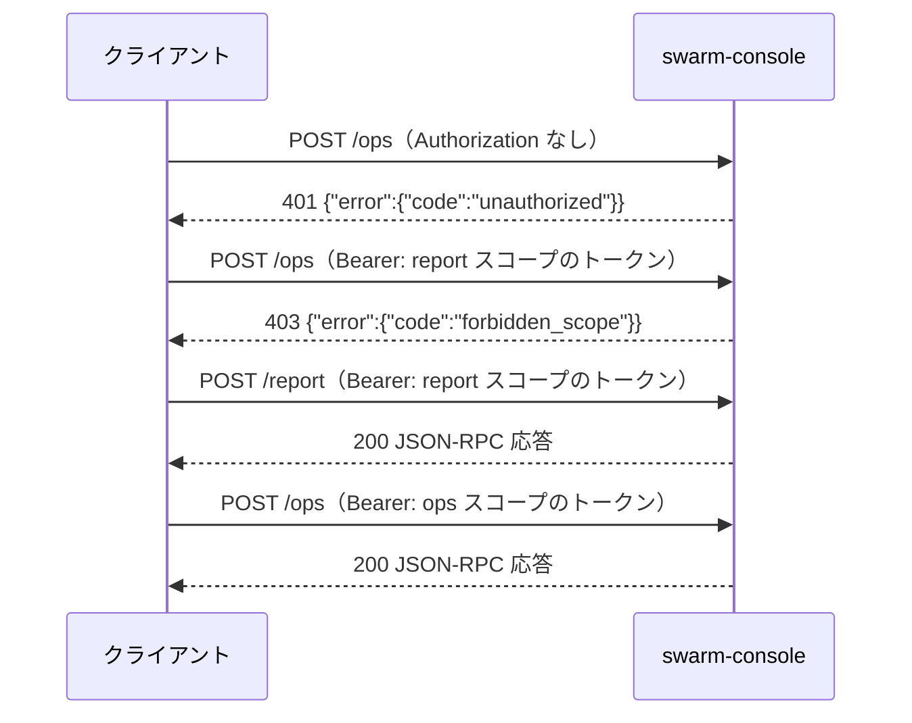

# API 仕様

swarm-console は MCP（Streamable HTTP、JSON-RPC）サーバー。このドキュメントは窓口・認証・エラー・全ツール・prompts・resources の入出力を定める。振る舞いの要件は [機能要件](../requirements/functional.md)、データ構造は [ER / データモデル](../architecture/er.md) を参照する。

この文書は 1 ファイル 300 行の上限（Linterly）のため、次のファイルに分けている。節番号は分割前の通し番号のまま、どのファイルでも同じ番号で引く。

- [API 仕様（本書）](endpoints.md)：§1 接続、§2 認証、§3 エラー、§4 共通の決まり
- [API 仕様：ペインを見る・操作する](endpoints-pane.md)：§5 ツール：§5.1 見る、§5.2 操作する
- [API 仕様：サーバーの状態・メモ](endpoints-state.md)：§5 ツール：§5.3 サーバーの状態、§5.4 メモ
- [API 仕様：レポート・指示・prompts・上限](endpoints-report.md)：§5 ツール：§5.5 `report`、§5.6 `dispatch`、§6 prompts と resources、§7 上限一覧

## 1. 接続

| 項目 | 内容 |
|------|------|
| プロトコル | MCP（Streamable HTTP、JSON-RPC 2.0）。`initialize`・`tools/list`・`tools/call`・`prompts/list`・`prompts/get`・`resources/list`・`resources/templates/list`・`resources/read` |
| 待ち受け | `config.toml` の `listen_addr`（tailnet IP:48120。tailnet の IP で 48120 以外のポートは起動拒否。テスト用のループバックはどのポートでも可）。`0.0.0.0` では待ち受けない |
| 窓口 | `POST /report`（見るだけ）、`POST /ops`（見る＋操作）。他のパスは 404 |
| ヘッダー | `Content-Type: application/json`、`Accept: application/json, text/event-stream`、`Authorization: Bearer <トークン>` |
| メソッド | `POST` のみ。`GET`・`DELETE` は 405（ステートレス運用。P-02） |
| 本文上限 | 256 KiB。超えたら 413 |
| 文字コード | UTF-8 |

### 1.1 窓口ごとに使えるもの

| 窓口 | ツール | prompts | resources |
|------|--------|---------|-----------|
| `/report` | `report`・`sessions_list`・`panes_status`・`pane_tail`・`ask_card`・`report_read`・`host_status`・`agent_auth_status`・`note_get`・`note_history`（10） | `report` | 全部（読み取りのみ） |
| `/ops` | 上の 10 ＋ `ask_pick`・`send_text`・`send_escape`・`pane_start`・`pane_close`・`dispatch`・`note_set`・`note_log`・`file_get`（計 19） | `report`・`dispatch` | 全部 |

`/report` の `tools/list` には操作のツール（`/ops` だけの 9 つ。`file_get` を含む）は載らない。`tools/call` で呼んでも `-32601`（Method not found）相当の `unknown_tool` で拒否する。`file_get` は `ops` スコープのトークンでも `/report` では呼べない（`/ops` で呼ぶ）。

### 1.2 curl からの呼び出し例

```sh
# sc.sh <tool> '<json>'（既定は /ops。SOCKS5 localhost:<port> 経由の curl）
sc.sh panes_status '{}'
sc.sh ask_pick '{"pane":"T2","n":1}'
```

```sh
# 実体（トークンは環境変数 SWARM_CONSOLE_TOKEN。ログに出さない）
curl --socks5-hostname localhost:<port> -sS "http://<tailnet-ip>:48120/ops" \
  -H "Authorization: Bearer $SWARM_CONSOLE_TOKEN" \
  -H "Content-Type: application/json" \
  -H "Accept: application/json, text/event-stream" \
  -d '{"jsonrpc":"2.0","id":1,"method":"tools/call","params":{"name":"panes_status","arguments":{}}}'
```

## 2. 認証



| 状況 | HTTP | `error.code` |
|------|------|-------------|
| `Authorization` なし／`Bearer` でない／トークン不一致／失効済み | 401（`WWW-Authenticate: Bearer`） | `unauthorized` |
| `report` スコープのトークンで `/ops` | 403 | `forbidden_scope` |
| `ops` スコープのトークンで `/report` | 通る（P-03） | — |
| 未知のパス | 404 | `not_found` |
| `POST` 以外 | 405 | `method_not_allowed` |
| 本文が 256 KiB 超 | 413 | `payload_too_large` |

トークンの比較は定数時間。「トークンがない」「違う」「失効済み」で応答を変えない。トークンは `swarm-console token add <名前> --scope ops|report`（サーバー上）で発行し、`token revoke <名前>` で無効にする。

トークンには、触れる tmux セッション（許可セッション）を付けられる：`token add <名前> --scope ops|report [--sessions 0,1]`（`--sessions` を省略すると `config.toml` の `sessions` 全部）。許可の検査は上の HTTP の 401・403 とは別に、ツール層が `session` を取るツールごとに行う（§4.1）。許可セッションを変えるには `token revoke` してから `token add --sessions` で発行し直す。

## 3. エラー

### 3.1 形式

HTTP レベルの失敗（401・403・404・405・413）と、ツールの失敗（`isError: true`）は同じ本文形式を使う。メッセージは日本語の固定文で、どのクライアントからでも同じになる。

```json
{"error": {"code": "invalid_state", "message": "このペインは作業中のため操作できません", "details": {"pane": "B4", "state": "working"}}}
```

- ツールの失敗は JSON-RPC の `result` に入れ、`isError: true`、`content[0].text` に上の JSON を入れる（JSON-RPC レベルの `error` は引数のスキーマ違反・未知のメソッドだけ）。
- **事前条件・権限の失敗**（何も送らなかった）は上のエラー。**送信したが期待した状態にならなかった**ときはエラーにせず、`ok: false` と現在の `state` を返す（例：`send_text` を貼ったが受理されなかった）。
- `details` は、拒否の理由が分かる最小限だけ（トークン・本文・メモの内容・秘密に見えた値は入れない）。

### 3.2 エラーコード

| コード | 意味 | 主に出るツール |
|--------|------|--------------|
| `unauthorized` | 認証なし・不一致・失効 | 全部（HTTP 401） |
| `forbidden_scope` | 窓口とスコープが合わない | 全部（HTTP 403） |
| `not_found` | HTTP では未知のパス（404）。ツールでは `file_get` の `path` が許可リストの中にあるのに存在しない | HTTP 404・`file_get` |
| `unknown_tool` | その窓口に出ていないツール | `/report` で操作系 |
| `invalid_args` | 引数の型・必須・未知のキー・値の範囲 | 全部 |
| `pane_not_found` | `pane` を、決めたセッションの位置・ID に解決できない（別の許可外セッションのペインに当たるときは `session_forbidden`、許可内の別セッションなら `invalid_args`） | `pane` を取る全部 |
| `session_required` | `session` を省略できない（許可セッションがちょうど 1 つではない）。メッセージ `session を指定してください`。`details` は `{"allowed_count": <許可セッション数>}`（許可の一覧は出さない） | `session` を取る全部（§4.1） |
| `session_forbidden` | 許可されていないセッション（指定した `session`、または解決したペインのセッション）。メッセージ `このセッションは許可されていません`。`details` は `{"session": "<名前>"}` | `session` を取る全部（§4.1） |
| `unsupported_agent` | `unknown` のペインで、`pane_tail`・メモ系以外 | `ask_card`・`ask_pick`・`send_text`・`send_escape`・`dispatch`・`pane_close` |
| `invalid_state` | ペインの状態が許可表に合わない（`details.state`） | 操作系全部 |
| `not_asking` | 質問カードが出ていない | `ask_pick` |
| `option_out_of_range` | `n` が選択肢の範囲外 | `ask_pick` |
| `custom_not_allowed` | `text` を受け付けないカード | `ask_pick` |
| `cursor_mismatch` | カーソルが目的の位置に合わず中止（Enter は送っていない） | `ask_pick` |
| `confirm_required` | `confirm: true` がない | `send_escape` |
| `forbidden_control_char` | 貼り付け本文に許可しない制御文字 | `send_text`・`dispatch` |
| `text_too_long` | 8000 字超 | `send_text`・`dispatch` |
| `forbidden_path` | 許可外のフォルダ／ファイル | `pane_start`・`dispatch`・`send_text` |
| `file_unreadable` | `file` が読めない・UTF-8 でない | `send_text` |
| `path_forbidden` | `file_get` の `path` が取得を許可されていない（相対パス・`..` を含む・許可リストの外・秘密のファイル・`denied_paths`。ペインの `cwd` が `/` やホームそのものなら、その `cwd` の下は許可リストの外）。`details.reason` は `not_absolute`・`dotdot`・`outside_roots`・`secret`・`denied`・`unreadable`。許可リストの外は存在の有無によらずこのコード | `file_get` |
| `unsupported_type` | `file_get` で取れる種類ではない。`details.reason` は `extension`（拡張子が png・jpg・jpeg・webp・gif・mp4 以外）・`content`（先頭バイトが拡張子の形式と合わない）・`not_regular`（ディレクトリ・FIFO・デバイスなど通常ファイルでない） | `file_get` |
| `too_large` | `file_get` のファイルが `file_get_max_bytes`（既定 20 MiB）を超える。`details.max` は上限（バイト） | `file_get` |
| `secret_detected` | 秘密に見える文字列（`details.field` に項目名だけ） | `note_set`・`note_log`・`dispatch` |
| `busy_timeout` | 同じペインの前の操作が `lock_timeout` 内に終わらない | 操作系全部 |
| `exit_timeout` | `pane_close` の終了コマンドを送ったあと、`accept_timeout` 内にペインが `shell` へ戻らない（`details.state` は最後に見た状態。`cd ~` 以降は送っていない） | `pane_close` |
| `tmux_error` | tmux の呼び出しに失敗 | 全部 |
| `internal` | 想定外のエラー | 全部 |

## 4. 共通の決まり

| 項目 | 内容 |
|------|------|
| `pane` 引数 | 位置（`"T1"`・`"work:B2"`・`"w1.T2"`）または tmux ID（`"%0"`）。位置は大文字小文字を区別しない。決めた `session` の中だけで探す（§4.1） |
| `session` 引数 | 任意の string。`session` を取るツール（§4.1）の対象の tmux セッション。省略の意味は許可セッション数で決まる（§4.1） |
| 返り値 | `content[0].text` に JSON を 1 つ入れる（キー順は固定）。`report` の `markdown` 形式だけは markdown 本文 |
| 切り詰め | 長い文字列は上限（§7）で切り、切ったら同じオブジェクトに `"truncated": true` を付ける |
| 時刻 | RFC 3339（`+09:00` などサーバーのローカルオフセット付き） |
| 期間表示 | `42m`・`20s`・`1h05m` のように短く。`null` は不明 |
| 未知の引数キー | `invalid_args` で拒否（打ち間違いの検知） |
| 操作の返り値 | 基本形 `{"ok": bool, "state": "<状態>", ...}`。`ok: true` は「思った状態になった」ことを確かめたあと |

### 4.1 `session` 引数と許可セッション

許可セッションは、トークンの `allowed_sessions`（なければ全部）と `config.toml` の `sessions` の共通部分。`session`（string、任意）を取るツール：`panes_status`・`report`・`host_status`・`pane_tail`・`ask_card`・`report_read`・`note_get`・`ask_pick`・`send_text`・`send_escape`・`pane_start`・`pane_close`・`dispatch`・`note_set`・`note_log`。`sessions_list`（`all` を取る。§5.3）・`note_history`・`agent_auth_status` は取らない。

| `session` | 結果 |
|-----------|------|
| 指定、`sessions` にない名前 | `invalid_args`（`details.field` = `"session"`） |
| 指定、`sessions` にあるが許可外 | `session_forbidden`（`details.session` = 指定した名前） |
| 指定、許可内 | そのセッション（読み取りも操作も同じ） |
| 省略、許可がちょうど 1 つ | その 1 つ（引数なしで動く。単一セッション運用と同じ） |
| 省略、許可が 2 つ以上（または 0） | `session_required`（全セッションの合算は返さない） |

`pane` を取るツールは、決まったセッション S のペインだけを候補にする（別のセッションの `T1` は当たらない）。

- 当たる指定：tmux ID（`%12`）、S 内の位置（`T1`。接頭辞なし）、全体の名前（既定セッション以外は `1:T1`、`pane_names` の固定名）、`<S>:<S 内の位置>`。
- S の中に無く、tmux ID か全体の名前が別のセッションのペインに当たるとき：そのセッションが許可外なら `session_forbidden`（`details.session` はそのペインのセッション）、許可内で S と違うなら `invalid_args`（`details.field` = `"pane"`。`session` を合わせて指定し直す）。
- どのセッションにも当たらない、または許可内で解決できないときだけ `pane_not_found`。

1 つのセッションに絞った応答（`panes_status`・`report`・`pane_tail` と `note_get` の `pane`・`report` の `attention` の `pane`・`sessions_list` の `panes`）：

- 位置は S 内の位置（接頭辞なし。3 列×2 段なら `T1`〜`T3`・`B1`〜`B3`、4 列×2 段なら `T1`〜`T4`・`B1`〜`B4`。命名は FR-POS-2 のまま）。固定名はそのまま。`layout` も S のペインだけから計算し直す。
- `warnings` は S の分だけ（`layout_changed` は S の並び。`pane_unreadable` は S のペイン。`session_missing` は欠けているセッションごとに 1 件で、メッセージは `tmux セッションが見つかりません: <名前>`）。`tmux_unavailable` は全体の警告なので常に入る。
- 最終報告ファイル名だけはセッション内の位置ではなく全体の位置から付く（`report_read` の `path`・`dispatch` の `{report_path}`。既定セッションは `T1.md`、それ以外の `1:T1` は `1_T1.md`。ER §7）。別のセッションのファイルは衝突しない。

## 改訂履歴

| 版 | 日付 | 変更内容 | 変更理由 |
|----|------|---------|---------|
| 1.0 | 2026-10-31 | 新規作成 | 初版 |
| 1.1 | 2026-11-01 | `host_status` に `update`（新しい版の確認結果）を追加 | Issue #7 |
| 1.2 | 2026-11-01 | `host_status.update` に自己更新の状況 `apply`（`off`・`idle`・`probation`・`failed`・`blocked`）を追加 | Issue #7（自己更新で確定） |
| 1.3 | 2026-11-01 | 300 行超過ファイルを分割（§5 ツール以降を endpoints-pane.md・endpoints-state.md・endpoints-report.md へ移動）。内容の変更なし | Issue #3 |
| 1.4 | 2026-11-01 | `pane_close` の「`~` のプロンプトだけ」に枠付き複数行プロンプトを含むと明記（実装の取りこぼしを修正。判定の意味は変えない） | Issue #19 |
| 1.5 | 2026-11-01 | `report` の JSON に `host`（CPU・スワップ・ディスクの使用率）・`usage`・`omp`・`update`・`auth`、`kind` の `auth_expired`・`auth_expiring` を追加（`attention[]` のキー・型は変えない）。`host_status` に同じ値を追加 | Issue #21〜#25 |
| 1.6 | 2026-11-02 | `report` の `pane` 指定の JSON でも、ログインの要対応・`usage`・`omp`・`update`・`auth`・`host` は絞らず常に入れると明記（ペインの項目だけ絞る）。例の `used` を JSON の数値表記（`48`）にそろえた | Issue #21〜#25（実装時の確認） |
| 1.7 | 2026-11-02 | `pane_close` が終了コマンドのあと `shell` に戻るまで待つと明記し、エラーコード `exit_timeout` を追加（戻らなければ `cd ~` 以降は送らない） | Issue #30 |
| 1.8 | 2026-11-02 | `pane_close` の `exit_timeout` はエラーだけを返す（`ok`・`steps`・`note_archived` は返らない）、終了コマンドは送ってあり呼び直してよい、`shell` に戻ったかの判定は `panes_status` と同じで `/proc` に依ると明記 | Issue #30 |
| 1.9 | 2026-11-02 | `pane_close` の `shell` に戻ったかの判定は、`/proc` が読めないとき前面コマンドが shell なら戻ったとみなす（1.8 の「`/proc` に依る」を改めた） | Issue #35 |
| 1.10 | 2026-11-02 | endpoints-report.md：「足した値の形」で、`auth`・`attention[]` は `report` の JSON だけと明記し、`host_status` と共通なのは `cpu`・`swap`・`disk`（`report` では `host.` の下）・`usage`・`omp`・`update` と直した（1.5 の「`host_status` に同じ値を追加」の範囲を正した）。実装は変えない | Issue #61 |
| 1.11 | 2026-11-02 | endpoints-report.md：指示文の `{report_path}` の `<位置>` は `:`・`/`・`\` を `_` にする（er-config §7 への参照を足した）。実装は変えない | Issue #74・#75（Issue #69 の仕様書側の追記） |
| 1.12 | 2026-11-02 | §1：tailnet の IP の `listen_addr` は 48120 以外のポートを起動拒否（ループバックは任意のポート）。endpoints-pane.md：`panes_status`・`report`（json）の各ペインは、`activity` を 120 字で切ったときだけ `"truncated": true` を付ける（実装を仕様に合わせた） | Issue #72・#70 |
| 1.13 | 2026-11-02 | トークンごとの許可セッションと `session` 引数（§4.1）、エラー `session_required`・`session_forbidden`（§3.2）、`sessions_list` の追加（ツール数 /report 9→10、/ops 17→18）。`panes_status` の `session` 省略は全セッションではなく §4.1 の規則に変更（許可セッションが 2 つ以上のトークンには破壊的変更）。endpoints-pane.md・endpoints-state.md・endpoints-report.md も同じ | セッション分割運用（許可セッションの分離） |
| 1.14 | 2026-11-03 | `file_get`（`/ops` のみ。許可リスト内の画像・動画を base64 で返す）を追加（ツール数 /ops 18→19、/report は 10 のまま）。エラー `path_forbidden`・`unsupported_type`・`too_large`（§3.2。`not_found` は `file_get` の存在しないパスにも使う）。endpoints-pane.md §5.2・endpoints-report.md §7 も同じ | Issue #82 |
| 1.15 | 2026-11-04 | `file_get` の許可リスト：ペインの `cwd` が `/` やホームそのもの（実パス）のときは、その `cwd` を根に入れない。明示した `file_get_roots`・`report_dir` はそのまま許可。外した `cwd` の下は `path_forbidden`（endpoints-pane.md §5.2、§3.2） | Issue #82 |
| 1.16 | 2026-11-04 | `file_get`（endpoints-pane.md）：宛先が存在しないシンボリックリンク・循環は、宛先が外なら存在の有無によらず `outside_roots`（宛先が許可の中なら `not_found`）。先頭 12 バイトを先に読み、形式が違えば残りを読まず `unsupported_type`。同時実行は制限しないと明記。`/proc/self/fd` が読めないときは `internal`（Linux の `/proc` が必須）。監査ログの `size`：stat 後に肥大化して上限を超えたときは記録しない | Issue #82（PR #84 の独立レビューの指摘） |
