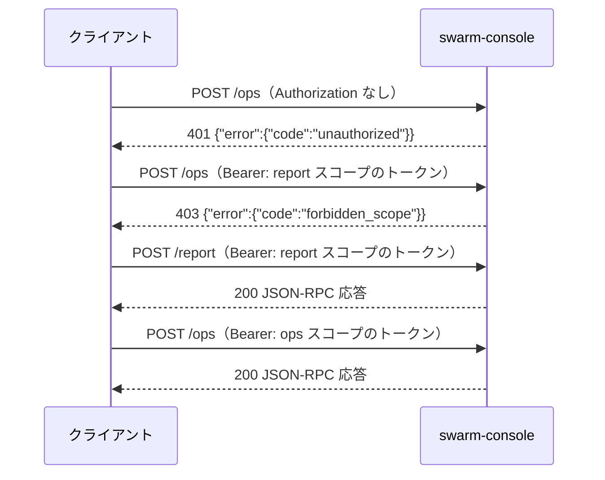

# API 仕様

swarm-console は MCP（Streamable HTTP、JSON-RPC）サーバー。このドキュメントは窓口・認証・エラー・全ツール・prompts・resources の入出力を定める。振る舞いの要件は [機能要件](../requirements/functional.md)、データ構造は [ER / データモデル](../architecture/er.md) を参照する。

この文書は 1 ファイル 300 行の上限（Linterly）のため、次のファイルに分けている。節番号は分割前の通し番号のまま、どのファイルでも同じ番号で引く。

- [API 仕様（本書）](endpoints.md)：§1 接続、§2 認証、§3 エラー、§4 共通の決まり
- [API 仕様：ペインを見る・操作する](endpoints-pane.md)：§5 ツール：§5.1 見る、§5.2 操作する
- [API 仕様：サーバーの状態・メモ](endpoints-state.md)：§5 ツール：§5.3 サーバーの状態、§5.4 メモ
- [API 仕様：レポート・指示・prompts・上限](endpoints-report.md)：§5 ツール：§5.5 `report`、§5.6 `dispatch`、§6 prompts と resources、§7 上限一覧

## 1. 接続

| 項目 | 内容 |
|------|------|
| プロトコル | MCP（Streamable HTTP、JSON-RPC 2.0）。`initialize`・`tools/list`・`tools/call`・`prompts/list`・`prompts/get`・`resources/list`・`resources/templates/list`・`resources/read` |
| 待ち受け | `config.toml` の `listen_addr`（tailnet IP:48120）。`0.0.0.0` では待ち受けない |
| 窓口 | `POST /report`（見るだけ）、`POST /ops`（見る＋操作）。他のパスは 404 |
| ヘッダー | `Content-Type: application/json`、`Accept: application/json, text/event-stream`、`Authorization: Bearer <トークン>` |
| メソッド | `POST` のみ。`GET`・`DELETE` は 405（ステートレス運用。P-02） |
| 本文上限 | 256 KiB。超えたら 413 |
| 文字コード | UTF-8 |

### 1.1 窓口ごとに使えるもの

| 窓口 | ツール | prompts | resources |
|------|--------|---------|-----------|
| `/report` | `report`・`panes_status`・`pane_tail`・`ask_card`・`report_read`・`host_status`・`agent_auth_status`・`note_get`・`note_history`（9） | `report` | 全部（読み取りのみ） |
| `/ops` | 上の 9 ＋ `ask_pick`・`send_text`・`send_escape`・`pane_start`・`pane_close`・`dispatch`・`note_set`・`note_log`（計 17） | `report`・`dispatch` | 全部 |

`/report` の `tools/list` には操作のツール（`/ops` だけの 8 つ）は載らない。`tools/call` で呼んでも `-32601`（Method not found）相当の `unknown_tool` で拒否する。

### 1.2 curl からの呼び出し例

```sh
# sc.sh <tool> '<json>'（既定は /ops。SOCKS5 localhost:<port> 経由の curl）
sc.sh panes_status '{}'
sc.sh ask_pick '{"pane":"T2","n":1}'
```

```sh
# 実体（トークンは環境変数 SWARM_CONSOLE_TOKEN。ログに出さない）
curl --socks5-hostname localhost:<port> -sS "http://<tailnet-ip>:48120/ops" \
  -H "Authorization: Bearer $SWARM_CONSOLE_TOKEN" \
  -H "Content-Type: application/json" \
  -H "Accept: application/json, text/event-stream" \
  -d '{"jsonrpc":"2.0","id":1,"method":"tools/call","params":{"name":"panes_status","arguments":{}}}'
```

## 2. 認証



| 状況 | HTTP | `error.code` |
|------|------|-------------|
| `Authorization` なし／`Bearer` でない／トークン不一致／失効済み | 401（`WWW-Authenticate: Bearer`） | `unauthorized` |
| `report` スコープのトークンで `/ops` | 403 | `forbidden_scope` |
| `ops` スコープのトークンで `/report` | 通る（P-03） | — |
| 未知のパス | 404 | `not_found` |
| `POST` 以外 | 405 | `method_not_allowed` |
| 本文が 256 KiB 超 | 413 | `payload_too_large` |

トークンの比較は定数時間。「トークンがない」「違う」「失効済み」で応答を変えない。トークンは `swarm-console token add <名前> --scope ops|report`（サーバー上）で発行し、`token revoke <名前>` で無効にする。

## 3. エラー

### 3.1 形式

HTTP レベルの失敗（401・403・404・405・413）と、ツールの失敗（`isError: true`）は同じ本文形式を使う。メッセージは日本語の固定文で、どのクライアントからでも同じになる。

```json
{"error": {"code": "invalid_state", "message": "このペインは作業中のため操作できません", "details": {"pane": "B4", "state": "working"}}}
```

- ツールの失敗は JSON-RPC の `result` に入れ、`isError: true`、`content[0].text` に上の JSON を入れる（JSON-RPC レベルの `error` は引数のスキーマ違反・未知のメソッドだけ）。
- **事前条件・権限の失敗**（何も送らなかった）は上のエラー。**送信したが期待した状態にならなかった**ときはエラーにせず、`ok: false` と現在の `state` を返す（例：`send_text` を貼ったが受理されなかった）。
- `details` は、拒否の理由が分かる最小限だけ（トークン・本文・メモの内容・秘密に見えた値は入れない）。

### 3.2 エラーコード

| コード | 意味 | 主に出るツール |
|--------|------|--------------|
| `unauthorized` | 認証なし・不一致・失効 | 全部（HTTP 401） |
| `forbidden_scope` | 窓口とスコープが合わない | 全部（HTTP 403） |
| `unknown_tool` | その窓口に出ていないツール | `/report` で操作系 |
| `invalid_args` | 引数の型・必須・未知のキー・値の範囲 | 全部 |
| `pane_not_found` | `pane` を位置・ID に解決できない | `pane` を取る全部 |
| `unsupported_agent` | `unknown` のペインで、`pane_tail`・メモ系以外 | `ask_card`・`ask_pick`・`send_text`・`send_escape`・`dispatch`・`pane_close` |
| `invalid_state` | ペインの状態が許可表に合わない（`details.state`） | 操作系全部 |
| `not_asking` | 質問カードが出ていない | `ask_pick` |
| `option_out_of_range` | `n` が選択肢の範囲外 | `ask_pick` |
| `custom_not_allowed` | `text` を受け付けないカード | `ask_pick` |
| `cursor_mismatch` | カーソルが目的の位置に合わず中止（Enter は送っていない） | `ask_pick` |
| `confirm_required` | `confirm: true` がない | `send_escape` |
| `forbidden_control_char` | 貼り付け本文に許可しない制御文字 | `send_text`・`dispatch` |
| `text_too_long` | 8000 字超 | `send_text`・`dispatch` |
| `forbidden_path` | 許可外のフォルダ／ファイル | `pane_start`・`dispatch`・`send_text` |
| `file_unreadable` | `file` が読めない・UTF-8 でない | `send_text` |
| `secret_detected` | 秘密に見える文字列（`details.field` に項目名だけ） | `note_set`・`note_log`・`dispatch` |
| `busy_timeout` | 同じペインの前の操作が `lock_timeout` 内に終わらない | 操作系全部 |
| `tmux_error` | tmux の呼び出しに失敗 | 全部 |
| `internal` | 想定外のエラー | 全部 |

## 4. 共通の決まり

| 項目 | 内容 |
|------|------|
| `pane` 引数 | 位置（`"T1"`・`"work:B2"`・`"w1.T2"`）または tmux ID（`"%0"`）。位置は大文字小文字を区別しない |
| 返り値 | `content[0].text` に JSON を 1 つ入れる（キー順は固定）。`report` の `markdown` 形式だけは markdown 本文 |
| 切り詰め | 長い文字列は上限（§7）で切り、切ったら同じオブジェクトに `"truncated": true` を付ける |
| 時刻 | RFC 3339（`+09:00` などサーバーのローカルオフセット付き） |
| 期間表示 | `42m`・`20s`・`1h05m` のように短く。`null` は不明 |
| 未知の引数キー | `invalid_args` で拒否（打ち間違いの検知） |
| 操作の返り値 | 基本形 `{"ok": bool, "state": "<状態>", ...}`。`ok: true` は「思った状態になった」ことを確かめたあと |

## 改訂履歴

| 版 | 日付 | 変更内容 | 変更理由 |
|----|------|---------|---------|
| 1.0 | 2026-10-31 | 新規作成 | 初版 |
| 1.1 | 2026-11-01 | `host_status` に `update`（新しい版の確認結果）を追加 | Issue #7 |
| 1.2 | 2026-11-01 | `host_status.update` に自己更新の状況 `apply`（`off`・`idle`・`probation`・`failed`・`blocked`）を追加 | Issue #7（自己更新で確定） |
| 1.3 | 2026-11-01 | 300 行超過ファイルを分割（§5 ツール以降を endpoints-pane.md・endpoints-state.md・endpoints-report.md へ移動）。内容の変更なし | Issue #3 |
| 1.5 | 2026-11-01 | `report` の JSON に `host`（CPU・スワップ・ディスクの使用率）・`usage`・`omp`・`update`・`auth`、`attention[].agent`、`kind` の `auth_expired`・`auth_expiring` を追加。`host_status` に同じ値を追加 | Issue #21〜#25 |
| 1.4 | 2026-11-01 | `pane_close` の「`~` のプロンプトだけ」に枠付き複数行プロンプトを含むと明記（実装の取りこぼしを修正。判定の意味は変えない） | Issue #19 |
