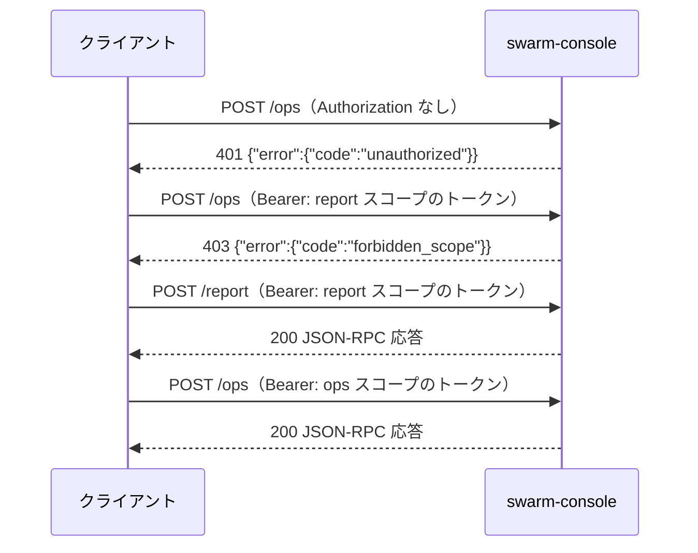

# API 仕様

swarm-console は MCP（Streamable HTTP、JSON-RPC）サーバー。このドキュメントは窓口・認証・エラー・全ツール・prompts・resources の入出力を定める。振る舞いの要件は [機能要件](../requirements/functional.md)、データ構造は [ER / データモデル](../architecture/er.md) を参照する。

## 1. 接続

| 項目 | 内容 |
|------|------|
| プロトコル | MCP（Streamable HTTP、JSON-RPC 2.0）。`initialize`・`tools/list`・`tools/call`・`prompts/list`・`prompts/get`・`resources/list`・`resources/templates/list`・`resources/read` |
| 待ち受け | `config.toml` の `listen_addr`（tailnet IP:48120）。`0.0.0.0` では待ち受けない |
| 窓口 | `POST /report`（見るだけ）、`POST /ops`（見る＋操作）。他のパスは 404 |
| ヘッダー | `Content-Type: application/json`、`Accept: application/json, text/event-stream`、`Authorization: Bearer <トークン>` |
| メソッド | `POST` のみ。`GET`・`DELETE` は 405（ステートレス運用。P-02） |
| 本文上限 | 256 KiB。超えたら 413 |
| 文字コード | UTF-8 |

### 1.1 窓口ごとに使えるもの

| 窓口 | ツール | prompts | resources |
|------|--------|---------|-----------|
| `/report` | `report`・`panes_status`・`pane_tail`・`ask_card`・`report_read`・`host_status`・`agent_auth_status`・`note_get`・`note_history`（9） | `report` | 全部（読み取りのみ） |
| `/ops` | 上の 9 ＋ `ask_pick`・`send_text`・`send_escape`・`pane_start`・`pane_close`・`dispatch`・`note_set`・`note_log`（計 17） | `report`・`dispatch` | 全部 |

`/report` の `tools/list` には操作のツール（`/ops` だけの 8 つ）は載らない。`tools/call` で呼んでも `-32601`（Method not found）相当の `unknown_tool` で拒否する。

### 1.2 curl からの呼び出し例

```sh
# sc.sh <tool> '<json>'（既定は /ops。SOCKS5 localhost:<port> 経由の curl）
sc.sh panes_status '{}'
sc.sh ask_pick '{"pane":"T2","n":1}'
```

```sh
# 実体（トークンは環境変数 SWARM_CONSOLE_TOKEN。ログに出さない）
curl --socks5-hostname localhost:<port> -sS "http://<tailnet-ip>:48120/ops" \
  -H "Authorization: Bearer $SWARM_CONSOLE_TOKEN" \
  -H "Content-Type: application/json" \
  -H "Accept: application/json, text/event-stream" \
  -d '{"jsonrpc":"2.0","id":1,"method":"tools/call","params":{"name":"panes_status","arguments":{}}}'
```

## 2. 認証



| 状況 | HTTP | `error.code` |
|------|------|-------------|
| `Authorization` なし／`Bearer` でない／トークン不一致／失効済み | 401（`WWW-Authenticate: Bearer`） | `unauthorized` |
| `report` スコープのトークンで `/ops` | 403 | `forbidden_scope` |
| `ops` スコープのトークンで `/report` | 通る（P-03） | — |
| 未知のパス | 404 | `not_found` |
| `POST` 以外 | 405 | `method_not_allowed` |
| 本文が 256 KiB 超 | 413 | `payload_too_large` |

トークンの比較は定数時間。「トークンがない」「違う」「失効済み」で応答を変えない。トークンは `swarm-console token add <名前> --scope ops|report`（サーバー上）で発行し、`token revoke <名前>` で無効にする。

## 3. エラー

### 3.1 形式

HTTP レベルの失敗（401・403・404・405・413）と、ツールの失敗（`isError: true`）は同じ本文形式を使う。メッセージは日本語の固定文で、どのクライアントからでも同じになる。

```json
{"error": {"code": "invalid_state", "message": "このペインは作業中のため操作できません", "details": {"pane": "B4", "state": "working"}}}
```

- ツールの失敗は JSON-RPC の `result` に入れ、`isError: true`、`content[0].text` に上の JSON を入れる（JSON-RPC レベルの `error` は引数のスキーマ違反・未知のメソッドだけ）。
- **事前条件・権限の失敗**（何も送らなかった）は上のエラー。**送信したが期待した状態にならなかった**ときはエラーにせず、`ok: false` と現在の `state` を返す（例：`send_text` を貼ったが受理されなかった）。
- `details` は、拒否の理由が分かる最小限だけ（トークン・本文・メモの内容・秘密に見えた値は入れない）。

### 3.2 エラーコード

| コード | 意味 | 主に出るツール |
|--------|------|--------------|
| `unauthorized` | 認証なし・不一致・失効 | 全部（HTTP 401） |
| `forbidden_scope` | 窓口とスコープが合わない | 全部（HTTP 403） |
| `unknown_tool` | その窓口に出ていないツール | `/report` で操作系 |
| `invalid_args` | 引数の型・必須・未知のキー・値の範囲 | 全部 |
| `pane_not_found` | `pane` を位置・ID に解決できない | `pane` を取る全部 |
| `unsupported_agent` | `unknown` のペインで、`pane_tail`・メモ系以外 | `ask_card`・`ask_pick`・`send_text`・`send_escape`・`dispatch`・`pane_close` |
| `invalid_state` | ペインの状態が許可表に合わない（`details.state`） | 操作系全部 |
| `not_asking` | 質問カードが出ていない | `ask_pick` |
| `option_out_of_range` | `n` が選択肢の範囲外 | `ask_pick` |
| `custom_not_allowed` | `text` を受け付けないカード | `ask_pick` |
| `cursor_mismatch` | カーソルが目的の位置に合わず中止（Enter は送っていない） | `ask_pick` |
| `confirm_required` | `confirm: true` がない | `send_escape` |
| `forbidden_control_char` | 貼り付け本文に許可しない制御文字 | `send_text`・`dispatch` |
| `text_too_long` | 8000 字超 | `send_text`・`dispatch` |
| `forbidden_path` | 許可外のフォルダ／ファイル | `pane_start`・`dispatch`・`send_text` |
| `file_unreadable` | `file` が読めない・UTF-8 でない | `send_text` |
| `secret_detected` | 秘密に見える文字列（`details.field` に項目名だけ） | `note_set`・`note_log`・`dispatch` |
| `busy_timeout` | 同じペインの前の操作が `lock_timeout` 内に終わらない | 操作系全部 |
| `tmux_error` | tmux の呼び出しに失敗 | 全部 |
| `internal` | 想定外のエラー | 全部 |

## 4. 共通の決まり

| 項目 | 内容 |
|------|------|
| `pane` 引数 | 位置（`"T1"`・`"work:B2"`・`"w1.T2"`）または tmux ID（`"%0"`）。位置は大文字小文字を区別しない |
| 返り値 | `content[0].text` に JSON を 1 つ入れる（キー順は固定）。`report` の `markdown` 形式だけは markdown 本文 |
| 切り詰め | 長い文字列は上限（§7）で切り、切ったら同じオブジェクトに `"truncated": true` を付ける |
| 時刻 | RFC 3339（`+09:00` などサーバーのローカルオフセット付き） |
| 期間表示 | `42m`・`20s`・`1h05m` のように短く。`null` は不明 |
| 未知の引数キー | `invalid_args` で拒否（打ち間違いの検知） |
| 操作の返り値 | 基本形 `{"ok": bool, "state": "<状態>", ...}`。`ok: true` は「思った状態になった」ことを確かめたあと |

## 5. ツール

### 5.1 見る

#### `panes_status`

対象セッションの全ペインを 1 回で返す。

| 引数 | 型 | 必須 | 説明 |
|------|-----|------|------|
| `session` | string | 任意 | 省略で全セッション。`sessions` にないセッション名は `invalid_args` |

```json
{
  "at": "2026-10-31T22:10:05+09:00",
  "host": {"load1": 98.2, "mem_free_gb": 41.3},
  "layout": {"rows": 2, "cols": [4, 4]},
  "panes": [
    {
      "pos": "B4", "id": "%12", "agent": "omp", "state": "working",
      "title": "agent: funid #982", "cwd": "/mnt/nvme/ousiassllc/funid-sweep-982",
      "elapsed": "42m", "activity": "Running go test ./...",
      "changed_ago": "20s",
      "note": {"from": "agent-b", "repo": "ousiassllc/funid", "items": ["#982"], "next": "完了したら #983 を入れる"}
    }
  ],
  "warnings": []
}
```

- `agent` は `omp`・`claude`・`codex`・`null`。`activity` はエージェントがいま何をしているかの 1 行（取れなければ `null`）。
- `note` はメモの要約（`from`・`repo`・`items`・`next` だけ）。メモがなければ `null`。
- `warnings[]` は `{"code": "layout_changed", "message": "..."}` の配列（コード：`layout_changed`・`tmux_unavailable`・`session_missing`・`pane_unreadable`）。

#### `pane_tail`

1 ペインの最後の n 行を、枠線・TODO 表示・ステータス行を取り除いた本文だけで返す。

| 引数 | 型 | 必須 | 説明 |
|------|-----|------|------|
| `pane` | string | 必須 | |
| `lines` | int | 任意 | 既定 30、1〜200 |
| `raw` | bool | 任意 | `true` なら飾りも残す |

```json
{"pane": "B4", "lines": 30, "text": "...\n...", "truncated": false}
```

`unknown` のペインは飾りの除去をせず `raw` 相当で返す。

#### `ask_card`

| 引数 | 型 | 必須 |
|------|-----|------|
| `pane` | string | 必須 |

```json
{"asking": true, "question": "(2) の Go での範囲をどうしますか？",
 "options": [{"n": 1, "label": "TS 仕様どおり", "recommended": true}, {"n": 2, "label": "ライブラリ関数として拡張"}],
 "cursor": 1, "allows_custom": true}
```

`asking` でなければ `{"asking": false}`。`unknown` のペインは `unsupported_agent`。

#### `report_read`

| 引数 | 型 | 必須 |
|------|-----|------|
| `pane` | string | 必須 |

```json
{"exists": true, "path": "/tmp/swarm-console/reports/B4.md", "updated_at": "2026-10-31T22:01:00+09:00", "text": "...", "truncated": false}
```

ファイルがなければ `{"exists": false}`。

### 5.2 操作する（`/ops` のみ）

共通の返り値：`{"ok": bool, "state": "...", ...}`。操作後の状態はスナップショットを取り直した結果。

#### `ask_pick`

| 引数 | 型 | 必須 | 説明 |
|------|-----|------|------|
| `pane` | string | 必須 | |
| `n` | int | `text` がなければ必須 | 選ぶ番号（1 始まり） |
| `text` | string | 任意 | 「その他」に打つ文字。`n` と同時指定は不可（P-10）。8000 字まで、制御文字は §5.2 `send_text` と同じ規則 |

```json
{"ok": true, "state": "working", "picked": {"n": 1, "label": "TS 仕様どおり"}, "card_closed": true}
```

カーソルが 3 回の試行で合わなければ `cursor_mismatch`（Enter は送らない）。カードが閉じず `working` にもならなければ `{"ok": false, "state": "asking", "card_closed": false}`。

#### `send_text`

| 引数 | 型 | 必須 | 説明 |
|------|-----|------|------|
| `pane` | string | 必須 | |
| `text` | string | `file` がなければ必須 | 8000 字まで。許可する制御文字は `\n`・`\t` のみ |
| `file` | string | `text` がなければ必須 | サーバー上のファイル。`file_roots` の下、UTF-8 で 8000 字まで。`text` と同時指定は不可 |

```json
{"ok": true, "state": "working", "accepted": true, "chars": 412}
```

tmux の bracketed paste で貼り付け、1 秒待って Enter。入力欄が空になって `working` になったら `accepted: true`。`accept_timeout` 内に受理されなければ `{"ok": false, "accepted": false, "state": "idle"}`。Ctrl-C などの特別なキーは送れない。

#### `send_escape`

| 引数 | 型 | 必須 | 説明 |
|------|-----|------|------|
| `pane` | string | 必須 | |
| `confirm` | bool | 必須 | `true` でなければ `confirm_required` |

```json
{"ok": true, "state": "idle", "interrupted": true}
```

- ツールの説明に「**オーナーの OK があるときだけ使う**」と書く。
- 実行は `note_log` に `Esc を送った（中断）` として自動で残る。
- 送って状態が変わらなければ `{"ok": false, ...}`。

#### `pane_start`

| 引数 | 型 | 必須 | 説明 |
|------|-----|------|------|
| `pane` | string | 必須 | `shell` のペインのみ |
| `agent` | string | 必須 | `omp`・`claude`・`codex` |
| `cwd` | string | 必須 | 許可したフォルダの下の既存ディレクトリ |
| `title` | string | 必須 | 80 字まで、制御文字なし。タイトルは `agent: <title>` になる |

```json
{"ok": true, "state": "idle", "agent": "omp", "cwd": "/mnt/nvme/ousiassllc/funid-sweep-982", "title": "agent: funid #982"}
```

`cd <cwd>` → エージェントの起動コマンド、の順に送り、`start_timeout` 以内に `idle` になったかを返す（ならなければ `ok: false`）。`cwd` はシェルに渡す前にクォートし、制御文字・`'` を含むものは `invalid_args`。

#### `pane_close`

| 引数 | 型 | 必須 |
|------|-----|------|
| `pane` | string | 必須 |

```json
{"ok": true, "state": "shell", "steps": ["/exit", "cd ~", "clear", "title"], "note_archived": true}
```

終了コマンド → `cd ~` → `clear` → タイトル消し、を 1 つずつ「文字列 → 1 秒 → Enter → 1 秒」で送る（`shell` のペインは終了コマンドを飛ばす）。最後に画面が `~` のプロンプトだけになったかを確かめ、なっていなければ `ok: false`。確かめられたとき（`ok: true`）だけ、ペインのメモを履歴へ移し（`note_archived: true`）、最終報告ファイルを `archive/` へ移す。`idle`・`shell` 以外は `invalid_state`。

#### `dispatch` → §5.6

### 5.3 サーバーの状態

#### `host_status`

引数なし。

```json
{"load": [98.2, 95.1, 90.4], "cpus": 32, "mem_total_gb": 128, "mem_free_gb": 41.3,
 "disk": [{"mount": "/", "free_gb": 120}, {"mount": "/mnt/nvme", "free_gb": 830}],
 "tmux_session": true, "agents": {"omp": 6, "claude": 0, "codex": 0}, "uptime": "12d 4h",
 "update": {"status": "up_to_date", "current": "v0.1.5", "latest": "v0.1.5", "checked_at": "2026-11-01T12:00:00+09:00",
            "apply": {"state": "idle"}}}
```

`disk` は設定した監視マウント（既定 `/` と `/mnt/nvme`）。`agents` は種別ごとのペイン数。

`update` は新しい版の確認の結果と、自己更新の状況 `apply`（FR-UPD-9・20）。`serve` が持つ最後の結果を返すだけで、呼び出しで GitHub へは通信しない。

| `status` | 意味 | 他に付くキー |
|----------|------|-------------|
| `up_to_date` | 最新版以上 | `current`・`latest`・`checked_at`・`apply` |
| `update_available` | 最新版が現在より新しい | `current`・`latest`・`checked_at`・`apply` |
| `unknown` | 確認できない | `current`・`reason`（`network`・`rate_limit`・`access`・`no_release`・`release_invalid`・`dev_build`）・`checked_at`（前回の成功した結果があれば `latest` も残す）・`apply` |
| `pending` | 起動後まだ確認していない | `current`・`apply` |
| `disabled` | `update_check = false` | `current`・`apply` |

`apply` は常に付く（自己更新の状況。FR-UPD-20）。

| `state` | 意味 | 他に付くキー |
|---------|------|-------------|
| `off` | `update_auto = false`、または `update_check = false`（自己更新しない） | なし |
| `idle` | 入れ替えの失敗・保留が無い（新しい版が無い・まだ確認していないときのほか、入れ替えの実行中を含む。入れ替えが済めば `serve` は終了するので、`update_available` で `idle` を見るのは入れ替えの実行中だけ） | なし |
| `probation` | 入れ替え直後の試運転中（待ち受けから 60 秒生きれば確定。FR-UPD-17） | `from`（入れ替え前の版） |
| `failed` | 入れ替えに至らなかった。次の周期で再試行 | `reason`（`unsupported_platform`・`not_managed`・`asset_missing`・`download`・`checksum`・`write`）・`at` |
| `blocked` | 起動に失敗して前の版へ戻した版（以下）なので入れ替えない | `version`（戻した版） |

`current` は動いているバイナリの版（版を入れていないビルドは `"dev"`）。`latest`・`from`・`version` は `vX.Y.Z` の形に合うときだけ出す。GitHub の応答の文面・URL・エラー文は出さない。

#### `agent_auth_status`

引数なし。

```json
{"agents": [
  {"agent": "omp", "status": "unknown", "expires_at": null},
  {"agent": "claude", "status": "valid", "expires_at": "2026-11-20T09:00:00+09:00"},
  {"agent": "codex", "status": "expiring_soon", "expires_at": "2026-11-01T08:00:00+09:00"}
]}
```

`status` は `valid`（有効）・`expired`（期限切れ）・`expiring_soon`（48 時間以内に切れる）・`unknown`（不明）。鍵・トークンの中身は出さない（読み先は P-16）。

### 5.4 メモ

#### `note_get`

| 引数 | 型 | 必須 |
|------|-----|------|
| `pane` | string | 必須 |

```json
{"pane": "B4", "id": "%12", "note": {"from": "agent-b", "repo": "ousiassllc/funid", "items": ["#982"], "next": "完了したら #983 を入れる", "log": [], "updated_at": "2026-10-31T21:50:12+09:00"}}
```

メモがなければ `"note": null`。

#### `note_set`（`/ops` のみ）

| 引数 | 型 | 必須 | 説明 |
|------|-----|------|------|
| `pane` | string | 必須 | |
| `set` | object | 必須 | 書き換える項目だけ。値が `null` ならその項目を消す。キーは ER §2.2 の項目（`updated_at`・`log` は不可） |

```json
{"ok": true, "note": {"...": "更新後のメモ全体"}}
```

#### `note_log`（`/ops` のみ）

| 引数 | 型 | 必須 | 説明 |
|------|-----|------|------|
| `pane` | string | 必須 | |
| `text` | string | 必須 | 1 行・500 字まで |

```json
{"ok": true, "log_size": 12}
```

#### `note_history`

| 引数 | 型 | 必須 | 説明 |
|------|-----|------|------|
| `repo` | string | 任意 | 完全一致 |
| `from` | string | 任意 | 完全一致 |
| `items` | string[] | 任意 | 指定したものをすべて含む |
| `limit` | int | 任意 | 既定 20、1〜100 |

```json
{"entries": [{"pane_id": "%4", "pos": "B1", "agent": "omp", "title": "agent: funid #981", "closed_at": "2026-10-31T18:40:00+09:00", "closed_by": "pane_close", "from": "agent-a", "repo": "ousiassllc/funid", "items": ["#981"], "log": []}], "total": 1}
```

新しい順。`total` は絞り込み後の件数（`limit` 前）。

### 5.5 `report`

| 引数 | 型 | 必須 | 説明 |
|------|-----|------|------|
| `format` | string | 任意 | `markdown`（既定）・`json` |
| `pane` | string | 任意 | 指定すると 1 ペインの詳しい版 |
| `lang` | string | 任意 | `ja`（既定、`default_lang` で変更）・`en` |

- `markdown`：`content[0].text` に機能要件 §5.3 の markdown 本文を入れる（他のキーは足さない）。ツールの説明に「返った markdown に手を加えずそのまま表示する」と書く。
- `json`：`panes_status` と同じ構造に、要対応の一覧を足す。言語に依存しない。

```json
{
  "at": "2026-10-31T22:10:05+09:00", "host": {"load1": 98.2, "mem_free_gb": 41.3}, "layout": {"rows": 2, "cols": [4, 4]},
  "panes": ["... panes_status と同じ"],
  "attention": [
    {"kind": "asking", "pane": "T2", "detail": "(2) の Go での範囲をどうしますか？"},
    {"kind": "stalled", "pane": "B3", "detail": "20m"},
    {"kind": "report_waiting", "pane": "T1", "detail": "/tmp/swarm-console/reports/T1.md"}
  ],
  "warnings": []
}
```

同じスナップショットなら、クライアントによらず同じ出力（FR-REP-7）。

### 5.6 `dispatch`（`/ops` のみ）

| 引数 | 型 | 必須 | 説明 |
|------|-----|------|------|
| `pane` | string | 必須 | `shell` または `idle` のペイン |
| `agent` | string | 必須 | `omp`・`claude`・`codex`。`idle` のペインで実際のエージェントと違えば `invalid_args` |
| `cwd` | string | `shell` のとき必須 | `pane_start` と同じ規則。`idle` のペインでは無視（省略可） |
| `title` | string | `shell` のとき必須 | `pane_start` と同じ規則 |
| `command` | string | 任意 | 1 行目のスラッシュコマンド（例：`/issue-sweep #982 --single-pr --base main`）。改行・制御文字不可 |
| `task` | string | 必須 | やることの本文 |
| `profile` | string | 必須 | `profiles.toml` のプロファイル名（`sweep`・`fix`・`investigate` ほか） |
| `extra_rules` | string[] | 任意 | 追加の条件（各 1 行） |
| `note` | object | 任意 | メモ（`note_set` の `set` と同じ項目）。一緒に保存する |

```json
{
  "ok": true, "state": "working", "accepted": true,
  "started": true,
  "sent": "/issue-sweep #982 --single-pr --base main\n\n## やること\n...\n\n## 条件\n- コミットは必ず ...\n",
  "note_saved": true
}
```

#### 指示文の組み立て

```
<command>                       ← 指定があれば 1 行目（なければ省略）

## やること
<task>

## 条件
- <共通の条件 1>
...
- <共通の条件 8>
- <プロファイルの条件>
- <extra_rules の各行>
```

- 共通の条件 → プロファイルの条件 → `extra_rules` の順。`{report_path}` は最終報告ファイルの実パス（`/tmp/swarm-console/reports/<位置>.md`）に置換。
- 見出し（`## やること`・`## 条件`）と `profiles.toml` の条件文以外の文は足さない。人の名前・経緯は入れない。
- 組み立て後の全文は 8000 字以内。`forbidden_control_char`（`\n`・`\t` 以外）・`text_too_long`・`secret_detected`（`note`）はここで検出し、何も送らない。

#### 手順と拒否

| ペインの状態 | 動き |
|-------------|------|
| `shell` | `pane_start`（`cwd`・`title`）→ `idle` を待つ → 指示文を送る。`started: true` |
| `idle` | そのまま指示文を送る。`started: false` |
| `working`・`asking`・`stalled`・`unknown` | `invalid_state`（何も送らない） |

送る前に、そのペインの古い最終報告ファイルを `archive/` へ移す。送ったあと、受理を確認し、`note` があれば保存して `note_saved` に入れる。

## 6. prompts と resources

### 6.1 prompts

| 名前 | 窓口 | 引数 | 内容 |
|------|------|------|------|
| `report` | `/report`・`/ops` | `lang`（任意） | 「`report` ツールを呼び、返った markdown を手を加えずそのまま表示する」というユーザーメッセージ |
| `dispatch` | `/ops` | `pane`・`agent`・`cwd`・`title`・`command`・`task`・`profile`・`extra_rules`（`profile` と `task` は必須） | 「この引数のまま `dispatch` ツールを呼び、返った `sent` と結果を報告する」というユーザーメッセージ |

プロンプトの文面はサーバー側で固定（クライアントによらず同じ）。

### 6.2 resources

| URI | MIME | 内容 |
|-----|------|------|
| `swarm://report` | `text/markdown` | `report`（markdown、既定言語）と同じ |
| `swarm://pane/<位置>` | `text/markdown` | `report` の `pane` 指定（1 ペインの詳しい版） |
| `swarm://notes/<位置>` | `application/json` | `note_get` と同じ |

- `<位置>` は位置の名前または tmux ID。ID の `%` は URI では `%25` にする（`swarm://pane/%2512`）。`resources/list` は現在のペインぶんの URI を列挙し、`resources/templates/list` にテンプレート（`swarm://pane/{pos}`・`swarm://notes/{pos}`）を返す。
- 解決できない位置は `pane_not_found`（resources は JSON-RPC のエラーコード `-32002` ＋ 同じ本文）。

## 7. 上限一覧

| 対象 | 上限 | 超えたとき |
|------|------|-----------|
| `send_text` の `text`／`file` の中身／`dispatch` の組み立て後の全文／`ask_pick` の `text` | 8000 字 | `text_too_long` |
| `pane_tail` の `lines` | 200 行（既定 30） | `invalid_args` |
| `pane_tail` の本文 | 20,000 字・1 行 500 字 | 切り詰め ＋ `truncated: true` |
| `report_read` の本文 | 20,000 字 | 切り詰め ＋ `truncated: true` |
| `ask_card` の `question` | 1,000 字、選択肢 `label` 300 字、選択肢 20 個 | 切り詰め ＋ `truncated: true` |
| `panes_status` の `activity` | 120 字 | 切り詰め ＋ `truncated: true` |
| メモの文字列項目 | 2,000 字（`memo` 4,000 字）、配列 50 件 | `invalid_args` |
| `note_log` の 1 行 | 500 字 | `invalid_args` |
| `title` | 80 字 | `invalid_args` |
| リクエスト本文 | 256 KiB | 413 |

## 改訂履歴

| 版 | 日付 | 変更内容 | 変更理由 |
|----|------|---------|---------|
| 1.0 | 2026-10-31 | 新規作成 | 初版 |
| 1.1 | 2026-11-01 | `host_status` に `update`（新しい版の確認結果）を追加 | Issue #7 |
| 1.2 | 2026-11-01 | `host_status.update` に自己更新の状況 `apply`（`off`・`idle`・`probation`・`failed`・`blocked`）を追加 | Issue #7（自己更新で確定） |
