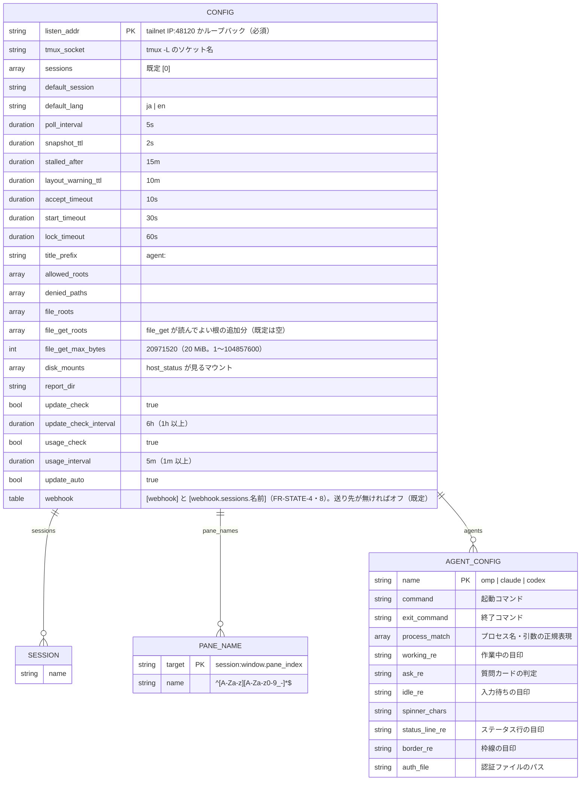
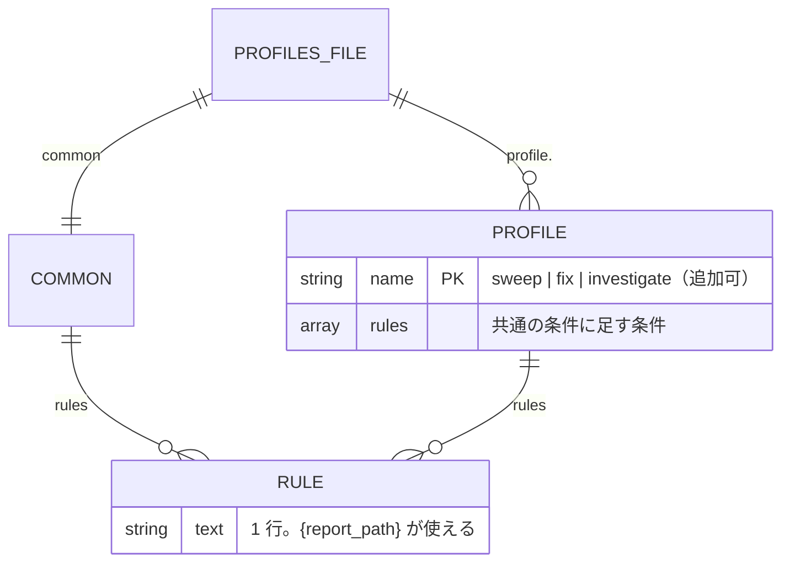

# ER / データモデル：config.toml・profiles.toml・最終報告・自己更新のファイル

[ER / データモデル](er.md) の続き。§5 config.toml、§6 profiles.toml、§7 最終報告ファイル、§8 自己更新のファイル、§9 webhook の台帳を定める。

改訂履歴は [ER / データモデル（本書）](er.md#改訂履歴) にまとめてある。

## 5. config.toml



| 検証 | 内容 |
|------|------|
| `listen_addr` | 必須。`0.0.0.0`・`::`・ホスト名ワイルドカードは拒否。tailnet の範囲（**ポートは 48120 だけ**。`100.64.0.1:8080`・`[fd7a:115c:a1e0::1]:1` などは拒否）またはループバック（どのポートでも可。ポート 0 も可）のみ（P-01・P-73）。ゾーン付き IPv6（`fe80::1%eth0` など）は拒否 |
| `tmux_socket` | 省略（既定のソケット）か `^[A-Za-z0-9][A-Za-z0-9_.-]{0,63}$`（英数字で始まり 64 字まで） |
| `sessions` | 1 つ以上。重複なし。名前は空（空白だけを含む）・`.`・`:`・制御文字を含まない（tmux が `.`・`:` を `_` に置き換えて一致しなくなるため）。`default_session` は `sessions` のどれか。トークンの `allowed_sessions`（ER §3）は `sessions` の部分集合で、ツールが触れるセッションは両方の共通部分。`default_session` は位置の接頭辞を省略するセッションを決めるだけで、ツールの許可・`session` の既定には使わない（FR-SESS-12・P-87） |
| `default_lang` | 省略（`ja`）か `"ja"`・`"en"`。それ以外は起動拒否 |
| `pane_names` | キーは `<セッション>:<ウィンドウ>.<ペイン番号>`（`^(.+):([0-9]+)\.([0-9]+)$`）の形で、セッションは `sessions` のどれか（FR-POS-5）。名前は `^[A-Za-z][A-Za-z0-9_-]*$`（英字始まりなので tmux のペイン ID の `%` 始まりとは重ならない）で、自動名（`T1`・`B2`・`R12` など）と衝突せず、名前どうしも大文字小文字を区別せず重ならない。どれかに反したら起動拒否 |
| `allowed_roots` | 1 つ以上（空配列は起動拒否）。書かなければ既定を使う。`pane_start`・`dispatch` の `cwd` を許す根で、`dir_list`（`/ops` のみ。`cwd` に選べるディレクトリの一覧）が一覧する範囲と、`path` を省略したときに返す一覧そのものにも使う（`denied_paths` と合わせて `cwd` の判定と共通） |
| `allowed_roots`・`file_roots`・`file_get_roots`・`denied_paths`・`disk_mounts`・`report_dir` | 絶対パス（空文字・制御文字を含むもの・相対パスは不可）。`~` は `~` 単体（ホームそのもの）か `~/…` の形だけで、`~user` のような他ユーザー形式は不可。`~` は展開。`report_dir` は 1 つの文字列で、省略か空文字なら既定（`/tmp/swarm-console/reports`）。`report_dir` は `/tmp/swarm-console` の**下**のフォルダだけ（NFR-SEC-14。`/tmp/swarm-console` 自身・外のパス・`..` やシンボリックリンクで外へ出るパスは `config.Load` が拒否。P-123）。`allowed_roots`・`file_roots`・`file_get_roots`・`denied_paths` の比較は `filepath.Clean` ＋ シンボリックリンク解決後。`denied_paths` は一致または配下を拒否（`cwd`・`file`・`file_get` と `dir_list` の `path`） |
| `report_dir` の検査 | 起動時に `report_dir` を作ったあと、次を検査する（NFR-SEC-20）。違えば起動拒否（エラーに原因のフォルダのパスを出す）。権限だけが 0700 でなければ 0700 に直す（エージェントが `mkdir -p` しただけの 0755 などで起動不能にしないため）。<br>・`report_dir` 自身：フォルダであること・シンボリックリンクでないこと・持ち主が自分の uid であること。<br>・親フォルダ（`report_dir` の実パスから根へ向かって、root 所有のフォルダ（`/`・`/home`・`/tmp` など）に届くまで。それより上は見ない）：持ち主が自分の uid か root であること。グループ／その他が書ける権限があるときは、sticky ビット付き（`/tmp` 相当）のときだけ許す。ただしグループが自分の uid と同じ自分専用グループ（gid == uid。UPG）の親は、グループ書き込み（0775 など）を許す（その他書き込みは従来どおり拒否）。gid が uid と違う 0775 の親（共有グループかもしれない）は拒否し、エラーに直し方（`chmod g-w <フォルダ>`）を出す（P-122）。祖先にシンボリックリンクがあるのは拒否しない（macOS の `/tmp` → `/private/tmp` など）が、先に解決した実パスの祖先を検査する。<br>既定が `/tmp` 下の予測できるパスなので、他人が先に作った・リンクにした・あとから差し替えられるフォルダは使わない（P-122）。検査は起動時の 1 回だけ |
| `denied_paths` の既定 | 既定は `["~/dotfiles"]`。`config.toml` に書いたら既定と**入れ替わる**（足されない。書き方の例は [環境構築](../environment/setup.md#ローカルで動かす)）。P-29 |
| 期間 | `time.ParseDuration` 形式。`poll_interval` ≥ 1s、`snapshot_ttl` ≥ 100ms、`update_check_interval` ≥ 1h、`usage_interval` ≥ 1m。`stalled_after`・`layout_warning_ttl`・`accept_timeout`・`start_timeout`・`lock_timeout` は 0 より大きい期間（下限は決めていない） |
| `title_prefix` | 改行・制御文字を含まない 1 行 |
| `update_check` | bool。省略は `true`。`false` なら `serve` は GitHub へ確認しに行かない（`version --check` の手動確認は動く。FR-UPD） |
| `update_auto` | bool。省略は `true`。`false` なら自己更新だけ止まる（確認と `host_status` は続く）。`update_check = false` のときは無視される（確認も更新もしない。FR-UPD-19） |
| `usage_check` | bool。省略は `true`。`false` なら `serve` は `omp usage --json` を実行せず、使用状況は `disabled`（FR-REP-12） |
| `usage_interval` | 期間。省略は `5m`、`1m` 以上。使用状況の取得の間隔。前の実行が終わるまで次を始めない |
| `file_get_roots` | 絶対パスの配列。省略は空（追加の根なし）。`file_get` の許可リストは、触れるセッションのペインの `cwd`・`report_dir` と、このキーの根の和（P-91）。ペインの `cwd` が `/` やホームそのもの（実パスで一致）のときは、その `cwd` だけを和から除く。このキーと `report_dir` に書いたものは `/` やホームでもそのまま許可する。`file_roots` とは別（`send_text` の `file` には効かない） |
| `file_get_max_bytes` | 整数（バイト）。省略は `20971520`（20 MiB）。1 以上 `104857600`（100 MiB）以下。範囲外・整数でない値は起動拒否。`file_get` が返す 1 ファイルの上限（超えたら `too_large`） |
| `agents.<name>` | `<name>` は `omp`・`claude`・`codex` だけ。書かれたキーだけ組み込みの既定を上書きする。正規表現（`working_re`・`ask_re`・`idle_re`・`status_line_re`・`border_re`・`process_match` の各要素）は起動時にコンパイルできること。`command`・`exit_command` は空文字不可で、改行・制御文字を含まない 1 行。`auth_file` は空文字不可（設定エラー）で、絶対パス（`~` 展開） |
| `webhook` | 表 `[webhook]`（FR-STATE-1〜8。既定オフ）。`url`：文字列、省略か空文字ならオフ（何も作らず何も送らない）。`https://` だけ（`http://` はループバックのアドレス（127.0.0.0/8・::1）と `localhost` だけ）で、ユーザー名・パスワードを含まない。`https` はどのホストでも受け付ける（ループバック・リンクローカル・プライベートのアドレスを指す URL は利用者の責任。NFR-SEC-18）。`secret`・`token`：文字列、省略か空ならそのヘッダー（`X-Swarm-Console-Signature`・`Authorization: Bearer`）を付けない。改行・制御文字を含まない 1 行。`max_attempts`：整数、既定 `5`、1〜10（最初の 1 回を含む）。`retry_interval`：期間、既定 `30s`、1s〜1h（最初の再送までの間隔。以後は倍々で 1h まで）。`timeout`：期間、既定 `10s`、1s〜1m（1 回の送信の上限）。違反は起動拒否で、エラー文に `url`・`secret`・`token` の値は入れない（NFR-SEC-18）。台帳は `~/.local/share/swarm-console/webhook-state.json`（600。形は §9。秘密の値は入らない） **セッションごとの送り先**（FR-STATE-8）：`[webhook.sessions."<セッション名>"]`（表の表。キーは `url`・`secret`・`token`・`max_attempts`・`retry_interval`・`timeout` で、検証も `[webhook]` と同じ）。名前は `sessions` にあるものだけ（無ければ起動拒否。エラー文は名前だけで値を出さない）。件を作る・送るときに、ペインのセッションの表があればそれ（`url` が空ならそのセッションは送らない）、無ければ `[webhook]`（`url` が空なら送らない）を使う。`max_attempts`・`retry_interval`・`timeout` は書かなければ `[webhook]` の値を受け継ぎ、`url`・`secret`・`token` は受け継がない。台帳は 1 つで、形は変わらない（`event_id` にセッション名が入るのでセッションをまたいで衝突しない） |
| 未知のキー | 起動拒否（打ち間違いを検知する） |

### 5.1 `setup` による書き戻し

`swarm-console setup`（FR-SET）が `config.toml` に書く規則。目的は「手で書いた内容を壊さない」ことで、ファイル全体を作り直さない。設定の読み込み（`config.Load`）は変えない。

| 項目 | 規則 |
|------|------|
| 読み方 | `go-toml/v2` の `unstable.Parser` で、キー（表を含む完全なキー）ごとの値のバイト範囲と、各表のヘッダー・最後のキーの位置を取る（`Unmarshal` では位置が取れない）。値の解釈は通常の読み込み（`DisallowUnknownFields`）と別に行い、`setup` が聞かないキー（FR-SET-4）も含めて何も変えない |
| 何を書くか | 運用者が画面で値を変えたキーだけ。比較は検証・`~` 展開・Clean 後の実効値で行い、ファイルに無く既定のままのキー（例：触らなかった `denied_paths`）は書かない |
| 既にあるキーを変える | 値のバイト範囲だけを置き換える。キー・`=`・前後の空白・行末コメント・前後の行は 1 バイトも変えない |
| 複数行の配列 | 変えるなら配列全体（`[` から `]`）を 1 行の配列に置き換える。配列の中にコメントがあるときは「このキーの中のコメントは消える」と確認画面に出し、了承がなければそのキーは元のままにする |
| 無いキーを足す（最上位） | 最初の表ヘッダーの直前（その直前の空行は保つ）に `key = value` を 1 行足す。表が 1 つも無ければファイルの末尾 |
| 無いキーを足す（表の中。`[agents.omp]` など） | その表の最後のキーの次の行。表が無ければ、末尾に空行 1 つと表ヘッダー、キーを足す |
| 挿入先を決められない形 | インラインテーブルへの追加、同じ表が離れて 2 回出てくる、dotted key で別の表に分かれている、などは、何も書かずに中止し、該当キーを手で直すよう案内する（一部だけ書くことはしない） |
| 値の書き方 | 文字列は `"..."`（基本文字列）、配列は 1 行。足した行にコメントは付けない |
| 改行・末尾 | 既存ファイルの改行（LF・CRLF）と末尾の改行の有無に合わせる |
| 新規作成 | 全キーの説明と既定値をコメントで並べたひな形（`config.toml` の見本。`go:embed`）から始め、同じ規則で値を足す。ひな形は `setup` を通さなくても手で使える |
| 保存前の検査（どれか 1 つでも落ちたら何も書かない） | ① 結果を `serve` と同じ読み込み経路（`config.ParseBytes`）で読み直して通る ② 値を変えていないキーの実効値が読み込み時と同じ ③ 置き換えた範囲・足した行の外のバイト列が元と同一 |
| 競合 | 読み込み時の内容のハッシュを持ち、書く直前にファイルを読み直して違えば中止する（`serve` や手書きとの競合。上書きしない） |
| 書き込み | `store.WriteFileAtomic`（一時ファイル → fsync → rename）。既存ファイルの権限は変えない。新規は 600（「644 以下」を満たす） |
| シンボリックリンク | `config.toml` がシンボリックリンクなら書かずに中止する（rename でリンクが普通のファイルに変わる、リンク先が設定の置き場の外・`~/dotfiles` のことがあるため。NFR-SEC-14）。手で編集してもらう |
| 手書き専用のキー | 下記が手で書かれていても、`setup` は何も変えずに残す：`tmux_socket`・`default_lang`・期間のキー全部（`poll_interval`・`snapshot_ttl`・`stalled_after`・`layout_warning_ttl`・`accept_timeout`・`start_timeout`・`lock_timeout`・`update_check_interval`・`usage_interval`）・`update_check`・`update_auto`・`usage_check`・`title_prefix`・`file_roots`・`file_get_roots`・`file_get_max_bytes`・`disk_mounts`・`report_dir`・`[webhook]`・`[pane_names]`・`[agents.<name>]` の `command`・`exit_command`・`auth_file` 以外のキー |

## 6. profiles.toml



初期値（元の omp-dispatch の条件そのまま）：

```toml
[common]
rules = [
  "コミットは必ず `git commit -s` で行う（cherry-pick も `-s`）。マージは `git merge --signoff`。",
  "force push・rebase・amend・squash・reset・`--no-verify` はしない。フックが落ちたら止めて報告する。",
  "リモートブランチは作業用でも消さない（削除はローカルだけ）。",
  "マージ・Issue の close・デプロイはしない。",
  "トークン・パスワードなどの秘密をコード・ログ・PR・Issue に書かない。",
  "オーナーの checkout と `~/dotfiles` には触らず、worktree で作業する。",
  "CI が緑になったら止める。",
  "最終報告（PR・head・CI・Issue 番号・残りの判断）を {report_path} にも書く。",
]

[profile.sweep]
rules = ["PR は 1 本まで（`--single-pr`）。PR を出して CI が緑になったら止まる。"]

[profile.fix]
rules = ["PR は 1 本まで。バグの再現確認と回帰テストを含める。PR を出して CI が緑になったら止まる。"]

[profile.investigate]
rules = [
  "調査だけを行い、ファイルの変更・コミット・push・PR 作成はしない。",
  "分かったこと・根拠・残りの判断を報告する。",
]
```

| 検証 | 内容 |
|------|------|
| 必須 | `common` と、`sweep`・`fix`・`investigate` の 3 プロファイルが存在する（追加は可） |
| 規則 | 各 `rules` は空でない 1 行の文字列（改行不可）。プレースホルダーは `{report_path}` だけ。他の `{...}` は起動時エラー |
| 不在 | ファイルが無ければ、上記の初期値を組み込みで使う |

## 7. 最終報告ファイル

| 項目 | 内容 |
|------|------|
| パス | `<report_dir>/<位置>.md`（`<位置>` はセッション内の位置ではなく全体の位置。既定セッションは `T1`、それ以外は `1:T1`。位置の `:`・`/`・`\` はすべて `_`。`/`・`\` はパスの外へ出さないため。例 `work:B2` → `work_B2.md`、`1:T1` → `1_T1.md`、`a/b:T1` → `a_b_T1.md`）。別のセッションの `T1` と衝突しない（FR-SESS-7・P-82） |
| 書き手 | エージェント（指示文の最後の条件で書かせる）。サーバーは読むだけ（`report_read`）。置き場は起動時に検査する（`report_dir` が自分の uid 所有の 0700 のフォルダ（リンクでない）で、親フォルダも他人が差し替えられないこと。違えば起動拒否。§5・P-122） |
| 移動 | `dispatch`・`pane_close` が古いファイルを `<report_dir>/archive/<位置>-<unix 秒>.md` へ移す（サーバーが書く唯一の操作）。アーカイブ名の `<位置>` も上のパスと同じ規則（`:`・`/`・`\` → `_`。例 `a_b_T1-1730000000.md`） |
| 読み取り上限 | 20,000 字。超えたら先頭から切って `truncated: true` |
| 存在判定 | 通常ファイルがあれば `report_exists: true`。空ファイルは存在扱い。シンボリックリンクは辿らず「無し」（P-30） |

## 8. 自己更新のファイル

置き場は `~/bin/swarm-console/` に固定（FR-UPD-12・15。NFR-SEC-14・16）。サーバーが書くのは次の 5 つだけ。

| ファイル | 中身 | 書き手・消す人 |
|---------|------|--------------|
| `swarm-console` | 動いているバイナリ（権限 755） | 入れ替え（`rename`）と戻し（`rename`） |
| `swarm-console.new` | ダウンロード中・検証待ちの一時ファイル | 入れ替えが作り、`rename` するか失敗時に消す |
| `swarm-console.old` | 入れ替え前のバイナリ（ハードリンク。1 世代だけ） | 入れ替えのたびに作り直す。戻しで `swarm-console` に `rename` される |
| `swarm-console.update-pending` | 試運転中のマーカー | 入れ替えが作る。試運転が済む・戻す・`to` が自分の版でないときに消す |
| `swarm-console.update-failed` | 起動に失敗して戻した版の記録 | 戻しが書く。運用者が消すと同じ版を再び試す |

```json
// swarm-console.update-pending（権限 600）
{"from": "v0.1.3", "to": "v0.1.5", "boots": 0}
// swarm-console.update-failed（権限 600）
{"version": "v0.1.5", "at": "2026-11-01T12:30:00+09:00"}
```

| 項目 | 検証・意味 |
|------|-----------|
| `from`・`to`・`version` | `vX.Y.Z`（FR-UPD-3 の形）。読めない・形が違うファイルは無いものとして扱い、消す |
| `boots` | 0 以上の整数。`serve` が起動の最初に 1 増やして書き戻し、3 以上になる起動で戻す。試運転が済んだらマーカーごと消える |
| 書き込み | 一時ファイル → `rename`（NFR-AVL-3 と同じ作り）。権限 600 |

## 9. webhook の台帳

`[webhook] url`（または `[webhook.sessions."<名>"] url`）を書いたときだけ、`~/.local/share/swarm-console/webhook-state.json`（権限 600。`store.WriteFileAtomic`）を作る（FR-STATE-2。書かなければ作らない）。ペインごとの「回」と、`asking` の回（`asked`。FR-STATE-9）と、受理を確かめられなかった指示の見張り（`watch`。FR-STATE-12）と、送る約束をした「件」（outbox）を持つ。件は回と独立で、ペインが `working` に戻る・消える・tmux が再起動しても影響を受けない。

```json
{
  "version": 2,
  "server_start": "1731744000",
  "panes": {
    "%3": {
      "phase": "done",
      "event_id": "evt_0123456789abcdef0123456789abcdef",
      "state_changed_at": "2026-11-16T09:00:05Z",
      "report_base": {"exists": true, "mtime_ns": 1731744000000000000, "size": 1100},
      "report_path": "/tmp/swarm-console/reports/T2.md",
      "report_sent": {"exists": true, "mtime_ns": 1731744100000000000, "size": 1300}
    }
  },
  "asked": {
    "%1": "evt_fedcba9876543210fedcba9876543210"
  },
  "watch": {
    "%3": {"enter": "2026-11-20T07:08:00Z", "retained": 2, "pid": 321}
  },
  "outbox": {
    "evt_0123456789abcdef0123456789abcdef": {
      "event_id": "evt_0123456789abcdef0123456789abcdef",
      "payload": {"event": "pane.idle_report", "event_id": "evt_0123456789abcdef0123456789abcdef", "…": "FR-STATE-3 の本文そのもの"},
      "attempts": 1
    },
    "evt_fedcba9876543210fedcba9876543210": {
      "event_id": "evt_fedcba9876543210fedcba9876543210",
      "payload": {"event": "pane.asking", "event_id": "evt_fedcba9876543210fedcba9876543210", "…": "FR-STATE-10 の本文そのもの"},
      "attempts": 0
    }
  }
}
```

| 項目 | 検証・意味 |
|------|-----------|
| `version` | `2`（`asked`・`panes` の `report_sent`・`watch` は省略できる任意のキーなので、それらを持たない古い台帳（Issue #111・#115・#118 より前の版 2）もそのまま読め、版は上げない。古いサーバーが新しい台帳を読むと、知らないキー（`watch`）は無視して、書き直すときに落とす＝見張りが消えるだけで、回・outbox は壊れない）。違う（版 1 を含む）・JSON として読めないファイルは、警告のログ（台帳のパスと理由）を出して空から始める（送信は止めない） |
| `server_start` | tmux サーバーの起動時刻（`#{start_time}`）。スナップショットの値が空でなく、台帳の値（空でない）と違えば、`panes` をすべて捨てて新しい値を書く（ペイン ID `%N` は再起動で使い回される）。`outbox` は残す。台帳の値が空なら書くだけ |
| `panes`（キーは tmux のペイン ID） | `phase`：`working`（`working` を見た）・`waiting`（`idle` になり、最終報告が書かれるのを待つ）・`done`（件を作った。次の `working` まで、この回は二度と始めない）。`event_id`：`waiting` に移るときに決める（セッション・ペイン ID・移った時刻から）。`state_changed_at`：`waiting` に移った（`working` から `idle` を見た）時刻。`report_base`・`report_path`：基準にした最終報告ファイル（有無・更新時刻（ns）・サイズ）と、そのパス。現在のパスが `report_path` と違うとき（ペインの位置がずれたとき）は、違うファイル同士を比べず、新しいパスで基準を取り直す。ペインが 1 つも無いスナップショット（tmux に接続できない・一覧が空）は、消えた判定に数えない。続けて 2 回のスナップショットに無いペインの行と `shell` を見たペインの行は消す。最終報告が通常のファイルでない（シンボリックリンクなど）ときは「無し」（`exists: false`）で、「書けた」にならない。`working` の行は `event_id` を持たず（空で書かない）、`state_changed_at` はゼロ時刻（`0001-01-01T00:00:00Z`）のまま |
| `panes` の `report_sent`（省略可） | `done` にした（件を作った）ときの最終報告ファイルの様子（`report_base` と同じ形）。次に `working` を見て回を始めるとき、同じパス（`report_path` が現在のパスと同じ）なら、新しい回の `report_base` にする。件を送ったあとに最終報告が書き直され、`working` を最初に見る前にもう書き直し済みでも、その回の `idle` で「書けた」と読むため（FR-STATE-1。Issue #115）。無い（Issue #115 より前の台帳の `done` の行）・パスが違うときは、次の `working` を見たときの最終報告を基準にする（今までどおり）。版は上げない。`working`・`waiting` の行には持たない |
| `asked`（キーは tmux のペイン ID。省略可） | いまの `asking` の回で `pane.asking` の件を作った（送り先が無くて作らなかった回も含む）印。値はその回の `event_id`（セッション・ペイン ID・`asking` を見た時刻から。`pane.idle_report` の `event_id` とは重ならない）。`asking`・`unknown` 以外（`working`・`idle`・`stalled`・`shell`）を見たら消し、次の `asking` は新しい回になる（FR-STATE-9）。`server_start` が変わったとき・ペインが続けて 2 回のスナップショットに無いときも消す。再起動しても同じ質問のまま二度目を作らない |
| `watch`（キーは tmux のペイン ID。省略可） | 受理を確かめられなかった指示（`send_text`・`dispatch`。FR-STATE-12）の見張り。`pane.Unaccepted`（メモリ）の写しで、サーバーの再起動のあとも見張りを続けるために持つ。`enter`：受理を確かめられなかった Enter の時刻（RFC3339。必須。無い行は読むときに捨てる）。`retained`：0 より大きければ、`pane.idle_report` の件を作ったあとも見続ける対象（印を付けた順。大きいほど新しい。省略は 0）。`pid`：見張った omp の pid（省略か 0 は未確認。今のペインの omp の pid と違えば、別のプロセスなので捨てる）。ログ・会話の記録を読んだ結果は持たない（起動後の最初のスナップショットで読み直す）。`serve` の起動で台帳を読むとき `pane.Unaccepted` に引き継ぐ（すでに記録のあるペインは上書きしない）。スナップショットごと（5 秒おき）に `pane.Unaccepted` の今の内容と比べ、変わっていれば台帳を書く（受理を確かめられた・shell に戻った・ペインが消えた・上限を超えたものは消える）。`server_start` が変わったとき・ペインが続けて 2 回のスナップショットに無いときも消す（`pane.Unaccepted` のうち、台帳と同じ `enter` の記録だけを消し、そのあとに受けた新しい指示の記録は残す） |
| `outbox`（キーは `event_id`） | `payload`：送る本文そのもの（件を作るときに 1 度だけ作る。再送・再起動後も 1 バイトも変えない）。`attempts`：送った回数（POST の前に 1 増やして書く。再起動をまたいで `max_attempts` を共有する）。成功（2xx）か諦めた（`error` のログを出した）ら件を消す。終了による中断では残し、中断した通信の分は `attempts` に数えない（戻して書く）。引き継いだ件は、`attempts` に応じた再送の間隔をあけてから続ける |
| 書き込みの順 | 回が「書けた」になったとき（`pane.idle_report`）、または `asking` の回を始めたとき（`pane.asking`）、`panes`（`done`）・`asked`・`watch`・`outbox`・`server_start` を 1 度に書いてから、最初の POST を始める |
| 書けないとき | 台帳を書けない（読み取り専用・ディスクいっぱい）ときは、警告のログ（パスと OS のエラー文）を出して送る。その間の再起動では、同じ回に別の `event_id` が付くことがある（重複排除の保証は、台帳が書けている間だけ） |
