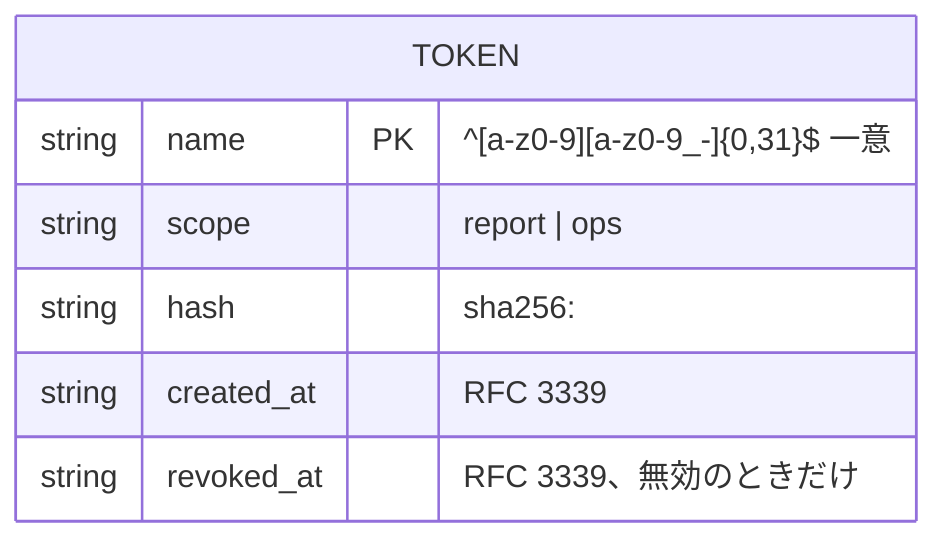
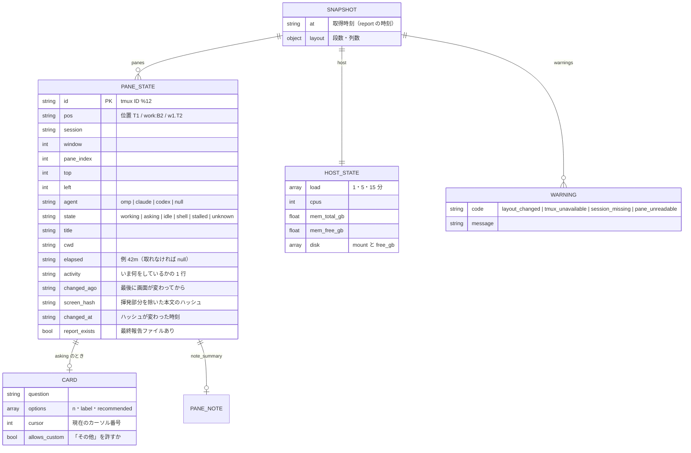

# ER / データモデル：tokens.toml・実行時のペイン状態

[ER / データモデル](er.md) の続き。§3 tokens.toml と §4 実行時のペイン状態（メモリ）を定める。

改訂履歴は [ER / データモデル（本書）](er.md#改訂履歴) にまとめてある。

## 3. tokens.toml



```toml
[[token]]
name = "ops-client"
scope = "ops"
hash = "sha256:9f86d081884c7d659a2feaa0c55ad015a3bf4f1b2b0b822cd15d6c15b0f00a08"
created_at = "2026-10-31T22:00:00+09:00"

[[token]]
name = "routine-report"
scope = "report"
hash = "sha256:..."
created_at = "2026-10-31T22:05:00+09:00"
revoked_at = "2026-11-02T09:00:00+09:00"
```

| 制約 | 内容 |
|------|------|
| 一意性 | `name` は一意。無効にした名前も再利用しない（ログの追跡性） |
| 平文 | 保存しない。`token add` が `sc_` ＋ base64url(32 バイト) を生成し、標準出力に 1 度だけ出す |
| 失効 | `token revoke <名前>` が `revoked_at` を付ける。失効済みは一致しても 401 |
| 照合 | 受け取ったトークンの SHA-256 を、全エントリの `hash` と定数時間比較（早期終了なし）。失効済みは一致扱いにしない |
| 書き込み | CLI だけが書く。一時ファイル → rename、権限 600 |
| 起動検証 | 権限が 600 でない・TOML が壊れている・未知の `scope` は起動拒否 |

## 4. 実行時のペイン状態（メモリ）



| 項目 | 規則 |
|------|------|
| 不変性 | スナップショットは作ったあと変更しない。次のスナップショットが作られるまで読み取り専用 |
| `state` の決定 | 質問カード → 作業中 → エージェントあり＝`idle` → エージェントなし＋シェル＝`shell` → それ以外 `unknown`。`working` で `now - changed_at ≥ stalled_after` なら `stalled` |
| `changed_at` | 前回と `screen_hash` が違えば更新。起動直後は起動時刻 |
| `pos` | FR-POS のとおり。固定名があればそれ |
| `elapsed` | アダプタが画面の経過時間表示を読めたらそれ。読めなければ、サーバーが `working` を観測し始めた時刻からの経過。それも不明なら `null` |
| 持たないもの | 画面の全文は保持しない（`pane_tail`・`ask_card` は呼ばれたとき取り直す）。ハッシュだけ残す |
