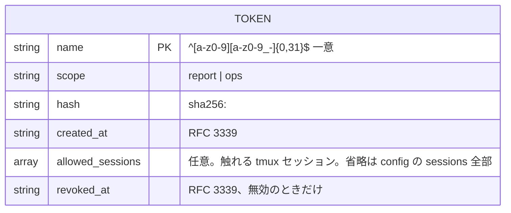
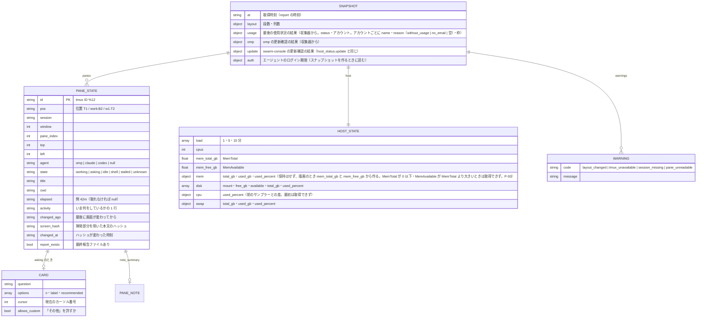

# ER / データモデル：tokens.toml・実行時のペイン状態

[ER / データモデル](er.md) の続き。§3 tokens.toml と §4 実行時のペイン状態（メモリ）を定める。

改訂履歴は [ER / データモデル（本書）](er.md#改訂履歴) にまとめてある。

## 3. tokens.toml



```toml
[[token]]
name = "ops-client"
scope = "ops"
hash = "sha256:9f86d081884c7d659a2feaa0c55ad015a3bf4f1b2b0b822cd15d6c15b0f00a08"
created_at = "2026-10-31T22:00:00+09:00"
allowed_sessions = ["0"]

[[token]]
name = "agent-b"
scope = "ops"
hash = "sha256:..."
created_at = "2026-11-02T18:00:00+09:00"
allowed_sessions = ["1"]

[[token]]
name = "routine-report"
scope = "report"
hash = "sha256:..."
created_at = "2026-10-31T22:05:00+09:00"
# allowed_sessions を書かない = config.toml の sessions 全部
revoked_at = "2026-11-02T09:00:00+09:00"
```

| 制約 | 内容 |
|------|------|
| 一意性 | `name` は一意。無効にした名前も再利用しない（ログの追跡性） |
| 平文 | 保存しない。`token add`（と `pair`）が `sc_` ＋ base64url(32 バイト) を生成し、標準出力に 1 度だけ出す（`pair` は接続文字列の中に入れる）。`token list` はハッシュも平文も出さない |
| 失効 | `token revoke <名前>` が `revoked_at` を付ける。失効済みは一致しても 401 |
| 照合 | 受け取ったトークンの SHA-256 を、全エントリの `hash` と定数時間比較（早期終了なし）。失効済みは一致扱いにしない |
| 書き込み | CLI だけが書く。一時ファイル → rename、権限 600 |
| 許可セッション | `allowed_sessions`（string 配列、任意）。キーが無ければ `config.toml` の `sessions` 全部。あるときは 1 要素以上（空配列は読み込みで拒否）・各要素は非空で `.`・`:`・制御文字を含まない・重複なし（`CheckSessions` と同じ文字規則）。実効の許可セッションは `allowed_sessions` と `sessions` の共通部分で、ツールの呼び出しごとに求める（`auth.Client.AllowedSessions`：`nil` は「`sessions` 全部」、値があれば明示のリスト）。`token add --sessions 0,1` が書く（省略ならキーを書かない）。変えるには `token revoke` してから `token add --sessions` で発行し直す（FR-SESS-1〜3・P-76〜P-78） |
| 起動検証 | 権限が 600 でない・TOML が壊れている・未知の `scope`・不正な `allowed_sessions`（空配列・重複・不正な文字）は起動拒否。`serve` の起動時は、さらに `allowed_sessions` に `config.toml` の `sessions` にない名前があれば起動拒否（エラーにトークン名とセッション名を出し、ハッシュは出さない）。起動後の再読み込みで食い違ったときは警告ログだけを出し、実効の許可セッションは共通部分にする（P-76） |

## 4. 実行時のペイン状態（メモリ）



| 項目 | 規則 |
|------|------|
| 不変性 | スナップショットは作ったあと変更しない。次のスナップショットが作られるまで読み取り専用 |
| `state` の決定 | 質問カード → 作業中 → エージェントあり＝`idle` → エージェントなし＋シェル＝`shell` → それ以外 `unknown`。`working` で `now - changed_at ≥ stalled_after` なら `stalled` |
| `changed_at` | 前回と `screen_hash` が違えば更新。起動直後は起動時刻 |
| `pos` | FR-POS のとおり。固定名があればそれ。スナップショットの `pos` は全体の位置（既定セッションは `T1`、それ以外は `1:T1`）で、最終報告ファイル名と複数セッション許可の resources の名前はこれから付く。1 つのセッションに絞った応答は、そのセッションのペインから接頭辞なしのセッション内の位置を付け直して返す（FR-SESS-7） |
| セッションでの絞り込み | スナップショットは全セッション分を持つ。`session` を取るツールは、決まったセッションのペインだけを取り出し、`layout`・`warnings` もそのセッションの分に絞って返す（FR-SESS-7・8）。並びの変化（`layout_changed`）の検知もセッションごと |
| `elapsed` | アダプタが画面の経過時間表示を読めたらそれ。読めなければ、サーバーが `working` を観測し始めた時刻からの経過。それも不明なら `null` |
| 持たないもの | 画面の全文は保持しない（`pane_tail`・`ask_card` は呼ばれたとき取り直す）。ハッシュだけ残す |
