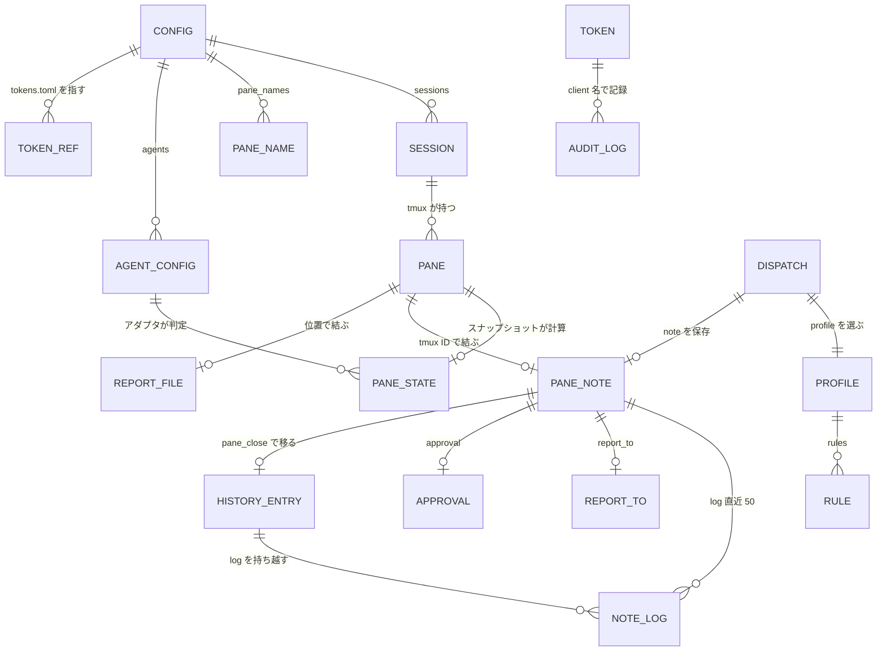
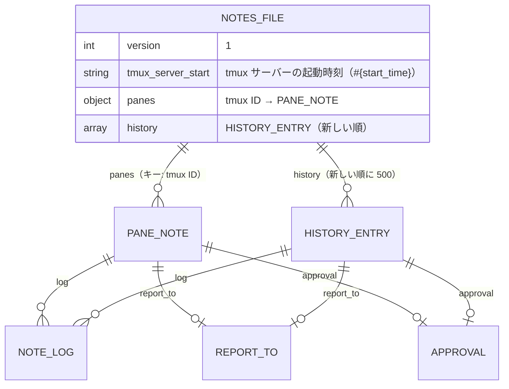
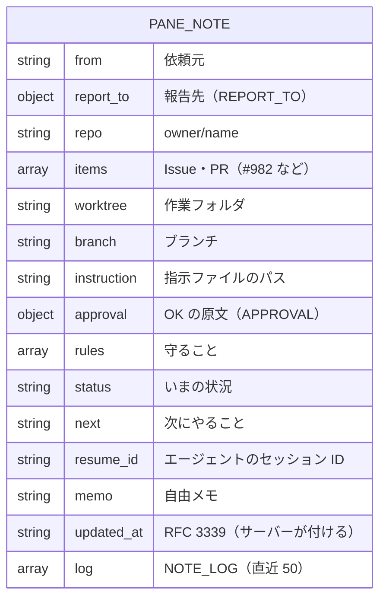
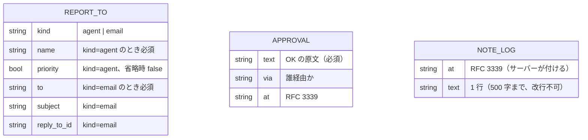
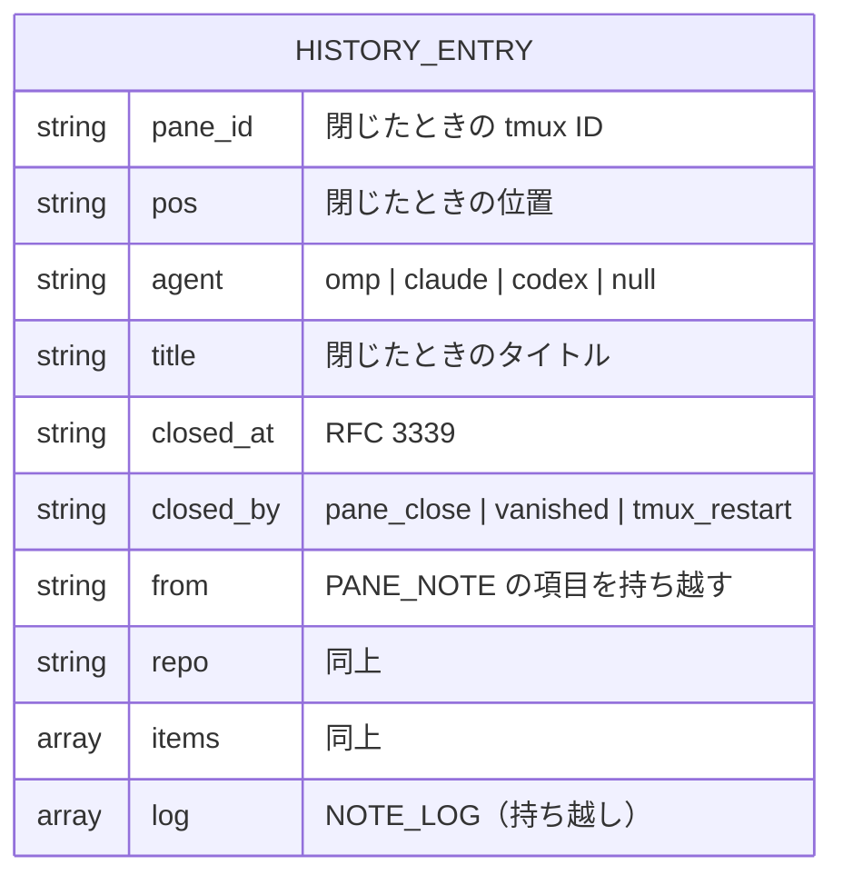
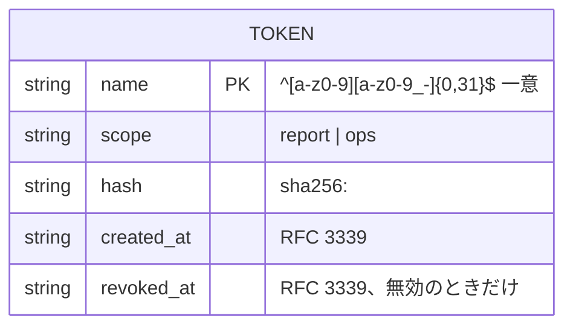
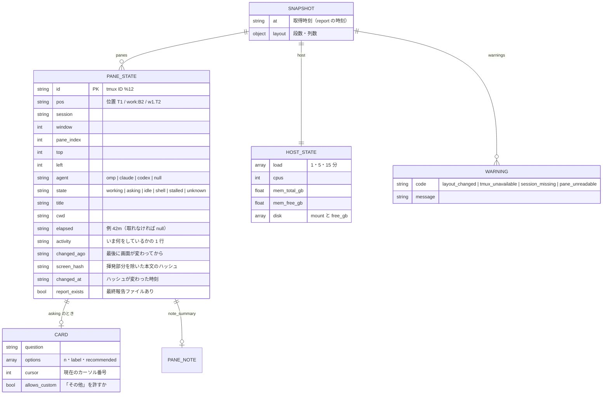
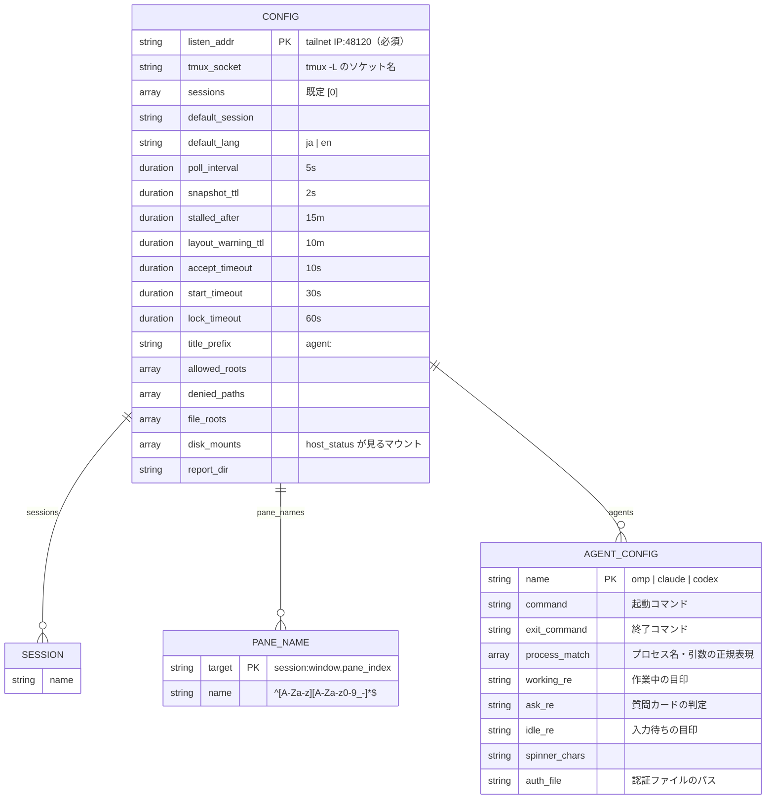
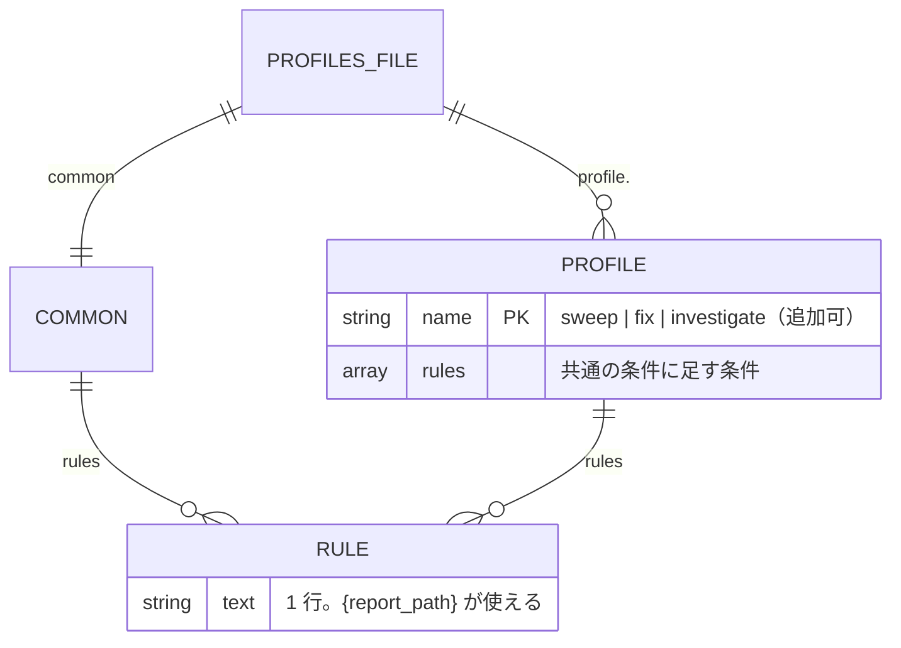

# ER / データモデル

本システムに RDB はない。永続データは次のファイルだけで、実行時の状態はメモリ上に持つ。このドキュメントはそれらのデータモデル（ファイルのスキーマ・関係・制約）を定める。実装時の構造体・バリデーションの根拠になる。

| 区分 | 実体 | 置き場 | 権限 |
|------|------|--------|------|
| 永続（書き込み） | メモと履歴 `notes.json` | `~/.local/share/swarm-console/notes.json` | 600 |
| 永続（書き込み: CLI のみ） | トークン `tokens.toml` | `~/.config/swarm-console/tokens.toml` | 600（違えば起動拒否） |
| 永続（人が編集） | 設定 `config.toml` | `~/.config/swarm-console/config.toml` | 644 以下 |
| 永続（人が編集） | 条件のひな形 `profiles.toml` | `~/.config/swarm-console/profiles.toml` | 644 以下 |
| 永続（人が編集、任意） | レポートのテンプレート | `~/.config/swarm-console/templates/report.{ja,en}.md` | — |
| 外部が書く | 最終報告 `<位置>.md` | `/tmp/swarm-console/reports/` | エージェントが書く |
| 実行時（メモリ） | スナップショット・ペイン状態 | プロセス内 | — |

## 1. 全体ER図



- `CONFIG`・`PROFILE`・`AGENT_CONFIG` は人が編集する設定、`TOKEN` は CLI だけが書く、`PANE_NOTE`・`HISTORY_ENTRY`・`NOTE_LOG` は `notes.json`、`PANE`・`SESSION`・`PANE_STATE` は tmux とスナップショット由来の揮発データ。
- メモ（`PANE_NOTE`）のキーは tmux ペイン ID（`%12`）。位置の名前（`B4`）はレイアウトから導く別名なので、キーにしない。

## 2. notes.json

### 2.1 ファイル構造



```json
{
  "version": 1,
  "tmux_server_start": "1761896400",
  "panes": {
    "%12": {
      "from": "agent-b",
      "report_to": {"kind": "agent", "name": "agent-b", "priority": true},
      "repo": "ousiassllc/funid",
      "items": ["#982"],
      "worktree": "/mnt/nvme/ousiassllc/funid-sweep-982",
      "branch": "sweep/issue-sweep-20261031-193532",
      "instruction": "/tmp/b4-funid-982.txt",
      "approval": {"text": "残りの1周のスイープをどんどんしていきたい", "via": "agent-b", "at": "2026-10-31T19:35:00+09:00"},
      "rules": ["マージしない", "dependabot PR に触らない"],
      "status": "CI 待ち",
      "next": "完了したら #983 を入れる",
      "resume_id": null,
      "memo": null,
      "updated_at": "2026-10-31T21:50:12+09:00",
      "log": [
        {"at": "2026-10-31T19:36:00+09:00", "text": "dispatch した"}
      ]
    }
  },
  "history": [
    {
      "pane_id": "%4",
      "pos": "B1",
      "agent": "omp",
      "title": "agent: funid #981",
      "closed_at": "2026-10-31T18:40:00+09:00",
      "closed_by": "pane_close",
      "from": "agent-a",
      "repo": "ousiassllc/funid",
      "items": ["#981"],
      "status": "PR 作成済み",
      "log": []
    }
  ]
}
```

### 2.2 PANE_NOTE（`panes[<tmux ID>]`）



| キー | 型 | 必須 | 上限 | 説明 |
|------|-----|------|------|------|
| `from` | string | 任意 | 2000 字 | 依頼元（例：`agent-b`、`agent-a`、`オーナー`） |
| `report_to` | object | 任意 | — | 報告先（§2.3） |
| `repo` | string | 任意 | 2000 字 | リポジトリ（`ousiassllc/funid`） |
| `items` | string[] | 任意 | 50 件・各 2000 字 | Issue・PR（`["#982"]`） |
| `worktree` | string | 任意 | 2000 字 | 作業フォルダ |
| `branch` | string | 任意 | 2000 字 | ブランチ名 |
| `instruction` | string | 任意 | 2000 字 | 指示ファイルのパス |
| `approval` | object | 任意 | — | OK の原文（§2.3） |
| `rules` | string[] | 任意 | 50 件・各 2000 字 | 守ること |
| `status` | string | 任意 | 2000 字 | いまの状況（`CI 待ち`） |
| `next` | string | 任意 | 2000 字 | 次にやること |
| `resume_id` | string | 任意 | 2000 字 | 再開 ID（エージェントのセッション ID） |
| `memo` | string | 任意 | 4000 字 | 自由メモ |
| `updated_at` | string | サーバー | — | RFC 3339。`note_set`・`note_log` の書き込みで更新。クライアントは書けない |
| `log` | NOTE_LOG[] | サーバー | 50 行 | `note_log` と `send_escape` の自動記録 |

- キーの値が `null`／未設定は「空」。`note_set` で `null` を渡すと、その項目を消す（JSON から落とす）。
- `from`・`repo`・`items`・`next` が `panes_status`・`report` に要約として出る。

### 2.3 REPORT_TO・APPROVAL・NOTE_LOG



| 実体 | 検証 |
|------|------|
| `REPORT_TO` | `kind` は `agent` か `email`。`agent` は `name` 必須。`email` は `to` 必須（`@` を含む）。それ以外のキーは拒否 |
| `APPROVAL` | `text` 必須（2000 字まで）。`at` は RFC 3339 として解釈できること |
| `NOTE_LOG` | `text` は改行を含まない 1 行、500 字まで。50 行を超えたら古いものから落とす |

### 2.4 HISTORY_ENTRY（`history[]`）と制約・上限



`HISTORY_ENTRY` は `PANE_NOTE` の全項目（`updated_at` を含む）に、上表の閉じたときの情報を足したもの。

| 制約 | 内容 |
|------|------|
| 履歴の上限 | 500 件。超えたら古いものから落とす（新しい順に並べて末尾を切る） |
| 現行メモのキー | tmux ペイン ID（`%` ＋ 数字）。`panes` に存在するのは、スナップショットに現存するペインのメモだけ |
| 書き込み方式 | 同一ディレクトリの一時ファイルに書く → `fsync` → `rename`。ファイル権限 600、ディレクトリ 700。プロセス内の排他ロックで直列化 |
| 壊れたファイル | 読み込めなければ `notes.json.corrupt-<時刻>` に退避し、空で開始して警告ログ |
| 秘密の拒否 | 文字列項目（キー名を除く全ての値、`log.text` も）が P-14 のパターンに当たれば書き込み全体を拒否（`secret_detected`、値は出さない）。部分的に書かない |
| 型の検証 | 未知のキー・型違いは `invalid_args`。`updated_at`・`log` はクライアントから書けない |
| ペインの消滅 | スナップショットで 2 回連続で存在しないペインのメモは `closed_by: "vanished"` で履歴へ移す。`tmux_server_start` が変わっていたら、現行メモを全部 `closed_by: "tmux_restart"` で履歴へ移す（ID の再利用による取り違え防止） |
| 履歴の検索 | `note_history` は線形検索（500 件）。`repo` は完全一致、`from` は完全一致、`items` は指定要素をすべて含むもの。インデックスは持たない |

## 3. tokens.toml



```toml
[[token]]
name = "ops-client"
scope = "ops"
hash = "sha256:9f86d081884c7d659a2feaa0c55ad015a3bf4f1b2b0b822cd15d6c15b0f00a08"
created_at = "2026-10-31T22:00:00+09:00"

[[token]]
name = "routine-report"
scope = "report"
hash = "sha256:..."
created_at = "2026-10-31T22:05:00+09:00"
revoked_at = "2026-11-02T09:00:00+09:00"
```

| 制約 | 内容 |
|------|------|
| 一意性 | `name` は一意。無効にした名前も再利用しない（ログの追跡性） |
| 平文 | 保存しない。`token add` が `sc_` ＋ base64url(32 バイト) を生成し、標準出力に 1 度だけ出す |
| 失効 | `token revoke <名前>` が `revoked_at` を付ける。失効済みは一致しても 401 |
| 照合 | 受け取ったトークンの SHA-256 を、全エントリの `hash` と定数時間比較（早期終了なし）。失効済みは一致扱いにしない |
| 書き込み | CLI だけが書く。一時ファイル → rename、権限 600 |
| 起動検証 | 権限が 600 でない・TOML が壊れている・未知の `scope` は起動拒否 |

## 4. 実行時のペイン状態（メモリ）



| 項目 | 規則 |
|------|------|
| 不変性 | スナップショットは作ったあと変更しない。次のスナップショットが作られるまで読み取り専用 |
| `state` の決定 | 質問カード → 作業中 → エージェントあり＝`idle` → エージェントなし＋シェル＝`shell` → それ以外 `unknown`。`working` で `now - changed_at ≥ stalled_after` なら `stalled` |
| `changed_at` | 前回と `screen_hash` が違えば更新。起動直後は起動時刻 |
| `pos` | FR-POS のとおり。固定名があればそれ |
| `elapsed` | アダプタが画面の経過時間表示を読めたらそれ。読めなければ、サーバーが `working` を観測し始めた時刻からの経過。それも不明なら `null` |
| 持たないもの | 画面の全文は保持しない（`pane_tail`・`ask_card` は呼ばれたとき取り直す）。ハッシュだけ残す |

## 5. config.toml



| 検証 | 内容 |
|------|------|
| `listen_addr` | 必須。`0.0.0.0`・`::`・ホスト名ワイルドカードは拒否。tailnet の範囲またはループバックのみ（P-01） |
| `sessions` | 1 つ以上。重複なし。`default_session` は `sessions` のどれか |
| `pane_names` | 名前は `^[A-Za-z][A-Za-z0-9_-]*$`、他の固定名・自動名（`T1` など）・`%` 始まりと衝突しない |
| `allowed_roots`・`file_roots`・`denied_paths` | 絶対パス。`~` は展開。比較は `filepath.Clean` ＋ シンボリックリンク解決後。`denied_paths` は一致または配下を拒否（`cwd`・`file` の両方） |
| `denied_paths` の既定 | 既定は `["~/dotfiles"]`。`config.toml` に書いたら既定と**入れ替わる**（足されない。書き方の例は [環境構築](../environment/setup.md#ローカルで動かす)）。P-29 |
| 期間 | `time.ParseDuration` 形式。`poll_interval` ≥ 1s、`snapshot_ttl` ≥ 100ms |
| `agents.<name>` | 書かれたキーだけ組み込みの既定を上書きする。正規表現は起動時にコンパイルできること |
| 未知のキー | 起動拒否（打ち間違いを検知する） |

## 6. profiles.toml



初期値（元の omp-dispatch の条件そのまま）：

```toml
[common]
rules = [
  "コミットは必ず `git commit -s` で行う（cherry-pick も `-s`）。マージは `git merge --signoff`。",
  "force push・rebase・amend・squash・reset・`--no-verify` はしない。フックが落ちたら止めて報告する。",
  "リモートブランチは作業用でも消さない（削除はローカルだけ）。",
  "マージ・Issue の close・デプロイはしない。",
  "トークン・パスワードなどの秘密をコード・ログ・PR・Issue に書かない。",
  "オーナーの checkout と `~/dotfiles` には触らず、worktree で作業する。",
  "CI が緑になったら止める。",
  "最終報告（PR・head・CI・Issue 番号・残りの判断）を {report_path} にも書く。",
]

[profile.sweep]
rules = ["PR は 1 本まで（`--single-pr`）。PR を出して CI が緑になったら止まる。"]

[profile.fix]
rules = ["PR は 1 本まで。バグの再現確認と回帰テストを含める。PR を出して CI が緑になったら止まる。"]

[profile.investigate]
rules = [
  "調査だけを行い、ファイルの変更・コミット・push・PR 作成はしない。",
  "分かったこと・根拠・残りの判断を報告する。",
]
```

| 検証 | 内容 |
|------|------|
| 必須 | `common` と、`sweep`・`fix`・`investigate` の 3 プロファイルが存在する（追加は可） |
| 規則 | 各 `rules` は空でない 1 行の文字列（改行不可）。プレースホルダーは `{report_path}` だけ。他の `{...}` は起動時エラー |
| 不在 | ファイルが無ければ、上記の初期値を組み込みで使う |

## 7. 最終報告ファイル

| 項目 | 内容 |
|------|------|
| パス | `<report_dir>/<位置>.md`（位置の `:` は `_`。例 `work:B2` → `work_B2.md`） |
| 書き手 | エージェント（指示文の最後の条件で書かせる）。サーバーは読むだけ（`report_read`） |
| 移動 | `dispatch`・`pane_close` が古いファイルを `<report_dir>/archive/<位置>-<unix 秒>.md` へ移す（サーバーが書く唯一の操作） |
| 読み取り上限 | 20,000 字。超えたら先頭から切って `truncated: true` |
| 存在判定 | あれば `report_exists: true`。空ファイルは存在扱い |

## 改訂履歴

| 版 | 日付 | 変更内容 | 変更理由 |
|----|------|---------|---------|
| 1.0 | 2026-10-31 | 新規作成 | 初版 |
