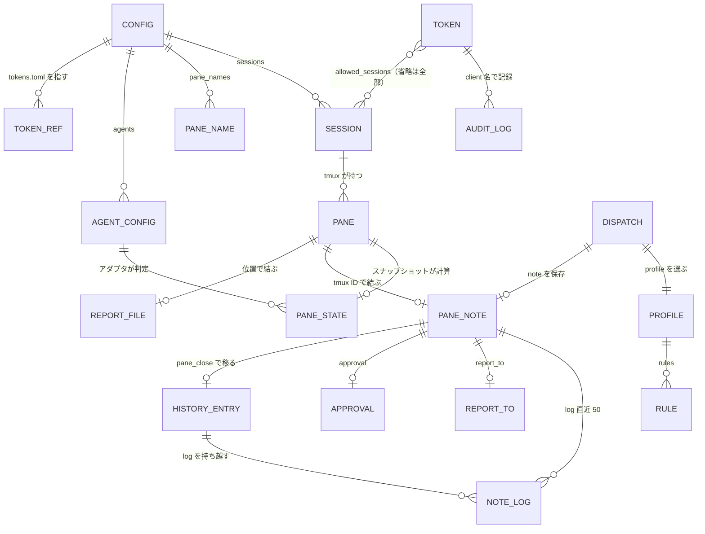
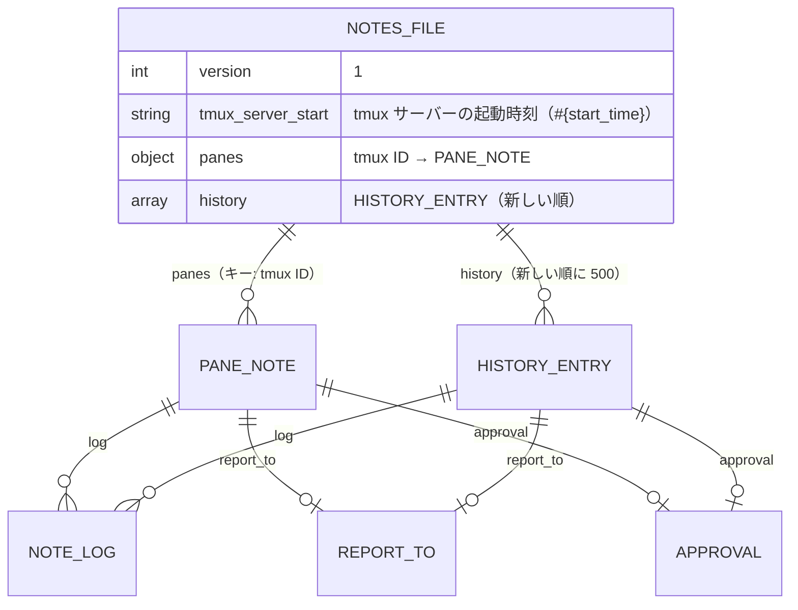
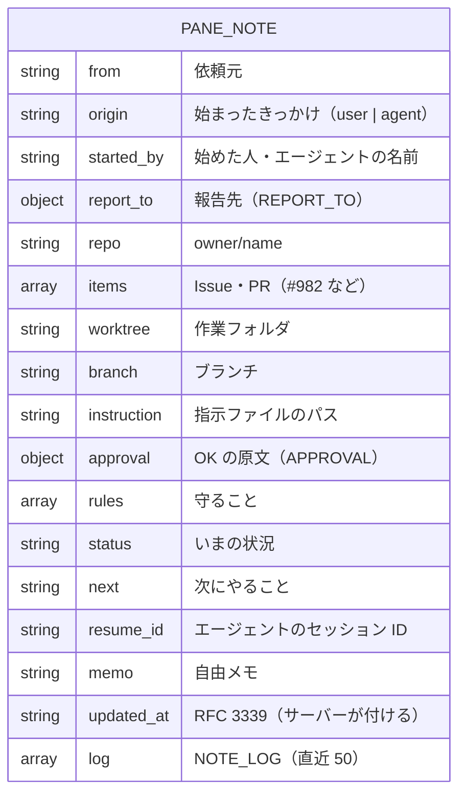
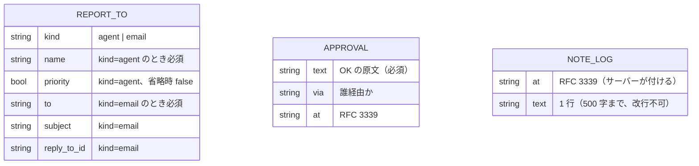
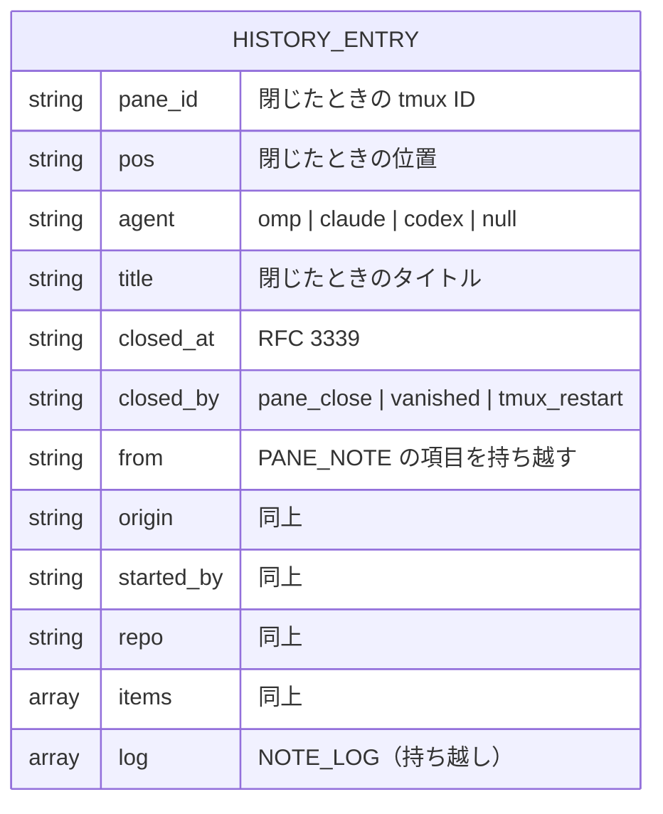

# ER / データモデル

本システムに RDB はない。永続データは次のファイルだけで、実行時の状態はメモリ上に持つ。このドキュメントはそれらのデータモデル（ファイルのスキーマ・関係・制約）を定める。実装時の構造体・バリデーションの根拠になる。

| 区分 | 実体 | 置き場 | 権限 |
|------|------|--------|------|
| 永続（書き込み） | メモと履歴 `notes.json` | `~/.local/share/swarm-console/notes.json` | 600 |
| 永続（書き込み: CLI のみ） | トークン `tokens.toml` | `~/.config/swarm-console/tokens.toml` | 600（違えば起動拒否） |
| 永続（人が編集。`setup` も書く） | 設定 `config.toml` | `~/.config/swarm-console/config.toml` | 644 以下（`setup` が新規に作るときは 600） |
| 永続（人が編集） | 条件のひな形 `profiles.toml` | `~/.config/swarm-console/profiles.toml` | 644 以下 |
| 永続（人が編集、任意） | レポートのテンプレート | `~/.config/swarm-console/templates/report.{ja,en}.md` | — |
| 外部が書く | 最終報告 `<位置>.md` | `/tmp/swarm-console/reports/` | エージェントが書く |
| 永続（書き込み: 自己更新のみ） | 旧バイナリの退避・試運転のマーカー・戻した版の記録 | `~/bin/swarm-console/swarm-console.{old,update-pending,update-failed}`（と一時の `swarm-console.new`） | 600（`.old`・`.new` は 755） |
| 実行時（メモリ） | スナップショット・ペイン状態 | プロセス内 | — |

この文書は 1 ファイル 300 行の上限（Linterly）のため、次のファイルに分けている。節番号は分割前の通し番号のまま、どのファイルでも同じ番号で引く。

- [ER / データモデル（本書）](er.md)：ファイル一覧、§1 全体 ER 図、§2 notes.json
- [ER：tokens.toml・実行時のペイン状態](er-runtime.md)：§3 tokens.toml、§4 実行時のペイン状態（メモリ）
- [ER：config.toml・profiles.toml ほか](er-config.md)：§5 config.toml、§6 profiles.toml、§7 最終報告ファイル、§8 自己更新のファイル

## 1. 全体ER図



- `CONFIG`・`PROFILE`・`AGENT_CONFIG` は人が編集する設定、`TOKEN` は CLI だけが書く、`PANE_NOTE`・`HISTORY_ENTRY`・`NOTE_LOG` は `notes.json`、`PANE`・`SESSION`・`PANE_STATE` は tmux とスナップショット由来の揮発データ。
- メモ（`PANE_NOTE`）のキーは tmux ペイン ID（`%12`）。位置の名前（`B4`）はレイアウトから導く別名なので、キーにしない。

## 2. notes.json

### 2.1 ファイル構造



```json
{
  "version": 1,
  "tmux_server_start": "1761896400",
  "panes": {
    "%12": {
      "from": "agent-b",
      "origin": "agent",
      "started_by": "かな",
      "report_to": {"kind": "agent", "name": "agent-b", "priority": true},
      "repo": "ousiassllc/funid",
      "items": ["#982"],
      "worktree": "/mnt/nvme/ousiassllc/funid-sweep-982",
      "branch": "sweep/issue-sweep-20261031-193532",
      "instruction": "/tmp/b4-funid-982.txt",
      "approval": {"text": "残りの1周のスイープをどんどんしていきたい", "via": "agent-b", "at": "2026-10-31T19:35:00+09:00"},
      "rules": ["マージしない", "dependabot PR に触らない"],
      "status": "CI 待ち",
      "next": "完了したら #983 を入れる",
      "resume_id": null,
      "memo": null,
      "updated_at": "2026-10-31T21:50:12+09:00",
      "log": [
        {"at": "2026-10-31T19:36:00+09:00", "text": "dispatch した"}
      ]
    }
  },
  "history": [
    {
      "pane_id": "%4",
      "pos": "B1",
      "agent": "omp",
      "title": "agent: funid #981",
      "closed_at": "2026-10-31T18:40:00+09:00",
      "closed_by": "pane_close",
      "from": "agent-a",
      "repo": "ousiassllc/funid",
      "items": ["#981"],
      "status": "PR 作成済み",
      "log": []
    }
  ]
}
```

### 2.2 PANE_NOTE（`panes[<tmux ID>]`）



| キー | 型 | 必須 | 上限 | 説明 |
|------|-----|------|------|------|
| `from` | string | 任意 | 2000 字 | 依頼元（例：`agent-b`、`agent-a`、`オーナー`） |
| `origin` | string | 任意 | `user`・`agent` | 始まったきっかけ。`user`＝オーナーの指示、`agent`＝エージェントが自分の判断で始めた。どちらでもなければ空のまま（`null` と空文字は消す）。ほかの値は `invalid_args`。`from`（依頼元）とは別の項目で、`from` には混ぜない |
| `started_by` | string | 任意 | 2000 字 | 始めた人・エージェントの名前（例：`かな`）。自由な文字列 |
| `report_to` | object | 任意 | — | 報告先（§2.3） |
| `repo` | string | 任意 | 2000 字 | リポジトリ（`ousiassllc/funid`） |
| `items` | string[] | 任意 | 50 件・各 2000 字 | Issue・PR（`["#982"]`） |
| `worktree` | string | 任意 | 2000 字 | 作業フォルダ |
| `branch` | string | 任意 | 2000 字 | ブランチ名 |
| `instruction` | string | 任意 | 2000 字 | 指示ファイルのパス |
| `approval` | object | 任意 | — | OK の原文（§2.3） |
| `rules` | string[] | 任意 | 50 件・各 2000 字 | 守ること |
| `status` | string | 任意 | 2000 字 | いまの状況（`CI 待ち`） |
| `next` | string | 任意 | 2000 字 | 次にやること |
| `resume_id` | string | 任意 | 2000 字 | 再開 ID（エージェントのセッション ID） |
| `memo` | string | 任意 | 4000 字 | 自由メモ |
| `updated_at` | string | サーバー | — | RFC 3339。`note_set`・`note_log` の書き込みで更新。クライアントは書けない |
| `log` | NOTE_LOG[] | サーバー | 50 行 | `note_log` と `send_escape` の自動記録 |

- キーの値が `null`／未設定は「空」。`note_set` で `null` を渡すと、その項目を消す（JSON から落とす）。
- `from`・`origin`・`started_by`・`repo`・`items`・`next` が `panes_status`・`report` に要約として出る。

### 2.3 REPORT_TO・APPROVAL・NOTE_LOG



| 実体 | 検証 |
|------|------|
| `REPORT_TO` | `kind` は `agent` か `email`。`agent` は `name` 必須。`email` は `to` 必須（`@` を含む）。それ以外のキーは拒否 |
| `APPROVAL` | `text` 必須（2000 字まで）。`at` は RFC 3339 として解釈できること |
| `NOTE_LOG` | `text` は改行を含まない 1 行、500 字まで。50 行を超えたら古いものから落とす |

### 2.4 HISTORY_ENTRY（`history[]`）と制約・上限



`HISTORY_ENTRY` は `PANE_NOTE` の全項目（`updated_at` を含む）に、上表の閉じたときの情報を足したもの。

| 制約 | 内容 |
|------|------|
| 履歴の上限 | 500 件。超えたら古いものから落とす（新しい順に並べて末尾を切る） |
| 現行メモのキー | tmux ペイン ID（`%` ＋ 数字）。`panes` に存在するのは、スナップショットに現存するペインのメモだけ |
| 書き込み方式 | 同一ディレクトリの一時ファイルに書く → `fsync` → `rename`。ファイル権限 600、ディレクトリ 700。プロセス内の排他ロックで直列化 |
| 壊れたファイル | 読み込めなければ `notes.json.corrupt-<時刻>` に退避し、空で開始して警告ログ |
| 秘密の拒否 | 文字列項目（キー名を除く全ての値、`log.text` も）が P-14 のパターンに当たれば書き込み全体を拒否（`secret_detected`、値は出さない）。部分的に書かない |
| 型の検証 | 未知のキー・型違いは `invalid_args`。`updated_at`・`log` はクライアントから書けない |
| ペインの消滅 | スナップショットで 2 回連続で存在しないペインのメモは `closed_by: "vanished"` で履歴へ移す。`tmux_server_start` が変わっていたら、現行メモを全部 `closed_by: "tmux_restart"` で履歴へ移す（ID の再利用による取り違え防止） |
| 履歴の検索 | `note_history` は線形検索（500 件）。`repo` は完全一致、`from` は完全一致、`origin` は完全一致、`started_by` は完全一致、`items` は指定要素をすべて含むもの。指定したものは AND で絞る。インデックスは持たない |

## 改訂履歴

| 版 | 日付 | 変更内容 | 変更理由 |
|----|------|---------|---------|
| 1.0 | 2026-10-31 | 新規作成 | 初版 |
| 1.1 | 2026-11-01 | §5.1 `setup` による書き戻し、`config.toml` の区分を更新 | Issue #5 |
| 1.2 | 2026-11-01 | `config.toml` に `update_check`・`update_check_interval` を追加 | Issue #7 |
| 1.3 | 2026-11-01 | `config.toml` に `update_auto` を追加。§8 自己更新のファイル（`.old`・`.update-pending`・`.update-failed`）を追加 | Issue #7（自己更新で確定） |
| 1.4 | 2026-11-01 | 300 行超過ファイルを分割（§3〜§8 を er-runtime.md・er-config.md へ移動）。内容の変更なし | Issue #3 |
| 1.5 | 2026-11-01 | `config.toml` に `usage_check`・`usage_interval` を追加。実行時の状態（`Snapshot`・`HOST_STATE`）にレポートに足す値を追加 | Issue #21〜#25 |
| 1.6 | 2026-11-02 | §5 config.toml：検証表に `config` が実際に拒否する値（`sessions` の名前・`tmux_socket`・`title_prefix`・期間の下限・`allowed_roots` の空配列・`listen_addr` のゾーンとポート・`agents.<name>` の検証）を追加し、`AGENT_CONFIG` に `status_line_re`・`border_re` を追加。実装は変えない | Issue #45 |
| 1.7 | 2026-11-02 | §7 最終報告の存在判定を、シンボリックリンクを辿らず「無し」とする（P-30 と揃える） | Issue #55 |
| 1.8 | 2026-11-02 | §5 config.toml の検証表：`default_lang`・`report_dir` の行を追加、`pane_names` にキーの形（`<セッション>:<ウィンドウ>.<ペイン番号>`・`sessions` に含まれる）を追加し、`%` 始まりは名前の規則（英字始まり）の帰結と直した。`~` は `~` 単体か `~/…`（`~user` 形式は不可）と直した。実装は変えない | Issue #62 |
| 1.9 | 2026-11-02 | §7 最終報告ファイル：パスとアーカイブ名の `<位置>` は `:`・`/`・`\` を `_` にする（実装の `reportBase` と同じ）と直し、例 `a/b:T1` → `a_b_T1.md` を足した。実装は変えない | Issue #74・#75（Issue #69 の仕様書側の追記） |
| 1.10 | 2026-11-02 | §5 config.toml の検証表：`agents.<name>` の `auth_file` は空文字不可（設定エラー）と追記した。実装は変えない | Issue #76 |
| 1.11 | 2026-11-02 | §5 config.toml の検証表：`listen_addr` は tailnet の IP ならポート 48120 だけ、ループバックはどのポートでも可と直した（`CheckListenAddr` のポート検査。P-73） | Issue #72 |
| 1.12 | 2026-11-02 | §3 tokens.toml に `allowed_sessions`（触れる tmux セッション。省略は `sessions` 全部）と検証・起動時の突き合わせを追加、§4 の `pos`（全体の位置とセッション内の位置）とセッションでの絞り込みを追記、§5 `sessions` に許可との関係と `default_session` は許可に使わない旨を追記、§7 最終報告ファイル名は全体の位置から付く（別セッションと衝突しない）と明記。全体 ER 図に `TOKEN`–`SESSION` を追加（FR-SESS） | セッション分割運用（許可セッションの分離） |
| 1.13 | 2026-11-03 | §2.2 PANE_NOTE に `origin`（`user` \| `agent`。ほかの値は `invalid_args`）と `started_by`（自由な文字列）を追加、要約に出す項目を増やし、§2.4 履歴の検索に `origin`・`started_by`（完全一致）を追記。既存のメモは移行しない（新しい項目は空のまま） | Issue #80 |
| 1.14 | 2026-11-03 | §5 config.toml に `file_get_roots`（既定は空）・`file_get_max_bytes`（既定 20 MiB、1〜100 MiB）を追加し、`denied_paths` は `file_get` の `path` にも効くと追記（P-91）。`setup` が触らない手書き専用のキーにも加えた。既存の config はそのまま動く | Issue #82 |
| 1.15 | 2026-11-04 | §5 config.toml（er-config.md）：`file_get_roots` の説明に、ペインの `cwd` が `/` やホームそのものなら `cwd` は許可に入れず、明示した根はそのまま許可と追記（P-91）。既存の config はそのまま動く | Issue #82 |
