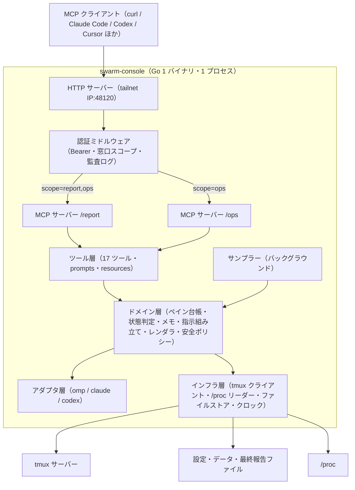
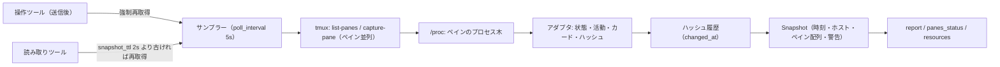
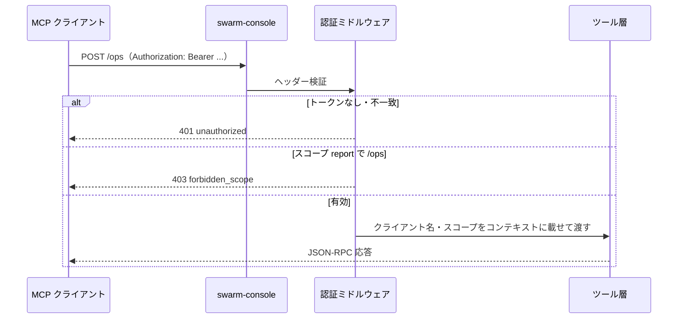
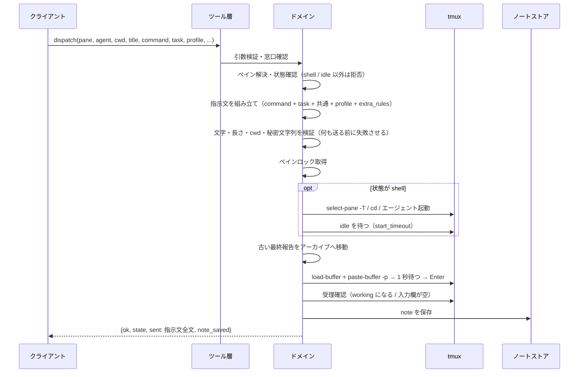
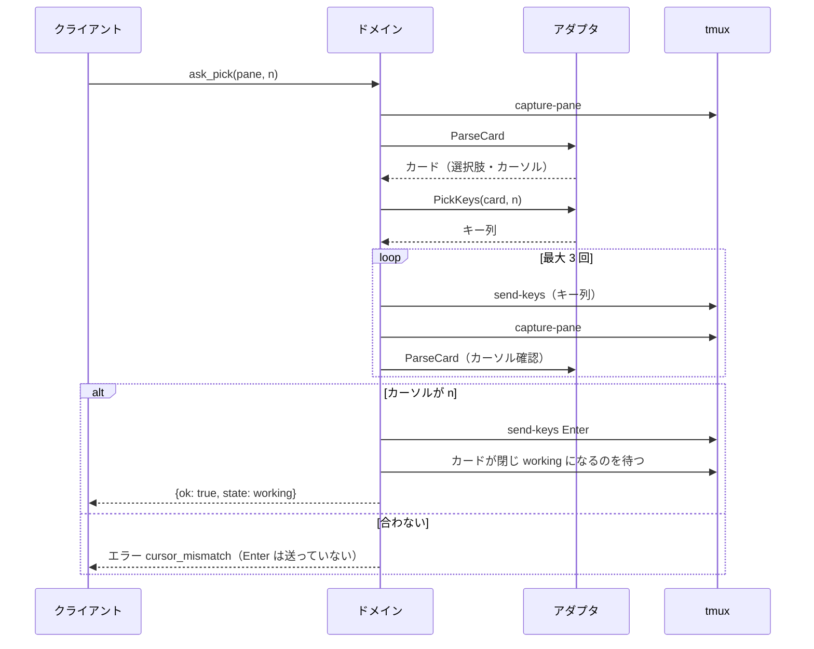
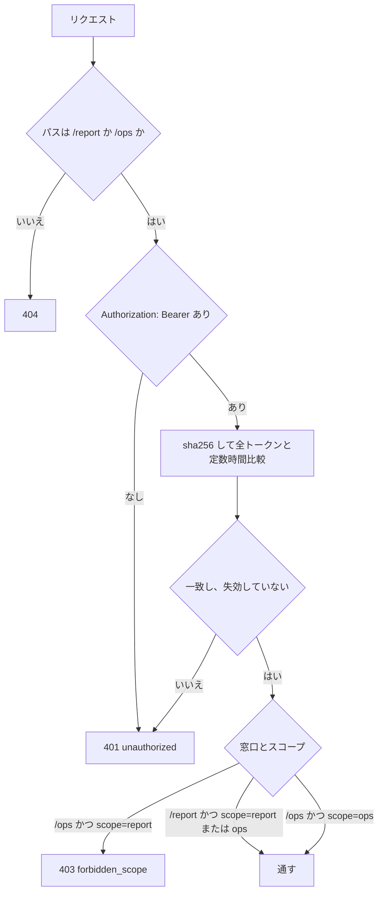

# アーキテクチャ設計

要件は [機能要件](../requirements/functional.md)・[非機能要件](../requirements/non-functional.md)、データ構造は [ER / データモデル](er.md)、ツールの入出力は [API 仕様](../api/endpoints.md)、パッケージ構成は [コンポーネント設計](../components/overview.md) を参照する。

この文書は 1 ファイル 300 行の上限（Linterly）のため、次のファイルに分けている。節番号は分割前の通し番号のまま、どのファイルでも同じ番号で引く。

- [アーキテクチャ設計（本書）](overview.md)：§1 全体構成、§2 技術選定、§3 レイヤー構造、§4 スナップショット方式、§5 通信フロー、§6 認証と窓口
- [アーキテクチャ：デプロイ構成・設定ファイル](deployment.md)：§7 デプロイ構成、§8 設定ファイルの全体像
- [アーキテクチャ：提案した既定値](decisions.md)：§9 提案した既定値と実装時確認事項（P-xx）

## 1. 全体構成

- 1 プロセスに 2 つの MCP サーバー（`/report`・`/ops`）を持つ。両者はツール定義の一部を共有し、`/report` には見るツールだけを登録する（`tools/list` に出さない）。
- ツール層は薄く、引数の検証・窓口に応じた権限・エラー整形だけを行う。ロジックはドメイン層に置く。
- アダプタ層が画面の読み方（状態・カード・飾り）を、インフラ層が tmux・`/proc`・ファイルの出入りを閉じ込める。ドメイン層はどちらにも直接触らない（インターフェース越し）。

## 2. 技術選定

| 項目 | 選定 | 理由 |
|------|------|------|
| 言語 | Go（1 バイナリ） | 元仕様。配布が単純で、systemd 常駐に向く |
| MCP | 公式 Go SDK（`github.com/modelcontextprotocol/go-sdk`） | 元仕様。Streamable HTTP・prompts・resources に対応 |
| HTTP | 標準 `net/http` | 窓口 2 つと認証だけで済む |
| tmux 操作 | `tmux` コマンド（`os/exec`、引数配列）。専用ソケットを `tmux_socket` で指定可 | 元仕様。`capture-pane`・`send-keys`・`load-buffer`・`paste-buffer`・`select-pane -T`・`display -p` |
| 設定・ひな形 | TOML（`github.com/pelletier/go-toml/v2`） | 人が編集する設定・トークン・プロファイル。コメントが書ける |
| メモ | JSON 1 ファイル（`encoding/json`） | 元仕様。500 件までで十分小さい |
| テンプレート | `text/template`（`go:embed` で既定を同梱） | レポート・指示文を言語ごとに差し替えるため |
| ログ | `log/slog`（JSON Lines） | 標準。journald で見る |
| Lint | `golangci-lint` | 元仕様の CI |
| トークン | 32 バイト乱数（`crypto/rand`）＋ SHA-256 保存 | 高エントロピーなので低速ハッシュは不要 |
| 設定の対話型 | `github.com/charmbracelet/huh`（Bubble Tea 上のフォーム）。端末判定に `golang.org/x/term` | 項目ごとの入力・選択・検証表示が既製で足りる。自前で Bubble Tea のモデルを書くより実装とテストが小さい（P-36） |
| `config.toml` の書き戻し | `go-toml/v2` の `unstable.Parser`（値のバイト範囲）で、変えた値だけを置き換える | `Marshal` は全体を書き直してコメント・並び・書式が消える。手で書いた値を壊さないため（P-34） |
| 版の確認 | 標準の `net/http` ＋ `golang.org/x/mod/semver`（自前で版を解析しない） | GitHub Releases の `/releases/latest` を読んで semver で比較する（P-42）。mam の `updater` と同じ作り |
| 配布・更新 | GitHub Releases（main の CI 成功ごとに自動でリリース。P-48〜P-53）＋ 自己更新（`serve` が新しい版を見つけたら、ダウンロード・`SHA256SUMS` で検証・入れ替え・自分で正常終了して systemd に立ち上げ直させる。起動に失敗したら `.old` から自動で戻す。機能要件 §12.4・P-46・P-54〜P-58） | 運用者の判断（Issue #7）。標準の `net/http`・`os`・`crypto/sha256` だけで足りる |

DB は使わない（ER ドキュメントは永続ファイルのデータモデル）。動作に外部サービスは要らない（新しい版の確認と自己更新だけ GitHub Releases に通信し、失敗しても動く。FR-UPD）。

## 3. レイヤー構造

| レイヤー | 責務 | 主なパッケージ（コンポーネント設計 §2） |
|---------|------|------------------------------------|
| エントリ | CLI（`serve`・`token`・`version`）、設定読み込み、起動時検証 | `cmd/swarm-console` |
| トランスポート | HTTP、窓口ごとのルーティング、認証、リクエスト上限、監査ログ | `internal/server`、`internal/auth` |
| ツール | MCP のツール・prompts・resources の登録、引数検証、エラー整形 | `internal/tools`、`internal/mcpapi` |
| ドメイン | ペイン台帳・位置解決・スナップショット・状態判定・メモ・指示組み立て・レンダリング・安全ポリシー | `internal/pane`、`internal/notes`、`internal/render`、`internal/safety` |
| アダプタ | エージェントごとの画面解釈・キー操作 | `internal/agent`（`omp`・`claude`・`codex`） |
| インフラ | tmux 実行、`/proc`・ホスト情報、ファイル入出力、時計 | `internal/tmux`、`internal/host`、`internal/store`、`internal/clock` |

依存方向は上から下の一方向。ドメインはインフラ・アダプタを小さなインターフェース（`TmuxRunner`・`Adapter`・`Clock`・`FS`）越しに使い、テストでは実 tmux と擬似エージェントに差し替えずに使える。

## 4. スナップショット方式

`report` を「同じペインの状態ならどのクライアントからでも 1 文字も違わない」ようにし、`stalled` 判定を呼び出しの有無によらず動かすため、ペインの状態を **スナップショット** にまとめる（P-05）。

- スナップショットは不変。`Snapshot.At` が `report` の時刻になり、`elapsed`・`changed_ago` も `At` 基準で計算する。呼び出しごとの時刻・クライアント情報は出力に入れない。
- 読み取りツールは、スナップショットが `snapshot_ttl`（既定 2 秒）以内ならそれを返し、古ければ 1 回だけ（singleflight）取り直す。同時に来た複数クライアントは同じスナップショットを受け取る。
- 操作ツールは、送信後の確認のために対象ペインを `accept_timeout` までポーリングし、終わったらスナップショットを取り直す。
- 画面ハッシュは、アダプタが「揮発部分（スピナー・経過時間・トークン数の表示）」を取り除いた本文から計算する。ハッシュが変わった時刻を `changed_at` として覚え、`working` で `now - changed_at ≥ stalled_after` なら `stalled` にする。サーバー起動直後は `changed_at` を起動時刻とし、起動後 `stalled_after` 経つまで `stalled` にしない。
- 並びの差分（追加・削除・位置の変化）は前回のスナップショットと比べて検知し、`layout_changed` 警告を `layout_warning_ttl` の間出す。サーバー起動直後は比較対象がないので警告しない。
- レポートに足す値（使用状況・omp の版・CPU・スワップ・ディスクの使用率・ログイン期限）もスナップショットに入れる。遅い取得（`omp usage --json`・`omp update --check`）は `serve` の別の収集器（`reportvalues`）が決まった間隔で行い、スナップショットはそのときの最後の結果を持つ。収集器が結果を更新しても、作ったスナップショットは変わらない（FR-REP-7・10。取り方は [report-values.md](report-values.md)）。
- ペインが 2 回連続のスナップショットで消えていたら、そのペインのメモを履歴へ移す（`closed_by: "vanished"`）。

## 5. 通信フロー

### 5.1 接続・認証

### 5.2 `dispatch`（空きペインへ指示）

### 5.3 `ask_pick`（質問カードに答える）

## 6. 認証と窓口

- `/report` は `report`・`ops` どちらのトークンでも通る（`ops` は `report` を含む。P-03）。`/ops` は `ops` のみ。
- トークン照合は `tokens.toml` の更新時刻が変わっていたら再読み込みする（失効を再起動なしで効かせる。P-04）。
- 401・403 とも本文は `{"error":{"code":...,"message":...}}` の固定形。ヒントになる情報（トークンが存在するか等）は出さない。
- 通ったリクエストごとに、クライアント名・窓口・ツール・ペイン・結果コード・所要時間を JSON Lines で記録する。

## 改訂履歴

| 版 | 日付 | 変更内容 | 変更理由 |
|----|------|---------|---------|
| 1.0 | 2026-10-31 | 新規作成 | 初版 |
| 1.1 | 2026-11-01 | P-16・P-24 を確定、P-22 を omp で確定（Claude Code は一部推定、Codex は未確定）。agent-patterns.md・agent-auth.md を追加。P-25〜P-31 を追加 | 実装時確認事項の反映（Issue #1） |
| 1.2 | 2026-11-01 | §2 に設定の対話型・書き戻しの選定、P-32〜P-39（`setup`）を追加 | Issue #5 |
| 1.3 | 2026-11-01 | 新しい版の確認の選定と設定キー、P-40〜P-47（P-46 は更新の方式で未決）を追加 | Issue #7 |
| 1.4 | 2026-11-01 | 更新の方式を自己更新で確定（P-40・P-41・P-46 を更新、P-54〜P-58 を追加）。技術選定・デプロイ構成・設定キー（`update_auto`）を自己更新に合わせて改訂 | Issue #7（自己更新で確定） |
| 1.5 | 2026-11-01 | P-20 を更新、P-48〜P-53（自動タグ付きリリース）を追加 | Issue #8 |
| 1.6 | 2026-11-01 | 配布・デプロイの記述を自己更新（Issue #7）に合わせて更新。リリースの成果物名を `swarm-console_vX.Y.Z_linux_amd64` に変更（環境構築 CI/CD） | Issue #8（Issue #7 の自己更新で確定） |
| 1.7 | 2026-11-01 | 300 行超過ファイルを分割（§7〜§9 を deployment.md・decisions.md へ移動。P-31 は除外の廃止に合わせて更新、ほかの内容は変更なし） | Issue #3 |
| 1.8 | 2026-11-01 | §4 スナップショット方式に、レポートに足す値（収集器の最後の結果・CPU・スワップ・ディスク・ログイン期限）を追加。P-60〜P-67 を追加 | Issue #21〜#25 |
