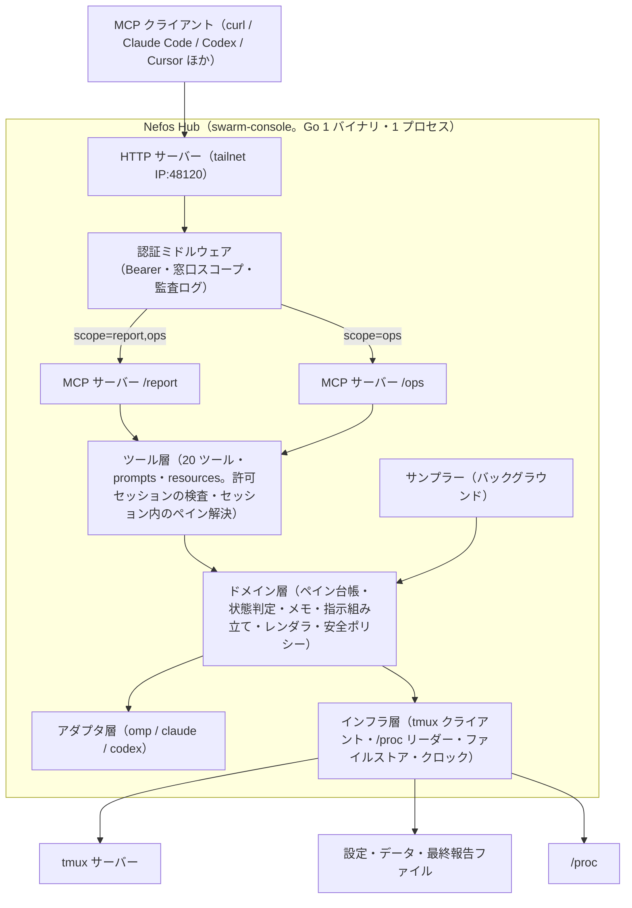
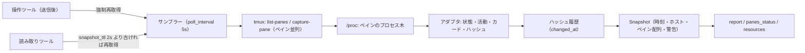
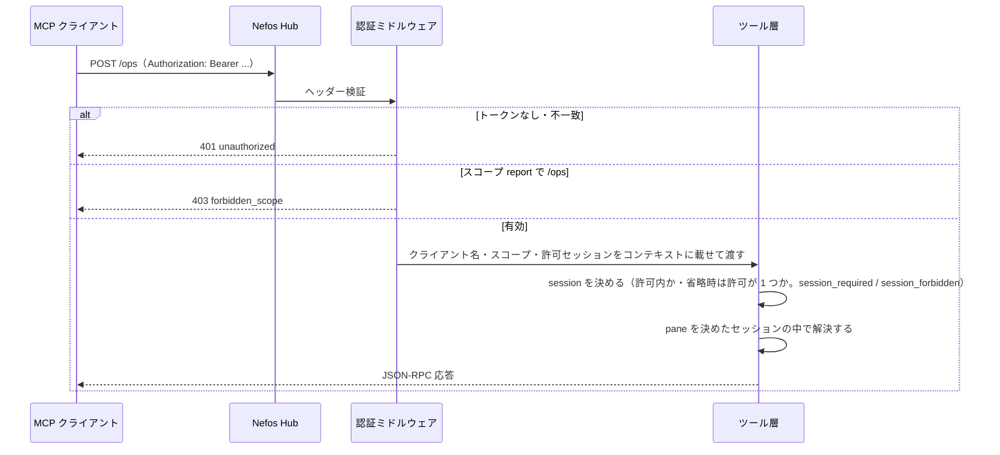
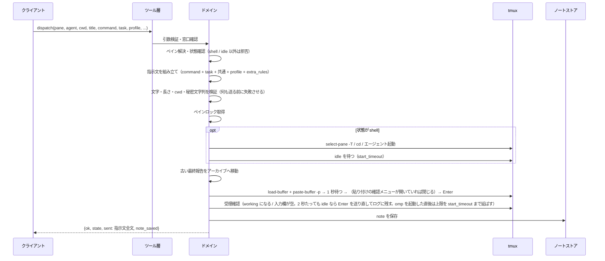
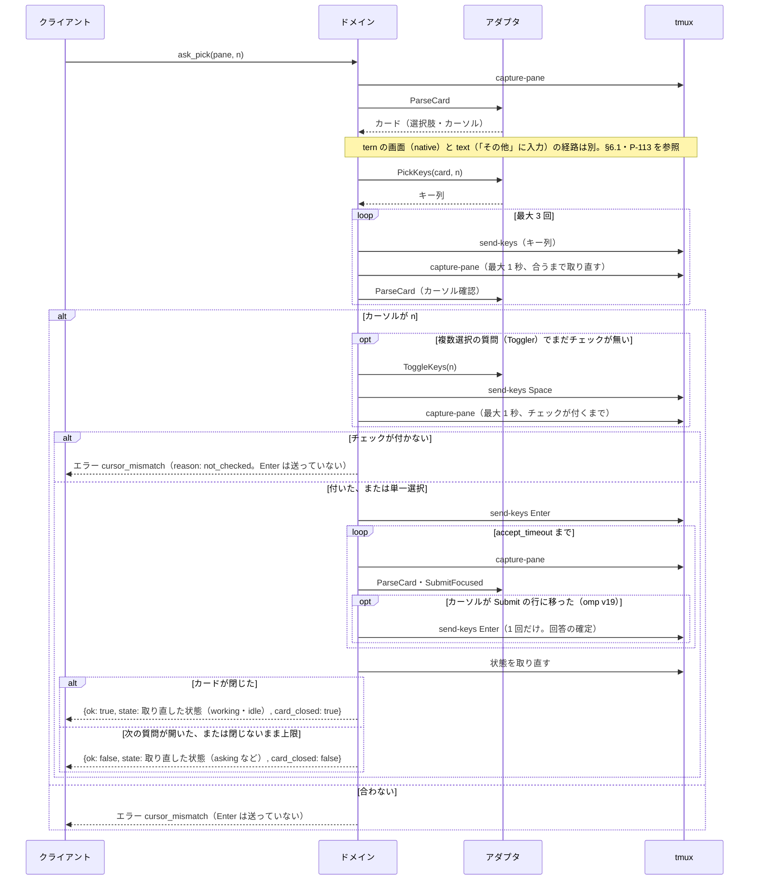
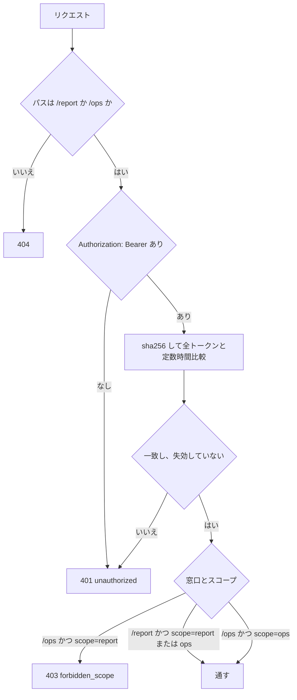

# アーキテクチャ設計

要件は [機能要件](../requirements/functional.md)・[非機能要件](../requirements/non-functional.md)、データ構造は [ER / データモデル](er.md)、ツールの入出力は [API 仕様](../api/endpoints.md)、パッケージ構成は [コンポーネント設計](../components/overview.md) を参照する。

この文書は 1 ファイル 300 行の上限（Linterly）のため、次のファイルに分けている。節番号は分割前の通し番号のまま、どのファイルでも同じ番号で引く。

- [アーキテクチャ設計（本書）](overview.md)：§1 全体構成、§2 技術選定、§3 レイヤー構造、§4 スナップショット方式、§5 通信フロー、§6 認証と窓口
- [アーキテクチャ：デプロイ構成・設定ファイル](deployment.md)：§7 デプロイ構成、§8 設定ファイルの全体像
- [アーキテクチャ：提案した既定値](decisions.md)：§9 提案した既定値と実装時確認事項（P-xx）

## 1. 全体構成

- 1 プロセスに 2 つの MCP サーバー（`/report`・`/ops`）を持つ。両者はツール定義の一部を共有し、`/report` には見るツールだけを登録する（`tools/list` に出さない）。
- ツール層は薄く、引数の検証・窓口に応じた権限・許可セッションの検査・エラー整形だけを行う。ロジックはドメイン層に置く。
- アダプタ層が画面の読み方（状態・カード・飾り）を、インフラ層が tmux・`/proc`・ファイルの出入りを閉じ込める。ドメイン層はどちらにも直接触らない（インターフェース越し）。

## 2. 技術選定

| 項目 | 選定 | 理由 |
|------|------|------|
| 言語 | Go（1 バイナリ） | 元仕様。配布が単純で、systemd 常駐に向く |
| MCP | 公式 Go SDK（`github.com/modelcontextprotocol/go-sdk`） | 元仕様。Streamable HTTP・prompts・resources に対応 |
| HTTP | 標準 `net/http` | 窓口 2 つと認証だけで済む |
| tmux 操作 | `tmux` コマンド（`os/exec`、引数配列）。専用ソケットを `tmux_socket` で指定可 | 元仕様。`capture-pane`・`send-keys`・`load-buffer`・`paste-buffer`・`delete-buffer`（自分が作った一意名のバッファの後始末だけ）・`select-pane -T`・`display -p` |
| 設定・ひな形 | TOML（`github.com/pelletier/go-toml/v2`） | 人が編集する設定・トークン・プロファイル。コメントが書ける |
| メモ | JSON 1 ファイル（`encoding/json`） | 元仕様。500 件までで十分小さい |
| テンプレート | `text/template`（`go:embed` で既定を同梱） | レポートを言語ごとに差し替えるため（指示文はテンプレートではなく `profiles.toml` の条件から組み立てる） |
| ログ | `log/slog`（JSON Lines） | 標準。journald で見る |
| Lint | `golangci-lint` | 元仕様の CI |
| トークン | 32 バイト乱数（`crypto/rand`）＋ SHA-256 保存 | 高エントロピーなので低速ハッシュは不要 |
| 設定の対話型 | `github.com/charmbracelet/huh`（Bubble Tea 上のフォーム）。端末判定に `golang.org/x/term` | 項目ごとの入力・選択・検証表示が既製で足りる。自前で Bubble Tea のモデルを書くより実装とテストが小さい（P-36） |
| `config.toml` の書き戻し | `go-toml/v2` の `unstable.Parser`（値のバイト範囲）で、変えた値だけを置き換える | `Marshal` は全体を書き直してコメント・並び・書式が消える。手で書いた値を壊さないため（P-34） |
| 版の確認 | 標準の `net/http` ＋ `golang.org/x/mod/semver`（自前で版を解析しない） | GitHub Releases の `/releases/latest` を読んで semver で比較する（P-42）。mam の `updater` と同じ作り |
| 配布・更新 | GitHub Releases（main の CI 成功ごとに自動でリリース。P-48〜P-53）＋ 自己更新（`serve` が新しい版を見つけたら、ダウンロード・`SHA256SUMS` で検証・入れ替え・自分で正常終了して systemd に立ち上げ直させる。起動に失敗したら `.old` から自動で戻す。機能要件 §12.4・P-46・P-54〜P-58） | 運用者の判断（Issue #7）。標準の `net/http`・`os`・`crypto/sha256` だけで足りる |

DB は使わない（ER ドキュメントは永続ファイルのデータモデル）。動作に外部サービスは要らない（新しい版の確認と自己更新だけ GitHub Releases に通信し、失敗しても動く。FR-UPD）。利用者が `[webhook] url` を書いたときだけ、その URL へも POST する（既定はオフ。tailnet の外へ出る。FR-STATE-1〜7・NFR-SEC-18）。

## 3. レイヤー構造

| レイヤー | 責務 | 主なパッケージ（コンポーネント設計 §2） |
|---------|------|------------------------------------|
| エントリ | CLI（`serve`・`setup`・`token`・`pair`・`version`）、設定読み込み、起動時検証 | `cmd/swarm-console` |
| トランスポート | HTTP、窓口ごとのルーティング、認証、リクエスト上限、監査ログ | `internal/server`、`internal/auth` |
| ツール | MCP のツール・prompts・resources の登録、引数検証、エラー整形 | `internal/tools`（`toolkit`・`view`・`ops`）、`internal/mcpapi` |
| ドメイン | ペイン台帳・位置解決・スナップショット・状態判定・メモ・指示組み立て・レンダリング・安全ポリシー | `internal/pane`、`internal/notes`、`internal/render`、`internal/safety` |
| アダプタ | エージェントごとの画面解釈・キー操作 | `internal/agent`（`omp`・`claude`・`codex`） |
| インフラ | tmux 実行、`/proc`・ホスト情報、ファイル入出力、時計 | `internal/tmux`、`internal/host`、`internal/store`、`internal/clock` |

依存方向は上から下の一方向。ドメインはインフラ・アダプタを小さなインターフェース（`pane.Tmux`（実装は `tmux.Client`）・`agent.Adapter`・`clock.Clock`・`pane.ReportFS`）越しに使い、テストでは実 tmux と擬似エージェントに差し替えずに使える。

## 4. スナップショット方式

`report` を「同じペインの状態ならどのクライアントからでも 1 文字も違わない」ようにし、`stalled` 判定を呼び出しの有無によらず動かすため、ペインの状態を **スナップショット** にまとめる（P-05）。

- スナップショットは不変。`Snapshot.At` が `report` の時刻になり、`elapsed`・`changed_ago` も `At` 基準で計算する。呼び出しごとの時刻・クライアント情報は出力に入れない。
- 読み取りツールは、スナップショットが `snapshot_ttl`（既定 2 秒）以内ならそれを返し、古ければ 1 回だけ（singleflight）取り直す。同時に来た複数クライアントは同じスナップショットを受け取る。
- 操作ツールは、送信後の確認のために対象ペインを `accept_timeout` までポーリングし、終わったらスナップショットを取り直す。
- 画面ハッシュは、アダプタが「揮発部分（スピナー・経過時間・トークン数の表示）」を取り除いた本文から計算する。ハッシュが変わった時刻を `changed_at` として覚え、`working` で `now - changed_at ≥ stalled_after` なら `stalled` にする。サーバー起動直後は `changed_at` を起動時刻とし、起動後 `stalled_after` 経つまで `stalled` にしない。
- 並びの差分（追加・削除・位置の変化）は前回のスナップショットと比べて、セッションごとに検知し、`layout_changed` 警告を `layout_warning_ttl` の間出す（セッションに絞った応答にはそのセッションの警告だけ。FR-SESS-8）。サーバー起動直後は比較対象がないので警告しない。
- レポートに足す値（使用状況・omp の版・メモリ・CPU・スワップ・ディスクの使用率・ログイン期限）もスナップショットに入れる。遅い取得（`omp usage --json`・`omp update --check`）は `serve` の別の収集器（`reportvalues`）が決まった間隔で行い、スナップショットはそのときの最後の結果を持つ。収集器が結果を更新しても、作ったスナップショットは変わらない（FR-REP-7・10。取り方は [report-values.md](report-values.md)）。
- ペインが 2 回連続のスナップショットで消えていたら、そのペインのメモを履歴へ移す（`closed_by: "vanished"`）。

## 5. 通信フロー

### 5.1 接続・認証

### 5.2 `dispatch`（空きペインへ指示）

### 5.3 `ask_pick`（質問カードに答える）

- 質問が複数のフォームは、選んだ Enter のあとに次の質問が開くので `ok: false`・`card_closed: false` で返る（選んだ分は済んでいる）。次の質問は `ask_card` で読み直して選ぶ。
- `state` は固定ではなく、待ちのあとに取り直した値。
- `text`（「その他」に文字を入れる）は、カーソルを「その他」に合わせたあと入力欄へ貼り付けて Enter を送る。tern の画面（`native`）は画面にカーソルもチェックも見えないので、質問が 1 つのフォームの番号指定だけ、確かめずにキー列（Up/Down・Space・Enter・Submit の Enter）を送る（`text` と複数の質問は `custom_not_allowed`・`cursor_mismatch`）。手順の詳細は [機能要件（質問カード）](../requirements/functional-report.md) §6.1、限界は decisions.md P-113。

## 6. 認証と窓口

- `/report` は `report`・`ops` どちらのトークンでも通る（`ops` は `report` を含む。P-03）。`/ops` は `ops` のみ。
- トークン照合は `tokens.toml` の更新時刻が変わっていたら再読み込みする（失効を再起動なしで効かせる。P-04）。
- 401・403 とも本文は `{"error":{"code":...,"message":...}}` の固定形。ヒントになる情報（トークンが存在するか等）は出さない。
- 許可セッション（`tokens.toml` の `allowed_sessions`。無ければ `sessions` 全部）は認証の一部としてクライアントに載り、ツール層が `session` を取るツールごとに検査する（認証の 401・403 とは別の、ツールの `isError` の `session_required`・`session_forbidden`。API 仕様 §4.1）。`serve` の起動時は `tokens.toml` の許可セッションを `config.toml` の `sessions` と突き合わせ、含まれない名前があれば起動拒否する（P-76）。
- 通ったリクエストごとに、クライアント名・窓口・ツール・ペイン・`session` 引数（任意）・結果コード・所要時間を JSON Lines で記録する（トークン・本文は記録しない。P-88）。`file_get` だけは取得先のパスとサイズも記録する（ファイルの中身は記録しない。P-91）。

## 改訂履歴

| 版 | 日付 | 変更内容 | 変更理由 |
|----|------|---------|---------|
| 1.0 | 2026-10-31 | 新規作成 | 初版 |
| 1.1 | 2026-11-01 | P-16・P-24 を確定、P-22 を omp で確定（Claude Code は一部推定、Codex は未確定）。agent-patterns.md・agent-auth.md を追加。P-25〜P-31 を追加 | 実装時確認事項の反映（Issue #1） |
| 1.2 | 2026-11-01 | §2 に設定の対話型・書き戻しの選定、P-32〜P-39（`setup`）を追加 | Issue #5 |
| 1.3 | 2026-11-01 | 新しい版の確認の選定と設定キー、P-40〜P-47（P-46 は更新の方式で未決）を追加 | Issue #7 |
| 1.4 | 2026-11-01 | 更新の方式を自己更新で確定（P-40・P-41・P-46 を更新、P-54〜P-58 を追加）。技術選定・デプロイ構成・設定キー（`update_auto`）を自己更新に合わせて改訂 | Issue #7（自己更新で確定） |
| 1.5 | 2026-11-01 | P-20 を更新、P-48〜P-53（自動タグ付きリリース）を追加 | Issue #8 |
| 1.6 | 2026-11-01 | 配布・デプロイの記述を自己更新（Issue #7）に合わせて更新。リリースの成果物名を `swarm-console_vX.Y.Z_linux_amd64` に変更（環境構築 CI/CD） | Issue #8（Issue #7 の自己更新で確定） |
| 1.7 | 2026-11-01 | 300 行超過ファイルを分割（§7〜§9 を deployment.md・decisions.md へ移動。P-31 は除外の廃止に合わせて更新、ほかの内容は変更なし） | Issue #3 |
| 1.8 | 2026-11-01 | §4 スナップショット方式に、レポートに足す値（収集器の最後の結果・CPU・スワップ・ディスク・ログイン期限）を追加。P-60〜P-67 を追加 | Issue #21〜#25 |
| 1.9 | 2026-11-01 | §7 デプロイ構成に最初の導入（`make install`）を追加 | Issue #18 |
| 1.10 | 2026-11-02 | §4：`host_status.update` もスナップショットの値として返す（FR-UPD-9）。P-64 を実機の出力で確定、P-65 を確定し、P-68・P-69 を追加 | Issue #21〜#25（実装時の確認） |
| 1.11 | 2026-11-02 | P-70 を追加（`pane_close` が終了コマンドのあと `shell` に戻るまで待ち、上限で `exit_timeout`） | Issue #30 |
| 1.12 | 2026-11-02 | agent-patterns.md：omp の `/exit` を実機（omp v18.15.0）で確認した内容に更新（Issue #53）。`command`・`exit_command` の空文字は設定エラーと明記（Issue #45）。コード・設定は変えない | Issue #45・#53 |
| 1.13 | 2026-11-02 | §2 のテンプレートの理由を実装どおりに直した（言語ごとに差し替えるのはレポートだけ。指示文は `profiles.toml` の条件から組み立てる） | Issue #42 |
| 1.14 | 2026-11-02 | §3 の依存の文を実装の名前（`pane.Tmux`・`agent.Adapter`・`clock.Clock`・`pane.ReportFS`）に合わせ、実装にない tmux のインターフェース名を除いた。エントリ層の CLI に `setup` を追加（コード・設定は変えない） | Issue #60 |
| 1.15 | 2026-11-02 | agent-auth.md：ログイン期限の判定を入れるのは `report` だけで、`host_status` には入れない（`agent_auth_status` が同じ判定を返す）と直した。コード・設定は変えない | Issue #61 |
| 1.16 | 2026-11-02 | decisions.md：P-30 に、最終報告の有無の判定（`report_exists`・1 ペインの詳しい版の最終報告欄・アーカイブ先の重複判定）もシンボリックリンクを辿らない（`lstat`）と追記。er-config.md §7 も同じ（er.md 1.7）。コード・設定は変えない | Issue #55 |
| 1.17 | 2026-11-02 | decisions.md：P-11 の最終報告ファイル名の規則を、位置の `:` だけでなく `/`・`\` も `_` にする（実装の `reportBase` と同じ。アーカイブ名も同じ）と直し、例 `a/b:T1` → `a_b_T1.md` を足した。er-config.md §7 も同じ（er.md 1.9）。コード・設定は変えない | Issue #74・#75（Issue #69 の仕様書側の追記） |
| 1.18 | 2026-11-02 | agent-patterns.md：`[agents.<name>]` の空文字は `command`・`exit_command` に加えて `auth_file` も設定エラー（起動拒否）と直した（ほかのキーの空文字・空配列は「上書きしない」）。er-config.md §5 の `agents.<name>` 行も同じ（er.md 1.10）。コード・設定は変えない | Issue #76 |
| 1.19 | 2026-11-02 | §tmux の許可サブコマンドに `delete-buffer` を追加（`Paste` の失敗時・中断時の後始末だけ）。decisions.md に P-71〜P-75 を追加（Issue #57・#70・#72・#71・#40 の方針） | Issue #57・#70・#72・#71・#40 |
| 1.20 | 2026-11-02 | §1・§4・§5.1・§6：ツール層が許可セッションを検査し `pane` を決めたセッションの中で解決する（認証後・ツールの中）、並びの変化の検知をセッションごとに。ツール数 17→18。deployment.md §8 の `sessions`・`default_session` の説明。decisions.md に P-76〜P-90（セッションごとの許可・`session` の省略規則・`sessions_list`・セッション内の位置・resources・dispatch prompt の `session`・監査ログ・既知の限界）を追加し、P-27 を改訂 | セッション分割運用（許可セッションの分離） |
| 1.21 | 2026-11-03 | §1：ツール数 18→19（`file_get`）。§6：監査ログに `file_get` のパス・サイズ。decisions.md に P-91（`file_get` の許可リスト・秘密・上限）を追加。deployment.md §8 に `file_get_roots`・`file_get_max_bytes` | Issue #82 |
| 1.22 | 2026-11-04 | decisions.md P-91：ペインの `cwd` が `/` やホームそのもの（実パス）のときは許可リストに入れず、明示した `file_get_roots`・`report_dir` はそのまま許可と追記。deployment.md §8 の `file_get_roots` の説明も同じ | Issue #82 |
| 1.23 | 2026-11-04 | §3：ツール層のパッケージを `internal/tools`（`toolkit`・`view`・`ops`）に更新（Linterly のディレクトリ上限のための分割。振る舞いは変えない） | Issue #82（PR #84） |
| 1.24 | 2026-11-04 | decisions.md P-91：宛先が存在しないリンク・循環は外のパスと区別しない、先頭 12 バイトを先に読む、同時実行は制限しない、`/proc/self/fd` が必須（読めなければ `internal`）を追記 | Issue #82（PR #84 の独立レビューの指摘） |
| 1.25 | 2026-11-05 | decisions.md P-93（`report`・`host_status` のメモリ `mem`）・P-94（使用状況のアカウントごとの `reason`）を追加。report-values.md §2.1・§2.2・§3・§7 を改訂 | Issue #86・#87 |
| 1.26 | 2026-11-05 | decisions.md P-95（`/proc/meminfo` を読めなくても `host` を捨てず、メモリだけ取得できずにする。P-93 の「変えない」を改めた）・P-96（`accountsWithoutUsage` に理由のキーがなく、`reason` は 2 値のまま）を追加。report-values.md §2.1・§2.2・§3 を改訂 | Issue #86・#87 |
| 1.27 | 2026-11-05 | decisions.md P-95：メモリのエラーは `host.Status.MemErr` で返し、`internal/pane/build.go` が警告ログに残す（「記録しない」から改める）。`mem_free_gb`・`mem_total_gb` が 0 になることと、読み手は `mem.available` を見ることを明記。report-values.md §3 を改訂 | Issue #86 |
| 1.28 | 2026-11-05 | decisions.md P-97（実機の `accountsWithoutUsage[]` はメールがトップレベルの `email` にある。読む位置だけを直し、無ければ `metadata.email`。名前の作り方は変えず、実機の出力ではこれまで空だった入力が入るため、名前と `reports` との重複の除去が変わる）を追加。report-values.md §2.1・§2.2・§7 を改訂 | Issue #87 |
| 1.29 | 2026-11-08 | §1：ツール数 19→20（`dir_list`）。decisions.md P-98（`dir_list` の判定を `file_get`・`pane_start` と共通にする。`pair --scope ops`。P-92 の「`ops` は出さない」を改めた）を追加 | Issue #90 |
| 1.30 | 2026-11-09 | decisions.md P-99（`pair --qr`。QR は標準エラー・PNG は書かない・発行前に QR にできるか確かめる）、P-41（確認の既定間隔を 24 時間→6 時間）の注記 | Issue #89・#79 |
| 1.31 | 2026-11-09 | decisions.md P-22：Codex を実画面（codex-cli 0.167.0）で確定（Claude Code の作業中・許可確認・質問は、ログイン切れのため推定のまま）。agent-patterns.md の codex 列・判定規則・採取手順を実画面に合わせて改訂（`status_line_re`・承認カードの質問文・折り返した選択肢・数字キーは押した時点で確定するので `PickKeys` は Up/Down を優先） | Issue #4 |
| 1.32 | 2026-11-16 | シーケンス図（dispatch）：貼り付けの 1 秒後に、omp の貼り付け確認メニューが開いていれば閉じてから Enter を送る。decisions.md P-100（Issue #99） |
| 1.33 | 2026-11-17 | シーケンス図（dispatch）：受理確認で 2 秒たっても `idle` なら Enter を送り直す。decisions.md P-101（Enter が効かないときの送り直し） | Issue #101 |
| 1.34 | 2026-11-17 | シーケンス図（dispatch）：omp を起動した直後の受理確認は上限を `start_timeout` まで延ばし、Enter を送り直したらログに残す。decisions.md P-102（omp を起動した直後の dispatch が高負荷で受理されないときの待ち） | Issue #103 |
| 1.35 | 2026-11-17 | decisions.md P-103（`pane_close` の `note_archived` は「この呼び出しで移したか」。仕様書を今の動きに合わせた） | Issue #105 |
| 1.36 | 2026-11-19 | deployment.md：webhook の表と通知の台帳に `pane.asking`（質問で止まったときの通知。FR-STATE-9〜11）を追記。agent-patterns.md：omp の asking は「最後の枠の上枠が `╭─ Ask`、下枠が画面の最後から 10 行以内」（v19 は枠のあとにステータス行が続く）、v19 のカード（区切りなし・`Other: …`・`Submit` の行・質問が複数のフォーム）、`Submit` の Enter と複数選択の Space を追記（P-22）。decisions.md P-104（omp の質問フォームを asking と判定できなかった原因と通知） | Issue #111 |
| 1.37 | 2026-11-20 | decisions.md P-106（1 件送ったあとも作業が続き、2 回目の idle で `pane.idle_report` が飛ばなかった原因と、次の回の基準を「件を作ったときの最終報告」にした直し方。台帳に `report_sent`（ER §9）。画面が変わらないままログにも作業の跡が無い間は判定できないことと、候補 2 つ（要判断）） | Issue #115 |
| 1.38 | 2026-11-20 | decisions.md P-107（件を送ったあとのペインは、ログに作業の行が 10 分以上出なくても見るのをやめない。ログを読む間隔 30 秒・見張るペイン 16 まで・やめる条件。P-106 の候補 (A)） | Issue #115 |
| 1.39 | 2026-11-20 | decisions.md P-108（受理を確かめられなかった dispatch のあと、長いコマンドの間も会話の記録＝omp のセッションの jsonl の最後が番の途中なら `working` と読む。見張りを台帳の `watch` に持ち、サーバーの再起動をまたぐ。台帳の版は 2 のまま） | Issue #118 |
| 1.40 | 2026-11-20 | decisions.md P-109（作業中のペインへの `send_text` が、指示を実行したか・無視したか・確かめられなかったかを、omp のセッションの jsonl で返す。判断の根拠・待つ上限・`text` を残す理由・`task` の形） | Issue #120 |
| 1.41 | 2026-11-20 | decisions.md P-111（omp が tern の画面になる条件と、14:26 以降の不具合との関係。同じ日 14:53 の `statusLine.preset: minimal` も別の原因）・P-112（会話の記録から画面を組み立てて読む）・P-113（tern の画面の限界）・P-114（テスト）。agent-patterns.md に「omp（tern の画面）」を追加 | Issue #121 |
| 1.42 | 2026-11-21 | decisions.md P-115〜P-121（起動時の `model`・`thinking`：起動行・検査・拒否の順・メモとレポート・列の出し方・実機確認）。`pane_start`・`dispatch` に任意の `model`・`thinking`（API 仕様 1.30、ER 1.22） | Issue #124 |
| 1.43 | 2026-11-22 | §3 レイヤー構造のエントリ行の CLI 列挙に `pair` を足す（実装の subcommand と合わせる） | Issue #129 |
| 1.44 | 2026-11-22 | §5.3 `ask_pick` のシーケンス図を実装（`PickAsk`）に合わせた：複数選択の Space のチェック（付かなければ `cursor_mismatch`）、Submit の Enter、次の質問が開いたときの `ok: false`・`card_closed: false`、`state` は取り直した値。`text`・tern の画面の経路は注記で §6.1・P-113 を指す。コード・設定は変えない | Issue #142 |
