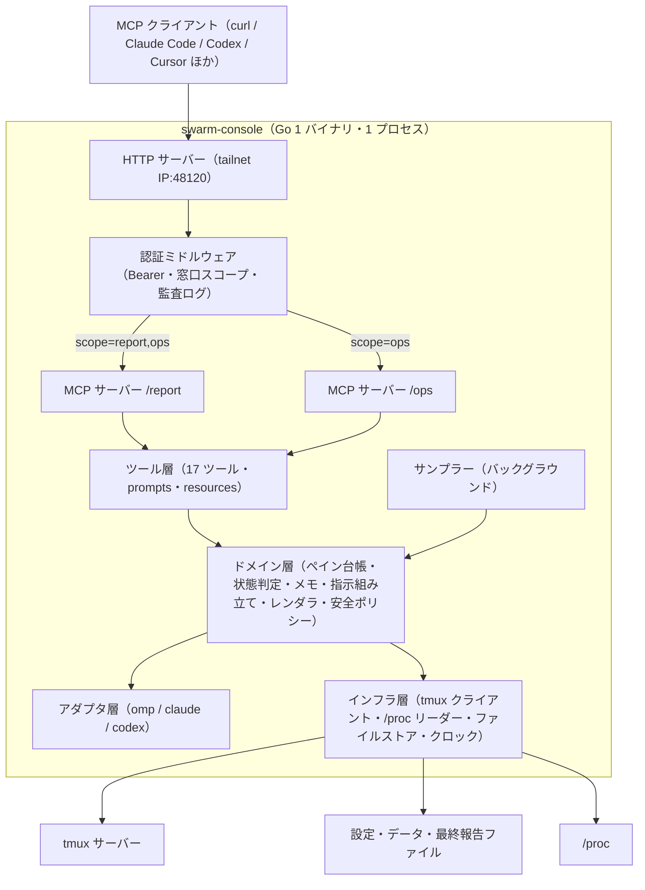
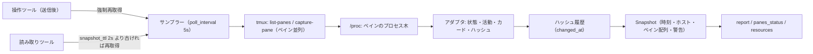
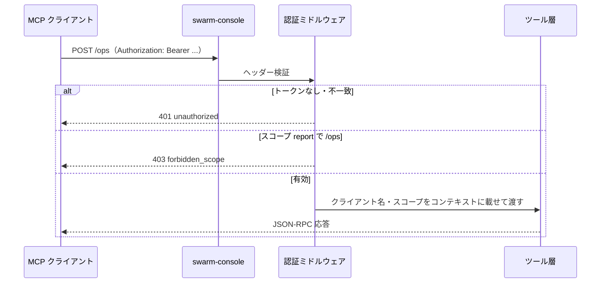
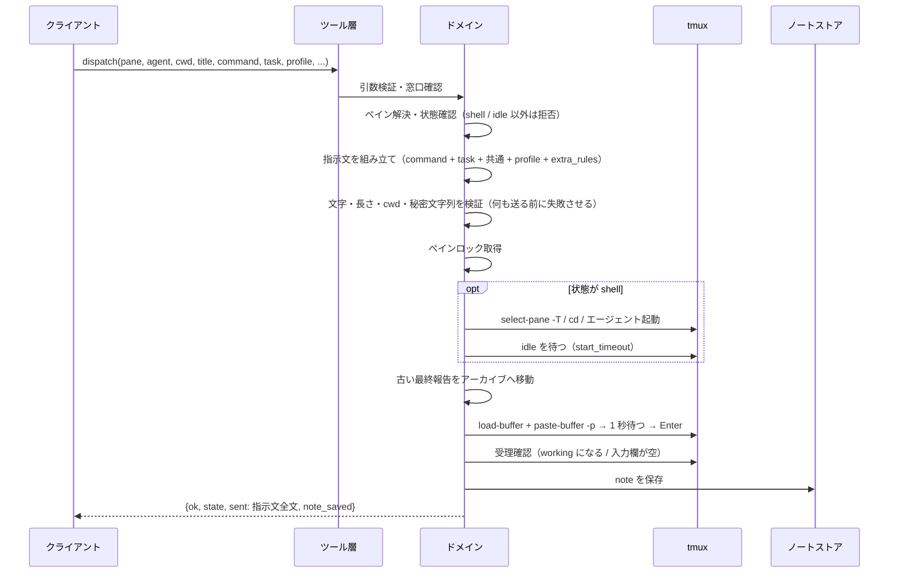
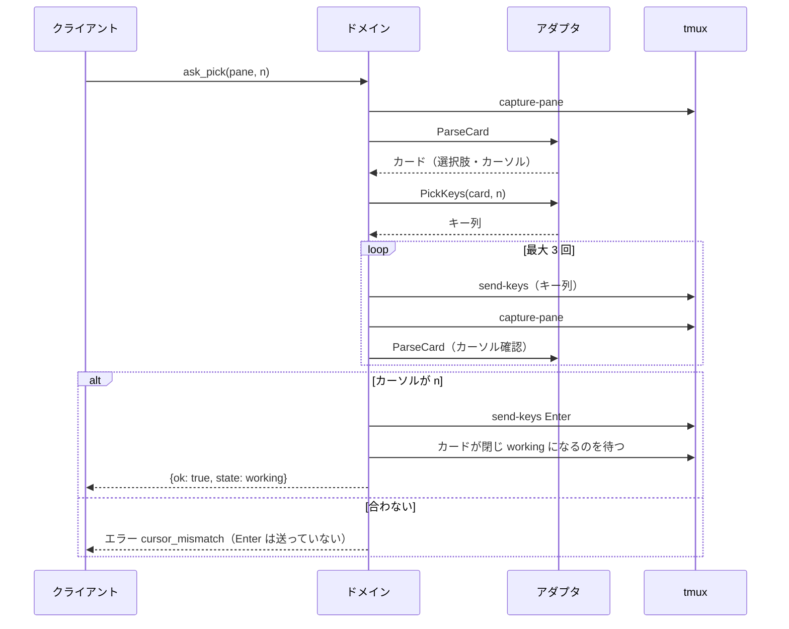
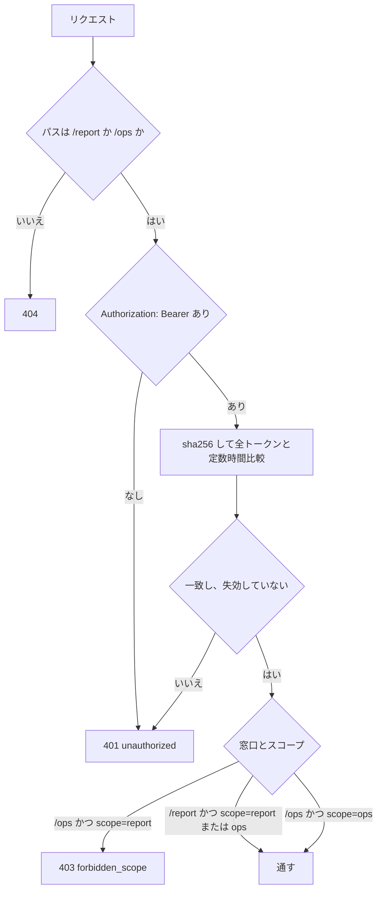

# アーキテクチャ設計

要件は [機能要件](../requirements/functional.md)・[非機能要件](../requirements/non-functional.md)、データ構造は [ER / データモデル](er.md)、ツールの入出力は [API 仕様](../api/endpoints.md)、パッケージ構成は [コンポーネント設計](../components/overview.md) を参照する。

## 1. 全体構成



- 1 プロセスに 2 つの MCP サーバー（`/report`・`/ops`）を持つ。両者はツール定義の一部を共有し、`/report` には見るツールだけを登録する（`tools/list` に出さない）。
- ツール層は薄く、引数の検証・窓口に応じた権限・エラー整形だけを行う。ロジックはドメイン層に置く。
- アダプタ層が画面の読み方（状態・カード・飾り）を、インフラ層が tmux・`/proc`・ファイルの出入りを閉じ込める。ドメイン層はどちらにも直接触らない（インターフェース越し）。

## 2. 技術選定

| 項目 | 選定 | 理由 |
|------|------|------|
| 言語 | Go（1 バイナリ） | 元仕様。配布が単純で、systemd 常駐に向く |
| MCP | 公式 Go SDK（`github.com/modelcontextprotocol/go-sdk`） | 元仕様。Streamable HTTP・prompts・resources に対応 |
| HTTP | 標準 `net/http` | 窓口 2 つと認証だけで済む |
| tmux 操作 | `tmux` コマンド（`os/exec`、引数配列）。専用ソケットを `tmux_socket` で指定可 | 元仕様。`capture-pane`・`send-keys`・`load-buffer`・`paste-buffer`・`select-pane -T`・`display -p` |
| 設定・ひな形 | TOML（`github.com/pelletier/go-toml/v2`） | 人が編集する設定・トークン・プロファイル。コメントが書ける |
| メモ | JSON 1 ファイル（`encoding/json`） | 元仕様。500 件までで十分小さい |
| テンプレート | `text/template`（`go:embed` で既定を同梱） | レポート・指示文を言語ごとに差し替えるため |
| ログ | `log/slog`（JSON Lines） | 標準。journald で見る |
| Lint | `golangci-lint` | 元仕様の CI |
| トークン | 32 バイト乱数（`crypto/rand`）＋ SHA-256 保存 | 高エントロピーなので低速ハッシュは不要 |
| 版の確認 | 標準の `net/http` ＋ `golang.org/x/mod/semver`（自前で版を解析しない） | GitHub Releases の `/releases/latest` を読んで semver で比較する（P-42）。mam の `updater` と同じ作り |
| 配布・更新 | GitHub Releases ＋ 自己更新（`serve` が新しい版を見つけたら、ダウンロード・`SHA256SUMS` で検証・入れ替え・自分で正常終了して systemd に立ち上げ直させる。起動に失敗したら `.old` から自動で戻す。機能要件 §12.4・P-46・P-54〜P-58） | 運用者の判断（Issue #7）。標準の `net/http`・`os`・`crypto/sha256` だけで足りる |

DB は使わない（ER ドキュメントは永続ファイルのデータモデル）。動作に外部サービスは要らない（新しい版の確認と自己更新だけ GitHub Releases に通信し、失敗しても動く。FR-UPD）。

## 3. レイヤー構造

| レイヤー | 責務 | 主なパッケージ（コンポーネント設計 §2） |
|---------|------|------------------------------------|
| エントリ | CLI（`serve`・`token`・`version`）、設定読み込み、起動時検証 | `cmd/swarm-console` |
| トランスポート | HTTP、窓口ごとのルーティング、認証、リクエスト上限、監査ログ | `internal/server`、`internal/auth` |
| ツール | MCP のツール・prompts・resources の登録、引数検証、エラー整形 | `internal/tools`、`internal/mcpapi` |
| ドメイン | ペイン台帳・位置解決・スナップショット・状態判定・メモ・指示組み立て・レンダリング・安全ポリシー | `internal/pane`、`internal/notes`、`internal/render`、`internal/safety` |
| アダプタ | エージェントごとの画面解釈・キー操作 | `internal/agent`（`omp`・`claude`・`codex`） |
| インフラ | tmux 実行、`/proc`・ホスト情報、ファイル入出力、時計 | `internal/tmux`、`internal/host`、`internal/store`、`internal/clock` |

依存方向は上から下の一方向。ドメインはインフラ・アダプタを小さなインターフェース（`TmuxRunner`・`Adapter`・`Clock`・`FS`）越しに使い、テストでは実 tmux と擬似エージェントに差し替えずに使える。

## 4. スナップショット方式

`report` を「同じペインの状態ならどのクライアントからでも 1 文字も違わない」ようにし、`stalled` 判定を呼び出しの有無によらず動かすため、ペインの状態を **スナップショット** にまとめる（P-05）。



- スナップショットは不変。`Snapshot.At` が `report` の時刻になり、`elapsed`・`changed_ago` も `At` 基準で計算する。呼び出しごとの時刻・クライアント情報は出力に入れない。
- 読み取りツールは、スナップショットが `snapshot_ttl`（既定 2 秒）以内ならそれを返し、古ければ 1 回だけ（singleflight）取り直す。同時に来た複数クライアントは同じスナップショットを受け取る。
- 操作ツールは、送信後の確認のために対象ペインを `accept_timeout` までポーリングし、終わったらスナップショットを取り直す。
- 画面ハッシュは、アダプタが「揮発部分（スピナー・経過時間・トークン数の表示）」を取り除いた本文から計算する。ハッシュが変わった時刻を `changed_at` として覚え、`working` で `now - changed_at ≥ stalled_after` なら `stalled` にする。サーバー起動直後は `changed_at` を起動時刻とし、起動後 `stalled_after` 経つまで `stalled` にしない。
- 並びの差分（追加・削除・位置の変化）は前回のスナップショットと比べて検知し、`layout_changed` 警告を `layout_warning_ttl` の間出す。サーバー起動直後は比較対象がないので警告しない。
- ペインが 2 回連続のスナップショットで消えていたら、そのペインのメモを履歴へ移す（`closed_by: "vanished"`）。

## 5. 通信フロー

### 5.1 接続・認証



### 5.2 `dispatch`（空きペインへ指示）



### 5.3 `ask_pick`（質問カードに答える）



## 6. 認証と窓口



- `/report` は `report`・`ops` どちらのトークンでも通る（`ops` は `report` を含む。P-03）。`/ops` は `ops` のみ。
- トークン照合は `tokens.toml` の更新時刻が変わっていたら再読み込みする（失効を再起動なしで効かせる。P-04）。
- 401・403 とも本文は `{"error":{"code":...,"message":...}}` の固定形。ヒントになる情報（トークンが存在するか等）は出さない。
- 通ったリクエストごとに、クライアント名・窓口・ツール・ペイン・結果コード・所要時間を JSON Lines で記録する。

## 7. デプロイ構成

| 項目 | 内容 |
|------|------|
| 実行場所 | example-host（tmux サーバーと同じホスト、同じユーザー） |
| バイナリ | `~/bin/swarm-console/swarm-console`（GitHub Releases から。`serve` が自分で入れ替える。`update_auto = false` のときは手で入れ替え）。同じフォルダに `swarm-console.new`・`.old`・`.update-pending`・`.update-failed` が一時的にできる（ER §8） |
| 設定 | `~/.config/swarm-console/`：`config.toml`・`profiles.toml`・`tokens.toml`（600）・`templates/`（任意） |
| データ | `~/.local/share/swarm-console/notes.json`（600） |
| 最終報告 | `/tmp/swarm-console/reports/<位置>.md`（エージェントが書く）、`archive/`（サーバーが移す） |
| 待ち受け | `config.toml` の `listen_addr`（example-host の tailnet IP:48120） |
| 常駐 | systemd ユーザーサービス `swarm-console.service` |
| クライアント | クライアント環境：`sc.sh <tool> '<json>'`（SOCKS5 localhost:<port> 経由の curl、既定 `/ops`）。パソコンの AI ツールは MCP 設定に URL とトークンを入れる |

`swarm-console.service` の骨子：

```ini
[Unit]
Description=swarm-console (MCP console for tmux agents)
After=network-online.target tailscaled.service

[Service]
ExecStart=%h/bin/swarm-console/swarm-console serve --config %h/.config/swarm-console/config.toml
Restart=always
RestartSec=2
TimeoutStopSec=15
UMask=0077

[Install]
WantedBy=default.target
```

- `listen_addr` は `tailscale ip -4` の値を設定に書く（コードでアドレスを探しにいかない。P-01）。tailscale がまだ上がっていなくても `bind` に失敗したら再試行して立ち上がるように、`Restart=always` に任せる。
- 更新手順（`update_auto = false` のとき）：新バイナリを置く → `systemctl --user restart swarm-console` → `host_status` で確認。
- 新しい版の確認は `serve` が 24 時間ごとに `api.github.com` を読んで行い（`update_check`。FR-UPD）、結果は `host_status` の `update` と `version --check` で見る。`update_auto`（既定 `true`）なら、新しい版を見つけたときにダウンロード → 検証 → `rename` → 正常終了し、上の `Restart=always`・`RestartSec=2` が新バイナリを起動する（`systemctl` は実行しない）。
- 自己更新は `swarm-console.service` の変更を要しない。新バイナリが起動に失敗し続けても、3 回目の起動で `.old` に戻して終了する（`RestartSec=2` なので約 4 秒後。systemd の既定の起動回数の上限（10 秒に 5 回）より前。FR-UPD-17・P-55）。

## 8. 設定ファイルの全体像

`~/.config/swarm-console/config.toml`（キーの型と検証は [ER §5](er.md#5-configtoml)）。

| キー | 既定 | 意味 |
|------|------|------|
| `listen_addr` | （必須） | tailnet IP:48120 |
| `tmux_socket` | なし | tmux の `-L` ソケット名（テスト用） |
| `sessions` | `["0"]` | 対象セッション |
| `default_session` | `sessions` の先頭（1 つだけのとき） | 位置の接頭辞を省略するセッション |
| `default_lang` | `"ja"` | `report` の既定言語 |
| `poll_interval` | `5s` | サンプラー間隔 |
| `snapshot_ttl` | `2s` | 読み取りツールが再取得する閾値 |
| `stalled_after` | `15m` | 画面変化なしで `stalled` とする時間 |
| `layout_warning_ttl` | `10m` | 並び変更の警告を出し続ける時間 |
| `accept_timeout` / `start_timeout` / `lock_timeout` | `10s` / `30s` / `60s` | 操作の確認待ち・起動待ち・同ペイン待ち |
| `title_prefix` | `"agent: "` | `pane_start` のタイトル接頭辞 |
| `allowed_roots` | `["/mnt/nvme/", "~/projects/"]` | `cwd` を許可する根 |
| `denied_paths` | `["~/dotfiles"]`（書いたら入れ替え。P-29） | `cwd`・`file` を拒否するパス |
| `file_roots` | `["/tmp/", + allowed_roots]` | `send_text` の `file` を許可する根（P-13） |
| `disk_mounts` | `["/", "/mnt/nvme"]` | `host_status` が見るマウント |
| `report_dir` | `/tmp/swarm-console/reports` | 最終報告の置き場 |
| `update_check` | `true` | `serve` が GitHub Releases で新しい版を確認する（FR-UPD） |
| `update_check_interval` | `24h`（1h 以上） | 確認の間隔 |
| `update_auto` | `true` | 新しい版を見つけたら `serve` が自分で入れ替える（FR-UPD-19。`update_check = false` なら無効） |
| `[pane_names]` | なし | 位置の固定名 |
| `[agents.<name>]` | 組み込み | アダプタの上書き（コマンド・正規表現・認証ファイル） |

## 9. 提案した既定値と実装時確認事項

元仕様に書かれていない点を、実装に入るために埋めた既定値。オーナーの OK のときに合わせて確認する。「確認」列が「実装時」のものは、実環境・実画面を見ないと決められないもの。

| ID | 論点 | 提案 | 確認 |
|----|------|------|------|
| P-01 | 待ち受けアドレス | `listen_addr` を設定に明記。`0.0.0.0`・`::`・未指定は起動拒否。tailnet の範囲（`100.64.0.0/10`、`fd7a:115c:a1e0::/48`）かループバックのみ許可（ループバックはテスト用） | OK 時 |
| P-02 | MCP のセッション | Streamable HTTP はステートレスで動かす（`Mcp-Session-Id` を持たない）。SDK が対応していなければ、セッション ID を発行しても状態を持たない構成にする | 実装時（SDK の対応） |
| P-03 | `ops` トークンで `/report` | 呼べる（`ops` は `report` を含む）。`report` トークンは `/ops` で 403 | OK 時 |
| P-04 | トークンの形式 | `sc_` ＋ base64url 32 バイト。`tokens.toml` に SHA-256 を保存。失効は削除でなく `revoked_at` を付ける（名前の再利用は不可）。ファイルの更新時刻が変わるたびに再読み込み。発行時に 1 度だけ平文を標準出力へ | OK 時 |
| P-05 | スナップショットとサンプラー | §4 のとおり。`poll_interval` 5 秒、`snapshot_ttl` 2 秒。画面ハッシュは揮発部分を除いた本文で計算 | OK 時 |
| P-06 | エージェントの特定 | `/proc` でペインのプロセス木をたどり、コマンド名・引数がアダプタの `process_match` に当たるかで判定。取れなければ画面の特徴で補う | 実装時（実プロセス名） |
| P-07 | ウィンドウが複数のとき | ウィンドウが複数のセッションは `w<index>.` を付ける。段は `pane_top`、列は同じ段の `pane_left` の順位。固定名のキーは `<セッション>:<ウィンドウ>.<ペイン番号>` | OK 時 |
| P-08 | 並び変更の警告 | 検知から `layout_warning_ttl`（10 分）の間、`panes_status`・`report` に出す。起動直後は出さない | OK 時 |
| P-09 | 操作と状態の許可表 | 機能要件 §4.2 の「許可する状態」のとおり（`send_text` は `idle`・`working`・`stalled`、`asking` は拒否） | OK 時 |
| P-10 | `ask_pick` の `text` | `n` と `text` は同時に指定できない。`text` を指定すると「その他」を選んで `text` を入れる | OK 時 |
| P-11 | 報告待ちと最終報告ファイル | 報告待ち ＝ `idle` かつ最終報告ファイルがある。`dispatch`・`pane_close` は古いファイルを `reports/archive/<位置>-<unix 秒>.md` へ移す。位置の `:` はファイル名で `_` にする | OK 時 |
| P-12 | エラー形式 | 事前条件・権限の失敗は MCP の `isError: true` ＋ 本文 `{"error":{"code","message","details"}}`。送信後に期待どおりでない場合は `ok: false` ＋ `state`。`message` は日本語の固定文。HTTP の 401・403・413 も同じ本文形式 | OK 時 |
| P-13 | `send_text` の制御文字と `file` | 許可する制御文字は `\n`・`\t` のみ（ESC・NUL・CR など拒否）。`file` の読み取りは `file_roots`（`/tmp/` と作業フォルダの根）の下のみ、シンボリックリンク解決後に判定、UTF-8 で 8000 字以内 | OK 時 |
| P-14 | 秘密文字列のパターン | `gh[pousr]_`＋20 字以上、`github_pat_`、`sk-`＋16 字以上、`eyJ`＋20 字以上、`AKIA`＋16 字、PEM 見出し（`-----BEGIN ... PRIVATE KEY-----`）、自分のトークン（`sc_`＋40 字以上） | OK 時 |
| P-15 | メモの置き去り | tmux サーバーの起動時刻を `notes.json` に持ち、変わっていたら現行メモを履歴へ（`closed_by: "tmux_restart"`）。ペインが 2 回連続で消えていたら履歴へ（`vanished`） | OK 時 |
| P-16 | `agent_auth_status` の読み先 | **確定**（[agent-auth.md](agent-auth.md)）。Claude Code：`~/.claude/.credentials.json` の `claudeAiOauth.expiresAt`・`refreshTokenExpiresAt`（epoch ミリ秒）。**`expiresAt` が 0 なら `refreshTokenExpiresAt` が未来でも `expired`**（`0` は無期限ではなく失効の値）。`expiresAt` が過去（> 0）で更新が未来なら通常の自動更新として `valid`。判定表は agent-auth.md。Codex：`~/.codex/auth.json` の `tokens.access_token`（JWT）の `exp`（秒）。omp：`[agents.omp] auth_file`（未設定なら「不明」）。読むのは期限だけ | **確定**（実機の Claude は `expiresAt: 0`＋トークン空で `expired`） |
| P-17 | 数量と文字数の上限 | 総ペイン 32、文字列項目 2000 字（`memo` 4000 字）、`items`・`rules` 50 件、`note_log` 1 行 500 字、リクエスト本文 256 KiB、`pane_tail` 20,000 字、`report_read` 20,000 字 | OK 時 |
| P-18 | 指示文の形 | `command` → 空行 → 「## やること」`task` → 空行 → 「## 条件」の箇条書き（共通 → プロファイル → `extra_rules`）。`{report_path}` は最終報告ファイルの実パスに置換 | OK 時 |
| P-19 | `pane_close` の許可状態 | `idle`・`shell` のみ。`working`・`stalled`・`asking`・`unknown` は拒否（元仕様は `working` のみ明記） | OK 時 |
| P-20 | リリース | タグ `v*` の push で linux/amd64 バイナリを GitHub Releases に載せるワークフロー | OK 時 |
| P-21 | テスト用の tmux | `tmux_socket`（`-L`）で専用サーバーを使う | OK 時 |
| P-22 | 状態判定・カードの正規表現の具体値 | [agent-patterns.md](agent-patterns.md) のとおり。既定値は組み込み、`[agents.<name>]` で上書き可。**omp は実画面で確定**。Claude Code は idle・信頼確認・`/model` が実画面、作業中・許可確認・質問は推定（ログイン切れで採れず）。**Codex は実画面で未確定**（この機に `codex` が無い。推定値） | **未完了**：Claude Code の作業中・許可確認・質問、Codex の全画面は、実画面で確かめて値を直す |
| P-23 | `dispatch` の `note` 保存 | 送信が行われた後に保存（拒否・事前検証失敗では保存しない）。受理に失敗しても保存し `note_saved: true` を返す | OK 時 |
| P-24 | tmux のバージョン | **確定**：3.x を前提。実機は `tmux 3.2a`（`load-buffer -`・`paste-buffer -p` の実動作を専用ソケットのテストで確認）。`tmux -V` を起動時に読み、`tmux.CheckVersion` が 2.x 以下・判定不能なら警告（3.x・`next-`・`master` は警告なし） | 実機で確定済み |
| P-25 | `report` の `format: json` と `pane` の併用 | `panes` と `attention` をその 1 ペインだけに絞る。`host`・`layout`・`warnings` は全体のまま | 実装時に決めた。OK 時に確認 |
| P-26 | `/report` で操作ツールを `tools/call` したとき | JSON-RPC `-32601` ではなく、`isError: true` ＋本文 `{"error":{"code":"unknown_tool",...}}` で返す（go-sdk v1.8.0 が `-32601` の `data` を捨てるため）。何も実行しない | 実装時に決めた。OK 時に確認 |
| P-27 | `layout`（段・列の数）が複数セッションのとき | 既定セッション（無ければセッション順で最初にペインのあるもの）の最初のウィンドウ | 実装時に決めた。OK 時に確認 |
| P-28 | `unknown`（エージェント無し）のペインへの操作 | `ask_pick`・`send_text`・`send_escape`・`pane_close`・`dispatch` は `invalid_state` ではなく `unsupported_agent`（API 仕様 §3.2 の表に合わせる） | 実装時に決めた |
| P-29 | `denied_paths` の既定 | **確定：既定 `~/dotfiles`、`config.toml` で変更可**。`denied_paths` を書いたら既定と入れ替わる（足されない）。書かなければ既定。`~` は展開して絶対パスで比較。`cwd`・`file` の両方に効く。オーナーの checkout の一覧は仕様書に無いため、必要なら設定で書く（例は [環境構築](../environment/setup.md#ローカルで動かす)） | **確定** |
| P-30 | `report_read` の読み取り | 最終報告ファイルは `O_NOFOLLOW` で開く（シンボリックリンクなら `exists: false`）。認証ファイルなどを読み出されないため | 実装時に決めた |
| P-31 | 仕様書の行数管理 | **確定**：`.linterlyignore` で `docs/**` を Linterly の対象から外す（`api/endpoints.md`・`architecture/er.md` が 300 行を超えるため）。仕様書の分割は別 Issue（#3） | **確定** |
| P-40 | 新しい版の確認の入口 | **確定（Issue #7 のヒアリングで選択）**：`swarm-console version --check`・`serve` の定期確認・`host_status` の `update` の 3 つ全部。`update` サブコマンドは作らない（入れ替えのきっかけは `serve` の自動だけ。P-46） | **確定** |
| P-41 | 定期確認の既定 | **確定（Issue #7 のヒアリングで選択）**：既定オン・24 時間ごと。`config.toml` の `update_check = false` で止める。設定なしで GitHub へ外向き通信が出る（確認の `api.github.com` の GET 1 本と、自己更新のダウンロード。NFR-SEC-15） | **確定** |
| P-42 | 版の形・比較・プレリリース | タグは `vX.Y.Z` だけを受け付ける（Issue #8 が付ける形と同じ）。比較は `golang.org/x/mod/semver`。`/releases/latest` を使うのでプレリリース・ドラフトは通知しない。現在の版がプレリリース形でも semver どおりに比較する | 実装時に決めた。OK 時に確認 |
| P-43 | `version --check` の終了コード | 最新 0・新しい版あり 10・確認できない 1。スクリプトで 3 つを区別できるようにする | 実装時に決めた |
| P-44 | 確認の失敗の扱い | 失敗後の再試行は次の周期まで行わない（バックオフなし）。ログは新しい版を見つけたとき 1 回と、失敗の `reason` が変わったときの警告だけ（FR-UPD-8）。`serve` は止めない | 実装時に決めた |
| P-45 | 最初の確認の遅れ | 起動の 1 分後（起動処理・サンプラーの初回取得と重ねない。`clock` 経由） | 実装時に決めた |
| P-46 | 更新の方式 | **確定（Issue #7 のヒアリングで選択）：自己更新。** 検証は `SHA256SUMS` のハッシュだけ（署名なし）、きっかけは `serve` の自動、再起動は自分で正常終了して systemd に立ち上げ直してもらう。限界とリスクは機能要件 §12.5 | **確定** |
| P-47 | 確認に認証を使わない | リポジトリが public である前提（public になった。private に戻すと GitHub は `releases/latest` に 404 を返し、`no_release` になる）。トークンは送らない（NFR-SEC-15） | 実装時に決めた |
| P-54 | 作業中のペインがあるときの更新 | **確定（Issue #7 の回答）**：待たずにすぐ入れ替えて終了する。ペインは tmux に残り、MCP クライアントはつなぎ直す。進行中のツール呼び出しは NFR-AVL-7 の 10 秒で打ち切る（mam の `SafeGate` のように作業中は更新しない、は採らない） | **確定** |
| P-55 | 起動失敗の判定と戻し | 戻すこと自体は **確定（Issue #7 の回答）**。判定と再起動ループの防ぎ方は実装案：入れ替え時に `.old`（ハードリンク）と `update-pending`（`boots` 0）を置く → 新バイナリは起動の最初に `boots` を +1 し、**3 回目の起動**で `.old` を戻して終了、`update-failed` に版を記録して同じ版を再試行しない（FR-UPD-17）。閾値 3 は `RestartSec=2` で約 4 秒後 ＝ systemd の起動回数の上限より前。60 秒生きれば確定。bind 失敗（tailscale 未起動）も数える＝旧バイナリでも起きる環境要因と区別しないが、戻したあとは `update-failed` でその版を止めるので、無限には繰り返さない。コードを 1 行も実行できない故障は数えられない（§12.5） | 実装時に決めた。OK 時に確認 |
| P-56 | `update_auto` の既定 | 運用者の回答は「自動更新を止める設定は `update_auto` を新しく足す」。「止める設定」と読み、**既定 `true`（自動で入れ替わる）、`false` で確認だけ**とした。`update_check = false` なら無効。ハッシュだけの検証と自動の組み合わせなので、既定を `false` にして明示的に有効にする案もある | **OK 時に確認（既定値）** |
| P-57 | ダウンロード先・アセット名・`SHA256SUMS` の書式 | アセット名は `swarm-console_vX.Y.Z_linux_amd64`（**確定**：版・OS・arch を含める）。`SHA256SUMS` は `sha256sum` の出力どおり（`<ハッシュ>␣␣<アセット名>`）の 1 行。ダウンロード URL は検証済みの `tag_name` から `releases/download/<tag>/…` を組み立て、API 応答の `assets[]` は使わない（応答の文字列を URL にしない）。許可ホストは `github.com`・`objects.githubusercontent.com`・`release-assets.githubusercontent.com`。サイズ上限：`SHA256SUMS` 64 KiB・バイナリ 64 MiB。生産側（`release.yml`）の改訂は Issue #8 | 実装時に決めた。OK 時に確認 |
| P-58 | 置き場と入れ替えの方法 | 置き場は `~/bin/swarm-console/` に**固定**（**確定**。`os.Executable()` が違えば `not_managed`）。入れ替えは「`.new` に書く → `.old` へハードリンク → マーカー → `.new` を `rename`」で、本体の名前が一度も消えない（途中で落ちても `swarm-console` がある）。旧バイナリは 1 世代だけ | 実装時に決めた。OK 時に確認 |

## 改訂履歴

| 版 | 日付 | 変更内容 | 変更理由 |
|----|------|---------|---------|
| 1.0 | 2026-10-31 | 新規作成 | 初版 |
| 1.1 | 2026-11-01 | P-16・P-24 を確定、P-22 を omp で確定（Claude Code は一部推定、Codex は未確定）。agent-patterns.md・agent-auth.md を追加。P-25〜P-31 を追加 | 実装時確認事項の反映（Issue #1） |
| 1.2 | 2026-11-01 | 新しい版の確認の選定と設定キー、P-40〜P-47（P-46 は更新の方式で未決）を追加 | Issue #7 |
| 1.3 | 2026-11-01 | 更新の方式を自己更新で確定（P-40・P-41・P-46 を更新、P-54〜P-58 を追加）。技術選定・デプロイ構成・設定キー（`update_auto`）を自己更新に合わせて改訂 | Issue #7（自己更新で確定） |
