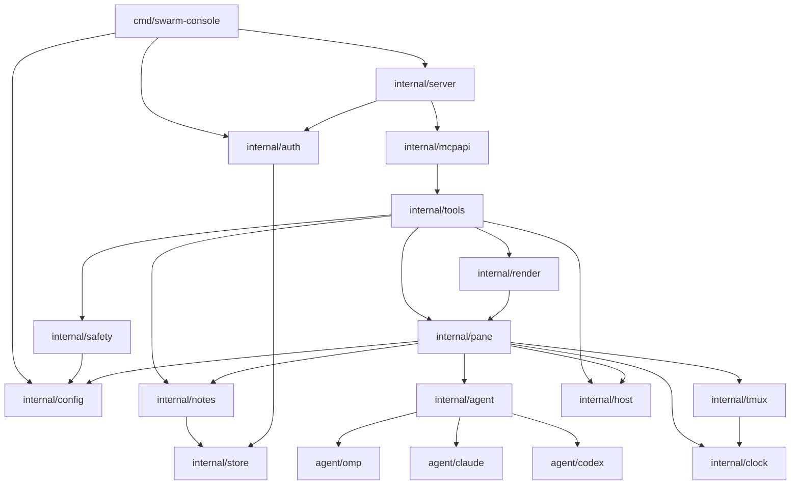

# コンポーネント設計

Go 1 バイナリを、責務ごとのパッケージに分ける。層の考え方は [アーキテクチャ設計 §3](../architecture/overview.md#3-レイヤー構造)、要件は [機能要件](../requirements/functional.md) を参照する。

## 1. コンポーネント依存関係



- 依存は一方向。`internal/pane` はドメインの中心で、`tools`・`render` が使う。
- `agent/*` は `internal/agent` の `Adapter` を実装し、`init()` で登録する（アダプタを足すには 1 パッケージ足すだけ。FR-AD-4）。
- 時計（`clock`）・tmux 実行（`tmux.Runner`）・ファイル（`store`）は差し替えられるインターフェース越しに使う。

## 2. パッケージ構成

```
swarm-console/
├── cmd/swarm-console/        main.go（serve / setup / token add|revoke / version [--check]）。setup.go は引数と TTY 判定だけ
├── internal/
│   ├── config/               config.toml・profiles.toml の読み込み・検証・既定値
│   │   └── tomledit/         config.toml の部分編集（値の範囲の置き換え・キーの追加。I/O なしの純関数）
│   ├── setup/                `setup` の画面（huh）、tailnet 候補の列挙、入力 → 編集操作の変換、保存（競合・検査・原子的書き込み）
│   ├── server/               HTTP サーバー、窓口ルーティング、リクエスト上限、監査ログ
│   ├── auth/                 tokens.toml、Bearer 検証、スコープ、token CLI
│   ├── mcpapi/               MCP サーバー（/report・/ops）、ツール・prompts・resources の登録
│   ├── tools/                ツールごとのハンドラ（引数検証・エラー整形）
│   ├── pane/                 ペイン台帳、位置解決、スナップショット、サンプラー、ロック、操作の実行
│   │   └── ops/              操作の実行（`pane.Ops` の実装。Linterly のディレクトリ上限のため分離）
│   ├── agent/                Adapter インターフェース、レジストリ、共通ヘルパー
│   │   ├── omp/
│   │   ├── claude/
│   │   └── codex/
│   ├── notes/                メモ・履歴、検証、秘密検出
│   ├── render/               report・dispatch のテンプレート組み立て
│   ├── safety/               パス検証、制御文字・長さの検証、秘密文字列
│   ├── tmux/                 tmux コマンド実行（Runner インターフェース）
│   ├── host/                 負荷・メモリ・ディスク・/proc・認証期限の読み取り
│   ├── store/                原子的ファイル書き込み、権限検査
│   ├── clock/                時計インターフェース（テストで固定）
│   ├── updatecheck/          GitHub Releases の最新版の取得・版の比較・結果の保持・定期確認（FR-UPD）
│   ├── selfupdate/           自己更新（ダウンロード・SHA256SUMS の検証・入れ替え・試運転と戻し。FR-UPD-11〜20）
│   ├── reportvalues/         レポートに足す値の収集（`omp usage --json`・`omp update --check` の実行と読み取り・間隔・最後の結果の保持。FR-REP-10〜18）
│   ├── apperr/               エラーコードと固定メッセージ（API 仕様 §3）
│   └── app/                  配線（設定・アダプタ・tmux・pane・tools・mcpapi・server の組み立て）
├── templates/                report.ja.md・report.en.md・dispatch.md（go:embed の既定）
├── testdata/screens/         実画面サンプル（omp/ claude/ codex/）
├── test/fakeagent/           擬似エージェント（サンプル画面を出し、キーに反応する）
├── test/integration/         実 tmux ＋ fakeagent ＋ MCP クライアントの統合・受け入れテスト
├── deploy/                   swarm-console.service（systemd ユーザーサービス）
├── scripts/                  install.sh（`make install`。最新リリースの取得・照合・配置・systemd 常駐。FR-INS）と、そのテスト install_test.sh
├── docs/                     仕様書
└── .github/                  workflows/ci.yml・release.yml、scripts/plan-release.sh（次の版を決める）と、そのテスト
```

## 3. コンポーネントの責務

| コンポーネント | 責務 | 主な公開 IF | 依存する要件 |
|---------------|------|-----------|-------------|
| `config` | 設定の読み込み・検証（未知キー拒否）、既定値、`~` 展開、`profiles.toml`。`setup` も同じ検証を使えるよう、検証関数と読み込み本体を公開する（コピーしない） | `Load(path) (*Config, error)`、`ParseBytes(data, path)`、`CheckListenAddr`・`CheckSessions`・`ExpandPath`、`Profiles` | FR-POS-1, FR-AD-2, FR-DIS-3, FR-SET-5 |
| `config/tomledit` | `go-toml/v2` の `unstable.Parser` で値のバイト範囲を取り、変更したキーの値だけを置き換える・無いキーを足す。変更範囲の外を 1 バイトも変えない（ER §5.1） | `Edit(src []byte, ops []Op) ([]byte, error)`、`Op{Key []string, Value any}` | FR-SET-3, NFR-OPS-8 |
| `setup` | `huh` のフォーム（項目と順番は FR-SET §11.1）、`net.InterfaceAddrs` による tailnet 候補、現在値の読み込み、変更したキーだけの `Op` への変換、保存前の検査・競合検出・`store.WriteFileAtomic`、任意のトークン発行（`auth.Add`） | `Run(ctx, Options) error`（`Options` は設定パス・入出力・インターフェース列挙・時計の差し替え） | FR-SET, NFR-OPS-8, NFR-OPS-9 |
| `server` | `net/http` の起動、`/report`・`/ops` のマウント、本文上限、`listen_addr` の検証、監査ログ、グレースフル停止 | `New(cfg, handlers)`、`Serve(ctx)` | NFR-SEC-1, NFR-SEC-13, NFR-AVL-7 |
| `auth` | `tokens.toml` の読み込み（更新時刻で再読込）、定数時間照合、スコープ判定、`token add/revoke` | `Authenticate(header) (Client, error)`、`Client{Name, Scope}` | NFR-SEC-3〜6 |
| `mcpapi` | 公式 SDK で 2 つの MCP サーバーを作り、窓口ごとにツールを登録（`/report` には見るツールだけ）。prompts・resources の登録 | `NewReportServer(tools)`、`NewOpsServer(tools)` | FR-SAFE-6 |
| `tools` | ツール 17 個のハンドラ。引数検証、窓口の権限確認、`pane` の解決、エラーコードへの変換 | `Tool` 構造体（名前・説明・スキーマ・ハンドラ・`Scope`）、`Registry` | API 仕様 §5 |
| `pane` | スナップショットとサンプラー、位置の命名、ペイン解決、ペインロック、`send_text`・`ask_pick` などの操作実行 | `Registry`、`Snapshot`、`Resolve(arg)`、`Ops` | FR-POS, FR-STATE, FR-O |
| `agent` | アダプタの契約（下記 §4）とレジストリ。設定の上書きの適用 | `Adapter`、`Register`、`Get(name)` | FR-AD |
| `notes` | `notes.json` の読み書き、`note_set` のマージ・検証、履歴、孤児化 | `Store`、`Get/Set/Log/Archive/History` | FR-NOTE |
| `render` | `report`（markdown/json、`ja`/`en`）と `dispatch` の指示文のレンダリング。純関数（スナップショット＋設定 → 文字列） | `Report(snap, opts)`、`Dispatch(args, profile, pos)` | FR-REP, FR-DIS |
| `safety` | `cwd`・`file` の許可判定（シンボリックリンク解決）、貼り付けテキストの検証、秘密パターン | `CheckCWD`、`CheckFile`、`CheckText`、`DetectSecret` | FR-SAFE, NFR-SEC |
| `tmux` | `list-panes`・`capture-pane`・`send-keys`・`load-buffer`＋`paste-buffer -p`・`select-pane -T`・`display -p` の実行と出力の解析 | `Runner` | NFR-SEC-7, NFR-ENV-2 |
| `host` | `/proc`（負荷・メモリ・スワップ・CPU の差・稼働時間・プロセス木）、`statfs`（空きと使用率）、認証ファイルの期限 | `Host`（`Status()`、`ProcTree(pid)`、`AuthStatus()`、`SampleCPU()`） | FR-R5, FR-R6, FR-AD-5, FR-REP-13 |
| `updatecheck` | `releases/latest` の取得（タイムアウト・本文上限・`api.github.com` 以外へリダイレクトしない）、`vX.Y.Z` の検査、`semver` 比較、失敗の分類（`reason`）、最後の結果の保持、`serve` の定期確認の goroutine | `Check(ctx) Result`、`Runner{Start(ctx), Status() Status}`（HTTP クライアントと `clock` を差し替え可能） | FR-UPD-1〜10, NFR-SEC-15, NFR-AVL-9 |
| `selfupdate` | `updatecheck` が `update_available` を返したときの入れ替え：許可ホスト内のダウンロード（サイズ上限・リダイレクト制限）、`SHA256SUMS` の検証、`~/bin/swarm-console/` の 5 ファイルへの書き込み（`.new` → `.old` ハードリンク → マーカー → `rename`）、起動時の試運転と戻し（`boots`・`.old` の `rename`・`update-failed`）、`apply` の状況の保持。入れ替え後は `serve` に正常終了を要求する（`systemctl` は実行しない） | `Apply(ctx, latest) error`、`Probation(dir, version, clock) Decision`（起動の最初）、`Status() Apply`（HTTP クライアント・実行ファイルのパス・`clock`・ホームを差し替え可能） | FR-UPD-11〜20, NFR-SEC-14・15・16, NFR-AVL-10 |
| `reportvalues` | `omp usage --json`・`omp update --check` の引数固定の実行（シェルなし・`/dev/null`・打ち切り・出力上限）、出力の読み取りとアカウント名の規則、`status`・`reason` の分類、最後の結果の保持（`stale`・`pending`・`disabled`）、`usage_interval`・`update_check_interval` ごとの収集（前の実行が終わるまで次を始めない）。メール・`accountId` を結果に持たない | `Collector`（`Usage() Usage`、`Omp() OmpStatus`）。実行ファイル・`clock` を差し替え可能 | FR-REP-10〜18, NFR-SEC-7, NFR-TEST-17 |
| `store` | 一時ファイル → fsync → rename の書き込み、権限検査（600） | `WriteFileAtomic`、`CheckMode` | NFR-AVL-3 |
| `clock` | `Now()`、`After()` を持つインターフェース。テストでは固定・手動進行 | `Clock` | NFR-TEST-5, NFR-TEST-7 |

## 4. アダプタのインターフェース

アダプタは「起動コマンド」「終了コマンド」「状態の判定」「質問カードの読み取り」「選択のキー操作」「画面の飾りの取り除き」を持つ（FR-AD-1）。

```go
// 画面は capture-pane -p の出力を行に分けたもの（ANSI なし）。
type Screen struct {
    Lines  []string // 画面の最後から最大 80 行
    Width  int
    Height int
}

type Detection struct {
    State    State  // Working | Asking | Idle | Unknown（shell はプロセス情報で決める）
    Activity string // いまの 1 行（なければ ""）
    Elapsed  string // 画面の経過時間表示（なければ ""）
}

type Card struct {
    Question     string
    Options      []Option // N（1 始まり）, Label, Recommended
    Cursor       int      // 現在のカーソル番号（1 始まり、不明なら 0）
    AllowsCustom bool
}

type Key struct {
    Name string // "Up" | "Down" | "Enter" | 数字 "1".."9"
}

type Adapter interface {
    Name() string                         // "omp" | "claude" | "codex"
    StartCommand() string                 // "omp"
    ExitCommand() string                  // "/exit" | "/quit"
    MatchProcess(argv []string) bool      // /proc で見たプロセスが自分か（process_match）
    MatchScreen(s Screen) bool            // プロセスで特定できないときの補助
    Detect(s Screen) Detection            // working / asking / idle の判定と活動・経過
    ParseCard(s Screen) (Card, bool)      // 質問カードの読み取り（asking のとき）
    PickKeys(c Card, n int) ([]Key, error) // カーソルを n へ動かすキー列
    CustomKeys(c Card) ([]Key, error)     // 「その他」を選ぶキー列（text 用）
    Clean(lines []string) []string        // 枠線・TODO 表示・ステータス行を除く
    StableText(lines []string) string     // 揮発部分（スピナー・経過）を除いた本文（ハッシュ用）
}
```

- 各アダプタは、判定に使う正規表現を `Patterns`（`working`・`ask`・`idle`・`spinner`・`status_line`・`border`・`process_match`）として持つ。組み込みの既定値を `config.toml` の `[agents.<name>]` で上書きできる（FR-AD-2）。
- 状態の決定（`pane` パッケージ）：①プロセス木で `Adapter` を特定（なければ `MatchScreen`）→ ②`Detect` が `Asking` なら `asking`、`Working` なら `working`、どちらでもなければエージェントありで `idle` → ③エージェントなしで前面コマンドがシェルなら `shell` → ④それ以外 `unknown` → ⑤`working` で画面無変化が `stalled_after` 以上なら `stalled`。
- 質問カードの操作は、omp は ↑/↓＋Enter、Claude Code は ↑/↓ または数字＋Enter、Codex は数字＋Enter。具体的な画面の目印は [agent-patterns.md](../architecture/agent-patterns.md)（P-22。実画面サンプルは `testdata/screens/`）。

| アダプタ | `PickKeys` | `CustomKeys` | 備考 |
|----------|-----------|--------------|------|
| `omp` | `Up`/`Down` を差分だけ | 「その他」の項へ `Down` | Ask カード |
| `claude` | 数字キー、または `Up`/`Down` | 「その他」の項へ | 選択肢つき確認 |
| `codex` | 数字キー | 対応する項があれば数字、なければ `custom_not_allowed` | 承認の確認 |

## 5. 主要な型とフロー

### 5.1 ペイン台帳とスナップショット

```go
type Snapshot struct {
    At       time.Time
    Host     host.Status
    Layout   Layout
    Panes    []PaneState      // 位置順
    Warnings []Warning
}

type Registry interface {
    Current(ctx) (*Snapshot, error)   // snapshot_ttl 内ならキャッシュ、古ければ singleflight で取り直す
    Refresh(ctx) (*Snapshot, error)   // 強制再取得（操作の後）
    Resolve(arg string) (PaneRef, error) // 位置・ID → ペイン
    Lock(ctx, id) (unlock func(), error) // ペインごとの排他（lock_timeout）
}
```

- サンプラーは `poll_interval` ごとに `Refresh` を呼ぶ。ペイン単位の取得は並列（同時 8、各 tmux 呼び出し 3 秒でタイムアウト）。
- 位置の命名は純関数 `NamePositions(panes, cfg) map[PaneID]string`。テストは座標表から期待値を引く。

### 5.2 操作の実行（`pane.Ops`）

| 操作 | 主な手順 |
|------|---------|
| `PickAsk(ref, n, text)` | ロック → カード読み取り → `PickKeys` → キーのあと画面に反映されるまで（最大 1 秒）取り直して検証（合わなければ読めたカーソルから差分を送り直す。最大 3 回）→ Enter → 閉じ・`working` を待つ |
| `SendText(ref, text)` | ロック → 検証 → `load-buffer -`（標準入力・一意なバッファ名）→ `paste-buffer -p -d` → 1 秒 → Enter → 受理を待つ |
| `Escape(ref)` | ロック → `send-keys Escape` → 状態遷移を待つ → `notes.Log` |
| `Start(ref, agent, cwd, title)` | ロック → 検証 → `select-pane -T` → `cd <cwd>` → 起動コマンド → `idle` を待つ |
| `Close(ref)` | ロック → 手順 [終了コマンド, `cd ~`, `clear`] を「文字列 → 1 秒 → Enter → 1 秒」で送る → タイトル消し → 画面確認 → `notes.Archive` |
| `Dispatch(ref, args)` | ロック → 状態確認 → `render.Dispatch` → 検証 → （`Start`）→ 古い報告を移動 → `SendText` → `notes.Set` |

固定時間の待ち（1 秒）は元仕様の手順どおり。それ以外の待ちは上限付きの条件待ち（ポーリング）で、`clock` を通す。

### 5.3 ツール層

```go
type Tool struct {
    Name        string
    Description string   // クライアントによらず同じ文面（report には「手を加えず表示する」、send_escape には「オーナーの OK があるとき」）
    Scope       Scope    // ScopeReport（/report と /ops）| ScopeOps（/ops のみ）
    Schema      any      // 引数の JSON Schema（未知キー拒否）
    Handler     func(ctx, Client, json.RawMessage) (Result, error)
}
```

- `Registry.ForEndpoint(endpoint)` が窓口に応じたツール集合を返す。`/report` の MCP サーバーには `ScopeReport` のツールだけ登録する（API 仕様 §1.1）。
- ハンドラは `*Error{Code, Message, Details}` を返し、`mcpapi` が `isError: true` の応答に変換する（API 仕様 §3）。メッセージ文は `internal/tools/errors.go` の表に集約する（クライアントで差が出ない）。

## 6. テスト構成

| 層 | 方法 | 主な確認 |
|----|------|---------|
| アダプタ | `testdata/screens/<agent>/*.txt` ＋ 期待結果の表（`state`・`card`・`activity`・`PickKeys`） | 状態判定・カード読み取り・キー列（NFR-TEST-6） |
| 位置の命名 | 座標表の単体テスト | 段・列・複数セッション・複数ウィンドウ・固定名 |
| レンダリング | ゴールデンファイル（`report` の `ja`・`en`、`dispatch` の全プロファイル） | 決定性・1 文字一致（NFR-TEST-5） |
| メモ | 一時ディレクトリ ＋ 書き込み途中停止の注入 | 壊れない・秘密拒否・500 件・50 行 |
| 安全 | 表駆動 | 許可外の `cwd`・`file`・制御文字・シンボリックリンク・秘密パターン |
| 認証 | `httptest` | 401・403・失効・定数時間の経路・`/report` の `tools/list` |
| 統合 | 実 tmux（専用ソケット `-L`、一時セッション）＋ `test/fakeagent` | 各ツールの正常系と拒否（NFR-TEST-1〜4）、`pane_close` の画面確認、並び変更の警告 |
| 受け入れ（自動化分） | MCP クライアント（SDK の client）で `/report`・`/ops` に接続 | AC-1〜AC-5 のうち自動で担保できる範囲 |
| 設定の編集（`setup`） | `tomledit` の表駆動の単体テスト ＋ 手書きの見本ファイル（`testdata/config/handwritten.toml`）に対する「入力値 → 編集」の検査 ＋ 実 tmux のペインで `setup` を起動して `send-keys` で入力 | 変更範囲の外のバイト列が同一・`serve` と同じ検証・TTY でない起動の拒否・中止で書かない（NFR-TEST-12・13） |
| 新しい版の確認 | `httptest` で GitHub の応答を差し替え ＋ `clock` を進める | 結果の区別・版の比較・失敗の分類・`serve` が止まらない・`host_status.update`（NFR-TEST-14） |
| 自己更新 | `httptest` の偽の配信元 ＋ 一時ディレクトリの `HOME` ＋ `clock` を進める。実 systemd は使わない | 入れ替えの成功・検証失敗・各ステップの失敗で本体が残る・許可外のリダイレクト・ダウングレードしない・試運転の `boots` と 60 秒・戻し・`blocked`・`working` でも待たない（NFR-TEST-16）。実機の再起動と戻しは未確認の報告に明記 |
| レポートに足す値 | 録った `omp usage --json`・`omp update --check` の出力と偽の実行ファイル ＋ `/proc` 相当の固定入力 ＋ `clock` を進める | 5 アカウント・枠なし・`usd`・`exhausted`・壊れた JSON・打ち切り・`stale`・`pending`・`disabled`・CPU の 1 回目と 2 回目・スワップ無し・要対応への入り方・収集器の更新で同じスナップショットの出力が変わらない（NFR-TEST-17） |

### 6.1 擬似エージェント `test/fakeagent`

- 引数でアダプタ種別（`omp`・`claude`・`codex`）とシナリオ（`idle`・`working`・`ask`・`ask-custom`）を取り、サンプル画面を出力する。
- 標準入力のキー（↑/↓・数字・Enter・bracketed paste）に反応して画面を書き換える（`ask` で ↑/↓ → カーソル移動、Enter → 閉じて `working` へ）。`/exit`・`/quit` でシェルに戻る。
- 起動待ち・受理待ちはすべて準備完了の出力（標準出力の `READY` 行など）で同期し、固定時間の `sleep` を使わない（NFR-TEST-7）。

## 7. CI・リリース

| ワークフロー | トリガー | 内容 |
|-------------|---------|------|
| `ci.yml` | push・PR | `go build ./...` → `go vet ./...` → `golangci-lint run` → `go test -race ./...`（tmux を `apt-get install tmux` で入れ、`tmux -V` で確かめる）。各コマンドは別ステップ。`runs-on: ubuntu-latest` |
| `release.yml` | `ci.yml` の `workflow_run`（main への push の CI が成功）、タグ `v*` の push | `plan`（次の版を決め、main の先頭だけ通す）→ `verify`（main の履歴・CI 成功）→ `build`（`GOOS=linux GOARCH=amd64`）→ `release`（`gh release create --target` でタグとリリースを同時に作り、Releases に載せる）。`release` だけが `contents: write`。`concurrency: release`（P-20・P-48〜P-53。環境構築 CI/CD） |

## 改訂履歴

| 版 | 日付 | 変更内容 | 変更理由 |
|----|------|---------|---------|
| 1.0 | 2026-10-31 | 新規作成 | 初版 |
| 1.1 | 2026-11-01 | `setup`・`config/tomledit` を追加、`config` の公開 IF を拡張、テスト構成に `setup` を追加 | Issue #5 |
| 1.2 | 2026-11-01 | `updatecheck` を追加、`version --check` を追加 | Issue #7 |
| 1.3 | 2026-11-01 | `selfupdate` を追加（自己更新の確定。FR-UPD-11〜20）、テスト構成に自己更新を追加 | Issue #7（自己更新で確定） |
| 1.4 | 2026-11-01 | §2 の `.github/`、§7 の `release.yml` を自動タグ付きに更新 | Issue #8 |
| 1.5 | 2026-11-01 | `reportvalues` を追加（レポートに足す値の収集。FR-REP-10〜18） | Issue #21〜#25 |
| 1.6 | 2026-11-01 | §2 に `scripts/`（`make install` の `install.sh` とそのテスト）を追加 | Issue #18 |
