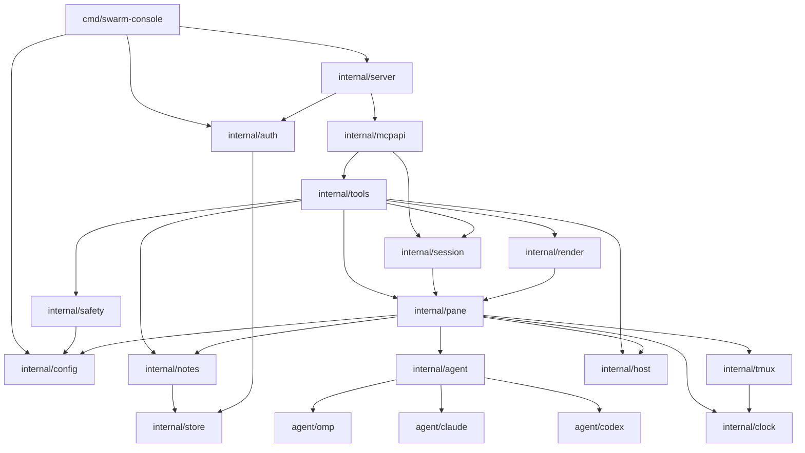

# コンポーネント設計

Go 1 バイナリを、責務ごとのパッケージに分ける。層の考え方は [アーキテクチャ設計 §3](../architecture/overview.md#3-レイヤー構造)、要件は [機能要件](../requirements/functional.md) を参照する。

## 1. コンポーネント依存関係



- 依存は一方向。`internal/pane` はドメインの中心で、`tools`（`view`・`ops`・`toolkit`）・`render` が使う。
- `agent/*` は `internal/agent` の `Adapter` を実装し、`init()` で登録する（アダプタを足すには 1 パッケージ足すだけ。FR-AD-4）。
- 時計（`clock`）・tmux 実行（`pane.Tmux`。実装は `tmux.Client`）・ファイル（`store`）は差し替えられるインターフェース越しに使う。

## 2. パッケージ構成

```
swarm-console/
├── cmd/swarm-console/        main.go（serve / setup / token add|revoke|list / pair / version [--check]）。setup.go は引数と TTY 判定だけ
├── internal/
│   ├── config/               config.toml・profiles.toml の読み込み・検証・既定値
│   │   └── tomledit/         config.toml の部分編集（値の範囲の置き換え・キーの追加。I/O なしの純関数）
│   ├── setup/                `setup` の画面（huh）、tailnet 候補の列挙、入力 → 編集操作の変換、保存（競合・検査・原子的書き込み）
│   ├── server/               HTTP サーバー、窓口ルーティング、リクエスト上限、監査ログ
│   ├── auth/                 tokens.toml、Bearer 検証、スコープ、token CLI
│   ├── pair/                 `pair`（swarm-viewer の接続文字列。`listen_addr` から url、4,096 バイトの事前確認、自動の token 名、`--scope report|ops` に応じた発行）
│   ├── session/              セッション ACL とセッション内のペイン解決（許可セッションの決定・`session` 引数の決め方・ペインの解決。状態を持たない純関数）
│   ├── mcpapi/               MCP サーバー（/report・/ops）、ツール・prompts・resources の登録
│   ├── tools/                ツールの組み立て（`New`・`Registry`。resources 用の窓口）。Linterly のディレクトリ上限のため、ハンドラは下の 3 つに分ける
│   │   ├── toolkit/          ハンドラの共有部品（`Tool`・`Result`・`Deps`・`Env`、引数の検証、JSON Schema の部品、エラー本文、監査用の `Audit`）
│   │   ├── view/             読み取り系 10 ツールのハンドラと、resources が使う同じ本文の組み立て
│   │   └── ops/              操作系 10 ツールのハンドラ（`file_get` は `ops/file.go`、`dir_list` は `ops/dir.go`）
│   ├── pane/                 ペイン台帳、位置解決、スナップショット、サンプラー、ロック、操作の実行
│   │   └── ops/              操作の実行（`pane.Ops` の実装。Linterly のディレクトリ上限のため分離）
│   ├── agent/                Adapter インターフェース、レジストリ、共通ヘルパー
│   │   ├── omp/
│   │   ├── claude/
│   │   └── codex/
│   ├── notes/                メモ・履歴、検証、秘密検出
│   ├── render/               report のテンプレート組み立てと、dispatch の指示文の組み立て（`profiles.toml` の条件から。テンプレートなし）
│   ├── safety/               パス検証、制御文字・長さの検証、秘密文字列
│   ├── tmux/                 tmux コマンド実行（`Client`。`pane.Tmux` インターフェースを実装）
│   ├── host/                 負荷・メモリ・ディスク・/proc・認証期限の読み取り
│   ├── store/                原子的ファイル書き込み、権限検査
│   ├── clock/                時計インターフェース（テストで固定）
│   ├── updatecheck/          GitHub Releases の最新版の取得・版の比較・結果の保持・定期確認（FR-UPD）
│   ├── selfupdate/           自己更新（ダウンロード・SHA256SUMS の検証・入れ替え・試運転と戻し。FR-UPD-11〜20）
│   ├── reportvalues/         レポートに足す値の収集（`omp usage --json`・`omp update --check` の実行と読み取り・間隔・最後の結果の保持。FR-REP-10〜18）
│   ├── apperr/               エラーコードと固定メッセージ（API 仕様 §3）
│   └── app/                  配線（設定・アダプタ・tmux・pane・tools・mcpapi・server の組み立て）
├── templates/                report.ja.md・report.en.md（go:embed の既定。dispatch の指示文はテンプレートではなく `profiles.toml` の条件から `render` が組み立てる）
├── testdata/screens/         実画面サンプル（omp/ claude/ codex/）
├── test/fakeagent/           擬似エージェント（サンプル画面を出し、キーに反応する）
├── test/integration/         実 tmux ＋ fakeagent ＋ MCP クライアントの統合・受け入れテスト
│   └── filegetintegration/   `file_get` の統合テスト（Linterly のディレクトリ上限のため分離）
├── test/setup/               `setup` の画面のテスト（実 tmux の専用ソケットのペインで `swarm-console setup` を起動し、`send-keys` で入力して確かめる。NFR-TEST-13）
├── deploy/                   swarm-console.service（systemd ユーザーサービス）
├── scripts/                  install.sh（`make install`。最新リリースの取得・照合・配置・systemd 常駐。FR-INS）と、そのテスト install_test.sh
├── docs/                     仕様書
└── .github/                  workflows/ci.yml・release.yml、scripts/plan-release.sh（次の版を決める）と、そのテスト
```

## 3. コンポーネントの責務

| コンポーネント | 責務 | 主な公開 IF | 依存する要件 |
|---------------|------|-----------|-------------|
| `config` | 設定の読み込み・検証（未知キー拒否）、既定値、`~` 展開、`profiles.toml`。`setup` も同じ検証を使えるよう、検証関数と読み込み本体を公開する（コピーしない） | `Load(path) (*Config, error)`、`ParseBytes(data, path)`、`CheckListenAddr`・`CheckSessions`・`ExpandPath`、`Profiles` | FR-POS-1, FR-AD-2, FR-DIS-3, FR-SET-5 |
| `config/tomledit` | `go-toml/v2` の `unstable.Parser` で値のバイト範囲を取り、変更したキーの値だけを置き換える・無いキーを足す。変更範囲の外を 1 バイトも変えない（ER §5.1） | `Edit(src []byte, ops []Op) ([]byte, error)`、`Op{Key []string, Value any}` | FR-SET-3, NFR-OPS-8 |
| `setup` | `huh` のフォーム（項目と順番は FR-SET §11.1）、`net.InterfaceAddrs` による tailnet 候補、現在値の読み込み、変更したキーだけの `Op` への変換、保存前の検査・競合検出・`store.WriteFileAtomic`、任意のトークン発行（`auth.Add`） | `Run(ctx, Options) error`（`Options{Path, Out, Home, Prompter, IssueToken}`。`Path` は `config.toml` のパス、`Prompter` は画面の差し替え、`IssueToken` は `token add` と同じ処理の注入で FR-SET-10）。tailnet 候補は `HostCandidates()`（`net.InterfaceAddrs` を直接呼ぶ）と `Candidates(addrs)`（引数のアドレスから選ぶ純関数。差し替えの接点） | FR-SET, NFR-OPS-8, NFR-OPS-9 |
| `server` | `net/http` の起動、`/report`・`/ops` のマウント、本文上限、`listen_addr` の検証、監査ログ、グレースフル停止 | `New(Options) (*Server, error)`（`Options{ListenAddr, Auth, Report, Ops, Logger, ShutdownTimeout}`）、`Server.Serve(ctx)` | NFR-SEC-1, NFR-SEC-13, NFR-AVL-7 |
| `auth` | `tokens.toml` の読み込み（更新時刻で再読込）、`allowed_sessions` の検証、定数時間照合、スコープ判定、`token add/revoke/list`（`add` は `--sessions`。`pair` も `add` を使う） | `Open(path, clk, logger)`（`logger` は再読み込み失敗の警告の出力先。nil なら出さない）、`Authenticator.Authenticate(header) (Client, error)`、`Client{Name, Scope, AllowedSessions []string}`（`nil` は `sessions` 全部、値があれば明示のリスト）、`Add`（名前が使われていれば `ErrNameInUse` を `errors.Is` で判定できる形で返す）・`Revoke`・`List(path) ([]Info, error)`（`Info` はハッシュ・平文を持たない） | NFR-SEC-3〜6, FR-SESS-1〜3, FR-PAIR-6〜7 |
| `pair` | `swarm-console pair`：`listen_addr` から tailnet の IP の `url` を作る（決められなければ発行しない）、接続文字列の組み立て（順は `v`・`url`・`token`・`name`・`sessions`。4,096 バイトを仮の token で事前確認）、自動の token 名（`viewer-<ホスト名>-<yyyymmdd>`、`--scope ops` は `viewer-ops-<ホスト名>-<yyyymmdd>`。重なれば `-2`…。`auth.ErrNameInUse`）、`--scope`（`report` 既定・`ops`）に応じた発行（`auth.Add`）と `url` の path（`/report`・`/ops`）、`ops` の標準エラーの警告 | `Run(args, stdout, stderr) error`、`Help`、`ErrUsage`（テストでは `Deps{Hostname, Now}` を差し替える） | FR-PAIR-1〜6 |
| `mcpapi` | 公式 SDK で 2 つの MCP サーバーを作り、窓口ごとにツールを登録（`/report` には見るツールだけ）。prompts・resources の登録。`tools/call` ごとに `toolkit.Audit` を ctx に載せ、`file_get` が埋めた取得先のパス・サイズを監査ログの `Event`（`Path`・`Size`・`HasSize`）に写す | `NewReportServer(Options)`、`NewOpsServer(Options)`（`Options{Tools, Version, Logger, Audit}`）、`NewHTTPHandler(s)` | FR-SAFE-6, NFR-SEC-12 |
| `tools` | ツール 20 個のハンドラ。引数検証、窓口の権限確認、`session` の決定と `pane` の解決（`session` パッケージ経由）、エラーコードへの変換。`dir_list`（`tools/ops/dir.go`）は `pane_start` の `cwd` の候補を 1 階層ずつ返す（隠し・ファイル・`denied_paths` の配下・外へ出るリンクは載せない）。`file_get`（`tools/ops/file.go`）は許可リスト（ペインの `cwd`・`report_dir`・`file_get_roots`）の組み立て、有限読み取り、先頭 12 バイトでの種類判定（違えば残りを読まない）を持つ | `New(toolkit.Deps)`、`Registry`。共有部品は `toolkit` パッケージ（`Tool` 構造体（名前・説明・スキーマ・ハンドラ・`Scope`）、`Deps`、`ErrorText`、`WithAudit(ctx)`・`Audit`（ツールが監査ログへ足す値））。ハンドラは `tools/view`（見る 10）と `tools/ops`（操作 10） | API 仕様 §5 |
| `session` | 許可セッション（`auth.Client.AllowedSessions` と `config.sessions` の共通部分）の計算、`session` 引数の決め方（`invalid_args`・`session_forbidden`・`session_required`）、決めたセッションの中での `pane` の解決（別のセッションのペインに当たるときの `session_forbidden`・`invalid_args`）。`tools` と `mcpapi`（resources）が使う | `Allowed(granted, configured)`、`Pick(allowed, configured, arg)`、`Resolve(snap, allowed, in, arg)` | FR-SESS-4〜6・11 |
| `pane` | スナップショットとサンプラー、位置の命名（全体の名前とセッション内の名前）、ペインロック（`pane/ops` の `Operator.Lock`）、`send_text`・`ask_pick` などの操作実行（ペイン引数の解決は `session` パッケージ） | `Registry`（`Current`・`Refresh`・`Tail`・`Card`）、`Snapshot`（`Find`・`ForSession(session)`）、`Ops` | FR-POS, FR-STATE, FR-O |
| `agent` | アダプタの契約（下記 §4）とレジストリ。設定の上書きの適用。組み込みのエージェント名の一覧（`Builtin()`・`IsBuiltin(name)`。並びの定義はここ 1 か所） | `Adapter`、`Register(name, factory)`、`New(name, ov)`、`Names()`、`Builtin()`、`IsBuiltin(name)` | FR-AD |
| `notes` | `notes.json` の読み書き、`note_set` のマージ・検証、履歴、孤児化 | `Store`、`Get/Set/Log/Archive/History` | FR-NOTE |
| `render` | `report`（markdown/json、`ja`/`en`）と `dispatch` の指示文のレンダリング。純関数（スナップショット＋設定 → 文字列） | `Report(ReportInput)`、`Dispatch(DispatchInput)` | FR-REP, FR-DIS |
| `safety` | `cwd`・`file`・`file_get`・`dir_list` の許可判定（シンボリックリンク解決。`dir_list` は `file_get` の判定を根 `allowed_roots` で共有）、貼り付けテキストの検証、秘密パターン、秘密のファイル名（`IsSecretName`）、`file_get` の根にしない広すぎる `cwd`（`IsBroadCWD`） | `NewPolicy(cfg)`、`Policy`（`CheckCWD`・`CheckFile`・`CheckFileGet`・`CheckDirList`・`IsListableDir`・`CheckText`・`DetectSecret`）、`DetectSecret(s)`、`IsSecretName(name)`、`IsBroadCWD(cwd, home)` | FR-SAFE, NFR-SEC |
| `tmux` | `list-panes`・`capture-pane`・`send-keys`・`load-buffer`＋`paste-buffer -p`（失敗時・中断時は自分が作った一意名のバッファだけ `delete-buffer -b`）・`select-pane -T`・`display -p` の実行と出力の解析 | `Client`（`New(socket, opts...)`。`pane.Tmux` を実装する） | NFR-SEC-7, NFR-ENV-2 |
| `host` | `/proc`（負荷・メモリ・スワップ・CPU の差・稼働時間・プロセス木）、`statfs`（空きと使用率）、認証ファイルの期限 | `Host`（インターフェース）、`Reader`（実装。`NewReader(clk)`）。`Status(ctx, diskMounts)`、`ProcTree(pid)`、`AuthStatus(agent, authFile, now)`、`SampleCPU()` | FR-R5, FR-R6, FR-AD-5, FR-REP-13 |
| `updatecheck` | `releases/latest` の取得（タイムアウト・本文上限・`api.github.com` 以外へリダイレクトしない）、`vX.Y.Z` の検査、`semver` 比較、失敗の分類（`reason`）、最後の結果の保持、`serve` の定期確認の goroutine | `Checker.Check(ctx) Result`（`New(Options)`）、`Runner`（`NewRunner(RunnerOptions)`、`Start(ctx)`、`Snapshot() Snapshot`）。HTTP クライアントと `clock` を差し替え可能 | FR-UPD-1〜10, NFR-SEC-15, NFR-AVL-9 |
| `selfupdate` | `updatecheck` が `update_available` を返したときの入れ替え：許可ホスト内のダウンロード（サイズ上限・リダイレクト制限）、`SHA256SUMS` の検証、`~/bin/swarm-console/` の 5 ファイルへの書き込み（`.new` → `.old` ハードリンク → マーカー → `rename`）、起動時の試運転と戻し（`boots`・`.old` の `rename`・`update-failed`）、`apply` の状況の保持。入れ替え後は `serve` に正常終了を要求する（`systemctl` は実行しない） | `Updater`（`New(Options, trial)`、`Apply(ctx, latest) error`、`Status() Apply`）、`Probation(dir, version, clk, logger) Decision`（起動の最初）。HTTP クライアント・実行ファイルのパス・`clock`・ホームを `Options` で差し替え可能 | FR-UPD-11〜20, NFR-SEC-14・15・16, NFR-AVL-10 |
| `reportvalues` | `omp usage --json`・`omp update --check` の引数固定の実行（シェルなし・`/dev/null`・打ち切り・出力上限）、出力の読み取りとアカウント名の規則、`status`・`reason` の分類、最後の結果の保持（`stale`・`pending`・`disabled`）、`usage_interval`・`update_check_interval` ごとの収集（前の実行が終わるまで次を始めない）。メール・`accountId` を結果に持たない | `Collector`（`New(Options)`、`Usage() Usage`、`Omp() Omp`、`Start(ctx)`（終了待ちの `wait func()` を返す））、`Runner`（インターフェース。`Run(ctx, Command)`。`Command` は引数固定の 2 つだけ。実体は `ExecRunner`）。実行ファイル・`clock` を差し替え可能。`app` が `pane` の `Values`（`Usage()`・`Omp()`・`UpdateInfo()`）として渡し、スナップショットを作るときに最後の結果を読む | FR-REP-10〜18, NFR-SEC-7, NFR-TEST-17 |
| `store` | 一時ファイル → fsync → rename の書き込み、権限検査（600） | `WriteFileAtomic`、`CheckMode` | NFR-AVL-3 |
| `clock` | `Now()`、`After()` を持つインターフェース。テストでは固定・手動進行 | `Clock` | NFR-TEST-5, NFR-TEST-7 |

## 4. アダプタのインターフェース

アダプタは「起動コマンド」「終了コマンド」「状態の判定」「質問カードの読み取り」「選択のキー操作」「画面の飾りの取り除き」を持つ（FR-AD-1）。

```go
// 画面は capture-pane -p の出力を行に分けたもの（ANSI なし）。
type Screen struct {
    Lines  []string // 画面の最後から最大 80 行
    Width  int
    Height int
}

type Detection struct {
    State    State  // Working | Asking | Idle | Unknown（shell はプロセス情報で決める）
    Activity string // いまの 1 行（なければ ""）
    Elapsed  string // 画面の経過時間表示（なければ ""）
}

type Card struct {
    Question     string
    Options      []Option // N（1 始まり）, Label, Recommended
    Cursor       int      // 現在のカーソル番号（1 始まり、不明なら 0）
    AllowsCustom bool
}

type Key struct {
    Name string // "Up" | "Down" | "Enter" | 数字 "1".."9"
}

type Adapter interface {
    Name() string                         // "omp" | "claude" | "codex"
    StartCommand() string                 // "omp"
    ExitCommand() string                  // "/exit" | "/quit"
    MatchProcess(argv []string) bool      // /proc で見たプロセスが自分か（process_match）
    MatchScreen(s Screen) bool            // プロセスで特定できないときの補助
    Detect(s Screen) Detection            // working / asking / idle の判定と活動・経過
    ParseCard(s Screen) (Card, bool)      // 質問カードの読み取り（asking のとき）
    PickKeys(c Card, n int) ([]Key, error) // カーソルを n へ動かすキー列
    CustomKeys(c Card) ([]Key, error)     // 「その他」を選ぶキー列（text 用）
    Clean(lines []string) []string        // 枠線・TODO 表示・ステータス行を除く
    StableText(lines []string) string     // 揮発部分（スピナー・経過）を除いた本文（ハッシュ用）
}
```

- 各アダプタは、判定に使う正規表現を `Patterns`（`working`・`ask`・`idle`・`spinner`・`status_line`・`border`・`process_match`）として持つ。組み込みの既定値を `config.toml` の `[agents.<name>]` で上書きできる（FR-AD-2）。
- 状態の決定（`pane` パッケージ）：①プロセス木で `Adapter` を特定（なければ `MatchScreen`。木が読めても読めなくても、前面コマンドがシェルでエージェントがいなければ画面は見ずエージェントなし。Issue #35）→ ②`Detect` が `Asking` なら `asking`、`Working` なら `working`、どちらでもなければエージェントありで `idle` → ③エージェントなしで前面コマンドがシェルなら `shell` → ④それ以外 `unknown` → ⑤`working` で画面無変化が `stalled_after` 以上なら `stalled`。
- 質問カードの操作は、omp は ↑/↓＋Enter、Claude Code は ↑/↓ または数字＋Enter、Codex は数字＋Enter。具体的な画面の目印は [agent-patterns.md](../architecture/agent-patterns.md)（P-22。実画面サンプルは `testdata/screens/`）。

| アダプタ | `PickKeys` | `CustomKeys` | 備考 |
|----------|-----------|--------------|------|
| `omp` | `Up`/`Down` を差分だけ | 「その他」の項へ `Down` | Ask カード |
| `claude` | 数字キー、または `Up`/`Down` | 「その他」の項へ | 選択肢つき確認 |
| `codex` | 数字キー | 対応する項があれば数字、なければ `custom_not_allowed` | 承認の確認 |

## 5. 主要な型とフロー

### 5.1 ペイン台帳とスナップショット

```go
type Snapshot struct {
    At       time.Time
    Host     host.Status
    Layout   Layout
    Panes    []PaneState      // 位置順
    Warnings []Warning
}

type Registry interface {
    Current(ctx) (*Snapshot, error)   // snapshot_ttl 内ならキャッシュ、古ければ singleflight で取り直す
    Refresh(ctx) (*Snapshot, error)   // 強制再取得（操作の後）
    Tail(ctx, ref Ref, lines int, raw bool) (Tail, error) // pane_tail
    Card(ctx, ref Ref) (*agent.Card, error)               // 質問カード（asking でなければ nil）
}
```

- サンプラーは `poll_interval` ごとに `Refresh` を呼ぶ。ペイン単位の取得は並列（同時 8、各 tmux 呼び出し 3 秒でタイムアウト）。
- 位置の命名は純関数 `NamePositions(panes, cfg) map[string]string`（キーは tmux のペイン ID）。テストは座標表から期待値を引く。
- ペインごとの排他（`lock_timeout`）は `Registry` ではなく、操作を実行する `pane/ops` の `Operator.Lock(ctx, id) (unlock func(), error)` が持つ。

### 5.2 操作の実行（`pane.Ops`）

| 操作 | 主な手順 |
|------|---------|
| `PickAsk(ref, n, text)` | ロック → カード読み取り → `PickKeys` → キーのあと画面に反映されるまで（最大 1 秒）取り直して検証（合わなければ読めたカーソルから差分を送り直す。最大 3 回）→ Enter → 閉じ・`working` を待つ |
| `SendText(ref, text)` | ロック → 検証 → `load-buffer -`（標準入力・一意なバッファ名）→ `paste-buffer -p -d`（失敗・中断したら `delete-buffer -b <一意名>` で本文を残さない）→ 1 秒 → Enter → 受理を待つ |
| `Escape(ref)` | ロック → `send-keys Escape` → 状態遷移を待つ → `notes.Log` |
| `Start(ref, agent, cwd, title)` | ロック → 検証 → `select-pane -T` → `cd <cwd>` → 起動コマンド → `idle` を待つ |
| `Close(ref)` | ロック → 終了コマンドを「文字列 → 1 秒 → Enter → 1 秒」で送る → 状態が `shell` に戻るまで待つ（スナップショットを 500 ms ごとに取り直す。上限は `accept_timeout`。超えたら何も送らず `apperr.ExitTimeout`）→ `cd ~`・`clear` を同じ間隔で送る → タイトル消し → 画面確認 → `notes.Archive` |
| `Dispatch(ref, args)` | ロック → 状態確認 → `render.Dispatch` → 検証 → （`Start`）→ 古い報告を移動 → `SendText` → `notes.Set` |

固定時間の待ち（1 秒）は元仕様の手順どおり。それ以外の待ちは上限付きの条件待ち（ポーリング）で、`clock` を通す。

### 5.3 ツール層

```go
type Tool struct {
    Name        string
    Description string   // クライアントによらず同じ文面（report には「手を加えず表示する」、send_escape には「オーナーの OK があるとき」）
    Scope       Scope    // ScopeReport（/report と /ops）| ScopeOps（/ops のみ）
    Schema      any      // 引数の JSON Schema（未知キー拒否）
    Handler     func(ctx, Client, json.RawMessage) (Result, error)
}
```

- `Registry.ForEndpoint(endpoint)` が窓口に応じたツール集合を返す。`/report` の MCP サーバーには `ScopeReport` のツールだけ登録する（API 仕様 §1.1）。
- ハンドラは `*Error{Code, Message, Details}` を返し、`mcpapi` が `isError: true` の応答に変換する（API 仕様 §3）。メッセージ文は `internal/tools/toolkit/errors.go` の表に集約する（クライアントで差が出ない）。

## 6. テスト構成

| 層 | 方法 | 主な確認 |
|----|------|---------|
| アダプタ | `testdata/screens/<agent>/*.txt` ＋ 期待結果の表（`state`・`card`・`activity`・`PickKeys`） | 状態判定・カード読み取り・キー列（NFR-TEST-6） |
| 位置の命名 | 座標表の単体テスト | 段・列・複数セッション・複数ウィンドウ・固定名 |
| レンダリング | ゴールデンファイル（`report` の `ja`・`en`、`dispatch` の全プロファイル） | 決定性・1 文字一致（NFR-TEST-5） |
| メモ | 一時ディレクトリ ＋ 書き込み途中停止の注入 | 壊れない・秘密拒否・500 件・50 行 |
| 安全 | 表駆動 | 許可外の `cwd`・`file`・制御文字・シンボリックリンク・秘密パターン |
| 認証・許可セッション | `httptest`、`session` パッケージの表駆動の単体テスト | 401・403・失効・定数時間の経路・`/report` の `tools/list`、`allowed_sessions` の読み込み、`session` の決め方とセッション内のペイン解決（AC-7） |
| 統合 | 実 tmux（専用ソケット `-L`、一時セッション。2 セッション）＋ `test/fakeagent` | 各ツールの正常系と拒否（NFR-TEST-1〜4）、`pane_close` の画面確認、並び変更の警告、セッションごとの許可・`sessions_list`・resources の許可 |
| 受け入れ（自動化分） | MCP クライアント（SDK の client）で `/report`・`/ops` に接続 | AC-1〜AC-5・AC-7 のうち自動で担保できる範囲 |
| 設定の編集（`setup`） | `tomledit` の表駆動の単体テスト ＋ 手書きの見本ファイル（`testdata/config/handwritten.toml`）に対する「入力値 → 編集」の検査 ＋ 実 tmux のペインで `setup` を起動して `send-keys` で入力 | 変更範囲の外のバイト列が同一・`serve` と同じ検証・TTY でない起動の拒否・中止で書かない（NFR-TEST-12・13） |
| 新しい版の確認 | `httptest` で GitHub の応答を差し替え ＋ `clock` を進める | 結果の区別・版の比較・失敗の分類・`serve` が止まらない・`host_status.update`（NFR-TEST-14） |
| 自己更新 | `httptest` の偽の配信元 ＋ 一時ディレクトリの `HOME` ＋ `clock` を進める。実 systemd は使わない | 入れ替えの成功・検証失敗・各ステップの失敗で本体が残る・許可外のリダイレクト・ダウングレードしない・試運転の `boots` と 60 秒・戻し・`blocked`・`working` でも待たない（NFR-TEST-16）。実機の再起動と戻しは未確認の報告に明記 |
| レポートに足す値 | 録った `omp usage --json`・`omp update --check` の出力と偽の実行ファイル ＋ `/proc` 相当の固定入力 ＋ `clock` を進める | 5 アカウント・枠なし・`usd`・`exhausted`・壊れた JSON・打ち切り・`stale`・`pending`・`disabled`・CPU の 1 回目と 2 回目・スワップ無し・要対応への入り方・収集器の更新で同じスナップショットの出力が変わらない（NFR-TEST-17） |

### 6.1 擬似エージェント `test/fakeagent`

- 引数でアダプタ種別（`omp`・`claude`・`codex`）とシナリオ（`idle`・`working`・`ask`・`ask-custom`）を取り、サンプル画面を出力する。
- 標準入力のキー（↑/↓・数字・Enter・bracketed paste）に反応して画面を書き換える（`ask` で ↑/↓ → カーソル移動、Enter → 閉じて `working` へ）。`/exit`・`/quit` でシェルに戻る。
- 起動待ち・受理待ちはすべて準備完了の出力（標準出力の `READY` 行など）で同期し、固定時間の `sleep` を使わない（NFR-TEST-7）。

## 7. CI・リリース

| ワークフロー | トリガー | 内容 |
|-------------|---------|------|
| `ci.yml` | push・PR | `go build ./...` → `go vet ./...` → `golangci-lint` → `linterly check` → `bash .github/scripts/plan-release_test.sh`（release plan test）→ `bash scripts/install_test.sh`（install script test）→ `go test -race ./...`（tmux を `apt-get install tmux` で入れ、`tmux -V` で確かめる）。各コマンドは別ステップ。`runs-on: ubuntu-latest`。ステップの骨子は [環境構築：CI/CD](../environment/setup-ci.md#cicd) |
| `release.yml` | `ci.yml` の `workflow_run`（main への push の CI が成功）、タグ `v*` の push | `plan`（次の版を決め、main の先頭だけ通す）→ `verify`（main の履歴・CI 成功）→ `build`（`GOOS=linux GOARCH=amd64`）→ `release`（`gh release create --target` でタグとリリースを同時に作り、Releases に載せる）。`release` だけが `contents: write`。`concurrency: release`（P-20・P-48〜P-53。環境構築 CI/CD） |

## 改訂履歴

| 版 | 日付 | 変更内容 | 変更理由 |
|----|------|---------|---------|
| 1.0 | 2026-10-31 | 新規作成 | 初版 |
| 1.1 | 2026-11-01 | `setup`・`config/tomledit` を追加、`config` の公開 IF を拡張、テスト構成に `setup` を追加 | Issue #5 |
| 1.2 | 2026-11-01 | `updatecheck` を追加、`version --check` を追加 | Issue #7 |
| 1.3 | 2026-11-01 | `selfupdate` を追加（自己更新の確定。FR-UPD-11〜20）、テスト構成に自己更新を追加 | Issue #7（自己更新で確定） |
| 1.4 | 2026-11-01 | §2 の `.github/`、§7 の `release.yml` を自動タグ付きに更新 | Issue #8 |
| 1.5 | 2026-11-01 | `reportvalues` を追加（レポートに足す値の収集。FR-REP-10〜18） | Issue #21〜#25 |
| 1.6 | 2026-11-01 | §2 に `scripts/`（`make install` の `install.sh` とそのテスト）を追加 | Issue #18 |
| 1.7 | 2026-11-02 | `reportvalues` の入出力を実装に合わせた（`Runner`・`Start`、`pane.Values`）。`tools` から `UpdateSource` を除き、`host_status.update` もスナップショットの値を返す | Issue #21〜#25（実装時の確認） |
| 1.8 | 2026-11-02 | §5.2 `Close(ref)` に、終了コマンドのあと `shell` に戻るまで待つ手順（上限で `apperr.ExitTimeout`）を追加 | Issue #30 |
| 1.9 | 2026-11-02 | `agent` に組み込みのエージェント名の一覧（`Builtin`・`IsBuiltin`）を足し、`pane.Agents`・`setup.AgentNames`・`config.agentNames` をこれに 1 か所化（出力は変えない）。§4 の状態の決定に、`/proc` が読めないときの扱いを追記 | Issue #35・#36 |
| 2.0 | 2026-11-02 | §3 の公開 IF 列と §5.1 の型を実装の名前・シグネチャに合わせた（`agent.Get`・`updatecheck.Runner.Status`・`Registry.Lock`・`tmux.Runner` などの存在しない名前を除いた）。§2 の `templates/` から存在しない `dispatch.md` を除いた。§7 の `ci.yml` に linterly・release plan test・install script test を追記（出力は変えない） | Issue #41・#42・#44 |
| 2.1 | 2026-11-02 | §3 の `auth` の公開 IF を `Open(path, clk, logger)` に直した（Issue #54 で `logger` 引数が増えた。実装・設定は変えない） | Issue #58 |
| 2.2 | 2026-11-02 | §3 の `setup` の公開 IF を実装の `Options{Path, Out, Home, Prompter, IssueToken}` に合わせた（実装にない `Options` の項目の記述を除き、`HostCandidates()`・`Candidates(addrs)` を明記。実装は変えない） | Issue #59 |
| 2.3 | 2026-11-02 | §2 のツリーに `test/setup/`（実 tmux のペインで `setup` を起動して `send-keys` で確かめるテスト。NFR-TEST-13）を追加（実装は変えない） | Issue #66 |
| 2.4 | 2026-11-02 | §tmux の許可サブコマンドと `Paste` の流れに `delete-buffer -b <一意名>`（失敗時・中断時の後始末）を追加 | Issue #57 |
| 2.5 | 2026-11-02 | `auth.Client` に `AllowedSessions` を追加（`token add --sessions`）。新しいパッケージ `internal/session`（セッション ACL とセッション内のペイン解決）を追加。`tools` を 17 個から 18 個に（`sessions_list`）。§1 の依存図・§2 のツリー・§3 の表を更新 | セッション分割運用（許可セッションの分離） |
| 2.6 | 2026-11-03 | `tools` を 18 個から 19 個に（`file_get`。`ops_file.go`）。`safety` に `CheckFileGet`・`IsSecretName`、`mcpapi` の監査 `Event` に `Path`・`Size`・`HasSize`、`tools` に `Audit`・`WithAudit` を追加。§3 の表を更新 | Issue #82 |
| 2.7 | 2026-11-04 | `safety` に `IsBroadCWD`（ペインの `cwd` が `/`・ホームそのものか）を追加。`tools` の `file_get` の根の集め方で使う。§3 の表を更新 | Issue #82 |
| 2.8 | 2026-11-04 | `internal/tools` を `toolkit`（共有部品）・`view`（読み取り系 10 ツール）・`ops`（操作系 9 ツール）に分け、`tools` は `New`・`Registry` だけにした（Linterly のディレクトリ上限のため。ファイルの移動と公開名の大文字化だけで、振る舞いは変えない）。`Tool`・`Deps`・`Audit`・`ErrorText`・`Endpoint*` は `toolkit` の名前になった。§2 のツリー・§3 の表を更新（§1 の依存図の `tools` は 3 つのサブパッケージをまとめた箱） | Issue #82（PR #84） |
| 2.9 | 2026-11-04 | §3 の `tools` の `file_get` の記述に、先頭 12 バイトを先に読むことを追記。`file_get` を試すための差し込み口（`toolkit.Deps.FileGet`。本番は nil）を追加。§2 のツリーに `test/integration/filegetintegration/` を追加 | Issue #82（PR #84 の独立レビューの指摘） |
| 2.10 | 2026-11-04 | `cmd/swarm-console` に `token list` と `pair` を追加。新しいパッケージ `internal/pair`（`pair` の本体）、`app` に `TokenAdd`・`TokenRevoke`・`TokenList`（`cmd` から移した。linterly のディレクトリ行数のため）、`auth` に `ErrNameInUse`（`Add` の名前重複の判定）と `List`・`Info` を追加（P-92） | Issue #83 |
| 2.11 | 2026-11-08 | `tools` を 19 個から 20 個に（`dir_list`。`ops/dir.go`）。`safety` に `CheckDirList`・`IsListableDir`（`dir_list` の `path` の検証と、一覧に載せる候補の判定。`file_get`・`pane_start` と共通）。`pair` に `--scope report\|ops`（`ops` は `/ops` の `url`・`viewer-ops-…` の名前・警告）（P-98） | Issue #90 |
