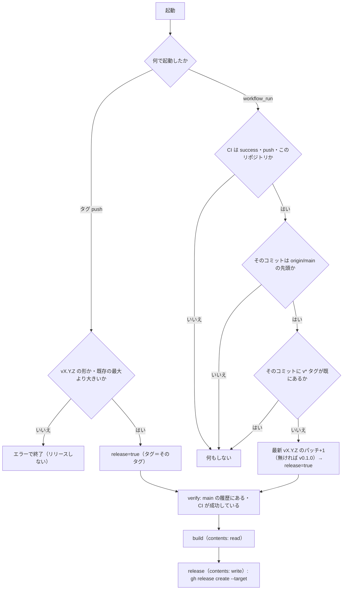

# 環境構築：CI/CD

[環境構築](setup.md) の続き。CI/CD（`ci.yml`・`release.yml`・自動タグ付きリリース・デプロイ）を定める。

改訂履歴は [環境構築（本書）](setup.md#改訂履歴) にまとめてある。

## CI/CD

### トリガーとジョブ構成

```mermaid
flowchart LR
    T["push / pull_request"] --> J["ci.yml: job test (ubuntu-latest)"]
    J --> S1["checkout"] --> S2["setup-go (go.mod)"] --> S3["apt install tmux"]
    S3 --> S4["go build ./..."] --> S5["go vet ./..."] --> S6["golangci-lint"] --> S7["linterly check"] --> S7b["plan-release_test.sh"] --> S7c["install_test.sh"] --> S8["go test -race ./..."]
    S8 --> CIOK["main への push の CI が成功"] --> RP["release.yml: plan（次の版を決める）"]
    TAG["手で打ったタグ vX.Y.Z"] --> RP
    RP --> RV["verify（main の履歴・CI 成功）"] --> RB["build linux/amd64"] --> RR["release（タグを付けて Releases に載せる）"]
```



- 全ジョブを GitHub ホストのランナー（`runs-on: ubuntu-latest`）で動かす。
- Go と golangci-lint は `actions/setup-go`（`go-version-file: go.mod`）と `golangci/golangci-lint-action` で入れる。
- tmux はジョブの中で `apt-get install` して入れ、続く `Check tmux` ステップで `tmux -V` により入ったことを確かめる。
- 1 ジョブ内で、build・vet・lint・linterly・release plan test（`plan-release.sh` の表駆動テスト。NFR-TEST-15）・install script test（`make install` の `install.sh` のテスト。NFR-TEST-18）・test を別ステップで順に実行する（失敗したステップで止まり、どのコマンドで落ちたか分かる）。
- ステップ順は lint → test の前に build・vet を置く（コンパイルエラーを先に出す）。
- `concurrency` で同じ ref の古い実行をキャンセルする。`permissions` は `contents: read`。

### `.github/workflows/ci.yml`（骨子）

```yaml
name: CI
on:
  push:
    branches: [main]
  pull_request:

permissions:
  contents: read

concurrency:
  group: ci-${{ github.ref }}
  cancel-in-progress: true

jobs:
  test:
    runs-on: ubuntu-latest
    steps:
      - uses: actions/checkout@v4
      - uses: actions/setup-go@v5
        with:
          go-version-file: go.mod
      - name: Install tmux
        run: sudo apt-get update && sudo apt-get install -y tmux
      - name: Check tmux
        run: tmux -V
      - name: Build
        run: go build ./...
      - name: Vet
        run: go vet ./...
      - name: golangci-lint
        uses: golangci/golangci-lint-action@v8
        with:
          version: v2.12
      - name: Linterly
        run: go install github.com/ousiassllc/linterly/cmd/linterly@v0.3.3 && linterly check
      - name: Release plan test
        run: bash .github/scripts/plan-release_test.sh
      - name: Install script test
        run: bash scripts/install_test.sh
      - name: Test
        run: go test -race ./...
```

- `push` は `main` のみ、それ以外は PR で検証する（ブランチ push と PR の二重実行を避ける）。
- tmux のバージョンは ubuntu-latest のパッケージ（3.x）。テストは専用ソケットで起動し、固定時間の待ちに頼らない（NFR-TEST-7）。
- `linterly` は `@v0.3.3` に固定する（再現性のため。golangci-lint の `version: v2.12` と同じ扱い）。上げるときは `ci.yml`・この節・[setup-quality.md](setup-quality.md#linterly)・[setup.md](setup.md) の版をそろえ、ローカルで `linterly check` が通ることを確かめてから変える。

### `.github/workflows/release.yml`

リリースの決まり。構成は同じ組織の mam（`ousiassllc/mam`）の `.github/workflows/release.yml` に合わせた（mam にある Windows・macOS のビルド・署名・脆弱性チェックは持たない）。版の形は Issue #7（新しい版の確認）が読む `vX.Y.Z` と同じ。

| 項目 | 決まり |
|------|--------|
| 版の上げ方 | **毎回パッチを上げる**（ヒアリングで選択。P-50）。main の先頭の CI が成功するたびに、既存の最新の `vX.Y.Z`（semver で最大）のパッチ版を 1 つ上げた版を付ける。タグが 1 つも無ければ `v0.1.0`。コミットメッセージ（`feat:`・`fix:`）は見ない。docs だけの変更でも版は上がる |
| マイナー・メジャー | 手で `vX.Y.Z` のタグを打つ（`git tag -s`・`git push origin vX.Y.Z`）。次の自動の版は、その手のタグを最新として、そのパッチ+1 になる |
| きっかけ | CI（`ci.yml`、`name: CI`）の `workflow_run`（`completed`）。リポジトリ内の main への push の CI が `success` のときだけ（PR・フォークの CI は対象外）。もう 1 つは手で打ったタグ `v*` の push |
| main の先頭だけ | `workflow_run` では、CI が通ったコミットが今の `origin/main` の先頭と違えば何もしない（古いコミットに新しい版を付けない）。そのコミットに既に `v*` タグがあるときも何もしない（再実行で二重に付けない） |
| 手で打ったタグの検査 | `^v[0-9]+\.[0-9]+\.[0-9]+$` に合う（プレリリースは不可）。打ったタグ以外の既存のどの `vX.Y.Z` よりも大きい（GitHub の「最新のリリース」は版の大きさでなくリリースの日時順で決まるため、小さい版を後から付けると「最新」が古い版に戻り、Issue #7 の確認が狂う）。main の履歴にあるコミットで、そのコミットの `ci.yml` が成功している。どれかが違えば、タグは残るがリリースは作らずエラーで終わる（P-53） |
| タグの付け方 | `GITHUB_TOKEN` で push したタグは別のワークフローを起動しない。そのため、別ワークフローに渡さず、`release.yml` の中で `gh release create <タグ> --target <コミット>` を使い、リリースと同時にタグも作る（手で打ったタグは既にあるのでそのまま使う）。ビルドが落ちればタグも作られない（欠番が出ない） |
| 同時に動くとき | `concurrency: group: release`・`cancel-in-progress: false`。次の版は直列になった実行の中で、そのときの既存タグから決める。`gh release create` は既存のリリースを上書きしない（ぶつかれば失敗する）。GitHub の仕様で、実行中 1 つ・待ち 1 つまでで、待ちが増えると古い待ちはキャンセルされる。古い main のコミットは対象外なので問題ないが、手で打ったタグの実行がキャンセルされたら、その実行を再実行する（P-51） |
| 変更履歴 | `gh release create --generate-notes`（GitHub が前のタグからのマージ済み PR・コミットを一覧にする）。`CHANGELOG.md` は作らない（P-52） |
| 成果物 | 2 つだけ：バイナリ `swarm-console_<タグ>_linux_amd64`（例 `swarm-console_v0.1.5_linux_amd64`。linux/amd64、`-trimpath`、`-X main.version=<タグ。v 付き>`。版・OS・arch を名前に含める）と `SHA256SUMS`（`sha256sum` の出力どおり。1 行 `<64 桁の小文字 16 進>␣␣swarm-console_<タグ>_linux_amd64`）。Issue #7 の自己更新（機能要件 FR-UPD-13・14、P-57）がこの 2 つの名前・書式で取りに来る。変えるときは #7 の仕様書も同時に直す |
| 権限 | 既定は `contents: read`。`contents: write` を持つのは `release` ジョブだけ（ビルドのジョブは書き込みトークンを持たない）。PR のコードは動かさない（`workflow_run` は main の CI だけが対象）。使う action は GitHub 公式（`actions/*`）だけ |
| ランナー | GitHub ホスト（`ubuntu-latest`）。リポジトリは public |
| 最初のリリース | 新しい `release.yml` が main に入ったあとの、次の main の CI 成功で `v0.1.0`（今はタグ・リリースとも無い）。`workflow_run` は main にあるワークフローファイルだけが動くので、この変更を入れた PR 自身では動かない |

手順（`plan` ジョブ）：



骨子（実装時に細部を詰める。mam の `release.yml` の `plan`・`verify`・`release` を基にする）：

```yaml
name: Release
on:
  push:
    tags: ["v*"]
  workflow_run:
    workflows: [CI]
    types: [completed]
    branches: [main]

permissions:
  contents: read

concurrency:
  group: release
  cancel-in-progress: false

env:
  # リリースするコミット：CI が通ったもの（workflow_run）か、タグが指すもの（tag push）
  RELEASE_SHA: ${{ github.event.workflow_run.head_sha || github.sha }}

jobs:
  plan:
    if: >-
      github.event_name == 'push' ||
      (github.event.workflow_run.conclusion == 'success' &&
       github.event.workflow_run.event == 'push' &&
       github.event.workflow_run.head_repository.full_name == github.repository)
    runs-on: ubuntu-latest
    outputs:
      release: ${{ steps.plan.outputs.release }}
      tag: ${{ steps.plan.outputs.tag }}
    steps:
      - uses: actions/checkout@v4
        with:
          ref: ${{ env.RELEASE_SHA }}
          fetch-depth: 0 # 全タグ（最新の版）と main の先頭
          persist-credentials: false
      - id: plan
        name: Decide the release and its tag
        run: bash .github/scripts/plan-release.sh # 上の図のとおり。release・tag を $GITHUB_OUTPUT へ

  verify:
    needs: plan
    if: needs.plan.outputs.release == 'true'
    runs-on: ubuntu-latest
    permissions:
      contents: read
      actions: read # gh run list（コミットの CI 結果）
    steps:
      - uses: actions/checkout@v4
        with:
          ref: ${{ env.RELEASE_SHA }}
          fetch-depth: 0
      - name: The commit is in main's history
        run: git merge-base --is-ancestor "$RELEASE_SHA" origin/main
      - name: ci.yml succeeded on the commit
        env:
          GH_TOKEN: ${{ github.token }}
        run: |
          ok="$(gh run list --workflow ci.yml --commit "$RELEASE_SHA" --json conclusion --jq 'any(.[]; .conclusion == "success")')"
          [ "$ok" = true ] || { echo "::error::no successful CI run for $RELEASE_SHA"; exit 1; }

  build:
    needs: [plan, verify]
    runs-on: ubuntu-latest
    permissions:
      contents: read
    steps:
      - uses: actions/checkout@v4
        with:
          ref: ${{ env.RELEASE_SHA }}
          persist-credentials: false
      - uses: actions/setup-go@v5
        with:
          go-version-file: go.mod
      - name: Build
        env:
          TAG: ${{ needs.plan.outputs.tag }}
        run: |
          mkdir -p dist
          CGO_ENABLED=0 GOOS=linux GOARCH=amd64 go build -trimpath \
            -ldflags "-s -w -X main.version=${TAG}" \
            -o "dist/swarm-console_${TAG}_linux_amd64" ./cmd/swarm-console
          (cd dist && sha256sum "swarm-console_${TAG}_linux_amd64" > SHA256SUMS)
      - uses: actions/upload-artifact@v4
        with:
          name: release
          path: dist/
          if-no-files-found: error

  release:
    needs: [plan, build]
    runs-on: ubuntu-latest
    permissions:
      contents: write # このジョブだけ。タグもここで作る
    steps:
      - uses: actions/download-artifact@v4
        with:
          name: release
          path: dist
      - name: Create the release
        env:
          GH_TOKEN: ${{ github.token }}
          GH_REPO: ${{ github.repository }} # checkout しないジョブ
          TAG: ${{ needs.plan.outputs.tag }}
        run: |
          # --target で、リリースするコミットにタグを作る（手で打ったタグは既にあるのでそのまま使う）
          gh release create "$TAG" --title "$TAG" --generate-notes --target "$RELEASE_SHA" \
            "dist/swarm-console_${TAG}_linux_amd64" dist/SHA256SUMS
```

- `plan` の処理は `.github/scripts/plan-release.sh` に切り出し、`bash` のテスト（表駆動）で確かめる（NFR-TEST-15）。ワークフローの YAML に長いシェルを埋め込まない。
- 今の `release.yml`（タグ `v*` の push で 1 ジョブ）は、手で打ったタグの経路としてそのまま残る（`plan` が検査を足す）。

デプロイは、既定では `serve` が新しい版を見つけて自分で入れ替える（自己更新。Issue #7、機能要件 §12.4）。`update_auto = false` のときは、新バイナリを `~/bin/swarm-console/` に手で入れ替え、`systemctl --user restart swarm-console` する（[アーキテクチャ設計 §7](../architecture/deployment.md#7-デプロイ構成)）。リリース（Releases にバイナリが載ること）は main の CI 成功ごとに自動。
