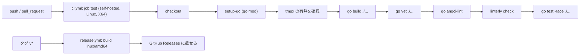

# 環境構築

swarm-console の開発環境・CI/CD・Lint・Format・Linterly・Git Hooks の構成を定める。要件は [非機能要件 §7](../requirements/non-functional.md#7-テストci-要件)、パッケージ構成は [コンポーネント設計 §2](../components/overview.md#2-パッケージ構成) を参照する。

## 概要

| 項目 | 内容 |
|------|------|
| 言語 | Go 1 バイナリ（`go.mod` の `go` ディレクティブは 1.26 以上。開発機は go1.26.5） |
| MCP | 公式 Go SDK（`github.com/modelcontextprotocol/go-sdk`） |
| パッケージ管理 | Go modules（`go.mod`・`go.sum`）。TypeScript / JavaScript は使わないため bun は不要 |
| 外部ランタイム依存 | tmux 3.x（開発機は 3.2a）。テストでも実 tmux を使う |
| CI/CD | GitHub Actions（`ci.yml`・`release.yml`）。**org のセルフホステッドランナー**（`runs-on: [self-hosted, Linux, X64]`）で動かす |
| Lint / Format | golangci-lint v2（開発機は 2.12.2）。format も同じ設定で管理（gofmt・goimports） |
| 行数管理 | Linterly（`.linterly.yml`） |
| Git Hooks | Lefthook（開発機は 2.1.17） |
| タスクランナー | Makefile |
| Swagger / OpenAPI | 対象外（API は MCP（JSON-RPC）で、仕様は [API 仕様](../api/endpoints.md) で管理する） |

## ディレクトリ構造

パッケージ構成は [コンポーネント設計 §2](../components/overview.md#2-パッケージ構成) に定める。環境構築に関わるファイルは次のとおり。

```
swarm-console/
├── .github/workflows/ci.yml        CI
├── .github/workflows/release.yml   タグ v* でバイナリを GitHub Releases へ
├── .golangci.yml                   lint / format 設定
├── .linterly.yml                   行数管理設定
├── .linterlyignore                 行数管理の除外（`docs/**` のみ。P-31）
├── lefthook.yml                    Git Hooks
├── Makefile                        タスクランナー
├── go.mod / go.sum
└── docs/environment/setup.md       このドキュメント
```

## 開発環境セットアップ

### 必要なツール

| ツール | バージョン | 用途 | 導入 |
|--------|-----------|------|------|
| Go | 1.26 以上 | ビルド・テスト | https://go.dev/dl/ |
| tmux | 3.x | 統合テスト・実運用（CI はセルフホステッドランナーの tmux を使う）（`load-buffer -`・`paste-buffer -p` が必要） | `apt install tmux` |
| golangci-lint | v2 系（2.12 以上） | lint / format | 公式のインストールスクリプト、または `go install github.com/golangci/golangci-lint/v2/cmd/golangci-lint@latest` |
| Lefthook | 2.x | Git Hooks | `go install github.com/evilmartians/lefthook@latest` |
| Linterly | 最新 | 行数管理 | `go install github.com/ousiassllc/linterly/cmd/linterly@latest` |
| make | — | タスクランナー | `apt install make` |
| tailscale | — | 実機での接続確認のみ（開発・テストでは不要） | 運用ホストに導入済み |

### 初回セットアップ

```sh
git clone git@github.com:ousiassllc/swarm-console.git
cd swarm-console
go mod download
lefthook install        # pre-commit / pre-push を有効化
make check              # build → vet → lint → linterly → test を順に実行
```

### ローカルで動かす

`listen_addr` はテスト用にループバックを許可している（[アーキテクチャ設計 P-01](../architecture/overview.md#9-提案した既定値と実装時確認事項)）。実機では `tailscale ip -4` の値を書く。

```sh
mkdir -p ~/.config/swarm-console
cat > ~/.config/swarm-console/config.toml <<'EOF'
listen_addr = "127.0.0.1:48120"
sessions = ["0"]
# 作業フォルダにしてはいけないパス（cwd・file を拒否）。書かなければ既定の ["~/dotfiles"]。
# 書いたら既定と入れ替わるので、~/dotfiles も守るなら一緒に書く（~ は展開して絶対パスで比較）。
# denied_paths = ["~/dotfiles", "/mnt/nvme/ousiassllc/some-checkout"]
EOF
go run ./cmd/swarm-console token add dev --scope ops   # 表示されたトークンを控える（再表示不可）
go run ./cmd/swarm-console serve --config ~/.config/swarm-console/config.toml
```

### 高負荷ホストでの実行

開発機（example-host）は他の作業で高負荷になりやすい（CPU 数に対し load average が大きく上回る状態が続くことがある）。

- build・vet・lint・test は 1 本のコマンドに詰めず、別々に 1 つずつ実行する（`make check` も直列）。
- 実行前に `uptime` で load average を `nproc` と比べる。超えているときは並列数を下げる（`GOMAXPROCS`、`go test -p 4`、golangci-lint は `.golangci.yml` の `run.concurrency: 4`）。
- tmux を使うテストは専用ソケット（`-L`）を使い、動いている本番の tmux サーバー（セッション `0`）に触れない。

## CI/CD

### トリガーとジョブ構成



- 全ジョブを org のセルフホステッドランナーで動かす。`runs-on` は `[self-hosted, Linux, X64]`（macOS のランナーに乗らないよう Linux・X64 まで指定する）。
- Go と golangci-lint はランナーの既存環境に頼らず、`actions/setup-go`（`go-version-file: go.mod`）と `golangci/golangci-lint-action` で入れる。
- tmux はランナーに入っている前提。ジョブの先頭ステップ（`Check tmux`）で `command -v tmux` を確かめ、無ければ分かるメッセージを出して失敗させる。**ジョブからもランナーへ sudo で入れない**（導入はランナーの管理者の作業）。
- ランナー側の不具合（node・PATH など）で落ちたときは、ワークフローで回避せずランナーの管理者に報告する。
- 1 ジョブ内で、build・vet・lint・linterly・test を別ステップで順に実行する（失敗したステップで止まり、どのコマンドで落ちたか分かる）。
- ステップ順は lint → test の前に build・vet を置く（コンパイルエラーを先に出す）。
- `concurrency` で同じ ref の古い実行をキャンセルする。`permissions` は `contents: read`。

### `.github/workflows/ci.yml`（骨子）

```yaml
name: CI
on:
  push:
    branches: [main]
  pull_request:

permissions:
  contents: read

concurrency:
  group: ci-${{ github.ref }}
  cancel-in-progress: true

jobs:
  test:
    runs-on: [self-hosted, Linux, X64]
    steps:
      - uses: actions/checkout@v4
      - uses: actions/setup-go@v5
        with:
          go-version-file: go.mod
      - name: Check tmux
        run: |
          if ! command -v tmux >/dev/null 2>&1; then
            echo "::error title=tmux がありません::ランナーの管理者が tmux 3.x を導入してください（ジョブからは入れません）。"
            exit 1
          fi
          tmux -V
      - name: Build
        run: go build ./...
      - name: Vet
        run: go vet ./...
      - name: golangci-lint
        uses: golangci/golangci-lint-action@v8
        with:
          version: v2.12
      - name: Linterly
        run: go install github.com/ousiassllc/linterly/cmd/linterly@latest && linterly check
      - name: Test
        run: go test -race ./...
```

- `push` は `main` のみ、それ以外は PR で検証する（ブランチ push と PR の二重実行を避ける）。
- tmux のバージョンはランナーに入っているもの（3.x を想定）。テストは専用ソケットで起動し、固定時間の待ちに頼らない（NFR-TEST-7）。
- 実装時に `linterly` を `@latest` から固定バージョンへ上げる（再現性のため）。

### `.github/workflows/release.yml`（骨子）

```yaml
name: Release
on:
  push:
    tags: ["v*"]

permissions:
  contents: write

jobs:
  release:
    runs-on: [self-hosted, Linux, X64]
    steps:
      - uses: actions/checkout@v4
      - uses: actions/setup-go@v5
        with:
          go-version-file: go.mod
      - name: Build
        run: |
          mkdir -p dist
          CGO_ENABLED=0 GOOS=linux GOARCH=amd64 go build -trimpath \
            -ldflags "-s -w -X main.version=${GITHUB_REF_NAME}" \
            -o dist/swarm-console ./cmd/swarm-console
          (cd dist && sha256sum swarm-console > SHA256SUMS)
      - name: Release
        env:
          GH_TOKEN: ${{ github.token }}
        run: gh release create "$GITHUB_REF_NAME" dist/swarm-console dist/SHA256SUMS --generate-notes
```

デプロイは自動化しない。サーバーでは新バイナリを `~/bin/swarm-console/` に手で入れ替え、`systemctl --user restart swarm-console` する（[アーキテクチャ設計 §7](../architecture/overview.md#7-デプロイ構成)）。

## Lint

| 項目 | 内容 |
|------|------|
| ツール | golangci-lint v2（`version: "2"` 形式の設定） |
| 設定ファイル | `.golangci.yml` |
| 実行 | `make lint`（`golangci-lint run ./...`） |
| 方針 | standard セットに、安全要件（シェル実行なし・パス検証・制御文字）と相性のよい linter を足す。除外（`//nolint`）は理由コメント必須（`nolintlint`） |

```yaml
version: "2"
run:
  concurrency: 4        # 高負荷ホストで他の作業を圧迫しない
  timeout: 5m
linters:
  default: standard     # errcheck・govet・ineffassign・staticcheck・unused
  enable:
    - gosec             # 安全要件（シェル実行なし、パス・ファイル権限）
    - revive
    - errorlint         # errors.Is / As の徹底
    - bodyclose         # HTTP 応答の閉じ忘れ
    - noctx             # context なしの HTTP / exec
    - nolintlint
    - misspell
formatters:
  enable:
    - gofmt
    - goimports
```

- `gosec` は `os/exec` を使う `internal/tmux`・`internal/host` に対して指摘が出る。引数配列渡し・許可リストで安全が担保される箇所は `//nolint:gosec // 理由` を付ける（理由なしは `nolintlint` が拒否）。
- linter の追加・除外を変えるときは、このドキュメントと `.golangci.yml` を同じコミットで更新する。

## Format

| 項目 | 内容 |
|------|------|
| ツール | gofmt・goimports（golangci-lint v2 の `formatters`） |
| 設定ファイル | `.golangci.yml`（上記 `formatters`） |
| 実行 | `make fmt`（`golangci-lint fmt ./...`）、検査のみは `make fmt-check`（`golangci-lint fmt --diff ./...`） |
| 対象 | `*.go`。markdown・yml・toml は自動整形しない |

## Linterly

| 項目 | 内容 |
|------|------|
| 目的 | ファイル・ディレクトリの行数肥大化を防ぐ |
| インストール | `go install github.com/ousiassllc/linterly/cmd/linterly@latest`（Go プロジェクトのため bun ではなく go install） |
| 設定ファイル | `.linterly.yml`、除外は `.linterlyignore` |
| 実行 | `make linterly`（`linterly check`） |

```yaml
rules:
  # max_lines_per_file / max_lines_per_directory はデフォルト値（300/2000）を使う。
  # 特別な理由がない限り変更しない。
  # max_lines_per_file: 300
  # max_lines_per_directory: 2000
  warning_threshold: 10       # 早めに警告を出す

count_mode: all               # 変更しない
default_excludes: true
language: ja

# ignore でパス別に除外する場合は慎重に。生成コードなど明確な理由がある場合のみ追加する。
# ignore:
#   - "internal/generated/**"
```

`.linterlyignore`（`docs/**` のみ除外する。手書きのソースコードは除外しない）：

```
# 仕様書（markdown）は行数管理の対象外（P-31。分割は別 Issue）
docs/**
# 自動生成コード（必要になった場合のみ追加する）
# *.generated.go
# *.pb.go
```

- 上限（`warn`: 閾値超え・終了コード 0、`error`: 上限超え・終了コード 1）に当たったら、除外ではなくパッケージ・ファイルの分割で解消する。
- 仕様書（`docs/`）は手書きのソースコードではないため `.linterlyignore` で除外する（[アーキテクチャ設計 P-31](../architecture/overview.md#9-提案した既定値と実装時確認事項)）。
- テストの画面サンプル（`testdata/screens/`）は 1 ファイル 1 画面にして上限を守る。

## Git Hooks

| 項目 | 内容 |
|------|------|
| ツール | Lefthook（`lefthook.yml`） |
| 有効化 | `lefthook install`（初回セットアップ） |
| 方針 | `--no-verify` は使わない。フックが失敗したらスキップせず原因を直す |

```yaml
pre-commit:
  parallel: false
  commands:
    format:
      glob: "*.go"
      run: golangci-lint fmt {staged_files}
      stage_fixed: true
    lint:
      glob: "*.go"
      run: golangci-lint run --new-from-rev=HEAD ./...
    linterly:
      run: linterly check

pre-push:
  parallel: false
  commands:
    build:
      run: go build ./...
    vet:
      run: go vet ./...
    test:
      run: go test -race ./...
```

| フック | 内容 | 狙い |
|--------|------|------|
| pre-commit | gofmt・goimports（staged、整形結果を自動で add）→ golangci-lint（変更分）→ linterly | 小さく速い検査でコミットを汚さない |
| pre-push | `go build` → `go vet` → `go test -race`（別コマンドを直列で実行） | CI と同じコマンドを push 前にローカルで通す |

- pre-push の `go test -race` は tmux を使う統合テストを含み、高負荷ホストでは重い。push 前に `uptime` を確認し、load average が `nproc` を超える間は並列数を下げて実行する（上記「高負荷ホストでの実行」）。
- CI でしか確認できない項目（実クライアント接続など）は、報告で「未確認」と明記する。

## タスクランナー（Makefile）

| ターゲット | 内容 |
|-----------|------|
| `make build` | `go build -o bin/swarm-console ./cmd/swarm-console` |
| `make vet` | `go vet ./...` |
| `make lint` | `golangci-lint run ./...` |
| `make fmt` / `make fmt-check` | 整形 / 整形差分の検査 |
| `make linterly` | `linterly check` |
| `make test` | `go test -race ./...` |
| `make check` | build → vet → lint → linterly → test を別ターゲットとして順に実行 |

`make check` は CI の `ci.yml` と同じ順序・同じコマンドにする（差が出たら両方を直す）。

## Swagger/OpenAPI

対象外。swarm-console の API は MCP（Streamable HTTP、JSON-RPC。窓口は `/report` と `/ops`）で、REST のエンドポイント群ではない。入出力・エラー・ツールは [API 仕様](../api/endpoints.md) を正とし、`SWAGGER_ENABLED`・`/swagger`・Stoplight Elements は導入しない。

## 改訂履歴

| 版 | 日付 | 変更内容 | 変更理由 |
|----|------|---------|---------|
| 1.0 | 2026-10-31 | 新規作成 | 初版 |
