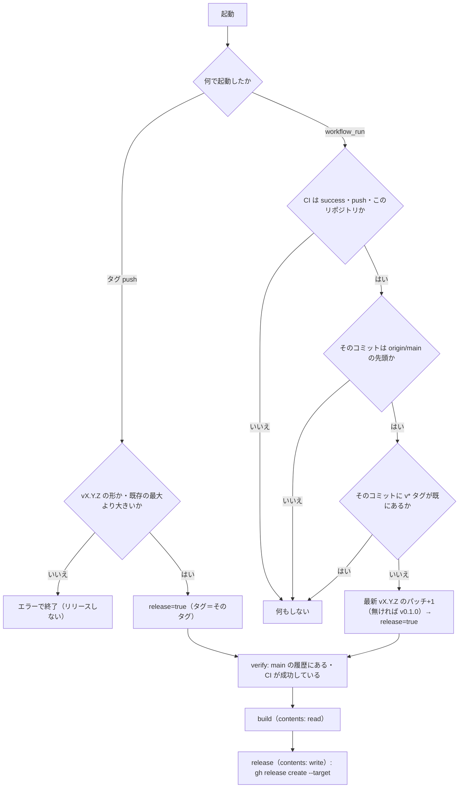

# 環境構築

swarm-console の開発環境・CI/CD・Lint・Format・Linterly・Git Hooks の構成を定める。要件は [非機能要件 §7](../requirements/non-functional.md#7-テストci-要件)、パッケージ構成は [コンポーネント設計 §2](../components/overview.md#2-パッケージ構成) を参照する。

## 概要

| 項目 | 内容 |
|------|------|
| 言語 | Go 1 バイナリ（`go.mod` の `go` ディレクティブは 1.26 以上。開発機は go1.26.5） |
| MCP | 公式 Go SDK（`github.com/modelcontextprotocol/go-sdk`） |
| パッケージ管理 | Go modules（`go.mod`・`go.sum`）。TypeScript / JavaScript は使わないため bun は不要 |
| 外部ランタイム依存 | tmux 3.x（開発機は 3.2a）。テストでも実 tmux を使う |
| CI/CD | GitHub Actions（`ci.yml`・`release.yml`）。GitHub ホストのランナー（`runs-on: ubuntu-latest`）で動かす。main の CI が成功すると `release.yml` が次の版のタグを付けて GitHub Releases に載せる（人がタグを打たなくてよい） |
| Lint / Format | golangci-lint v2（開発機は 2.12.2）。format も同じ設定で管理（gofmt・goimports） |
| 行数管理 | Linterly（`.linterly.yml`） |
| Git Hooks | Lefthook（開発機は 2.1.17） |
| タスクランナー | Makefile |
| Swagger / OpenAPI | 対象外（API は MCP（JSON-RPC）で、仕様は [API 仕様](../api/endpoints.md) で管理する） |

## ディレクトリ構造

パッケージ構成は [コンポーネント設計 §2](../components/overview.md#2-パッケージ構成) に定める。環境構築に関わるファイルは次のとおり。

```
swarm-console/
├── .github/workflows/ci.yml        CI
├── .github/workflows/release.yml   main の CI 成功（または手で打ったタグ v*）でタグを付け、バイナリを GitHub Releases へ
├── .golangci.yml                   lint / format 設定
├── .linterly.yml                   行数管理設定
├── .linterlyignore                 行数管理の除外（`docs/**` のみ。P-31）
├── lefthook.yml                    Git Hooks
├── Makefile                        タスクランナー
├── go.mod / go.sum
└── docs/environment/setup.md       このドキュメント
```

## 開発環境セットアップ

### 必要なツール

| ツール | バージョン | 用途 | 導入 |
|--------|-----------|------|------|
| Go | 1.26 以上 | ビルド・テスト | https://go.dev/dl/ |
| tmux | 3.x | 統合テスト・実運用（`load-buffer -`・`paste-buffer -p` が必要） | `apt install tmux` |
| golangci-lint | v2 系（2.12 以上） | lint / format | 公式のインストールスクリプト、または `go install github.com/golangci/golangci-lint/v2/cmd/golangci-lint@latest` |
| Lefthook | 2.x | Git Hooks | `go install github.com/evilmartians/lefthook@latest` |
| Linterly | 最新 | 行数管理 | `go install github.com/ousiassllc/linterly/cmd/linterly@latest` |
| make | — | タスクランナー | `apt install make` |
| tailscale | — | 実機での接続確認のみ（開発・テストでは不要） | 運用ホストに導入済み |

### 初回セットアップ

```sh
git clone git@github.com:ousiassllc/swarm-console.git
cd swarm-console
go mod download
lefthook install        # pre-commit / pre-push を有効化
make check              # build → vet → lint → linterly → test を順に実行
```

### ローカルで動かす

`listen_addr` はテスト用にループバックを許可している（[アーキテクチャ設計 P-01](../architecture/overview.md#9-提案した既定値と実装時確認事項)）。実機では `tailscale ip -4` の値を書く。

```sh
mkdir -p ~/.config/swarm-console
cat > ~/.config/swarm-console/config.toml <<'EOF'
listen_addr = "127.0.0.1:48120"
sessions = ["0"]
# 作業フォルダにしてはいけないパス（cwd・file を拒否）。書かなければ既定の ["~/dotfiles"]。
# 書いたら既定と入れ替わるので、~/dotfiles も守るなら一緒に書く（~ は展開して絶対パスで比較）。
# denied_paths = ["~/dotfiles", "/mnt/nvme/ousiassllc/some-checkout"]
EOF
go run ./cmd/swarm-console token add dev --scope ops   # 表示されたトークンを控える（再表示不可）
go run ./cmd/swarm-console serve --config ~/.config/swarm-console/config.toml
```

手書きの代わりに、対話型でも同じ `config.toml` を作れる（[機能要件 §11](../requirements/functional.md#11-対話型の設定fr-set)）。端末（TTY）が要る。手で書いた `config.toml` を開いて直してもよく、触っていない項目は 1 バイトも変わらない。

```sh
go run ./cmd/swarm-console setup                       # 既定は ~/.config/swarm-console/config.toml
go run ./cmd/swarm-console setup --config ./my.toml    # 別の場所
```

端末でない環境（SSH の `-t` なし・CI・パイプ）では終了コード 1 で終わる。その場合は上のように手で書く。保存したら `systemctl --user restart swarm-console` で反映する。

### 高負荷ホストでの実行

開発機（example-host）は他の作業で高負荷になりやすい（CPU 数に対し load average が大きく上回る状態が続くことがある）。

- build・vet・lint・test は 1 本のコマンドに詰めず、別々に 1 つずつ実行する（`make check` も直列）。
- 実行前に `uptime` で load average を `nproc` と比べる。超えているときは並列数を下げる（`GOMAXPROCS`、`go test -p 4`、golangci-lint は `.golangci.yml` の `run.concurrency: 4`）。
- tmux を使うテストは専用ソケット（`-L`）を使い、動いている本番の tmux サーバー（セッション `0`）に触れない。

## CI/CD

### トリガーとジョブ構成

```mermaid
flowchart LR
    T["push / pull_request"] --> J["ci.yml: job test (ubuntu-latest)"]
    J --> S1["checkout"] --> S2["setup-go (go.mod)"] --> S3["apt install tmux"]
    S3 --> S4["go build ./..."] --> S5["go vet ./..."] --> S6["golangci-lint"] --> S7["linterly check"] --> S7b["plan-release_test.sh"] --> S8["go test -race ./..."]
    S8 --> CIOK["main への push の CI が成功"] --> RP["release.yml: plan（次の版を決める）"]
    TAG["手で打ったタグ vX.Y.Z"] --> RP
    RP --> RV["verify（main の履歴・CI 成功）"] --> RB["build linux/amd64"] --> RR["release（タグを付けて Releases に載せる）"]
```



- 全ジョブを GitHub ホストのランナー（`runs-on: ubuntu-latest`）で動かす。
- Go と golangci-lint は `actions/setup-go`（`go-version-file: go.mod`）と `golangci/golangci-lint-action` で入れる。
- tmux はジョブの中で `apt-get install` して入れ、続く `Check tmux` ステップで `tmux -V` により入ったことを確かめる。
- 1 ジョブ内で、build・vet・lint・linterly・release plan test（`plan-release.sh` の表駆動テスト。NFR-TEST-15）・test を別ステップで順に実行する（失敗したステップで止まり、どのコマンドで落ちたか分かる）。
- ステップ順は lint → test の前に build・vet を置く（コンパイルエラーを先に出す）。
- `concurrency` で同じ ref の古い実行をキャンセルする。`permissions` は `contents: read`。

### `.github/workflows/ci.yml`（骨子）

```yaml
name: CI
on:
  push:
    branches: [main]
  pull_request:

permissions:
  contents: read

concurrency:
  group: ci-${{ github.ref }}
  cancel-in-progress: true

jobs:
  test:
    runs-on: ubuntu-latest
    steps:
      - uses: actions/checkout@v4
      - uses: actions/setup-go@v5
        with:
          go-version-file: go.mod
      - name: Install tmux
        run: sudo apt-get update && sudo apt-get install -y tmux
      - name: Check tmux
        run: tmux -V
      - name: Build
        run: go build ./...
      - name: Vet
        run: go vet ./...
      - name: golangci-lint
        uses: golangci/golangci-lint-action@v8
        with:
          version: v2.12
      - name: Linterly
        run: go install github.com/ousiassllc/linterly/cmd/linterly@latest && linterly check
      - name: Release plan test
        run: bash .github/scripts/plan-release_test.sh
      - name: Test
        run: go test -race ./...
```

- `push` は `main` のみ、それ以外は PR で検証する（ブランチ push と PR の二重実行を避ける）。
- tmux のバージョンは ubuntu-latest のパッケージ（3.x）。テストは専用ソケットで起動し、固定時間の待ちに頼らない（NFR-TEST-7）。
- 実装時に `linterly` を `@latest` から固定バージョンへ上げる（再現性のため）。

### `.github/workflows/release.yml`

リリースの決まり。構成は同じ組織の mam（`ousiassllc/mam`）の `.github/workflows/release.yml` に合わせた（mam にある Windows・macOS のビルド・署名・脆弱性チェックは持たない）。版の形は Issue #7（新しい版の確認）が読む `vX.Y.Z` と同じ。

| 項目 | 決まり |
|------|--------|
| 版の上げ方 | **毎回パッチを上げる**（ヒアリングで選択。P-50）。main の先頭の CI が成功するたびに、既存の最新の `vX.Y.Z`（semver で最大）のパッチ版を 1 つ上げた版を付ける。タグが 1 つも無ければ `v0.1.0`。コミットメッセージ（`feat:`・`fix:`）は見ない。docs だけの変更でも版は上がる |
| マイナー・メジャー | 手で `vX.Y.Z` のタグを打つ（`git tag -s`・`git push origin vX.Y.Z`）。次の自動の版は、その手のタグを最新として、そのパッチ+1 になる |
| きっかけ | CI（`ci.yml`、`name: CI`）の `workflow_run`（`completed`）。リポジトリ内の main への push の CI が `success` のときだけ（PR・フォークの CI は対象外）。もう 1 つは手で打ったタグ `v*` の push |
| main の先頭だけ | `workflow_run` では、CI が通ったコミットが今の `origin/main` の先頭と違えば何もしない（古いコミットに新しい版を付けない）。そのコミットに既に `v*` タグがあるときも何もしない（再実行で二重に付けない） |
| 手で打ったタグの検査 | `^v[0-9]+\.[0-9]+\.[0-9]+$` に合う（プレリリースは不可）。打ったタグ以外の既存のどの `vX.Y.Z` よりも大きい（GitHub の「最新のリリース」は版の大きさでなくリリースの日時順で決まるため、小さい版を後から付けると「最新」が古い版に戻り、Issue #7 の確認が狂う）。main の履歴にあるコミットで、そのコミットの `ci.yml` が成功している。どれかが違えば、タグは残るがリリースは作らずエラーで終わる（P-53） |
| タグの付け方 | `GITHUB_TOKEN` で push したタグは別のワークフローを起動しない。そのため、別ワークフローに渡さず、`release.yml` の中で `gh release create <タグ> --target <コミット>` を使い、リリースと同時にタグも作る（手で打ったタグは既にあるのでそのまま使う）。ビルドが落ちればタグも作られない（欠番が出ない） |
| 同時に動くとき | `concurrency: group: release`・`cancel-in-progress: false`。次の版は直列になった実行の中で、そのときの既存タグから決める。`gh release create` は既存のリリースを上書きしない（ぶつかれば失敗する）。GitHub の仕様で、実行中 1 つ・待ち 1 つまでで、待ちが増えると古い待ちはキャンセルされる。古い main のコミットは対象外なので問題ないが、手で打ったタグの実行がキャンセルされたら、その実行を再実行する（P-51） |
| 変更履歴 | `gh release create --generate-notes`（GitHub が前のタグからのマージ済み PR・コミットを一覧にする）。`CHANGELOG.md` は作らない（P-52） |
| 成果物 | 2 つだけ：バイナリ `swarm-console_<タグ>_linux_amd64`（例 `swarm-console_v0.1.5_linux_amd64`。linux/amd64、`-trimpath`、`-X main.version=<タグ。v 付き>`。版・OS・arch を名前に含める）と `SHA256SUMS`（`sha256sum` の出力どおり。1 行 `<64 桁の小文字 16 進>␣␣swarm-console_<タグ>_linux_amd64`）。Issue #7 の自己更新（機能要件 FR-UPD-13・14、P-57）がこの 2 つの名前・書式で取りに来る。変えるときは #7 の仕様書も同時に直す |
| 権限 | 既定は `contents: read`。`contents: write` を持つのは `release` ジョブだけ（ビルドのジョブは書き込みトークンを持たない）。PR のコードは動かさない（`workflow_run` は main の CI だけが対象）。使う action は GitHub 公式（`actions/*`）だけ |
| ランナー | GitHub ホスト（`ubuntu-latest`）。リポジトリは public |
| 最初のリリース | 新しい `release.yml` が main に入ったあとの、次の main の CI 成功で `v0.1.0`（今はタグ・リリースとも無い）。`workflow_run` は main にあるワークフローファイルだけが動くので、この変更を入れた PR 自身では動かない |

手順（`plan` ジョブ）：



骨子（実装時に細部を詰める。mam の `release.yml` の `plan`・`verify`・`release` を基にする）：

```yaml
name: Release
on:
  push:
    tags: ["v*"]
  workflow_run:
    workflows: [CI]
    types: [completed]
    branches: [main]

permissions:
  contents: read

concurrency:
  group: release
  cancel-in-progress: false

env:
  # リリースするコミット：CI が通ったもの（workflow_run）か、タグが指すもの（tag push）
  RELEASE_SHA: ${{ github.event.workflow_run.head_sha || github.sha }}

jobs:
  plan:
    if: >-
      github.event_name == 'push' ||
      (github.event.workflow_run.conclusion == 'success' &&
       github.event.workflow_run.event == 'push' &&
       github.event.workflow_run.head_repository.full_name == github.repository)
    runs-on: ubuntu-latest
    outputs:
      release: ${{ steps.plan.outputs.release }}
      tag: ${{ steps.plan.outputs.tag }}
    steps:
      - uses: actions/checkout@v4
        with:
          ref: ${{ env.RELEASE_SHA }}
          fetch-depth: 0 # 全タグ（最新の版）と main の先頭
          persist-credentials: false
      - id: plan
        name: Decide the release and its tag
        run: bash .github/scripts/plan-release.sh # 上の図のとおり。release・tag を $GITHUB_OUTPUT へ

  verify:
    needs: plan
    if: needs.plan.outputs.release == 'true'
    runs-on: ubuntu-latest
    permissions:
      contents: read
      actions: read # gh run list（コミットの CI 結果）
    steps:
      - uses: actions/checkout@v4
        with:
          ref: ${{ env.RELEASE_SHA }}
          fetch-depth: 0
      - name: The commit is in main's history
        run: git merge-base --is-ancestor "$RELEASE_SHA" origin/main
      - name: ci.yml succeeded on the commit
        env:
          GH_TOKEN: ${{ github.token }}
        run: |
          ok="$(gh run list --workflow ci.yml --commit "$RELEASE_SHA" --json conclusion --jq 'any(.[]; .conclusion == "success")')"
          [ "$ok" = true ] || { echo "::error::no successful CI run for $RELEASE_SHA"; exit 1; }

  build:
    needs: [plan, verify]
    runs-on: ubuntu-latest
    permissions:
      contents: read
    steps:
      - uses: actions/checkout@v4
        with:
          ref: ${{ env.RELEASE_SHA }}
          persist-credentials: false
      - uses: actions/setup-go@v5
        with:
          go-version-file: go.mod
      - name: Build
        env:
          TAG: ${{ needs.plan.outputs.tag }}
        run: |
          mkdir -p dist
          CGO_ENABLED=0 GOOS=linux GOARCH=amd64 go build -trimpath \
            -ldflags "-s -w -X main.version=${TAG}" \
            -o "dist/swarm-console_${TAG}_linux_amd64" ./cmd/swarm-console
          (cd dist && sha256sum "swarm-console_${TAG}_linux_amd64" > SHA256SUMS)
      - uses: actions/upload-artifact@v4
        with:
          name: release
          path: dist/
          if-no-files-found: error

  release:
    needs: [plan, build]
    runs-on: ubuntu-latest
    permissions:
      contents: write # このジョブだけ。タグもここで作る
    steps:
      - uses: actions/download-artifact@v4
        with:
          name: release
          path: dist
      - name: Create the release
        env:
          GH_TOKEN: ${{ github.token }}
          GH_REPO: ${{ github.repository }} # checkout しないジョブ
          TAG: ${{ needs.plan.outputs.tag }}
        run: |
          # --target で、リリースするコミットにタグを作る（手で打ったタグは既にあるのでそのまま使う）
          gh release create "$TAG" --title "$TAG" --generate-notes --target "$RELEASE_SHA" \
            "dist/swarm-console_${TAG}_linux_amd64" dist/SHA256SUMS
```

- `plan` の処理は `.github/scripts/plan-release.sh` に切り出し、`bash` のテスト（表駆動）で確かめる（NFR-TEST-15）。ワークフローの YAML に長いシェルを埋め込まない。
- 今の `release.yml`（タグ `v*` の push で 1 ジョブ）は、手で打ったタグの経路としてそのまま残る（`plan` が検査を足す）。

デプロイは、既定では `serve` が新しい版を見つけて自分で入れ替える（自己更新。Issue #7、機能要件 §12.4）。`update_auto = false` のときは、新バイナリを `~/bin/swarm-console/` に手で入れ替え、`systemctl --user restart swarm-console` する（[アーキテクチャ設計 §7](../architecture/overview.md#7-デプロイ構成)）。リリース（Releases にバイナリが載ること）は main の CI 成功ごとに自動。

## Lint

| 項目 | 内容 |
|------|------|
| ツール | golangci-lint v2（`version: "2"` 形式の設定） |
| 設定ファイル | `.golangci.yml` |
| 実行 | `make lint`（`golangci-lint run ./...`） |
| 方針 | standard セットに、安全要件（シェル実行なし・パス検証・制御文字）と相性のよい linter を足す。除外（`//nolint`）は理由コメント必須（`nolintlint`） |

```yaml
version: "2"
run:
  concurrency: 4        # 高負荷ホストで他の作業を圧迫しない
  timeout: 5m
linters:
  default: standard     # errcheck・govet・ineffassign・staticcheck・unused
  enable:
    - gosec             # 安全要件（シェル実行なし、パス・ファイル権限）
    - revive
    - errorlint         # errors.Is / As の徹底
    - bodyclose         # HTTP 応答の閉じ忘れ
    - noctx             # context なしの HTTP / exec
    - nolintlint
    - misspell
formatters:
  enable:
    - gofmt
    - goimports
```

- `gosec` は `os/exec` を使う `internal/tmux`・`internal/host` に対して指摘が出る。引数配列渡し・許可リストで安全が担保される箇所は `//nolint:gosec // 理由` を付ける（理由なしは `nolintlint` が拒否）。
- linter の追加・除外を変えるときは、このドキュメントと `.golangci.yml` を同じコミットで更新する。

## Format

| 項目 | 内容 |
|------|------|
| ツール | gofmt・goimports（golangci-lint v2 の `formatters`） |
| 設定ファイル | `.golangci.yml`（上記 `formatters`） |
| 実行 | `make fmt`（`golangci-lint fmt ./...`）、検査のみは `make fmt-check`（`golangci-lint fmt --diff ./...`） |
| 対象 | `*.go`。markdown・yml・toml は自動整形しない |

## Linterly

| 項目 | 内容 |
|------|------|
| 目的 | ファイル・ディレクトリの行数肥大化を防ぐ |
| インストール | `go install github.com/ousiassllc/linterly/cmd/linterly@latest`（Go プロジェクトのため bun ではなく go install） |
| 設定ファイル | `.linterly.yml`、除外は `.linterlyignore` |
| 実行 | `make linterly`（`linterly check`） |

```yaml
rules:
  # max_lines_per_file / max_lines_per_directory はデフォルト値（300/2000）を使う。
  # 特別な理由がない限り変更しない。
  # max_lines_per_file: 300
  # max_lines_per_directory: 2000
  warning_threshold: 10       # 早めに警告を出す

count_mode: all               # 変更しない
default_excludes: true
language: ja

# ignore でパス別に除外する場合は慎重に。生成コードなど明確な理由がある場合のみ追加する。
# ignore:
#   - "internal/generated/**"
```

`.linterlyignore`（`docs/**` のみ除外する。手書きのソースコードは除外しない）：

```
# 仕様書（markdown）は行数管理の対象外（P-31。分割は別 Issue）
docs/**
# 自動生成コード（必要になった場合のみ追加する）
# *.generated.go
# *.pb.go
```

- 上限（`warn`: 閾値超え・終了コード 0、`error`: 上限超え・終了コード 1）に当たったら、除外ではなくパッケージ・ファイルの分割で解消する。
- 仕様書（`docs/`）は手書きのソースコードではないため `.linterlyignore` で除外する（[アーキテクチャ設計 P-31](../architecture/overview.md#9-提案した既定値と実装時確認事項)）。
- テストの画面サンプル（`testdata/screens/`）は 1 ファイル 1 画面にして上限を守る。

## Git Hooks

| 項目 | 内容 |
|------|------|
| ツール | Lefthook（`lefthook.yml`） |
| 有効化 | `lefthook install`（初回セットアップ） |
| 方針 | `--no-verify` は使わない。フックが失敗したらスキップせず原因を直す |

```yaml
pre-commit:
  parallel: false
  commands:
    format:
      glob: "*.go"
      run: golangci-lint fmt {staged_files}
      stage_fixed: true
    lint:
      glob: "*.go"
      run: golangci-lint run --new-from-rev=HEAD ./...
    linterly:
      run: linterly check

pre-push:
  parallel: false
  commands:
    build:
      run: go build ./...
    vet:
      run: go vet ./...
    test:
      run: go test -race ./...
```

| フック | 内容 | 狙い |
|--------|------|------|
| pre-commit | gofmt・goimports（staged、整形結果を自動で add）→ golangci-lint（変更分）→ linterly | 小さく速い検査でコミットを汚さない |
| pre-push | `go build` → `go vet` → `go test -race`（別コマンドを直列で実行） | CI と同じコマンドを push 前にローカルで通す |

- pre-push の `go test -race` は tmux を使う統合テストを含み、高負荷ホストでは重い。push 前に `uptime` を確認し、load average が `nproc` を超える間は並列数を下げて実行する（上記「高負荷ホストでの実行」）。
- CI でしか確認できない項目（実クライアント接続など）は、報告で「未確認」と明記する。

## タスクランナー（Makefile）

| ターゲット | 内容 |
|-----------|------|
| `make build` | `go build -o bin/swarm-console ./cmd/swarm-console` |
| `make vet` | `go vet ./...` |
| `make lint` | `golangci-lint run ./...` |
| `make fmt` / `make fmt-check` | 整形 / 整形差分の検査 |
| `make linterly` | `linterly check` |
| `make plan-test` | `bash .github/scripts/plan-release_test.sh`（次の版を決める処理のテスト。NFR-TEST-15） |
| `make test` | `go test -race ./...` |
| `make check` | build → vet → lint → linterly → plan-test → test を別ターゲットとして順に実行 |

`make check` は CI の `ci.yml` と同じ順序・同じコマンドにする（差が出たら両方を直す）。

## Swagger/OpenAPI

対象外。swarm-console の API は MCP（Streamable HTTP、JSON-RPC。窓口は `/report` と `/ops`）で、REST のエンドポイント群ではない。入出力・エラー・ツールは [API 仕様](../api/endpoints.md) を正とし、`SWAGGER_ENABLED`・`/swagger`・Stoplight Elements は導入しない。

## 改訂履歴

| 版 | 日付 | 変更内容 | 変更理由 |
|----|------|---------|---------|
| 1.0 | 2026-10-31 | 新規作成 | 初版 |
| 1.1 | 2026-11-01 | 「ローカルで動かす」に `setup`（対話型）の使い方を追加 | Issue #5 |
| 1.2 | 2026-11-01 | release.yml の骨子の成果物名を `swarm-console_vX.Y.Z_linux_amd64` に、デプロイの記述を自己更新に更新 | Issue #7（自己更新で確定） |
| 1.3 | 2026-11-01 | CI/CD に自動タグ付きリリース（`release.yml` の `plan`・`verify`・`build`・`release`、版の上げ方、手で打ったタグの検査）を追加 | Issue #8 |
| 1.4 | 2026-11-01 | 成果物名を `swarm-console_<タグ>_linux_amd64`（版・OS・arch 入り）と `SHA256SUMS` の書式に変更、デプロイの記述を自己更新（Issue #7）に合わせて更新 | Issue #8（Issue #7 の自己更新で確定） |
| 1.5 | 2026-11-01 | CI に `plan-release_test.sh` のステップ、Makefile に `plan-test` を追加（NFR-TEST-15 を CI で動かす） | Issue #8 の実装 |
