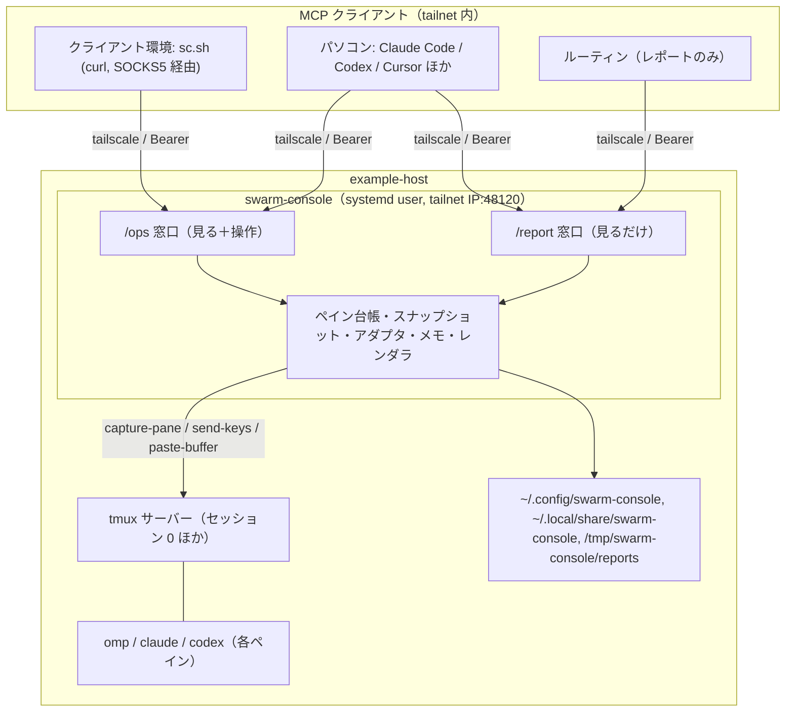

# プロジェクト概要

## 目的

tmux の中で動く AI コーディングエージェント（omp・Claude Code・Codex）を、MCP 経由で次の 4 点が満たせる形にする常駐サーバー `swarm-console` を作る。

1. ペインの画面をまるごと読まずに、状態・質問カード・最終報告を短い JSON で取れる（文字量を減らす）
2. 貼り付け・選択・閉じるなどの手順を 1 回の呼び出しで正しく行える（SSH の回数と手順ミスを減らす）
3. ペインごとに「誰の依頼で、どこに報告し、次に何をするか」をメモとして残し、閉じたあとも履歴で探せる
4. omp だけでなく Claude Code と Codex も同じツールで扱える

## 背景

- example-host 上の tmux に複数のエージェントペインを並べて作業させており、運用エージェントがクライアント環境から tailnet 越しに SSH で画面を読み、キーを送って操作している。
- 画面全体を読むと文字量が大きく、貼り付け・選択・閉じるの手順を SSH 越しに毎回手で組み立てるため、手順ミスと呼び出し回数が増えている。
- ペインを引き継ぐたびに会話を遡って「依頼元・報告先・次にやること」を探している。
- 利用クライアントは curl に限らず、tailnet 内のパソコンの Claude Code・Codex・Cursor など MCP をしゃべれるものすべて。クライアントごとに表示や指示文が揺れないよう、見た目と指示文はサーバー側で組み立てる。
- 元仕様は「swarm-console 仕様 v1.1（完全版）」。本ドキュメント群はそれを仕様書として分割・具体化したもの。

## スコープ

### 含むもの

- MCP（Streamable HTTP）サーバー。窓口は `/report`（見るだけ）と `/ops`（見る＋操作）の 2 つ、ポート 48120（tailnet IP のみで待ち受け）
- 3 つのエージェント（omp・Claude Code・Codex）のアダプタ。画面から状態・質問カード・活動を判定する
- ツール 17 個：見る 9（`report`・`panes_status`・`pane_tail`・`ask_card`・`report_read`・`host_status`・`agent_auth_status`・`note_get`・`note_history`）と操作 8（`ask_pick`・`send_text`・`send_escape`・`pane_start`・`pane_close`・`dispatch`・`note_set`・`note_log`）
- ペインごとのメモと閉じたペインの履歴（JSON ファイル）
- サーバー側で組み立てる `report`（日本語・英語の markdown）と `dispatch`（条件のひな形つき指示文）
- MCP の prompts（`report`・`dispatch`）と resources（`swarm://report`・`swarm://pane/<位置>`・`swarm://notes/<位置>`）
- クライアントごとの Bearer トークン（窓口付き）の発行・無効化 CLI
- systemd ユーザーサービスとしての常駐、GitHub Releases での配布、CI（build・vet・golangci-lint・test -race）
- 実 tmux と擬似エージェント画面を使ったテスト

### 含まないもの

- 任意のシェルコマンドの実行
- tmux セッション・ペインの作成・削除・分割（今あるペインを見つけて使う）
- コードのレビューや git 操作（エージェント側の仕事）
- インターネットへの公開（Funnel・Tunnel は使わない）
- 呼び出し元クライアントごとの許可設定（`send_escape` の利用可否はクライアント単位では持たない）
- クライアント側の呼び出しスクリプト `sc.sh`（リポジトリ外。本サーバーの利用側）
- 段階リリース（§9 のとおり全機能を 1 本で実装する）

## ステークホルダー / 想定ユーザー

| 区分 | 役割 | 備考 |
|------|------|------|
| オーナー | 依頼元・承認者。`send_escape` の OK を出す | 実装着手の最終 OK もオーナー |
| 運用エージェント | 主な利用者。クライアント環境から tailnet 越しに `/ops` を呼び、ペインの監視・指示・引き継ぎを行う | クライアント環境の curl（`sc.sh`） |
| agent-b・agent-a ほか依頼元エージェント | メモの `from`・`report_to` に現れる依頼元・報告先 | 本サーバーを直接呼ぶとは限らない |
| パソコンの AI ツール（Claude Code・Codex・Cursor など） | MCP クライアント。レポート表示や操作を行う | クライアントを決め打ちしない |
| ルーティン（定期レポート） | `/report` のみに接続して `report` を取る | `report` スコープのトークン |
| 運用者（オーナー兼任） | トークン発行、バイナリ入れ替え、`systemctl --user restart` | example-host 上で実施 |

## システム全体像

アーキテクチャの詳細は [architecture/overview.md](architecture/overview.md) を参照。

## ドキュメントマップ

このプロジェクトの仕様は以下のドキュメントで構成される。実装時はそれぞれ参照すること。

| ドキュメント | パス | 概要 |
|------------|------|------|
| 機能要件 | `docs/requirements/functional.md` | ユースケース、機能一覧（17 ツール・レポート・指示文・メモ）、状態遷移、操作フロー、受け入れ確認 |
| 非機能要件 | `docs/requirements/non-functional.md` | 性能目標、セキュリティ（tailnet 限定・認証・拒否規則）、可用性、運用、テスト・CI 要件 |
| アーキテクチャ設計 | `docs/architecture/overview.md` | 全体構成、技術選定、レイヤー構造、スナップショット方式、通信フロー、デプロイ、提案した既定値の一覧 |
| ER / データモデル | `docs/architecture/er.md` | notes.json・tokens.toml・config.toml・profiles.toml・実行時ペイン状態のスキーマと制約 |
| API 仕様 | `docs/api/endpoints.md` | 窓口・認証・エラー形式・全ツールの引数と返り値・prompts・resources |
| コンポーネント設計 | `docs/components/overview.md` | Go パッケージ構成、アダプタ IF、責務、依存関係、テスト構成 |

## マイルストーン / リリース計画

段階リリースはしない。全機能を 1 本で実装する（元仕様 §9）。

- M1: §5〜§7 の全機能（3 アダプタ、見る・操作・メモ・サーバー状態・レポート・指示）を実装。完了条件は、テストが全部通り、CI が緑で、受け入れ確認（機能要件 §8）が通ること
- 実装着手はオーナーの OK のあと

## 用語集

| 用語 | 定義 |
|------|------|
| ペイン | tmux のペイン。1 ペインに 1 エージェント（またはシェル）が入る |
| 位置 | ペインの座標から自動で付ける名前（`T1`・`B4`、複数セッションでは `work:B2`）。tmux ID（`%12`）でも指定できる |
| アダプタ | エージェントごとの違い（起動・終了・状態判定・質問カード・キー操作・飾りの除去）を閉じ込めたモジュール |
| 窓口 | 同じポート 48120 のパスで分けた入口。`/report`（見るだけ）と `/ops`（全部） |
| スコープ | トークンに付く使える窓口（`report` または `ops`） |
| 質問カード | エージェントが選択肢つきで止まっている画面（omp の Ask カード、Claude Code の確認、Codex の承認） |
| 状態 | `working`・`asking`・`idle`・`shell`・`stalled`・`unknown` の 6 つ |
| メモ | ペインごとの引き継ぎ情報（依頼元・報告先・リポジトリ・次にやること など） |
| 履歴 | `pane_close` で閉じたペインのメモの保管（最大 500 件） |
| 最終報告 | エージェントが `/tmp/swarm-console/reports/<位置>.md` に書くファイル。`report_read` で読む |
| スナップショット | 全ペインの画面・状態・ホスト情報を一度に取った結果。`report` と `panes_status` はこれから作る（アーキテクチャ §4） |
| プロファイル | `dispatch` で指示文に足す条件のひな形（`sweep`・`fix`・`investigate`）。`profiles.toml` に置く |
| dispatch | 中身（task）と条件（profile）から決まった形の指示文を組み立てて送るツール |
| tailnet | Tailscale のネットワーク。本サーバーはこの中だけで待ち受ける |
| クライアント環境 | 運用エージェントが動く環境。ユーザースペース tailscale（SOCKS5 localhost:<port>）から接続する |
| omp | 本リポジトリの対象エージェントの 1 つ（`omp` コマンド） |

## 改訂履歴

| 版 | 日付 | 変更内容 | 変更理由 |
|----|------|---------|---------|
| 1.0 | 2026-10-31 | 新規作成（元仕様 v1.1 を仕様書に展開） | 初版 |
