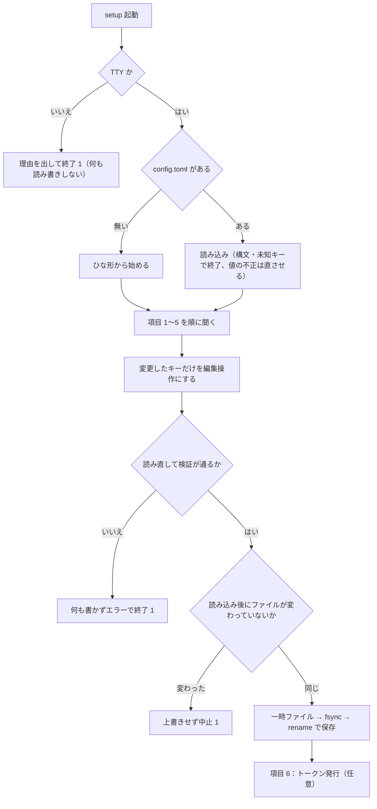

# 機能要件：メモ・安全・対話型の設定

[機能要件](functional.md) の続き。§9 メモ（FR-NOTE）、§10 安全のための決まり（FR-SAFE）、§11 対話型の設定（FR-SET）を定める。

改訂履歴は [機能要件（本書）](functional.md#改訂履歴) にまとめてある。

## 9. メモ（FR-NOTE）

メモの目的：運用エージェントがペインを引き継ぐときに、毎回会話を遡らなくて済むようにする。項目定義は [ER / データモデル](../architecture/er.md#2-notesjson)。

| ID | 要件 |
|----|------|
| FR-NOTE-1 | 項目はすべて任意。分からないものは空のままでよい |
| FR-NOTE-2 | 項目：依頼元 `from`、始まったきっかけ `origin`、始めた人 `started_by`、報告先 `report_to`、リポジトリ `repo`、Issue・PR `items`、作業フォルダ `worktree`、ブランチ `branch`、指示ファイル `instruction`、OK の原文 `approval`、守ること `rules`、いまの状況 `status`、次にやること `next`、再開 ID `resume_id`、自由メモ `memo`。`origin` は `user`（オーナーの指示）か `agent`（エージェントが自分の判断で始めた）のどちらかで、どちらでもなければ空のまま（FR-NOTE-1）。それ以外の値は `invalid_args`。`started_by` は始めた人・エージェントの名前（自由な文字列。例：`かな`）。`from` は依頼元（どのボットからの依頼か）のままで、「かな発」などの印は `from` に混ぜず `origin`・`started_by` に書く。`dispatch`・`note_set`・`note_get` で読み書きでき、`null` で消す決まり（FR-NOTE-4）・秘密の検査（FR-NOTE-8）はほかの項目と同じ。既存のメモは移行しない（新しい項目は空のまま） |
| FR-NOTE-3 | `panes_status` と `report`（markdown・json）には `from`・`origin`・`started_by`・`repo`・`items`・`next` だけを要約として出す。markdown の表では、`origin` が `agent` のとき依頼元のセルに `🤖 <started_by>発` を添える（`started_by` が空なら `🤖 エージェント発`）。`user` と空のときは何も添えない。詳細（`report` の `pane` 指定）のメモには `origin`・`started_by` も項目として出る。`note_history` は `from` に加えて `origin`・`started_by` でも絞り込める（それぞれ完全一致、AND）。`/report` からの書き込みは今までどおりできない（FR-SAFE-6） |
| FR-NOTE-4 | `note_set` は渡した項目だけ書き換え、他の項目は残す。`null` を渡すとその項目を消す |
| FR-NOTE-5 | `note_log` は出来事を時刻つきで 1 行足す（例：「Ask で B を選んだ」「agent-b へ報告した」）。直近 50 行を残す |
| FR-NOTE-6 | `pane_close` はそのペインのメモを履歴に移し、現行メモを消す |
| FR-NOTE-7 | 履歴は 500 件まで。古いものから消す |
| FR-NOTE-8 | 秘密の値は書かない。`ghp_`・`sk-`・`eyJ` で始まる長い文字列、PEM などに見える文字列が入っていたら書き込みを拒否（`secret_detected`。拒否した値は応答・ログに出さない） |
| FR-NOTE-9 | 書き込みは一時ファイルに書いてから rename（途中で落ちても壊れない）。権限 600 |
| FR-NOTE-10 | `send_escape` の実行は `note_log` に自動で残す |
| FR-NOTE-11 | tmux ペインが外部で消えた・tmux サーバーが再起動して ID が再利用され得る場合、旧メモを履歴へ移す（P-15） |
| FR-NOTE-12 | `note_get`・`note_set`・`note_log` は任意の `session` を取り、`pane` を決めたセッションの中で解決する（FR-SESS-5・6）。許可外のセッションのペインのメモは、読み書きとも `session_forbidden`。メモは tmux ID に結び付いたまま（FR-POS-8）。`note_history` は `session` を取らず、ペインのセッションで絞らない（P-89）。メモの要約（`panes_status`・`report`）の位置はセッション内の位置 |

## 10. 安全のための決まり（FR-SAFE）

| ID | 決まり | 内容 |
|----|--------|------|
| FR-SAFE-1 | シェル実行なし | 決まった tmux 操作と、決まったファイル・`/proc` の読み取りだけ |
| FR-SAFE-2 | ペインを壊さない | ペインの kill、セッションの削除、ペインの分割はできない |
| FR-SAFE-3 | 起動できるもの | 設定したエージェント（omp・claude・codex）だけ |
| FR-SAFE-4 | 作業フォルダ | `/mnt/nvme/` の下と `~/projects/` の下だけ許可。`denied_paths` に書いたパスは拒否（既定は `~/dotfiles` だけ。オーナーの checkout も拒否したいなら `denied_paths` に書く。P-29） |
| FR-SAFE-5 | 送れる文字 | 通常の文字と Enter だけ。Esc は `/ops` の `send_escape`（`confirm` 必須）だけ。その他の制御キーは拒否 |
| FR-SAFE-6 | 窓口 | `/report` からは何も変えられない（メモの書き込みも不可）。`/report` の `tools/list` に操作のツールは載らない |
| FR-SAFE-7 | 作業中は閉じない | `pane_close` は `working` のペインを拒否 |
| FR-SAFE-8 | ログ | 誰が・いつ・どのツールを・どのペインに（と、どの `session` 引数で）使ったかを記録する。送った本文とトークンは記録しない |
| FR-SAFE-9 | 呼び出しの間隔 | 同じペインへの操作は前の操作が終わるまで待たせる |
| FR-SAFE-10 | セッションの許可 | トークンごとの許可セッション以外のペインは、読み取りも操作も拒否する（`session_forbidden`。FR-SESS-10） |

## 11. 対話型の設定（FR-SET）

`config.toml` を手で書く今の方法はそのまま残し、対話型（`swarm-console setup`）でも同じファイルを作る・直せるようにする。置き場は 1 つ（`~/.config/swarm-console/config.toml`）で、どちらで書いても `serve` が読む内容は同じ。書き戻しの規則は [ER §5.1](../architecture/er-config.md#51-setup-による書き戻し)、画面を作る部品は [コンポーネント設計](../components/overview.md#3-コンポーネントの責務) を参照する。

| ID | 要件 |
|----|------|
| FR-SET-1 | `swarm-console setup [--config <path>]`。ファイルが無ければ新規作成、あれば読み込んで現在値を初期値にして開く（初回専用ではなく、編集にも使う）。`--config` の既定は `serve`・`token` と同じ |
| FR-SET-2 | 設定の置き場は `serve` が読む `config.toml` だけ。`setup` 専用の別ファイルは持たない。手で書いた内容は次に `setup` で開いたときも読み込まれる |
| FR-SET-3 | 手で書いた値を壊さない。`setup` が触るのは、運用者が画面で値を変えたキーだけ。それ以外のキー・コメント・空行・並び・書式はバイト単位で同じに残す（規則は ER §5.1）。値が変わっていないキー、ファイルに無く既定のままのキーは書かない（既定値を書き出さない） |
| FR-SET-4 | 聞く項目と順番は下表。下表に無いキーは画面に出さず、読み書きとも一切触らない（手で書く） |
| FR-SET-5 | 入力の検証は `serve` の起動時と同じ関数を使う（`0.0.0.0`・`::`・ホスト名・ポート無し・tailnet 外・tailnet の IP の 48120 以外のポートは `listen_addr` として拒否など。ER §5 の検証表と同一）。入力中にその場でエラーを出し、通るまで次へ進めない。保存の直前に、結果のファイルを `serve` と同じ読み込み経路で読み直し、落ちるなら何も書かない |
| FR-SET-6 | 端末（TTY）でないとき（標準入力か標準出力が端末でない、`TERM=dumb`。SSH の `-t` なし・CI・パイプ）は、何も読まず何も書かず、理由と手書きの案内を標準エラーに出して終了コード 1 で終わる |
| FR-SET-7 | 中止（Ctrl+C・Esc）では何も書かない。終了コード 1 |
| FR-SET-8 | 既存の `config.toml` が TOML として読めない・未知のキーがある場合は、開かずに行番号・キー名つきのエラーで終わる（自動では直さない）。値の検証エラー（`listen_addr` 未設定を含む）は「現在値が不正」と示したうえで開き、その項目を直させる |
| FR-SET-9 | 保存したら、保存先と変更したキーの一覧を表示し、`systemctl --user restart swarm-console` で反映することを案内する（再起動は実行しない。NFR-OPS-3） |
| FR-SET-10 | 最後に任意で、トークンを発行できる（名前と `ops`/`report`）。`config.toml` の保存が済んだあとに `token add` と同じ処理で発行し、平文は標準出力へ 1 度だけ出す。発行の失敗は保存済みの `config.toml` を変えない |

### 11.1 聞く項目と順番

| # | 項目 | 聞き方 | 補足 |
|---|------|--------|------|
| 1 | `listen_addr` | このホストのネットワークインターフェースのうち tailnet の範囲（`100.64.0.0/10`・`fd7a:115c:a1e0::/48`）にあるアドレス ＋ ポート `48120` を選択肢に出す。末尾に「手で入力」（ループバックなど） | 現在値があれば最初に選ばれる。候補が 0 件なら手入力だけにし、tailscale が上がっていないかもしれないと案内する。`tailscale` コマンドは実行しない |
| 2 | `sessions`・`default_session` | `sessions` はカンマ区切りの 1 行。2 つ以上のときだけ `default_session` を選ぶ | 既定 `["0"]` |
| 3 | `allowed_roots` | 1 行 1 パスの複数行入力 | 許可する `cwd` の根。既定 `/mnt/nvme/`・`~/projects/` |
| 4 | `denied_paths` | 1 行 1 パスの複数行入力。初期値は今の実効値（ファイルに無ければ既定の `~/dotfiles`） | 画面に「書くと既定と入れ替わる（足されない）」と出す（P-29）。`~/dotfiles` を守るなら残す |
| 5 | エージェント（`omp`・`claude`・`codex`） | まず「エージェントの設定を変えますか」（既定は いいえ）。はい のときだけ、各エージェントの `command`・`exit_command`・`auth_file` を聞く | 空欄は「上書きしない」（組み込みの既定を使う）。既定値は入力欄の例示として出す |
| 6 | トークン発行（任意） | 発行するか → 名前 → `ops`/`report` | FR-SET-10 |

`setup` が聞かず手書きだけに残すもの：`tmux_socket`・`default_lang`・期間のキー（`poll_interval` ほか 6 つ）・`title_prefix`・`file_roots`・`disk_mounts`・`report_dir`・`[pane_names]`・`[agents.<name>]` の正規表現とその他のキー（`process_match`・`working_re`・`ask_re`・`idle_re`・`spinner_chars`・`status_line_re`・`border_re`）・`profiles.toml`・レポートのテンプレート。これらが手で書かれていても、`setup` は読み込んだうえでそのまま残す。

### 11.2 `setup` の流れ

