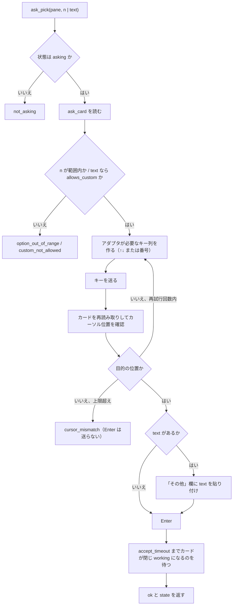

# 機能要件：レポート・質問カード・指示

[機能要件](functional.md) の続き。§5 レポート（FR-REPORT）、§6 質問カードの操作（FR-ASK）、§7 指示の組み立て（FR-DISPATCH）、§8 受け入れ確認を定める。

改訂履歴は [機能要件（本書）](functional.md#改訂履歴) にまとめてある。

## 5. レポート（FR-REPORT）

### 5.1 要件

| ID | 要件 |
|----|------|
| FR-REP-1 | `report` は全ペインの状況をサーバーが組み立てた markdown で返す。クライアントは手を加えずそのまま表示する（ツールの説明に書く） |
| FR-REP-2 | 中身は、見出し（時刻・サーバー負荷）、ペインの表（位置・エージェント・状態・依頼元・リポジトリ／Issue・いまやっていること・次にやること）、要対応の一覧（質問カードで止まっている・止まっているように見える・完了して報告待ち） |
| FR-REP-3 | 状態は絵文字つきの決まった言葉で出す（下表） |
| FR-REP-4 | 引数：`format`（`markdown` 既定・`json`）、`pane`（1 ペインの詳しい版）、`lang`（`ja` 既定・`en`）。既定の言語は `default_lang` で変えられる |
| FR-REP-5 | テンプレートは言語ごとに `templates/report.ja.md`・`templates/report.en.md`。サーバーの設定フォルダ（`~/.config/swarm-console/templates/`）に置けば組み込みのものより優先され、直せばどのクライアントにも同じく反映される |
| FR-REP-6 | メモの中身（依頼元・次にやること など）は書かれたままの言葉で出す（訳さない） |
| FR-REP-7 | 同じスナップショットからは、クライアントによらず 1 文字も違わない出力を返す（時刻はスナップショットの時刻を使い、呼び出し時刻・クライアント名などを含めない）。受け入れ確認 §8 の条件 |
| FR-REP-8 | 「完了して報告待ち」は、状態が `idle` で、最終報告ファイルが存在するペイン（P-11） |
| FR-REP-9 | `format: json` は `panes_status` と同じペイン配列に要対応の一覧（`attention`）を足した JSON を返す。言語に依存しない |

### 5.2 状態の言葉

| 状態 | 日本語（`ja`） | 英語（`en`） |
|------|---------------|-------------|
| `working` | 🟢 作業中 | 🟢 Working |
| `asking` | 🟡 質問待ち | 🟡 Asking |
| `idle` | ⚪ 入力待ち | ⚪ Idle |
| `shell` | ⬜ 空き | ⬜ Free |
| `stalled` | 🔴 止まってそう | 🔴 Stalled |
| `unknown` | ❔ 不明 | ❔ Unknown |

### 5.3 出力レイアウト（`ja`、例）

````markdown
# swarm-console レポート

- 時刻: 2026-10-31 22:10:05 (+09:00)
- サーバー負荷: load1 98.2 / メモリ空き 41.3 GB

## ペイン

| 位置 | エージェント | 状態 | 依頼元 | リポジトリ / Issue | いまやっていること | 次にやること |
|------|------------|------|--------|------------------|------------------|------------|
| T1 | omp | ⚪ 入力待ち | — | — | — | — |
| B4 | omp | 🟢 作業中 | agent-b | ousiassllc/funid #982 | Running go test ./... | 完了したら #983 を入れる |
| B1 | — | ⬜ 空き | — | — | — | — |

## 要対応

- 🟡 質問待ち: T2 — (2) の Go での範囲をどうしますか？
- 🔴 止まってそう: B3 — 変化なし 20m
- 📩 報告待ち: T1 — 最終報告あり（`report_read` で読む）

## 警告

- 並びが変わりました: B3 が追加されました
````

- 要対応がなければ `- なし`。警告がなければ「警告」見出しごと出さない。
- 表のセルは `|` と改行をエスケープし、空は `—`。長いセルは 80 字で `…` に切る。
- `en` は見出し・ラベル・状態の言葉が英語になり、メモの中身は同じ。
- `pane` 指定の詳しい版は、上記に加えて「メモ全項目」「質問カード（あれば）」「画面の最後の 15 行（飾りなし）」「最終報告ファイルの有無と更新時刻」を出す。

## 6. 質問カードの操作（FR-ASK）

### 6.1 `ask_pick` の手順



- `n`（選ぶ番号）と `text`（「その他」に打つ文字）は同時に指定できない。どちらも指定しなければ `invalid_args`。`text` を指定すると「その他」の選択肢を選んで `text` を入れる（P-10）。
- 再試行は 2 回まで。カーソルが合わないままの Enter は送らない。

## 7. 指示の組み立て（FR-DISPATCH）

| ID | 要件 |
|----|------|
| FR-DIS-1 | 引数：`pane`、`agent`、`cwd`、`title`、`command`（1 行目のスラッシュコマンド）、`task`（本文）、`profile`（`sweep`・`fix`・`investigate`）、`extra_rules`（追加の条件）、`note`（メモ。一緒に保存する） |
| FR-DIS-2 | 指示文は `command` ＋ `task` ＋ 条件（共通の条件 → プロファイル固有の条件 → `extra_rules`）の決まった形に組み立てる（API 仕様 §5.6）。`task` と `extra_rules` 以外にサーバーが足すのは、固定の見出しとプロファイルの条件文だけ。人の名前・経緯は足さない |
| FR-DIS-3 | 条件のひな形は `profiles.toml` に置く。初期値は元の omp-dispatch の条件そのまま（下表） |
| FR-DIS-4 | ペインが `shell` なら `pane_start` してから送り、`idle` ならそのまま送る。`working`・`asking` ほかは拒否（何も送らない） |
| FR-DIS-5 | 返り値は送った指示文の全文と、受け付けたか。同じ引数なら、どのクライアントから送っても、ペインに入る指示文は同じ |
| FR-DIS-6 | `note` は送信後に `note_set` と同じ検証・マージ規則で保存する（P-23）。保存したかを返り値の `note_saved` に入れる |
| FR-DIS-7 | 送信前に、そのペインの古い最終報告ファイルをアーカイブへ移す（P-11） |
| FR-DIS-8 | 組み立てた指示文は 8000 字以内（超えたら `text_too_long`、何も送らない） |

### 7.1 条件の初期値

共通の条件（全プロファイル）：

| # | 条件 |
|---|------|
| 1 | コミットは必ず `git commit -s`（cherry-pick も `-s`）、マージは `git merge --signoff` |
| 2 | force push・rebase・amend・squash・reset・`--no-verify` はしない。フックが落ちたら止めて報告する |
| 3 | リモートブランチは作業用でも消さない（削除はローカルだけ） |
| 4 | マージ・Issue の close・デプロイはしない |
| 5 | トークン・パスワードなどの秘密をコード・ログ・PR・Issue に書かない |
| 6 | オーナーの checkout と `~/dotfiles` には触らず、worktree で作業する |
| 7 | CI が緑になったら止める |
| 8 | 最終報告（PR・head・CI・Issue 番号・残りの判断）を `report_read` のファイル（`/tmp/swarm-console/reports/<位置>.md`）にも書く |

プロファイル固有の条件（共通に足す）：

| プロファイル | 足す条件 |
|-------------|---------|
| `sweep` | `--single-pr` で PR は 1 本まで。PR を出して CI が緑になったら止まる |
| `fix` | PR は 1 本まで。バグの再現確認と回帰テストを含める。PR を出して CI が緑になったら止まる |
| `investigate` | 調査だけを行い、ファイルの変更・コミット・push・PR 作成はしない。分かったこと・根拠・残りの判断を報告する |

## 8. 受け入れ確認（元仕様 §10）

| ID | 確認内容 | 検証方法 |
|----|---------|---------|
| AC-1 | 同じペインの状態で、Claude Code・Codex・Cursor・curl（クライアント環境）の 4 つから `report` を呼び、返る markdown が 1 文字も違わない（`lang` が `ja` でも `en` でも） | 4 クライアントの実接続 ＋ 自動テスト（同一スナップショットを固定したレンダリングの一致） |
| AC-2 | `/report` の `tools/list` に操作のツールが出ない。`report` のトークンで `/ops` を呼ぶと 403 | 自動テスト ＋ 実接続 |
| AC-3 | ペインを増やす・減らす・別セッションを足したとき、次の `panes_status` で新しい並びと警告が出て、メモがずれない | 実 tmux の統合テスト ＋ 実機 |
| AC-4 | 同じ `dispatch` の引数を 2 つのクライアントから送り、ペインに入る指示文が同じ | 実 tmux ＋ 擬似エージェントで貼り付け内容を比較 |
| AC-5 | 認証なし・違うトークン・窓口違い・許可していないフォルダ・作業中のペインを閉じる・Esc の `confirm` なし、がどのクライアントからでも同じエラーになる | 自動テスト ＋ 実接続 |
| AC-6 | 非機能要件 §7 のテスト（実 tmux、擬似画面、拒否、メモの書き込み途中停止）が全部通り、CI が緑 | CI |
