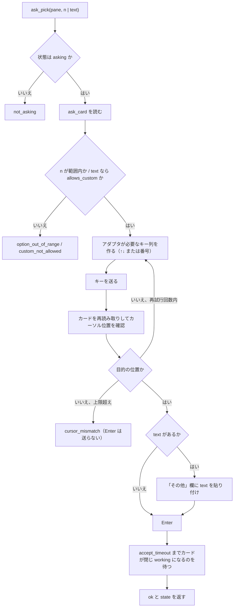

# 機能要件：レポート・質問カード・指示

[機能要件](functional.md) の続き。§5 レポート（FR-REPORT）、§6 質問カードの操作（FR-ASK）、§7 指示の組み立て（FR-DISPATCH）、§8 受け入れ確認を定める。

改訂履歴は [機能要件（本書）](functional.md#改訂履歴) にまとめてある。

## 5. レポート（FR-REPORT）

### 5.1 要件

| ID | 要件 |
|----|------|
| FR-REP-1 | `report` は全ペインの状況をサーバーが組み立てた markdown で返す。クライアントは手を加えずそのまま表示する（ツールの説明に書く） |
| FR-REP-2 | 中身は、見出し（時刻・サーバー負荷・CPU・スワップ・ディスク・更新確認・ログイン期限）、ペインの表（位置・エージェント・状態・経過・依頼元・リポジトリ／Issue・いまやっていること・次にやること）、要対応の一覧（質問カードで止まっている・止まっているように見える・完了して報告待ち・ログイン期限切れ・ログイン期限間近）、使用状況（Claude・Cursor・Codex） |
| FR-REP-3 | 状態は絵文字つきの決まった言葉で出す（下表） |
| FR-REP-4 | 引数：`format`（`markdown` 既定・`json`）、`pane`（1 ペインの詳しい版）、`session`（任意。FR-REP-19）、`lang`（`ja` 既定・`en`）。既定の言語は `default_lang` で変えられる |
| FR-REP-5 | テンプレートは言語ごとに `templates/report.ja.md`・`templates/report.en.md`。サーバーの設定フォルダ（`~/.config/swarm-console/templates/`）に置けば組み込みのものより優先され、直せばどのクライアントにも同じく反映される |
| FR-REP-6 | メモの中身（依頼元・次にやること など）は書かれたままの言葉で出す（訳さない）。ただし `origin` が `agent` のときの依頼元の横の印 `🤖 <started_by>発`（`started_by` が空なら `🤖 エージェント発`）は、言語によらず固定の語（FR-NOTE-3） |
| FR-REP-7 | 同じスナップショットからは、クライアントによらず 1 文字も違わない出力を返す（時刻はスナップショットの時刻を使い、呼び出し時刻・クライアント名などを含めない）。受け入れ確認 §8 の条件 |
| FR-REP-8 | 「完了して報告待ち」は、状態が `idle` で、最終報告ファイルが存在するペイン（P-11） |
| FR-REP-9 | `format: json` は `panes_status` と同じペイン配列に要対応の一覧（`attention`）を足した JSON を返す。言語に依存しない。FR-REP-10〜16 の値のキーも同じ JSON に入る（形は API 仕様 §5.5） |
| FR-REP-10 | 足す値（使用状況・メモリ・CPU・スワップ・ディスク・omp の版・ログイン期限・ペインの経過）は、**スナップショットを作るときにまとめて入れる**。描画は入った値だけを使い、コマンド実行・ファイル読み取り・呼び出し時刻の参照をしない。遅い取得（`omp usage --json`・`omp update --check`）は `serve` の別の収集器が決まった間隔で実行し、最後の結果をスナップショットに載せる。FR-REP-7 を崩さない（集め方は [report-values.md](../architecture/report-values.md)） |
| FR-REP-11 | 取れない値は消さない。JSON はキーを残して `available: false` と `null` を返し（取得の失敗は固定の `reason` コードだけ）、markdown は「取得できず」と出す。値が無い（スワップ無し・Cursor の枠なし など）のと取得できないのを区別する |
| FR-REP-12 | 使用状況（Issue #21）：Claude の 5 時間枠・7 日枠、Cursor の使用量、Codex の 5 時間枠・7 日枠を、アカウントごとに返す。Claude は `omp` が返したアカウントを全部返し、ある枠が取れなくてもアカウントを消さない。取れなかったアカウント（`accountsWithoutUsage` から来たもの）と名前が作れなかったアカウント（メールが空）には、JSON だけ理由 `reason`（`without_usage`・`no_email`。どちらでもなければ `null`。両方なら `without_usage`。Issue #87）を付ける。JSON は `usage`（API 仕様 §5.5）、markdown は「使用状況」の節。取り方・間隔は [report-values.md §2](../architecture/report-values.md#2-使用状況issue-21) |
| FR-REP-13 | サーバー負荷（Issue #23・#86）：メモリの全体・使用量・使用率（`MemTotal − MemAvailable`。`mem_free_gb` は互換のため残す）・CPU 使用率・スワップの使用量と使用率・`disk_mounts` の各マウントの使用率を、数値で返す。バーなどの見た目は仕様に入れず、値だけを返す。メモリの markdown の行は変えない（空きだけ）。SSD 2 台は既存の `disk_mounts`（既定 `/` と `/mnt/nvme`）。取れない値は FR-REP-11 |
| FR-REP-14 | ペインの経過（Issue #22）：ペインの表に列「経過」を、状態の右に足す。値は `panes_status` の `elapsed`（エージェントの画面の経過表示、読めなければサーバーが `working` を観測し始めてからの経過。ER §4）をそのまま使い、`null` は `—`。新しい項目・起点は足さない。JSON は既存の `panes[].elapsed` |
| FR-REP-15 | omp の更新確認（Issue #24）：omp の今の版と、新しい版があるかを返す（`omp.status`：`up_to_date`・`update_available`・`unknown`・`pending`・`disabled`）。`update_check`・`update_check_interval` に従う。swarm-console 自身の状態（`host_status.update` と同じ）も `update` として一緒に返す（JSON は `update`、markdown は見出しの「更新」の 1 行に omp と並べる。FR-UPD-9）。取れないときは `unknown` と `reason`（markdown は「取得できず」） |
| FR-REP-16 | ログイン期限（Issue #25）：`agent_auth_status` と同じ判定を `auth` として返す。`expired`・`expiring_soon`（48 時間以内）だけ要対応の一覧に入れる（`kind`：`auth_expired`・`auth_expiring`）。`unknown` は要対応に入れず、`auth` に `unknown` のまま残し、markdown の見出しに「不明」と出す。`pane` を指定した場合も、ログインの要対応は入れる（ペインに属さないので絞らない。並びはペインの項目のあと。API 仕様 §5.5）。閾値・設定は足さない |
| FR-REP-17 | `host_status` は、同じスナップショットの値として `mem`・`cpu`・`swap`・拡張した `disk`・`usage`（アカウントごとの `reason` を含む）・`omp` を返す（キーと形は `report` の JSON と同じ。API 仕様 §5.3。`mem_total_gb`・`mem_free_gb` も残す）。`format: markdown` に出す新しい値の見た目（行の並び・言葉）は §5.3・§5.4 に従う |
| FR-REP-18 | メール・`accountId`・`orgId`・トークン・`omp` のコマンド出力の文面・パスは、レポートと `host_status` のどこにも出さない（アカウントごとの `reason` は決まった値だけで、これらを含めない）。アカウントは [report-values.md §2.2](../architecture/report-values.md#22-アカウント名) の名前だけで示す（NFR-SEC-5） |
| FR-REP-19 | `report` は任意の `session` を取る（決め方は FR-SESS-5）。ペインの表・`layout`・要対応のペインの項目（`asking`・`stalled`・`report_waiting`）・警告をそのセッションだけに絞り、位置はセッション内の位置にする（FR-SESS-7・8）。見出し（時刻・サーバー負荷・CPU・スワップ・ディスク・更新・ログイン）・使用状況・ログインの要対応はホスト全体のままで、`session` に関係なく同じ（FR-SESS-9）。許可が 2 つ以上のトークンが省略すると `session_required` |

### 5.2 状態の言葉

| 状態 | 日本語（`ja`） | 英語（`en`） |
|------|---------------|-------------|
| `working` | 🟢 作業中 | 🟢 Working |
| `asking` | 🟡 質問待ち | 🟡 Asking |
| `idle` | ⚪ 入力待ち | ⚪ Idle |
| `shell` | ⬜ 空き | ⬜ Free |
| `stalled` | 🔴 止まってそう | 🔴 Stalled |
| `unknown` | ❔ 不明 | ❔ Unknown |

### 5.3 出力レイアウト（`ja`、例）

````markdown
# swarm-console レポート

- 時刻: 2026-10-31 22:10:05 (+09:00)
- サーバー負荷: load1 98.2 / CPU 42% / メモリ空き 41.3 GB / スワップ 5%
- ディスク: / 73%（空き 120 GB）、/mnt/nvme 78%（空き 830 GB）
- 更新: omp 18.14.2（最新）／ swarm-console v0.1.5（最新）
- ログイン: omp 不明 / claude 期限切れ / codex 期限間近

## ペイン

| 位置 | エージェント | 状態 | 経過 | 依頼元 | リポジトリ / Issue | いまやっていること | 次にやること |
|------|------------|------|------|--------|------------------|------------------|------------|
| T1 | omp | ⚪ 入力待ち | — | — | — | — | — |
| B4 | omp | 🟢 作業中 | 42m | agent-b 🤖 かな発 | ousiassllc/funid #982 | Running go test ./... | 完了したら #983 を入れる |
| B1 | — | ⬜ 空き | — | — | — | — | — |

## 要対応

- 🟡 質問待ち: T2 — (2) の Go での範囲をどうしますか？
- 🔴 止まってそう: B3 — 変化なし 20m
- 📩 報告待ち: T1 — 最終報告あり（`report_read` で読む）
- 🔑 ログイン期限切れ: claude
- ⏳ ログイン期限間近: codex — あと 10 時間 5 分（2026-11-01 08:15）

## 使用状況

### Claude

| アカウント | 5 時間枠 | 7 日枠 |
| --- | --- | --- |
| acct-a | 取得できず | 48%（リセット 2026-11-01 07:00） |
| acct-b | 0% | 7%（リセット 2026-11-06 10:00） |

### Cursor

| アカウント | 枠 | 使用 |
| --- | --- | --- |
| acct-a | monthly | 0%（リセット 2026-12-01 09:00） |
| acct-b | weekly | 0 USD（リセット 2026-11-02 09:00） |

### Codex

| アカウント | 5 時間枠 | 7 日枠 |
| --- | --- | --- |
| acct-a | 0%（リセット 2026-11-02 03:09） | 2%（リセット 2026-11-04 09:00） |

## 警告

- 並びが変わりました: B3 が追加されました
````

- 要対応がなければ `- なし`。警告がなければ「警告」見出しごと出さない。
- 表のセルは `|` と改行をエスケープし、空は `—`。長いセルは 80 字で `…` に切る。
- `en` は見出し・ラベル・状態の言葉が英語になり、メモの中身は同じ。
- `pane` 指定の詳しい版は、上記に加えて「メモ全項目」「質問カード（あれば）」「画面の最後の 15 行（飾りなし）」「最終報告ファイルの有無と更新時刻」を出す。見出し・使用状況は全ペインの版と同じ（`pane` の指定では変わらない）。
- 見出しの新しい行は値を出すだけで、バー・色分け・警告記号は使わない。時刻は `at` のオフセットで `YYYY-MM-DD HH:MM`。「あと N 時間」は `expires_at` と `at` の差（分未満は切り捨て）から描画で計算する：1 時間未満は「M 分」、24 時間未満は「N 時間 M 分」（M が 0 なら「N 時間」）、24 時間以上は「N 日 M 時間」（M が 0 なら「N 日」）。呼び出し時刻は使わない。英語は同じ形で単位を `d`・`h`・`min` にし、前に `in` を付ける（`in 5 min`・`in 10 h 5 min`・`in 2 d 3 h`。§5.4）。
- 使用状況・見出しの行は、`status` が `disabled` なら「無効」、`pending` なら「未取得」、取得できなければ「取得できず」を 1 行で出す（節の見出しは残す）。`stale` は表を出したうえで、節の末尾に「取得できず（最後の成功: 時刻）」を 1 行足す。

### 5.4 新しい値の言葉（`ja`・`en`）

| 意味 | 日本語（`ja`） | 英語（`en`） |
|------|---------------|-------------|
| 取れない | 取得できず | Unavailable |
| 未取得（起動直後） | 未取得 | Pending |
| 止めてある | 無効 | Disabled |
| 最新・更新あり | 最新 / 新しい版 X あり | Up to date / Update X available |
| ログインの状態 `valid`・`expiring_soon`・`expired`・`unknown` | 有効・期限間近・期限切れ・不明 | Valid・Expiring soon・Expired・Unknown |
| 要対応 `auth_expired`・`auth_expiring` | 🔑 ログイン期限切れ・⏳ ログイン期限間近 | 🔑 Login expired・⏳ Login expiring |
| 枠が上限 `exhausted` | 上限到達 | Exhausted |
| 枠の名前 | 5 時間枠・7 日枠・リセット | 5-hour・7-day・Resets |
| 見出しの行 | 更新・ログイン・ディスク・使用状況 | Updates・Login・Disk・Usage |
| 期限までの時間（`at` との差。分未満は切り捨て） | あと 5 分・あと 10 時間 5 分・あと 2 日 3 時間 | in 5 min・in 10 h 5 min・in 2 d 3 h |

## 6. 質問カードの操作（FR-ASK）

### 6.1 `ask_pick` の手順



- `n`（選ぶ番号）と `text`（「その他」に打つ文字）は同時に指定できない。どちらも指定しなければ `invalid_args`。`text` を指定すると「その他」の選択肢を選んで `text` を入れる（P-10）。
- 再試行は 2 回まで。カーソルが合わないままの Enter は送らない。

## 7. 指示の組み立て（FR-DISPATCH）

| ID | 要件 |
|----|------|
| FR-DIS-1 | 引数：`session`（任意。許可が 1 つなら省略可。FR-SESS-5）、`pane`、`agent`、`cwd`、`title`、`command`（1 行目のスラッシュコマンド）、`task`（本文）、`profile`（`sweep`・`fix`・`investigate`）、`extra_rules`（追加の条件）、`note`（メモ。一緒に保存する）。`pane` は決めたセッションの中で解決する（FR-SESS-6）。`{report_path}` のファイル名は全体の位置から付ける（FR-SESS-7） |
| FR-DIS-2 | 指示文は `command` ＋ `task` ＋ 条件（共通の条件 → プロファイル固有の条件 → `extra_rules`）の決まった形に組み立てる（API 仕様 §5.6）。`task` と `extra_rules` 以外にサーバーが足すのは、固定の見出しとプロファイルの条件文だけ。人の名前・経緯は足さない |
| FR-DIS-3 | 条件のひな形は `profiles.toml` に置く。初期値は元の omp-dispatch の条件そのまま（下表） |
| FR-DIS-4 | ペインが `shell` なら `pane_start` してから送り、`idle` ならそのまま送る。`working`・`asking` ほかは拒否（何も送らない） |
| FR-DIS-5 | 返り値は送った指示文の全文と、受け付けたか。同じ引数なら、どのクライアントから送っても、ペインに入る指示文は同じ |
| FR-DIS-6 | `note` は送信後に `note_set` と同じ検証・マージ規則で保存する（P-23）。保存したかを返り値の `note_saved` に入れる |
| FR-DIS-7 | 送信前に、そのペインの古い最終報告ファイルをアーカイブへ移す（P-11） |
| FR-DIS-8 | 組み立てた指示文は 8000 字以内（超えたら `text_too_long`、何も送らない） |

### 7.1 条件の初期値

共通の条件（全プロファイル）：

| # | 条件 |
|---|------|
| 1 | コミットは必ず `git commit -s`（cherry-pick も `-s`）、マージは `git merge --signoff` |
| 2 | force push・rebase・amend・squash・reset・`--no-verify` はしない。フックが落ちたら止めて報告する |
| 3 | リモートブランチは作業用でも消さない（削除はローカルだけ） |
| 4 | マージ・Issue の close・デプロイはしない |
| 5 | トークン・パスワードなどの秘密をコード・ログ・PR・Issue に書かない |
| 6 | オーナーの checkout と `~/dotfiles` には触らず、worktree で作業する |
| 7 | CI が緑になったら止める |
| 8 | 最終報告（PR・head・CI・Issue 番号・残りの判断）を `report_read` のファイル（`/tmp/swarm-console/reports/<位置>.md`）にも書く |

プロファイル固有の条件（共通に足す）：

| プロファイル | 足す条件 |
|-------------|---------|
| `sweep` | `--single-pr` で PR は 1 本まで。PR を出して CI が緑になったら止まる |
| `fix` | PR は 1 本まで。バグの再現確認と回帰テストを含める。PR を出して CI が緑になったら止まる |
| `investigate` | 調査だけを行い、ファイルの変更・コミット・push・PR 作成はしない。分かったこと・根拠・残りの判断を報告する |

## 8. 受け入れ確認（元仕様 §10）

| ID | 確認内容 | 検証方法 |
|----|---------|---------|
| AC-1 | 同じペインの状態で、Claude Code・Codex・Cursor・curl（クライアント環境）の 4 つから `report` を呼び、返る markdown が 1 文字も違わない（`lang` が `ja` でも `en` でも） | 4 クライアントの実接続 ＋ 自動テスト（同一スナップショットを固定したレンダリングの一致） |
| AC-2 | `/report` の `tools/list` に操作のツールが出ない。`report` のトークンで `/ops` を呼ぶと 403 | 自動テスト ＋ 実接続 |
| AC-3 | ペインを増やす・減らす・別セッションを足したとき、次の `panes_status` で新しい並びと警告が出て、メモがずれない | 実 tmux の統合テスト ＋ 実機 |
| AC-4 | 同じ `dispatch` の引数を 2 つのクライアントから送り、ペインに入る指示文が同じ | 実 tmux ＋ 擬似エージェントで貼り付け内容を比較 |
| AC-5 | 認証なし・違うトークン・窓口違い・許可していないフォルダ・作業中のペインを閉じる・Esc の `confirm` なし、がどのクライアントからでも同じエラーになる | 自動テスト ＋ 実接続 |
| AC-6 | 非機能要件 §7 のテスト（実 tmux、擬似画面、拒否、メモの書き込み途中停止）が全部通り、CI が緑 | CI |
| AC-7 | `sessions = ["0", "1"]`、トークン A は `["0"]`・B は `["1"]` のとき、A は `session` を省略するとセッション `0` の位置（`T1`〜）だけが返り、`1` の `panes_status`・`pane_tail`・`dispatch` は `session_forbidden`。許可が 2 つのトークンが省略すると `session_required`、`sessions` にない名前は `invalid_args`。`sessions = ["0"]` だけ・`allowed_sessions` なしでは、どのツールも `session` なしで今までどおり動く（FR-SESS） | 実 tmux の統合テスト（2 セッション）＋ 自動テスト |
