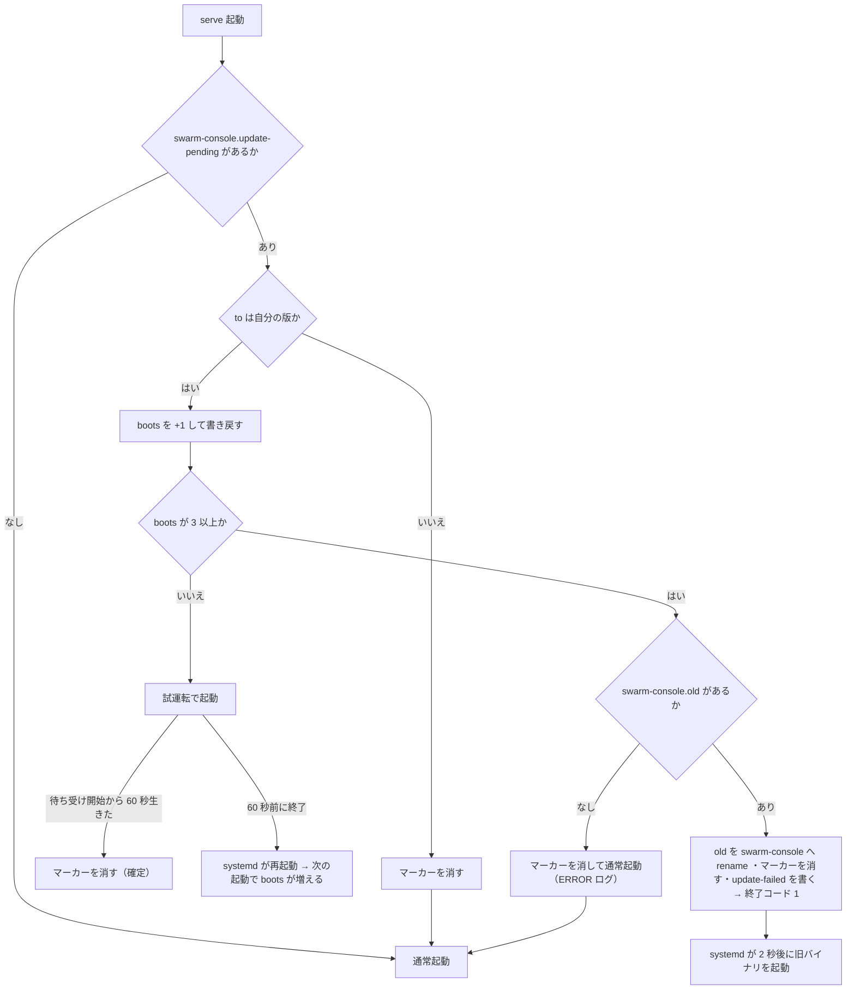

# 機能要件：新しい版の確認と自己更新

[機能要件](functional.md) の続き。§12 新しい版の確認と自己更新（FR-UPD）を定める。

改訂履歴は [機能要件（本書）](functional.md#改訂履歴) にまとめてある。

## 12. 新しい版の確認と自己更新（FR-UPD）

GitHub Releases（`ousiassllc/swarm-console`）の最新版を見て、動いているバイナリより新しい版があるかを確認し、あれば `serve` が自分でダウンロード・検証・入れ替えをする（自己更新）。参考：同じ組織の mam（`ousiassllc/mam`）の `backend/internal/service/updater`（`/releases/latest` の取得・semver 比較・失敗の分類）。

**更新の方式は自己更新で確定（Issue #7 のヒアリング。P-46）。** 確認は §12.1〜12.3、自己更新は §12.4〜12.6。リリースを作る側（タグの付け方・アセット名・`SHA256SUMS` の書式）は [環境構築 CI・リリース](../environment/setup-ci.md#cicd) と Issue #8 が決め、本節の FR-UPD-13・14 と同じにする。

### 12.1 確認の要件

| ID | 要件 |
|----|------|
| FR-UPD-1 | 確認先は `GET https://api.github.com/repos/ousiassllc/swarm-console/releases/latest` だけ。owner・repo は定数で、設定で変えられない。認証なし（トークンを送らない。`SWARM_CONSOLE_TOKEN` も使わない。リポジトリは public）。`Accept: application/vnd.github+json`、`User-Agent: swarm-console/<版>`。タイムアウト 10 秒、本文は 1 MiB まで。リダイレクトは `api.github.com` の外へ追わない |
| FR-UPD-2 | `/releases/latest` はドラフトとプレリリースを返さないので、通知の対象は正式版だけ（プレリリースは通知しない） |
| FR-UPD-3 | 版の形は `vX.Y.Z`（正規表現 `^v(0\|[1-9][0-9]*)\.(0\|[1-9][0-9]*)\.(0\|[1-9][0-9]*)$`）。Issue #8 が付けるタグと同じ。最新側の `tag_name` がこの形に合わなければ `release_invalid`。比較は `golang.org/x/mod/semver`（自前で解析しない）。現在の版が `dev`・`vX.Y.Z` でない（ビルド時に版を入れていない）ときは通信せず `dev_build`。現在の版がプレリリース形（`v1.2.0-rc.1`）でも、比較は semver どおり（`v1.2.0` のほうが新しい） |
| FR-UPD-4 | 結果は 3 つに区別する：`up_to_date`（最新版以上）・`update_available`（最新版が現在より新しい）・`unknown`（確認できない。`reason` 付き）。`unknown` の `reason`：`network`（接続失敗・タイムアウト・5xx）・`rate_limit`（429、または 403 で `X-RateLimit-Remaining: 0` か `Retry-After`）・`access`（401・その他の 403）・`no_release`（404。リリース未公開、またはリポジトリが見えない）・`release_invalid`（JSON が読めない・版の形に合わない）・`dev_build` |
| FR-UPD-5 | 確認の失敗は `reason` だけを保持・表示する。URL・ヘッダー・応答本文・リリースノート・生のエラー文面は、ログ・応答・メモに出さない |
| FR-UPD-6 | `swarm-console version`（引数なし）は今までどおり版を 1 行出すだけで通信しない。`swarm-console version --check` は 1 回だけ確認する（バイナリは置き換えない）。標準出力：1 行目に現在の版、2 行目に結果（§12.2）。終了コード：`up_to_date` 0、`update_available` 10、`unknown` 1。`config.toml` を読まず、`update_check` が `false` でも動く（手動の確認） |
| FR-UPD-7 | `serve` は `update_check`（既定 `true`）が `true` のとき、起動の 1 分後に 1 回確認し、以後 `update_check_interval`（既定 24 時間、下限 1 時間）ごとに確認する。結果が `update_available` で `update_auto`（FR-UPD-19）が `true` なら、続けて自己更新（§12.4）に進む。待ちは `clock` を通す（固定時間の `sleep` を使わない）。ツールの呼び出しでは通信しない。確認の結果はメモリだけに持ち、再起動で失ってよい（NFR-AVL-2） |
| FR-UPD-8 | 確認・ダウンロード・入れ替えが失敗・遅延・拒否されても `serve` は動き続ける（入れ替えが成功して自分で終了するとき、FR-UPD-16 を除く）。確認と自己更新は、バックグラウンドの 1 本の goroutine で、起動・ツールの応答・終了（SIGTERM から 10 秒。NFR-AVL-7）を待たせない。SIGTERM を受けたら通信を中断し、書きかけの一時ファイルを消す。失敗後の再試行は次の周期まで行わない。ログ：新しい版を初めて見つけたとき 1 回（同じ版では出さない）、失敗は `reason` が前回と変わったときだけ警告 |
| FR-UPD-9 | `host_status` に `update` を足す（`/report` `/ops` の両方。読み取りのみ）。確認の結果に加えて、自己更新の状況 `apply`（FR-UPD-20）も返す。API 仕様 §5.3。`serve` の確認結果を返すだけで、通信はしない。`report`（markdown）には載せない（AC-1 の 1 文字一致・NFR-PERF-3 の文字量に影響させない） |
| FR-UPD-10 | 確認の設定は `config.toml` の `update_check`（bool、既定 `true`）と `update_check_interval`（期間、既定 `24h`、`1h` 以上）。自己更新の設定は `update_auto`（FR-UPD-19）。いずれも未知キー拒否の対象に加える（ER §5） |

### 12.2 `version --check` の表示

| 結果 | 2 行目 | 終了コード |
|------|--------|-----------|
| `up_to_date` | `最新です（最新版 v0.1.5）` | 0 |
| `update_available` | `新しい版があります: v0.1.5（https://github.com/ousiassllc/swarm-console/releases/tag/v0.1.5）` | 10 |
| `unknown`（`network`） | `確認できませんでした: GitHub に接続できません` | 1 |
| `unknown`（`rate_limit`） | `確認できませんでした: GitHub の取得回数の上限に達しました。しばらくしてからやり直してください` | 1 |
| `unknown`（`access`） | `確認できませんでした: GitHub が取得を拒否しました` | 1 |
| `unknown`（`no_release`） | `確認できませんでした: 公開されたリリースがありません` | 1 |
| `unknown`（`release_invalid`） | `確認できませんでした: 最新リリースの版の形が不正です` | 1 |
| `unknown`（`dev_build`） | `確認しません: この実行ファイルにはリリースの版が入っていません（dev）` | 1 |

URL は最新版が FR-UPD-3 の形に合うときだけ、その版から組み立てる（応答の URL をそのまま出さない）。

### 12.3 通信と安全

- 外向きの通信は、確認の `api.github.com` への GET 1 本と、自己更新のダウンロード（`github.com/ousiassllc/swarm-console/releases/download/<タグ>/…` とそのリダイレクト先。FR-UPD-13）だけ。待ち受けの方針（NFR-SEC-1・2: tailnet の IP だけ、インターネットに出さない）は変えない（NFR-SEC-15）。
- `host_status.update.latest` は FR-UPD-3 の形に合うときだけ出す（GitHub が返した文字列をそのまま MCP の応答に載せない）。ダウンロードの URL も、応答の URL ではなく、検証済みの版から組み立てる。
- バイナリの置き場への書き込みは `~/bin/swarm-console/` の決まったファイルだけ（FR-UPD-15。NFR-SEC-14・16）。新しいバイナリは入れ替える前に実行しない（NFR-SEC-7）。

### 12.4 自己更新の要件

`update_available` を見つけた `serve` が、次の順で自分を入れ替える。

| ID | 要件 |
|----|------|
| FR-UPD-11 | 方式は自己更新。`serve` が確認で `update_available` を見つけ、`update_auto`（既定 `true`）が `true` なら、最新版のバイナリをダウンロードして検証し、動いているバイナリと入れ替え、自分で正常終了して systemd に立ち上げ直してもらう。きっかけは `serve` の自動だけで、運用者が打つ `update` サブコマンドは作らない（P-40・P-46）。`update_auto = false` なら確認だけで、入れ替えは従来の手順（新バイナリを置く → `systemctl --user restart swarm-console`）。`version --check` は入れ替えない |
| FR-UPD-12 | 次を全部満たすときだけ入れ替える。満たさないときは入れ替えず、`apply` を `failed`（FR-UPD-18）か `blocked`（4）にする：(1) `runtime.GOOS`/`GOARCH` が linux/amd64（違えば `unsupported_platform`）(2) 動いているバイナリのパス（`os.Executable()`）が `$HOME/bin/swarm-console/swarm-console` と同じで、通常ファイル（シンボリックリンクでない）、そのフォルダに書ける（違えば `not_managed`）(3) 最新版が現在の版より semver で新しい（ダウングレードしない）。現在の版がプレリリース形（`v1.2.0-rc.1`）のときは、確認の比較はできても入れ替えない（試運転のマーカーの `from` は `vX.Y.Z` だけ。FR-UPD-15・17）ので `not_managed` (4) 最新版が `swarm-console.update-failed` に記録された版より新しい（戻した版とそれ以下は入れ替えない。FR-UPD-17） |
| FR-UPD-13 | ダウンロード先の URL は、FR-UPD-3 に合う `tag_name`（以下 `<tag>`）から組み立てる：バイナリ `https://github.com/ousiassllc/swarm-console/releases/download/<tag>/swarm-console_<tag>_linux_amd64`、チェックサム `…/download/<tag>/SHA256SUMS`。API 応答の `assets[]`・`browser_download_url` は使わない。認証なし（トークンを送らない）。`https` だけ。リダイレクトは `github.com`・`objects.githubusercontent.com`・`release-assets.githubusercontent.com`（GitHub がリリースの実体を置くホスト）の `https` だけ、最大 5 回追う。接続 10 秒・全体 5 分。`SHA256SUMS` は 64 KiB まで、バイナリは 64 MiB まで（超えたら中断）。404 は `asset_missing`、そのほかの失敗は `download` |
| FR-UPD-14 | 検証は `SHA256SUMS` のハッシュだけ（署名は付けない。限界は §12.5）。`SHA256SUMS` を先に取り、バイナリは書き込みながら SHA-256 を計算する。`SHA256SUMS` は `sha256sum` の出力（1 行 `<64 桁の小文字 16 進>␣␣<ファイル名>`）で、行末の CR（CRLF）と、ファイル名の直前の `*`（`sha256sum -b` の形。`<ハッシュ>␣*<ファイル名>`）は許す。区切りの空白の数・タブ・ハッシュの大文字は許さない（形式が違う扱い）。ファイル名が `swarm-console_<tag>_linux_amd64` に一致する行がちょうど 1 行あり、ハッシュが 64 桁の小文字 16 進のとき、それと比べる。行が無い・複数ある・形式が違う・ハッシュが違う・サイズが 0 は `checksum` で、入れ替えない。生産側（Issue #8 の `release.yml`）は `sha256sum` の出力どおり（空白 2 つ・LF）だけを出す |
| FR-UPD-15 | 入れ替えは `~/bin/swarm-console/` の次の 5 つのファイルだけを使い、この順に行う：(1) `swarm-console.new`（権限 0755。既存は消してから作る）に書いて fsync。検証が済むまで本体に触れない (2) 既存の `swarm-console.old` を消し、動いている `swarm-console` を `swarm-console.old` にハードリンクで残す（本体の名前は一度も消えない。旧バイナリは 1 世代だけ） (3) 試運転のマーカー `swarm-console.update-pending` を一時ファイル経由の `rename` で書く（`{"from":"v0.1.3","to":"v0.1.5","boots":0}`、権限 600） (4) `swarm-console.new` を `swarm-console` へ `rename`（原子的。ここで初めて本体が新しくなる。動いているプロセスは旧バイナリのまま動く） (5) 自分で正常終了（FR-UPD-16）。(1)〜(4) のどこで失敗しても本体は旧バイナリのまま残る。`.new` とマーカーは消す。使うファイルは `swarm-console`・`swarm-console.new`・`swarm-console.old`・`swarm-console.update-pending`・`swarm-console.update-failed`（FR-UPD-17）だけ |
| FR-UPD-16 | 入れ替えのあと、SIGTERM と同じ正常終了を始める（進行中の操作を最大 10 秒待ち、ペインに半端な入力を残さない。NFR-AVL-7）。終了コードは 0 で、systemd の `Restart=always`・`RestartSec=2` が入れ替わった新しいバイナリを起動する。`systemctl` などのコマンドは実行しない（NFR-SEC-7）。`working` のペインがあっても待たず、すぐ入れ替えて終了する（Issue #7 で決定。P-54）。ペインとエージェントは tmux に残り、メモは原子的書き込み（FR-NOTE-9）で失われない。MCP クライアントは接続が切れるのでつなぎ直す（進行中のツール呼び出しは 10 秒で終わらなければ打ち切られる） |
| FR-UPD-17 | 試運転と自動の戻し。`serve` は起動の最初（設定の読み込みより前）に `swarm-console.update-pending` を調べる。マーカーが無ければ通常どおり。`to` が自分の版でなければ（入れ替えが起きなかった）マーカーを消して通常どおり。`to` が自分の版なら `boots` を 1 増やして書き戻し、増やした値が 3 以上（3 回目の起動）なら、`swarm-console.old` を `swarm-console` へ `rename` で戻し、マーカーを消し、`swarm-console.update-failed`（`{"version":"<to>","at":"<時刻>"}`、権限 600）を書き、ERROR ログ（`from`・`to` だけ）を出して終了コード 1 で終了する（systemd が 2 秒後に旧バイナリを起動する）。試運転の終わり：待ち受けを始めてから 60 秒、プロセスが終了しなければ起動できたとみなしてマーカーを消す（INFO ログ）。それより前に終了（パニック・設定エラー・bind 失敗・SIGTERM を含む）すればマーカーは残る。`.old` が無い・戻せないときは、マーカーを消して通常どおり起動を続け（以後は数えない）、ERROR ログを出す。戻ったあとの旧バイナリは、`.update-failed` の版以下を入れ替えない（`blocked`）。それより新しい版が出れば試す。運用者が `.update-failed` を消せば同じ版を再び試す（P-55） |
| FR-UPD-18 | 入れ替えに至らなかったときの `reason`：`unsupported_platform`・`not_managed`・`asset_missing`・`download`（接続失敗・タイムアウト・5xx・サイズ超過・許可されないリダイレクト）・`checksum`・`write`（一時ファイル・リンク・`rename`・マーカーの書き込みの失敗）。本体は置き換わらない。`reason` だけを保持・表示し、URL・ヘッダー・応答本文・生のエラー文面は出さない（FR-UPD-5）。ログ：入れ替えを始めるとき INFO（`from`・`to`）、失敗は `reason` が前回と変わったときだけ警告 |
| FR-UPD-19 | 自己更新の設定は `config.toml` の `update_auto`（bool、既定 `true`）。`false` なら自己更新だけ止まる（確認と `host_status` は続く）。`update_check` が `false` のときは、`update_auto` に関わらず確認も入れ替えもしない。未知キー拒否の対象に加える（ER §5）。反映は `serve` の再起動（NFR-OPS-3）（P-56） |
| FR-UPD-20 | `host_status.update.apply`（常に付く）：`off`（`update_auto` か `update_check` が `false`）・`idle`（入れ替えの失敗・保留が無い。新しい版が無い・まだ確認していないときのほか、入れ替えの実行中を含む。入れ替えが済めば `serve` は終了するので、`update_available` で `idle` なのは実行中だけ）・`probation`（入れ替え直後の試運転中。`from` 付き）・`failed`（`reason` 付き。`update_available` のまま次の周期で再試行）・`blocked`（戻した版が最新のため入れ替えない。`version` 付き）。API 仕様 §5.3 |

### 12.5 リスクと限界

検証がハッシュだけで、きっかけが自動、という組み合わせを運用者が選んだ（Issue #7）。次を承知のうえで採る。

| 項目 | 内容 |
|------|------|
| 検出できないもの | `SHA256SUMS` はバイナリと同じリリース・同じ配信元にある。リポジトリやリリースが乗っ取られて差し替えられると、バイナリも `SHA256SUMS` も差し替えられ、検出できない。検出できるのは、転送中の破損・途中切れ・取り違えだけ |
| 影響 | 入れ替わったバイナリは、運用者の操作なしに、すべてのペインへ入力を送れる権限で動く。常駐してエージェントを操作するサーバーなので、乗っ取りはそのまま全ペイン操作の乗っ取りになる |
| 抑えにしているもの | HTTPS のみ・配信元ホストの許可リスト・トークンを送らない・書き込み先を固定 5 ファイルに限る・入れ替え前に新バイナリを実行しない・ダウングレードしない・`update_auto = false` で止められる・リリースは Issue #8 の CI だけが作る |
| 自動で戻せない場合 | 新バイナリがコードを 1 行も実行できずに落ちる（実行形式の不正など）と、`boots` を数えられず自動で戻らない。linux/amd64 の静的ビルドで、ハッシュが CI の成果物と一致する前提では起こりにくい。この場合は運用者が `mv ~/bin/swarm-console/swarm-console.old ~/bin/swarm-console/swarm-console` で戻して `systemctl --user restart swarm-console` する（再起動を繰り返して systemd が起動を諦めたときは、先に `systemctl --user reset-failed swarm-console`） |
| 署名 | 付けない（鍵の用意・秘密の保管・`release.yml` の改訂が要る）。付けるなら別 Issue で FR-UPD-14 を改訂する |

### 12.6 運用者の操作

| やりたいこと | 方法 |
|-------------|------|
| 自動更新を止める | `config.toml` に `update_auto = false` → `systemctl --user restart swarm-console`。確認だけが続き、入れ替えは手で行う |
| 更新の状況を見る | `host_status` の `update`（`status`・`apply`）、`swarm-console version --check`、`journalctl --user -u swarm-console` |
| 手で更新する（`update_auto = false` のとき） | 新バイナリを `~/bin/swarm-console/swarm-console` に置く → `systemctl --user restart swarm-console` → `host_status` で確認 |
| 戻された版を再び試す | `~/bin/swarm-console/swarm-console.update-failed` を消す（次の確認の周期で再び試す） |
| 手で前の版に戻す | `swarm-console.old` を `swarm-console` に戻して再起動（`update_auto = false` にしておかないと、次の確認で再び最新版へ入れ替わる） |
