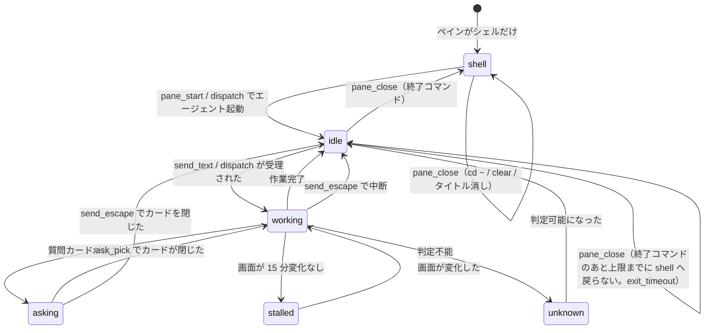

# 機能要件

元仕様 v1.1 の §1〜§7・§10 を機能要件として整理したもの。引数・返り値の厳密な定義は [API 仕様](../api/endpoints.md)、データ構造は [ER / データモデル](../architecture/er.md) を参照する。

元仕様に書かれていない既定値は「提案」として `P-xx` の番号を付け、[アーキテクチャ設計 §9](../architecture/decisions.md#9-提案した既定値と実装時確認事項) に一覧する。

この文書は 1 ファイル 300 行の上限（Linterly）のため、次のファイルに分けている。節番号は分割前の通し番号のまま、どのファイルでも同じ番号で引く。

- [機能要件（本書）](functional.md)：§1〜§4 ユースケース、ペイン位置（FR-POS）、セッションの許可と解決（FR-SESS）、ペインの状態とエージェントの種類（FR-STATE）、機能一覧
- [機能要件：レポート・質問カード・指示](functional-report.md)：§5 レポート（FR-REPORT）、§6 質問カードの操作（FR-ASK）、§7 指示の組み立て（FR-DISPATCH）、§8 受け入れ確認
- [機能要件：メモ・安全・設定](functional-note.md)：§9 メモ（FR-NOTE）、§10 安全のための決まり（FR-SAFE）、§11 対話型の設定（FR-SET）
- [機能要件：新しい版の確認と自己更新](functional-update.md)：§12 新しい版の確認と自己更新（FR-UPD）
- [機能要件：インストール](functional-install.md)：§13 インストール（FR-INS）

## 1. ユースケース

```mermaid
graph TD
    OPSAGENT["運用エージェント（クライアント環境）"]
    PCAI["パソコンの AI ツール"]
    ROUT["ルーティン"]
    ADMIN["運用者"]

    OPSAGENT --> UC1["UC1 全ペインの状況を見る"]
    OPSAGENT --> UC2["UC2 質問カードに答える"]
    OPSAGENT --> UC3["UC3 指示を送る（dispatch）"]
    OPSAGENT --> UC4["UC4 ペインを閉じる・メモを履歴へ"]
    OPSAGENT --> UC5["UC5 ペインを引き継ぐ（メモ・履歴を読む）"]
    OPSAGENT --> UC6["UC6 作業を中断する（Esc）"]
    PCAI --> UC1
    PCAI --> UC2
    PCAI --> UC3
    ROUT --> UC1
    ADMIN --> UC7["UC7 トークン発行・無効化"]
    ADMIN --> UC8["UC8 サーバー状態・ログイン期限を確認"]
    ADMIN --> UC9["UC9 対話型で config.toml を作る・直す"]
    ADMIN --> UC10["UC10 新しい版があるか確認する"]
    OPSAGENT --> UC10
    OPSAGENT --> UC8
    OPSAGENT --> UC11["UC11 自分に許可されたセッションのペインだけを見る・操作する"]
    ADMIN --> UC12["UC12 セッションごとにトークンを分ける"]
```

| ID | ユースケース | 主な機能 | 窓口 |
|----|------------|---------|------|
| UC1 | 全ペインの状況を、クライアントによらず同じ見た目で取る | `report`・`panes_status`・`pane_tail`・`report_read`・`sessions_list` | `/report` `/ops` |
| UC2 | `asking` のペインの質問カードを読み、番号（または自由入力）で答える | `ask_card`・`ask_pick` | カード読み取りは両方、選択は `/ops` |
| UC3 | 空き（`shell`）または入力待ち（`idle`）のペインに、決まった条件つきで指示を送る | `dispatch`・`pane_start`・`send_text` | `/ops` |
| UC4 | 完了したペインをきれいに閉じ、メモを履歴に移す | `pane_close`・`note_history` | `/ops` |
| UC5 | ペインを引き継ぐとき、依頼元・報告先・次にやることを会話を遡らず取る | `note_get`・`note_set`・`note_log`・`note_history` | 読みは両方、書きは `/ops` |
| UC6 | オーナーの OK があったとき、作業中のエージェントを止める | `send_escape` | `/ops` |
| UC7 | クライアントごとに別のトークンを発行・無効化する（`--sessions` で触れるセッションを付ける。FR-SESS-3） | `swarm-console token add/revoke`（サーバー上） | CLI |
| UC8 | ホストの負荷・ディスク・エージェントのログイン期限を見る | `host_status`・`agent_auth_status` | `/report` `/ops` |
| UC9 | 運用者が `config.toml` を、対話型の画面で作る・直す（手で書いた内容を残したまま。手書きのままでも使える） | `swarm-console setup` | CLI |
| UC10 | 動いているバイナリより新しい版が GitHub Releases にあるかを確認し、あれば `serve` が自分で入れ替える（自己更新。§12） | `swarm-console version --check`（確認だけ）・`serve` の定期確認と自動更新・`host_status` の `update` | CLI、`/report` `/ops` |
| UC11 | tmux セッションを分けた運用で、自分に許可されたセッション（例：セッション `0` は agent-a、`1` は agent-b）のペインだけを、同じ `T1` などの位置で見る・操作する。ほかのセッションのペインは読めも操作もできない（FR-SESS） | `session` 引数・`sessions_list` | `/report` `/ops` |
| UC12 | トークンごとに許可セッションを決めて発行し、変えるときは無効化して発行し直す（FR-SESS-1〜3） | `swarm-console token add --sessions`・`token revoke` | CLI |
| UC13 | swarm-viewer につなぐ接続文字列を 1 行で作る（既定は `report` スコープ、`--scope ops` なら `ops` スコープのトークンを 1 つ発行する。FR-PAIR）。発行済みのトークンは一覧で確かめ、無効化できる | `swarm-console pair`・`token list`・`token revoke`（サーバー上） | CLI |

## 2. ペイン位置の決め方（FR-POS）

ペインの数・並び・セッションは決め打ちしない。呼び出し（またはスナップショット更新）のたびに tmux から今のペインを読み取る。

| ID | 要件 |
|----|------|
| FR-POS-1 | 対象のセッションは `config.toml` の `sessions` に並べる（既定は `["0"]`、複数可）。`default_session` は位置の接頭辞を省略するセッション（未指定で 1 つだけなら、それ）。ツールの許可・`session` の既定には使わない（FR-SESS-12） |
| FR-POS-2 | 位置の名前はペインの座標から自動で付ける。上の段から `T`・`B`（3 段以上なら `R1`・`R2`・`R3`…）、段の中で左から `1`・`2`・`3`…。段は `pane_top` の異なる値の順位、列は同じ段のペインの `pane_left` の順位で決める（P-07） |
| FR-POS-3 | 既定セッション以外は `<セッション>:T1` のように頭にセッション名を付ける |
| FR-POS-4 | 対象セッションにウィンドウが複数あるときは、位置の前にウィンドウ番号 `w<index>.` を付ける（例：`w1.T2`、`work:w1.B1`）。ウィンドウが 1 つだけのセッションは付けない（P-07） |
| FR-POS-5 | `config.toml` の `[pane_names]` でペインに固定の名前を付けられる（自動の名前より優先）。キーは `<セッション>:<ウィンドウ>.<ペイン番号>` |
| FR-POS-6 | ツールの引数 `pane` は位置（`"T1"`・`"work:B2"`）でも tmux ID（`"%0"`）でも受け付ける。位置は大文字小文字を区別しない。決めたセッションの中で解決し（FR-SESS-6）、解決できなければ `pane_not_found` |
| FR-POS-7 | 並びが変わったとき、次の呼び出しから新しい位置で返し、`panes_status`・`report` に警告 `layout_changed` を出す。警告は検知から `layout_warning_ttl`（既定 10 分）残す（P-08）。並びの変化はセッションごとに検知し、セッションに絞った応答にはそのセッションの警告だけを出す（FR-SESS-8） |
| FR-POS-8 | メモは tmux ID に結び付けて持つ。位置の名前が変わってもメモはずれない |
| FR-POS-9 | ツールの呼び出しには `session` の文脈がある（FR-SESS-5）。1 つのセッションに絞った応答の位置は、そのセッション内の位置（接頭辞なし。FR-POS-2 のアルゴリズムのまま）で返す（FR-SESS-7） |

今の並び（横 4×縦 2）の例：

| 位置 | T1 | T2 | T3 | T4 | B1 | B2 | B3 | B4 |
|---|---|---|---|---|---|---|---|---|
| tmux ID | %0 | %1 | %2 | %3 | %4 | %5 | %10 | %12 |

### 2.1 セッションの許可と解決（FR-SESS）

tmux セッションを分け、トークンごとに触れるセッションを決める（例：セッション `0` は agent-a、`1` は agent-b。どちらも 3 列×2 段）。引数・応答の定義は [API 仕様 §4.1](../api/endpoints.md#41-session-引数と許可セッション)。

| ID | 要件 |
|----|------|
| FR-SESS-1 | `tokens.toml` の各 `[[token]]` に、触れる tmux セッションの `allowed_sessions`（string 配列、任意）を持てる。実効の許可セッションは `allowed_sessions` と `config.toml` の `sessions` の共通部分で、キーがなければ `sessions` 全部。要素は 1 つ以上・非空・重複なし・`.`・`:`・制御文字なし（空配列などは `tokens.toml` の読み込みで拒否） |
| FR-SESS-2 | `serve` の起動時に、`allowed_sessions` に `sessions` にない名前があれば起動を拒否する（エラーにトークン名とセッション名を出し、ハッシュは出さない）。起動後に `tokens.toml` が再読み込みされて食い違ったときは警告ログだけを出し、実効の許可セッションは共通部分にする（空になりうる。空なら `session` の省略は `session_required`、指定は `session_forbidden`） |
| FR-SESS-3 | `swarm-console token add <名前> --scope ops` か `--scope report` に `--sessions 0,1`（カンマ区切り）を付けられる。省略すると `allowed_sessions` を書かない（全部）。`--sessions` があるときだけ `config.toml` を読み、読めない・検証できない・`sessions` にない名前があれば発行しない。発行済みのトークンの許可セッションを変えるには `token revoke` してから `token add --sessions` で発行し直す（属性を更新するサブコマンドは作らない。`tokens.toml` の手編集は動くが正式な手順ではない。P-78） |
| FR-SESS-4 | 任意の `session`（string）を取るツール：`panes_status`・`report`・`host_status`・`pane_tail`・`ask_card`・`report_read`・`note_get`・`ask_pick`・`send_text`・`send_escape`・`pane_start`・`pane_close`・`dispatch`・`note_set`・`note_log`。取らないツール：`sessions_list`（FR-R10）・`note_history`・`agent_auth_status` |
| FR-SESS-5 | `session` の決め方（取るツール共通）：`sessions` にない名前は `invalid_args`（`details.field` = `"session"`）、`sessions` にあるが許可外は `session_forbidden`、許可内ならそのセッション。省略したときは、許可がちょうど 1 つならそれ、そうでなければ `session_required`（許可セッションを合算して返すことはしない）。`panes_status` の「省略は全セッション」はこの規則に置き換わる（許可が 2 つ以上のトークンには破壊的変更。P-77） |
| FR-SESS-6 | `pane` は決めたセッション S のペインだけを候補にして解決する。当たる指定は、tmux ID・S 内の位置（接頭辞なし。大文字小文字を区別しない）・全体の名前（`1:T1`・`pane_names` の固定名）・`<S>:<S 内の位置>`。S に無く、tmux ID か全体の名前が別のセッションのペインに当たるときは、そのセッションが許可外なら `session_forbidden`、許可内で S と違えば `invalid_args`（`details.field` = `"pane"`）。それ以外で解決できないときだけ `pane_not_found`（P-81） |
| FR-SESS-7 | 1 つのセッションに絞った応答（`panes_status`・`report`・`pane_tail`・`note_get` の `pane`、`report` の要対応の `pane`、`sessions_list` の `panes`）は、位置を S 内の位置（接頭辞なし。3 列×2 段なら `T1`〜`T3`・`B1`〜`B3`、4 列×2 段なら `T1`〜`T4`・`B1`〜`B4`。FR-POS-2 のアルゴリズムのまま）で返し、`layout` を S のペインだけから計算し直す。最終報告ファイル名だけは全体の位置から付け（既定セッション `T1.md`、それ以外 `1:T1` → `1_T1.md`）、`dispatch` の `{report_path}` と `report_read` も同じパスを使うので、別のセッションのファイルは衝突しない（P-82） |
| FR-SESS-8 | セッションに絞った応答の `warnings` には、そのセッションの分だけを入れる：`layout_changed`（S の並び。メッセージの位置は S 内の位置）・`pane_unreadable`（S のペイン）・`session_missing`（欠けているセッションごとに 1 件。メッセージは `tmux セッションが見つかりません: <名前>`）。`tmux_unavailable` は全体の警告なので常に入る |
| FR-SESS-9 | `host_status` と `report` は、ホスト全体の値（負荷・CPU・メモリ・スワップ・ディスク・稼働時間・`usage`・`omp`・`update`・ログイン期限 `auth`）を `session` に関係なく返し、ペインに関する値だけを絞る。`host_status` は `agents` の数と `tmux_session`（そのセッションにペインがあるか）、`report` は `panes`・`layout`・`attention` のペインの項目・`warnings`（P-83） |
| FR-SESS-10 | 許可外のセッションのペインは、読み取り（`pane_tail`・`ask_card`・`report_read`・`note_get`・resources など）も操作も拒否する（`session_forbidden`）。他のセッションの指示・cwd・メモを漏らさないため（許可外のペインの存在そのものは、tmux ID・全体の名前で直接指すと `session_forbidden`／`pane_not_found` の違いで分かる。P-79）。ホスト全体の値は、許可に関係なくどの呼び出し元にも見える。`note_history`（閉じたペインのメモ。ペインのセッションを持たない）は `session` を取らず許可の対象外（既知の限界。P-89）（P-79） |
| FR-SESS-11 | `resources/list` は許可セッションのペインだけを列挙し、`resources/read` も同じ許可の検査をする。`swarm://pane/<位置>`・`swarm://notes/<位置>` の `<位置>` は、許可が 1 つなら S 内の位置か tmux ID、2 つ以上なら全体の名前か tmux ID。`swarm://report` は許可が 1 つのときだけそのセッションの report で、2 つ以上なら `session_required`（list には載せない）。エラーは `pane_not_found`・`session_forbidden` が `-32002`、`session_required` が `-32602`（P-85）。`dispatch` の prompt は `session` を任意の引数（先頭）に持つ（P-86） |
| FR-SESS-12 | `default_session` は位置の接頭辞を省略するセッションを決めるだけで、`session` の既定にも許可にも使わない（P-87） |
| FR-SESS-13 | 監査ログに、`pane` の隣に任意の `session`（渡された `session` 引数をそのまま。40 字で切る。`dispatch` の prompt は prompt の `session` 引数）を記録する。トークン・本文は記録しない（FR-SAFE-8。P-88） |
| FR-SESS-14 | 後方互換：`sessions = ["0"]` だけで `allowed_sessions` が無ければ、どのツールも `session` なしで今までどおり動く（許可セッションが 1 つ） |

## 3. ペインの状態とエージェントの種類（FR-STATE）

### 3.1 状態

| 状態 | 意味 | 主な判定材料 |
|------|------|-------------|
| `working` | エージェントが作業中 | アダプタの「作業中の目印」（スピナー、経過時間、`esc to interrupt`） |
| `asking` | 質問カードで止まっている | アダプタの質問カード判定 |
| `idle` | エージェントは起動していて、入力待ち | エージェントのプロセスがあり、上の 2 つに当たらない |
| `shell` | エージェントは起動しておらず、シェルのプロンプトだけ（空き） | ペインのプロセス木にエージェントがなく、前面コマンドがシェル |
| `stalled` | `working` に見えるが、画面が `stalled_after`（既定 15 分）変わっていない | `working` ＋ 画面ハッシュの無変化時間 |
| `unknown` | 判定できない | どれにも当たらない |

### 3.2 エージェントの種類（アダプタ）

エージェントごとの違いはアダプタに閉じ込め、ツール側はアダプタ越しにだけ画面を扱う。

| 項目 | omp | Claude Code | Codex |
|------|-----|-------------|-------|
| 起動 | `omp` | `claude` | `codex` |
| 終了 | `/exit` | `/exit` | `/quit` |
| 中断 | Esc | Esc | Esc |
| 質問カード | Ask カード（↑/↓ と Enter） | 選択肢つきの確認（↑/↓ または番号と Enter） | 承認の確認（番号と Enter） |
| 作業中の目印 | スピナーと経過時間 | スピナーと `esc to interrupt` | スピナーと `esc to interrupt` |

| ID | 要件 |
|----|------|
| FR-AD-1 | アダプタは「起動コマンド」「終了コマンド」「状態の判定」「質問カードの読み取り」「選択のキー操作」「画面の飾りの取り除き」を持つ |
| FR-AD-2 | 判定に使う文字列・正規表現は `config.toml` の `[agents.<名前>]` で上書きできる。エージェントの画面が変わったら設定だけで直せる |
| FR-AD-3 | どのアダプタにも当てはまらないペインは `agent: null`・`state: unknown` として扱い、`pane_tail`・メモ系だけ使える。それ以外の操作は `unsupported_agent` で拒否 |
| FR-AD-4 | 新しいエージェントはアダプタを 1 つ足せば対応できる（コード変更はアダプタ登録のみ） |
| FR-AD-5 | エージェントの特定は、まずペインのプロセス木（`/proc`）で行い、取れなければ画面の特徴で補う（P-06）。ただし前面コマンドが shell のペインは、画面に過去の表示が残っていてもエージェントなし（`shell`）とする（木が読めないときも同じ。Issue #35） |
| FR-AD-6 | `stalled` 判定の画面ハッシュは、スピナー・経過時間など毎回変わる部分を除いた本文で計算する（P-05） |

具体的な正規表現の値は [agent-patterns.md](../architecture/agent-patterns.md)（P-22。実画面サンプルは `testdata/screens/`）。

## 4. 機能一覧

返り値はすべて JSON（`report` の markdown 形式を除く）。長い文字列は上限で切り、切ったら `truncated: true` を付ける（上限値は API 仕様 §7）。

### 4.1 見る（`/report`・`/ops` の両方）

ペインを取るツールとセッション単位のツール（FR-SESS-4）は、任意の `session` を取る。省略の規則と、`invalid_args`・`session_forbidden`・`session_required` による拒否は FR-SESS-5・6 に従い、下の表の「前提・拒否条件」「拒否」の列には繰り返さない。

| ID | ツール | 内容 | 前提・拒否条件 |
|----|--------|------|--------------|
| FR-R1 | `panes_status` | 対象セッションの全ペインを 1 回で返す（位置・ID・エージェント・状態・タイトル・cwd・経過・活動・画面変化からの時間・メモ要約）。ホスト負荷・並びの警告・`layout`（段と列の数）も返す。位置・`layout`・警告は対象セッションに絞る（FR-SESS-7・8） | `session` の決め方は FR-SESS-5 |
| FR-R2 | `pane_tail` | 1 ペインの最後の n 行を、枠線・TODO 表示・ステータス行を除いた本文だけで返す。`raw: true` なら飾りも残す。`lines` 既定 30・上限 200 | `unknown` エージェントでも可（飾りの除去はしない＝`raw` 相当） |
| FR-R3 | `ask_card` | 質問カードの質問・選択肢・カーソル・自由入力の可否を返す。`asking` でなければ `{"asking": false}` | `unsupported_agent`（`unknown`）|
| FR-R4 | `report_read` | `/tmp/swarm-console/reports/<位置>.md`（`<位置>` はセッション内の位置ではなく全体の位置。既定セッションは `T1`、それ以外は `1:T1`。`:`・`/`・`\` は `_`。例 `1:T1` → `1_T1.md`、`a/b:T1` → `a_b_T1.md`。[er-config §7](../architecture/er-config.md#7-最終報告ファイル)）を読む。なければ `{"exists": false}` | — |
| FR-R5 | `host_status` | 負荷・CPU 数・メモリ・CPU 使用率・スワップ・ディスク（使用率つき）・tmux セッションの有無・エージェント種別ごとのペイン数・稼働時間・使用状況（`usage`）・omp の更新確認（`omp`）・新しい版の確認結果（`update`。FR-UPD-9）。足した値は FR-REP-10〜18。`session` を決めると、ペイン数と tmux セッションの有無だけそのセッションに絞る（FR-SESS-9） | — |
| FR-R6 | `agent_auth_status` | エージェントごとのログイン状態（有効／期限切れ／48 時間以内に切れる／不明）と期限日時。鍵・トークンの中身は出さない | — |
| FR-R7 | `note_get` | 1 ペインのメモを全部返す | — |
| FR-R8 | `note_history` | 閉じたペインのメモを新しい順に返す。`repo`・`from`・`origin`・`started_by`・`items` で絞り込み | — |
| FR-R9 | `report` | 全ペインの状況をサーバーが作った markdown で返す（§5） | — |
| FR-R10 | `sessions_list` | `session` を選ぶための一覧。呼び出し元の許可セッションを `sessions` の順に返す（`id`・`allowed`・`operable`・`layout`・`panes`）。`all: true` なら許可外もスタブ（`id`・`allowed: false`・`operable: false`。`layout`・`panes` は出さない）で含める。`operable` は、許可内でスコープが `ops` かつ `/ops` 経由のときだけ `true`。許可で tmux に無いセッションは `layout` が段 0・列なし、`panes` が空 | — |

### 4.2 操作する（`/ops` のみ）

どの操作も、送ったあとに画面を確かめて、思った状態になったかを `ok` と `state` で返す。

| ID | ツール | 内容 | 許可する状態 | 拒否 |
|----|--------|------|------------|------|
| FR-O1 | `ask_pick` | `n` 番を選ぶ。カーソルを n に動かし、合っているか確かめてから Enter。`text` があれば「その他」を選んで文字を入れて確定（§6.1）。選んだあと、カードが閉じて `working` になったかを返す | `asking` | `not_asking`・`option_out_of_range`・`custom_not_allowed`・`cursor_mismatch`（Enter を送らずに中止） |
| FR-O2 | `send_text` | `text`（上限 8000 字）または `file`（サーバー上のパス）を、bracketed paste で貼り付け、1 秒待って Enter。入力欄が空になって `working` になったかを返す。制御キーは送れない | `idle`・`working`・`stalled`（エージェントが動いているとき）| `invalid_state`（`shell`・`asking`・`unknown`）・`forbidden_control_char`・`text_too_long`・`forbidden_path`・`file_unreadable` |
| FR-O3 | `send_escape` | `confirm: true` が必須。作業中のエージェントを中断する。使ったことをメモの履歴（`log`）に自動で残す。**オーナーの OK があるときだけ使う**（ツールの説明にも書く）。ツールごとのクライアント別の許可設定は持たない（トークンに付くのは許可セッションだけ。FR-SESS-1） | `working`・`stalled`・`asking`・`idle` | `confirm_required`・`invalid_state`（`shell`・`unknown`）|
| FR-O4 | `pane_start` | `shell` のペインで `cwd` に cd し、エージェントを起動、タイトルを `agent: <title>` にして、`idle` になったかを返す | `shell` | `invalid_state`・`forbidden_path`・`invalid_args`（`agent` が未設定のもの）|
| FR-O5 | `pane_close` | 終了コマンド → `cd ~` → `clear` → タイトル消し、を 1 つずつ「文字列 → 1 秒 → Enter → 1 秒」で送る。終了コマンドのあとは、ペインの状態が `shell` に戻るまで、スナップショットを 500 ms ごとに取り直して待ち（上限は `accept_timeout`、既定 10 秒。P-70）、戻ってから `cd ~` 以降を送る。`shell` に戻ったかは `panes_status` と同じ状態の判定（前面コマンド・プロセス木 `/proc`、取れなければ画面で補う。FR-AD-5）で見る。`/proc` が読めないときは、前面コマンドが shell なら戻ったとみなし、終了後も画面に残ったエージェントの表示では判定しない（正常に終了したのに `exit_timeout` にならない）。上限までに戻らなければ `cd ~` 以降を送らずに、エラー `exit_timeout` だけを返す（`ok`・`steps`・`note_archived` などの結果の項目は返らない）。メモも最終報告も移さない。終了コマンドはすでに送ってあるので、呼び出し側は `pane_close` を呼び直してよい（そのときペインが `shell` なら終了コマンドは飛ばす）。終了が遅れた画面へ `cd ~` が入力されるのを防ぐ。最後に画面が `~` のプロンプトだけになったかを確かめて返す。確かめられたら、そのペインのメモを履歴に移す | `idle`・`shell` | `invalid_state`（`working`・`stalled`・`asking`・`unknown`。P-19）・`exit_timeout`（終了コマンドのあと上限までに `shell` へ戻らない）|
| FR-O6 | `dispatch` | 指示を中身と条件に分けて受け取り、決まった形の指示文に組み立てて送る（§7）。送った指示文の全文を返す | `shell`（→ `pane_start` してから）・`idle` | `invalid_state`（`working`・`asking` ほか）|
| FR-O7 | `note_set` | 渡した項目だけ書き換える。`null` でその項目を消す | — | `secret_detected`・`invalid_args` |
| FR-O8 | `note_log` | 出来事を時刻つきで 1 行足す。直近 50 行を残す | — | `secret_detected`・`invalid_args` |
| FR-O9 | `file_get` | サーバー上の画像・動画（png・jpg・jpeg・webp・gif・mp4）を 1 つ、`path`・`mime`・`size`・`sha256`・`data_base64` で返す（ompが撮ったスクショ・動画を scp なしで取る。ペインには何も送らない）。取れるのは、触れるセッションのペインの `cwd` の下・`report_dir` の下・`file_get_roots` の下の実パスだけ（ペインの `cwd` が `/` かホームそのものなら、その `cwd` は許可に入れない。`file_get_roots`・`report_dir` に明示したものはそのまま許可）。秘密に見えるファイル（`.env`・`*.pem`・`*.key`・`id_*`・`config.toml`・`tokens.toml` ほか）、中身が拡張子の形式と合わないもの、上限（`file_get_max_bytes` 既定 20 MiB）超えは断る。P-91。API 仕様 §5.2 | —（ペインの状態は見ない） | `path_forbidden`・`not_found`・`unsupported_type`・`too_large`・`invalid_args` |
| FR-O10 | `dir_list` | `pane_start` の `cwd` に選べるディレクトリを、1 階層ずつ `path`・`entries`（`name`・`path`・`git`）・`truncated` で返す（swarm-viewer のフォルダ選択用。ペインには何も送らず、作成・削除・ファイルの一覧はしない）。`path`（絶対パス）を省略すると `allowed_roots` そのもの。返すのは `path` 直下のサブディレクトリだけで、名前順。`limit` は既定 200・1〜500 で、超えたら `truncated: true`。隠しディレクトリ（`.` 始まり）・ファイル・`denied_paths` の配下・実パスが `allowed_roots` の外へ出るリンク・秘密のファイル名と同じ名前は載せない。`git` は直下に `.git` があるか。`path` の検証は `file_get` と同じ判定（`not_absolute`・`dotdot`・`outside_roots`・`denied`・`secret`。根は `allowed_roots`）で、`pane_start` の `cwd` の判定と共通化し、`dir_list` に出たものは `pane_start` の `cwd` で `forbidden_path` にならない。`/ops` のみ（`/report` では `unknown_tool`）。API 仕様 §5.2 | —（ペインの状態は見ない） | `path_forbidden`・`not_found`・`invalid_args` |

共通要件：

| ID | 要件 |
|----|------|
| FR-O-C1 | 同じペインへの操作は前の操作が終わるまで待たせる（同時に 2 つ送らない）。待ち時間が `lock_timeout`（既定 60 秒）を超えたら `busy_timeout` |
| FR-O-C2 | 事前条件（状態・パス・引数）を満たさないものは何も送らずに拒否する。送信後に期待した状態にならなかった場合は例外にせず `ok: false` と現在の `state` を返す（例外：`pane_close` で終了コマンドのあと `shell` に戻らないときは、次を送らずに `exit_timeout` のエラーで止める。FR-O5） |
| FR-O-C3 | 画面の確認は上限付きのポーリング（`accept_timeout` 既定 10 秒、`start_timeout` 既定 30 秒）で行い、固定時間の待ちに頼らない（ただし仕様で定めた「1 秒待って Enter」を除く） |
| FR-O-C4 | 送れる文字は通常の文字と Enter だけ。Esc は `send_escape` だけ。その他の制御キーは拒否する（`text` の ESC・NUL・CR などを含む制御文字は `forbidden_control_char`。`\n`・`\t` は許可） |

### 4.3 swarm-viewer のペアリング（FR-PAIR）

| ID | 要件 |
|----|------|
| FR-PAIR-1 | `swarm-console pair [--scope report\|ops] [--sessions 0,1] [--name <表示名>] [--config <path>]` は、`--scope`（既定 `report`。それ以外の値は使い方の誤りで、発行しない）のトークンを 1 つ発行（`token add <自動名> --scope <scope> [--sessions …]` と同じ処理）し、swarm-viewer の接続文字列を標準出力に **1 行だけ**出す。`--scope` を省略したときの出力は従来（`report` 固定）と同じ。案内（平文は今回しか表示されない・履歴・端末ログ・チャットに貼らない・使い回さない・なくしたら `token revoke <名前>` して `pair` をやり直す・発行した名前）は標準エラーに出し、トークンは標準エラーに出さない（P-92）。`--scope ops` のときは、標準エラーに強い警告（このトークンはペインへの送信・中断・起動・終了ができる・スマホをなくしたらすぐ `token revoke`・`--sessions` で絞ることを勧める。`--sessions` を付けても警告は出す）を足す（P-98） |
| FR-PAIR-2 | 接続文字列は `swarm-viewer://pair?v=1&url=<URLエンコード>&token=<TOKEN>[&name=<表示名>][&sessions=0%2C1]`。パラメータの順は `v`・`url`・`token`・`name`・`sessions`、同じパラメータは 1 回だけ。全体は 4,096 バイト以内（超えるときは発行せずエラー）。空白は `%20`、カンマは `%2C` にエンコードする |
| FR-PAIR-3 | `url` は `http://<IP>:48120/report`（`--scope ops` のときは `http://<IP>:48120/ops`。viewer は `url` の path で種類を見分け、`v=1` の形式は変えない。IPv6 は `[ ]` で囲む。末尾スラッシュ・userinfo・クエリ・フラグメントなし）。IP は `listen_addr` の tailnet の IP リテラル（100.64.0.0/10・fd7a:115c:a1e0::/48）で、ポートは 48120 だけ。ループバック・それ以外・読めない・`listen_addr` がない場合は、トークンを発行せず（`tokens.toml` に触れず）エラーにする |
| FR-PAIR-4 | `--sessions` は `token add` と同じ（省略すると `allowed_sessions` を書かず `config.toml` の `sessions` 全部。指定は `config.toml` の `sessions` にあるものだけ）。接続文字列の `sessions` は実効の一覧（省略時は `config.toml` の `sessions` 全部）をカンマ区切りにした表示のヒントで、権限の正は発行したトークン。空なら付けない |
| FR-PAIR-5 | `--name` は接続文字列の `name` にそのまま入る（1〜100 文字・制御文字なし。違えば発行せずエラー）。省略すると `name` は付けない |
| FR-PAIR-6 | トークン名は自動で `viewer-<ホスト名>-<yyyymmdd>`（`--scope ops` は区別できるように `viewer-ops-<ホスト名>-<yyyymmdd>`。ホスト名は token 名の規則に合わせて小文字・英数字・`-`・`_` にし、`-100` まで付けても token 名の上限 32 文字に収まるよう、report は 12 文字まで・ops は 8 文字まで。取れなければ `host`）。同じ名前があれば（失効済みを含む）末尾に `-2`・`-3`… を付けて、`-100` まで試し、それでも決まらなければエラー。重なりの判定は `auth.Add` が返す `auth.ErrNameInUse` による |
| FR-PAIR-7 | `swarm-console token list [--config <path>]` は、`tokens.toml` のトークンを 1 件 1 行（名前・scope・許可セッション〔なしは `all`〕・発行日時・`active` か `revoked <日時>`）で標準出力に出す。ハッシュも平文も出さない。ファイルがなければ何も出さずに正常終了する |
| FR-PAIR-8 | `swarm-console pair --qr`（`--scope`・`--sessions`・`--name` と併用できる）は、FR-PAIR-1 の出力（標準出力の接続文字列 1 行。変えない）に加えて、**同じ接続文字列**の QR を標準エラーに出す。中身は接続文字列そのまま（誤り訂正 M。4,096 バイト以内でも QR に入りきらない大きさ〔約 2,300 バイト超〕は、トークンを発行する前に仮のトークンで確かめて、発行せずエラー）。上下 2 モジュールを 1 文字（`▀`・`▄`・`█`・空白）にし、前景黒・背景白を ANSI で明示して、端末の配色によらず読めるようにする。外側に 4 モジュールの余白を付ける。`--qr` なしでは QR を出さない。QR にもトークンが入るので、画面の撮影・共有をしないよう `--help`・README・標準エラーに書く。swarm-viewer（Android）の「QR を読み取る」でペアリング確認画面に進めること（実機）は未確認で、自動テストでは別の実装（gozxing）で読み取った中身が接続文字列と一致することを確かめる |

## 改訂履歴

| 版 | 日付 | 変更内容 | 変更理由 |
|----|------|---------|---------|
| 1.0 | 2026-10-31 | 新規作成 | 初版 |
| 1.1 | 2026-11-01 | UC9 と §11 対話型の設定（FR-SET）を追加 | Issue #5 |
| 1.2 | 2026-11-01 | UC10 と §12 新しい版の確認（FR-UPD）を追加。更新の方式（確認だけ／自己更新）は未決として §12.4 に併記 | Issue #7 |
| 1.3 | 2026-11-01 | 更新の方式を自己更新で確定し、§12.4 を自己更新の要件（FR-UPD-11〜20）に書き換え、§12.5 リスクと限界・§12.6 運用者の操作を追加。UC10・§12.1 の FR-UPD-6〜10・§12.3 を自己更新に合わせて改訂。検証はハッシュのみ・きっかけは `serve` の自動・再起動は自分で正常終了して systemd に任せる・作業中でも更新・起動失敗は `.old` から自動で戻す・`update_auto` を追加・置き場は `~/bin/swarm-console/` に固定・アセット名は版・OS・arch 入り | Issue #7（自己更新で確定） |
| 1.4 | 2026-11-01 | 300 行超過ファイルを分割（§5〜§12 を functional-report.md・functional-note.md・functional-update.md へ移動）。内容の変更なし | Issue #3 |
| 1.5 | 2026-11-01 | FR-UPD-14：`SHA256SUMS` の行末の CR（CRLF）とファイル名直前の `*` を許す（ほかの空白・大文字は許さない）ことを明記 | Issue #7（実装時の確認） |
| 1.6 | 2026-11-01 | FR-UPD-12：現在の版がプレリリース形のときは入れ替えない（`not_managed`）ことを明記 | Issue #7（実装時の確認） |
| 1.7 | 2026-11-01 | FR-UPD-12・20：試運転中（`apply = probation`）は新しい入れ替えを始めない（次の周期で再試行）ことを明記 | Issue #12 |
| 1.8 | 2026-11-01 | FR-UPD-12：試運転中に見送った入れ替えは、試運転の確定の時点で次の周期を待たずに再試行することを明記 | Issue #15 |
| 1.9 | 2026-11-01 | FR-REP-2・9 を改訂し FR-REP-10〜18 を追加（使用状況・ペインの経過・CPU/スワップ/ディスク・omp の更新確認・ログイン期限の警告をレポートと `host_status` に追加）。FR-R5 を更新。§5.3 の出力レイアウトに新しい行・節を追加し、§5.4（新しい値の言葉）を追加 | Issue #21〜#25 |
| 1.10 | 2026-11-01 | §13 インストール（FR-INS-1〜11）を functional-install.md に追加（`make install`：最新リリースの取得・`SHA256SUMS` の照合・配置・systemd 常駐・リンガリング。何回流しても同じ結果） | Issue #18 |
| 1.11 | 2026-11-02 | FR-UPD-9：`report` に swarm-console 自身の更新状態を載せる（markdown は見出しの「更新」の 1 行、JSON は `update`）。`report` に載せないとした記述を改め、スナップショットの値だけを使う描画で AC-1・NFR-PERF-3 を保つ。FR-REP-15・16：見出しの「更新」の行・`pane` 指定でもログインの要対応を入れることを明記。§5.4 に英語の「あと N 時間」（`in 5 min`・`in 10 h 5 min`・`in 2 d 3 h`）を追加 | Issue #21〜#25（実装時の確認） |
| 1.12 | 2026-11-02 | FR-O5：終了コマンドのあと `shell` に戻るまで待ってから `cd ~` 以降を送る。上限（`accept_timeout`）までに戻らなければ `cd ~` 以降を送らず `exit_timeout` を返す（メモは移さない）。FR-O-C2 の「`ok: false`」の例外 | Issue #30 |
| 1.13 | 2026-11-02 | FR-O5：`exit_timeout` はエラーだけを返す（結果の項目は返らない）、終了コマンドは送ってあり `pane_close` を呼び直してよい、`shell` に戻ったかの判定は `panes_status` と同じで `/proc` に依ると明記。状態遷移図に `exit_timeout` の経路（`idle` のまま）を追加 | Issue #30 |
| 1.14 | 2026-11-02 | FR-O5・FR-AD-5：`/proc` が読めないときは、前面コマンドが shell なら `shell` とみなす（終了後も画面にエージェントの表示が残る `pane_close` が `exit_timeout` にならない）。1.13 の「`/proc` が読めることに依る」を改めた | Issue #35 |
| 1.15 | 2026-11-02 | FR-SAFE-4：拒否するパスの設定を `denied_paths`（既定は `~/dotfiles` だけ。P-29）と明記し、存在しない「オーナーの checkout の一覧」設定を示す書き方をやめた。実装・設定の挙動は変えない | Issue #46 |
| 1.16 | 2026-11-02 | FR-INS-6・7（functional-install.md）：unit は実ファイルで内容が同じときだけ触らず、無い・内容が違う・シンボリックリンク（内容が同じでも）のときは実ファイルとして書いて `daemon-reload` する（NFR-TEST-18 と一致。実装は変えない） | Issue #64 |
| 1.17 | 2026-11-02 | FR-R4：最終報告ファイル名の規則を、位置の `:` だけでなく `/`・`\` も `_` にする（実装の `reportBase` と同じ）と直し、例 `a/b:T1` → `a_b_T1.md` を足した。コード・設定は変えない | Issue #74・#75（Issue #69 の仕様書側の追記） |
| 1.18 | 2026-11-02 | §2.1 セッションの許可と解決（FR-SESS-1〜14）を追加し、FR-POS-1・6・7 を改訂、FR-POS-9・FR-R10（`sessions_list`）・UC11・UC12 を追加、FR-R1・FR-O3・UC1・UC7 を改訂。functional-report.md：FR-REP-4 を改訂、FR-REP-19（`report` の `session`）・AC-7 を追加、FR-DIS-1 に `session`。functional-note.md：FR-NOTE-12・FR-SAFE-10 を追加、FR-SAFE-8 を改訂。non-functional.md は 1.12（NFR-SEC-3・12）。`session` 引数・トークンごとの許可セッション・セッション内の位置・`warnings` の絞り込み・resources の許可を定めた。`panes_status` の `session` 省略（全セッション）は FR-SESS-5 の規則に置き換わる | セッション分割運用（許可セッションの分離） |
| 1.19 | 2026-11-03 | functional-note.md：FR-NOTE-2 にメモの項目 `origin`（`user`・`agent`）と `started_by` を追加、FR-NOTE-3 に要約への追加と markdown の `🤖 <started_by>発` の印・`note_history` の絞り込みを追記。functional-report.md：FR-REP-6 に印は言語によらず固定と追記、表の例を更新。FR-R8 に絞り込みの項目を追記。`from` の意味・絞り込みと `/report` の読み取り専用（FR-SAFE-6）は変えない | Issue #80 |
| 1.20 | 2026-11-03 | §4.2 に FR-O9 `file_get`（`/ops` のみ。許可リスト内の画像・動画を base64 で返す。P-91）を追加。FR-SAFE-6（`/report` に出さない）は変えない | Issue #82 |
| 1.21 | 2026-11-04 | FR-O9・functional-note.md FR-SAFE-11：ペインの `cwd` が `/` やホームそのものなら、その `cwd` は `file_get` の許可に入れない（明示した `file_get_roots`・`report_dir` はそのまま許可。P-91） | Issue #82 |
| 1.22 | 2026-11-04 | UC13 と §4.3（FR-PAIR-1〜7）を追加：`swarm-console pair`（swarm-viewer の接続文字列を 1 行出す。`report` スコープのトークンを発行）と `token list`（P-92） | Issue #83 |
| 1.23 | 2026-11-05 | functional-report.md FR-REP-10・13・17：メモリ `mem`（全体・使用量・使用率。`report` の `host` と `host_status`。P-93）を足す。FR-REP-12・17・18：使用状況のアカウントごとの `reason`（`without_usage`・`no_email`。JSON のみ。P-94）を足す | Issue #86・#87 |
| 1.24 | 2026-11-08 | §4.2 に FR-O10 `dir_list`（`/ops` のみ。`pane_start` の `cwd` の候補を 1 階層ずつ返す。判定は `file_get`・`pane_start` と共通）を追加。§4.3 FR-PAIR-1・3・6・UC13：`pair --scope ops`（`ops` スコープ・`/ops` の `url`・`viewer-ops-…` の名前・標準エラーの強い警告）を追加し、「`ops` スコープは発行しない」を改める（P-98） | Issue #90 |
| 1.25 | 2026-11-09 | §4.3 に FR-PAIR-8 `pair --qr`（同じ接続文字列の QR を標準エラーに出す。標準出力は 1 行のまま。QR に入りきらないときは発行前にエラー。P-99）を追加 | Issue #89 |
