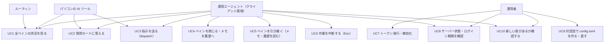
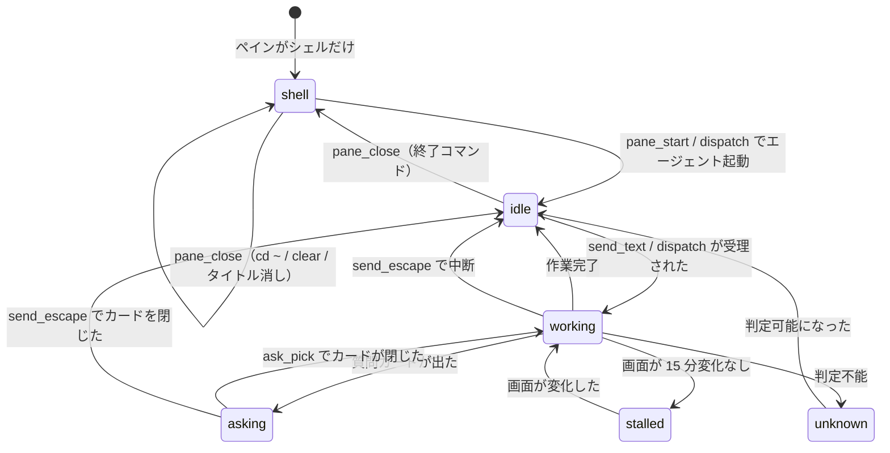

# 機能要件

元仕様 v1.1 の §1〜§7・§10 を機能要件として整理したもの。引数・返り値の厳密な定義は [API 仕様](../api/endpoints.md)、データ構造は [ER / データモデル](../architecture/er.md) を参照する。

元仕様に書かれていない既定値は「提案」として `P-xx` の番号を付け、[アーキテクチャ設計 §9](../architecture/decisions.md#9-提案した既定値と実装時確認事項) に一覧する。

この文書は 1 ファイル 300 行の上限（Linterly）のため、次のファイルに分けている。節番号は分割前の通し番号のまま、どのファイルでも同じ番号で引く。

- [機能要件（本書）](functional.md)：§1〜§4 ユースケース、ペイン位置（FR-POS）、ペインの状態とエージェントの種類（FR-STATE）、機能一覧
- [機能要件：レポート・質問カード・指示](functional-report.md)：§5 レポート（FR-REPORT）、§6 質問カードの操作（FR-ASK）、§7 指示の組み立て（FR-DISPATCH）、§8 受け入れ確認
- [機能要件：メモ・安全・設定](functional-note.md)：§9 メモ（FR-NOTE）、§10 安全のための決まり（FR-SAFE）、§11 対話型の設定（FR-SET）
- [機能要件：新しい版の確認と自己更新](functional-update.md)：§12 新しい版の確認と自己更新（FR-UPD）

## 1. ユースケース

| ID | ユースケース | 主な機能 | 窓口 |
|----|------------|---------|------|
| UC1 | 全ペインの状況を、クライアントによらず同じ見た目で取る | `report`・`panes_status`・`pane_tail`・`report_read` | `/report` `/ops` |
| UC2 | `asking` のペインの質問カードを読み、番号（または自由入力）で答える | `ask_card`・`ask_pick` | カード読み取りは両方、選択は `/ops` |
| UC3 | 空き（`shell`）または入力待ち（`idle`）のペインに、決まった条件つきで指示を送る | `dispatch`・`pane_start`・`send_text` | `/ops` |
| UC4 | 完了したペインをきれいに閉じ、メモを履歴に移す | `pane_close`・`note_history` | `/ops` |
| UC5 | ペインを引き継ぐとき、依頼元・報告先・次にやることを会話を遡らず取る | `note_get`・`note_set`・`note_log`・`note_history` | 読みは両方、書きは `/ops` |
| UC6 | オーナーの OK があったとき、作業中のエージェントを止める | `send_escape` | `/ops` |
| UC7 | クライアントごとに別のトークンを発行・無効化する | `swarm-console token add/revoke`（サーバー上） | CLI |
| UC8 | ホストの負荷・ディスク・エージェントのログイン期限を見る | `host_status`・`agent_auth_status` | `/report` `/ops` |
| UC9 | 運用者が `config.toml` を、対話型の画面で作る・直す（手で書いた内容を残したまま。手書きのままでも使える） | `swarm-console setup` | CLI |
| UC10 | 動いているバイナリより新しい版が GitHub Releases にあるかを確認し、あれば `serve` が自分で入れ替える（自己更新。§12） | `swarm-console version --check`（確認だけ）・`serve` の定期確認と自動更新・`host_status` の `update` | CLI、`/report` `/ops` |

## 2. ペイン位置の決め方（FR-POS）

ペインの数・並び・セッションは決め打ちしない。呼び出し（またはスナップショット更新）のたびに tmux から今のペインを読み取る。

| ID | 要件 |
|----|------|
| FR-POS-1 | 対象のセッションは `config.toml` の `sessions` に並べる（既定は `["0"]`、複数可）。`default_session` は位置の接頭辞を省略するセッション（未指定で 1 つだけなら、それ） |
| FR-POS-2 | 位置の名前はペインの座標から自動で付ける。上の段から `T`・`B`（3 段以上なら `R1`・`R2`・`R3`…）、段の中で左から `1`・`2`・`3`…。段は `pane_top` の異なる値の順位、列は同じ段のペインの `pane_left` の順位で決める（P-07） |
| FR-POS-3 | 既定セッション以外は `<セッション>:T1` のように頭にセッション名を付ける |
| FR-POS-4 | 対象セッションにウィンドウが複数あるときは、位置の前にウィンドウ番号 `w<index>.` を付ける（例：`w1.T2`、`work:w1.B1`）。ウィンドウが 1 つだけのセッションは付けない（P-07） |
| FR-POS-5 | `config.toml` の `[pane_names]` でペインに固定の名前を付けられる（自動の名前より優先）。キーは `<セッション>:<ウィンドウ>.<ペイン番号>` |
| FR-POS-6 | ツールの引数 `pane` は位置（`"T1"`・`"work:B2"`）でも tmux ID（`"%0"`）でも受け付ける。位置は大文字小文字を区別しない。解決できなければ `pane_not_found` |
| FR-POS-7 | 並びが変わったとき、次の呼び出しから新しい位置で返し、`panes_status`・`report` に警告 `layout_changed` を出す。警告は検知から `layout_warning_ttl`（既定 10 分）残す（P-08） |
| FR-POS-8 | メモは tmux ID に結び付けて持つ。位置の名前が変わってもメモはずれない |

今の並び（横 4×縦 2）の例：

| 位置 | T1 | T2 | T3 | T4 | B1 | B2 | B3 | B4 |
|---|---|---|---|---|---|---|---|---|
| tmux ID | %0 | %1 | %2 | %3 | %4 | %5 | %10 | %12 |

## 3. ペインの状態とエージェントの種類（FR-STATE）

### 3.1 状態

| 状態 | 意味 | 主な判定材料 |
|------|------|-------------|
| `working` | エージェントが作業中 | アダプタの「作業中の目印」（スピナー、経過時間、`esc to interrupt`） |
| `asking` | 質問カードで止まっている | アダプタの質問カード判定 |
| `idle` | エージェントは起動していて、入力待ち | エージェントのプロセスがあり、上の 2 つに当たらない |
| `shell` | エージェントは起動しておらず、シェルのプロンプトだけ（空き） | ペインのプロセス木にエージェントがなく、前面コマンドがシェル |
| `stalled` | `working` に見えるが、画面が `stalled_after`（既定 15 分）変わっていない | `working` ＋ 画面ハッシュの無変化時間 |
| `unknown` | 判定できない | どれにも当たらない |

### 3.2 エージェントの種類（アダプタ）

エージェントごとの違いはアダプタに閉じ込め、ツール側はアダプタ越しにだけ画面を扱う。

| 項目 | omp | Claude Code | Codex |
|------|-----|-------------|-------|
| 起動 | `omp` | `claude` | `codex` |
| 終了 | `/exit` | `/exit` | `/quit` |
| 中断 | Esc | Esc | Esc |
| 質問カード | Ask カード（↑/↓ と Enter） | 選択肢つきの確認（↑/↓ または番号と Enter） | 承認の確認（番号と Enter） |
| 作業中の目印 | スピナーと経過時間 | スピナーと `esc to interrupt` | スピナーと `esc to interrupt` |

| ID | 要件 |
|----|------|
| FR-AD-1 | アダプタは「起動コマンド」「終了コマンド」「状態の判定」「質問カードの読み取り」「選択のキー操作」「画面の飾りの取り除き」を持つ |
| FR-AD-2 | 判定に使う文字列・正規表現は `config.toml` の `[agents.<名前>]` で上書きできる。エージェントの画面が変わったら設定だけで直せる |
| FR-AD-3 | どのアダプタにも当てはまらないペインは `agent: null`・`state: unknown` として扱い、`pane_tail`・メモ系だけ使える。それ以外の操作は `unsupported_agent` で拒否 |
| FR-AD-4 | 新しいエージェントはアダプタを 1 つ足せば対応できる（コード変更はアダプタ登録のみ） |
| FR-AD-5 | エージェントの特定は、まずペインのプロセス木（`/proc`）で行い、取れなければ画面の特徴で補う（P-06） |
| FR-AD-6 | `stalled` 判定の画面ハッシュは、スピナー・経過時間など毎回変わる部分を除いた本文で計算する（P-05） |

具体的な正規表現の値は [agent-patterns.md](../architecture/agent-patterns.md)（P-22。実画面サンプルは `testdata/screens/`）。

## 4. 機能一覧

返り値はすべて JSON（`report` の markdown 形式を除く）。長い文字列は上限で切り、切ったら `truncated: true` を付ける（上限値は API 仕様 §7）。

### 4.1 見る（`/report`・`/ops` の両方）

| ID | ツール | 内容 | 前提・拒否条件 |
|----|--------|------|--------------|
| FR-R1 | `panes_status` | 対象セッションの全ペインを 1 回で返す（位置・ID・エージェント・状態・タイトル・cwd・経過・活動・画面変化からの時間・メモ要約）。ホスト負荷・並びの警告・`layout`（段と列の数）も返す | `session` 指定が対象外なら `invalid_args` |
| FR-R2 | `pane_tail` | 1 ペインの最後の n 行を、枠線・TODO 表示・ステータス行を除いた本文だけで返す。`raw: true` なら飾りも残す。`lines` 既定 30・上限 200 | `unknown` エージェントでも可（飾りの除去はしない＝`raw` 相当） |
| FR-R3 | `ask_card` | 質問カードの質問・選択肢・カーソル・自由入力の可否を返す。`asking` でなければ `{"asking": false}` | `unsupported_agent`（`unknown`）|
| FR-R4 | `report_read` | `/tmp/swarm-console/reports/<位置>.md`（`:` は `_`）を読む。なければ `{"exists": false}` | — |
| FR-R5 | `host_status` | 負荷・CPU 数・メモリ・CPU 使用率・スワップ・ディスク（使用率つき）・tmux セッションの有無・エージェント種別ごとのペイン数・稼働時間・使用状況（`usage`）・omp の更新確認（`omp`）・新しい版の確認結果（`update`。FR-UPD-9）。足した値は FR-REP-10〜18 | — |
| FR-R6 | `agent_auth_status` | エージェントごとのログイン状態（有効／期限切れ／48 時間以内に切れる／不明）と期限日時。鍵・トークンの中身は出さない | — |
| FR-R7 | `note_get` | 1 ペインのメモを全部返す | — |
| FR-R8 | `note_history` | 閉じたペインのメモを新しい順に返す。`repo`・`from`・`items` で絞り込み | — |
| FR-R9 | `report` | 全ペインの状況をサーバーが作った markdown で返す（§5） | — |

### 4.2 操作する（`/ops` のみ）

どの操作も、送ったあとに画面を確かめて、思った状態になったかを `ok` と `state` で返す。

| ID | ツール | 内容 | 許可する状態 | 拒否 |
|----|--------|------|------------|------|
| FR-O1 | `ask_pick` | `n` 番を選ぶ。カーソルを n に動かし、合っているか確かめてから Enter。`text` があれば「その他」を選んで文字を入れて確定（§6.1）。選んだあと、カードが閉じて `working` になったかを返す | `asking` | `not_asking`・`option_out_of_range`・`custom_not_allowed`・`cursor_mismatch`（Enter を送らずに中止） |
| FR-O2 | `send_text` | `text`（上限 8000 字）または `file`（サーバー上のパス）を、bracketed paste で貼り付け、1 秒待って Enter。入力欄が空になって `working` になったかを返す。制御キーは送れない | `idle`・`working`・`stalled`（エージェントが動いているとき）| `invalid_state`（`shell`・`asking`・`unknown`）・`forbidden_control_char`・`text_too_long`・`forbidden_path`・`file_unreadable` |
| FR-O3 | `send_escape` | `confirm: true` が必須。作業中のエージェントを中断する。使ったことをメモの履歴（`log`）に自動で残す。**オーナーの OK があるときだけ使う**（ツールの説明にも書く）。クライアントごとの許可設定は持たない | `working`・`stalled`・`asking`・`idle` | `confirm_required`・`invalid_state`（`shell`・`unknown`）|
| FR-O4 | `pane_start` | `shell` のペインで `cwd` に cd し、エージェントを起動、タイトルを `agent: <title>` にして、`idle` になったかを返す | `shell` | `invalid_state`・`forbidden_path`・`invalid_args`（`agent` が未設定のもの）|
| FR-O5 | `pane_close` | 終了コマンド → `cd ~` → `clear` → タイトル消し、を 1 つずつ「文字列 → 1 秒 → Enter → 1 秒」で送る。最後に画面が `~` のプロンプトだけになったかを確かめて返す。確かめられたら、そのペインのメモを履歴に移す | `idle`・`shell` | `invalid_state`（`working`・`stalled`・`asking`・`unknown`。P-19）|
| FR-O6 | `dispatch` | 指示を中身と条件に分けて受け取り、決まった形の指示文に組み立てて送る（§7）。送った指示文の全文を返す | `shell`（→ `pane_start` してから）・`idle` | `invalid_state`（`working`・`asking` ほか）|
| FR-O7 | `note_set` | 渡した項目だけ書き換える。`null` でその項目を消す | — | `secret_detected`・`invalid_args` |
| FR-O8 | `note_log` | 出来事を時刻つきで 1 行足す。直近 50 行を残す | — | `secret_detected`・`invalid_args` |

共通要件：

| ID | 要件 |
|----|------|
| FR-O-C1 | 同じペインへの操作は前の操作が終わるまで待たせる（同時に 2 つ送らない）。待ち時間が `lock_timeout`（既定 60 秒）を超えたら `busy_timeout` |
| FR-O-C2 | 事前条件（状態・パス・引数）を満たさないものは何も送らずに拒否する。送信後に期待した状態にならなかった場合は例外にせず `ok: false` と現在の `state` を返す |
| FR-O-C3 | 画面の確認は上限付きのポーリング（`accept_timeout` 既定 10 秒、`start_timeout` 既定 30 秒）で行い、固定時間の待ちに頼らない（ただし仕様で定めた「1 秒待って Enter」を除く） |
| FR-O-C4 | 送れる文字は通常の文字と Enter だけ。Esc は `send_escape` だけ。その他の制御キーは拒否する（`text` の ESC・NUL・CR などを含む制御文字は `forbidden_control_char`。`\n`・`\t` は許可） |

## 改訂履歴

| 版 | 日付 | 変更内容 | 変更理由 |
|----|------|---------|---------|
| 1.0 | 2026-10-31 | 新規作成 | 初版 |
| 1.1 | 2026-11-01 | UC9 と §11 対話型の設定（FR-SET）を追加 | Issue #5 |
| 1.2 | 2026-11-01 | UC10 と §12 新しい版の確認（FR-UPD）を追加。更新の方式（確認だけ／自己更新）は未決として §12.4 に併記 | Issue #7 |
| 1.3 | 2026-11-01 | 更新の方式を自己更新で確定し、§12.4 を自己更新の要件（FR-UPD-11〜20）に書き換え、§12.5 リスクと限界・§12.6 運用者の操作を追加。UC10・§12.1 の FR-UPD-6〜10・§12.3 を自己更新に合わせて改訂。検証はハッシュのみ・きっかけは `serve` の自動・再起動は自分で正常終了して systemd に任せる・作業中でも更新・起動失敗は `.old` から自動で戻す・`update_auto` を追加・置き場は `~/bin/swarm-console/` に固定・アセット名は版・OS・arch 入り | Issue #7（自己更新で確定） |
| 1.4 | 2026-11-01 | 300 行超過ファイルを分割（§5〜§12 を functional-report.md・functional-note.md・functional-update.md へ移動）。内容の変更なし | Issue #3 |
| 1.5 | 2026-11-01 | FR-UPD-14：`SHA256SUMS` の行末の CR（CRLF）とファイル名直前の `*` を許す（ほかの空白・大文字は許さない）ことを明記 | Issue #7（実装時の確認） |
| 1.6 | 2026-11-01 | FR-UPD-12：現在の版がプレリリース形のときは入れ替えない（`not_managed`）ことを明記 | Issue #7（実装時の確認） |
| 1.7 | 2026-11-01 | FR-UPD-12・20：試運転中（`apply = probation`）は新しい入れ替えを始めない（次の周期で再試行）ことを明記 | Issue #12 |
| 1.8 | 2026-11-01 | FR-UPD-12：試運転中に見送った入れ替えは、試運転の確定の時点で次の周期を待たずに再試行することを明記 | Issue #15 |
| 1.9 | 2026-11-01 | FR-REP-2・9 を改訂し FR-REP-10〜18 を追加（使用状況・ペインの経過・CPU/スワップ/ディスク・omp の更新確認・ログイン期限の警告をレポートと `host_status` に追加）。FR-R5 を更新。§5.3 の出力レイアウトに新しい行・節を追加し、§5.4（新しい値の言葉）を追加 | Issue #21〜#25 |
