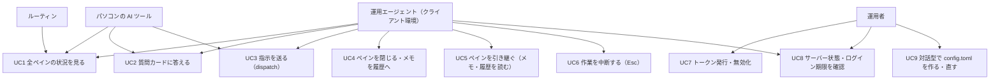
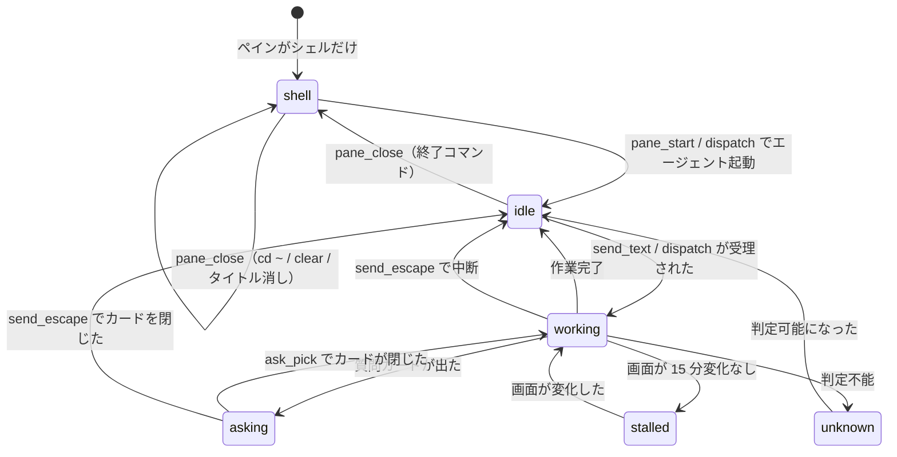
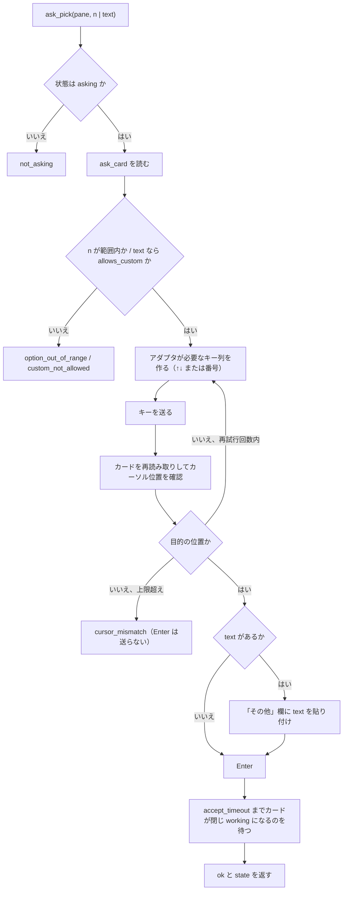
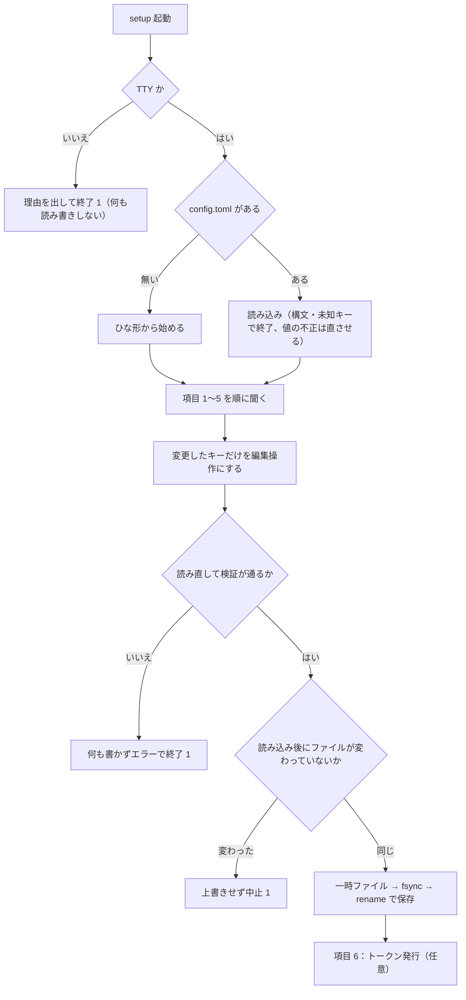

# 機能要件

元仕様 v1.1 の §1〜§7・§10 を機能要件として整理したもの。引数・返り値の厳密な定義は [API 仕様](../api/endpoints.md)、データ構造は [ER / データモデル](../architecture/er.md) を参照する。

元仕様に書かれていない既定値は「提案」として `P-xx` の番号を付け、[アーキテクチャ設計 §9](../architecture/overview.md#9-提案した既定値と実装時確認事項) に一覧する。

## 1. ユースケース



| ID | ユースケース | 主な機能 | 窓口 |
|----|------------|---------|------|
| UC1 | 全ペインの状況を、クライアントによらず同じ見た目で取る | `report`・`panes_status`・`pane_tail`・`report_read` | `/report` `/ops` |
| UC2 | `asking` のペインの質問カードを読み、番号（または自由入力）で答える | `ask_card`・`ask_pick` | カード読み取りは両方、選択は `/ops` |
| UC3 | 空き（`shell`）または入力待ち（`idle`）のペインに、決まった条件つきで指示を送る | `dispatch`・`pane_start`・`send_text` | `/ops` |
| UC4 | 完了したペインをきれいに閉じ、メモを履歴に移す | `pane_close`・`note_history` | `/ops` |
| UC5 | ペインを引き継ぐとき、依頼元・報告先・次にやることを会話を遡らず取る | `note_get`・`note_set`・`note_log`・`note_history` | 読みは両方、書きは `/ops` |
| UC6 | オーナーの OK があったとき、作業中のエージェントを止める | `send_escape` | `/ops` |
| UC7 | クライアントごとに別のトークンを発行・無効化する | `swarm-console token add/revoke`（サーバー上） | CLI |
| UC8 | ホストの負荷・ディスク・エージェントのログイン期限を見る | `host_status`・`agent_auth_status` | `/report` `/ops` |
| UC9 | 運用者が `config.toml` を、対話型の画面で作る・直す（手で書いた内容を残したまま。手書きのままでも使える） | `swarm-console setup` | CLI |

## 2. ペイン位置の決め方（FR-POS）

ペインの数・並び・セッションは決め打ちしない。呼び出し（またはスナップショット更新）のたびに tmux から今のペインを読み取る。

| ID | 要件 |
|----|------|
| FR-POS-1 | 対象のセッションは `config.toml` の `sessions` に並べる（既定は `["0"]`、複数可）。`default_session` は位置の接頭辞を省略するセッション（未指定で 1 つだけなら、それ） |
| FR-POS-2 | 位置の名前はペインの座標から自動で付ける。上の段から `T`・`B`（3 段以上なら `R1`・`R2`・`R3`…）、段の中で左から `1`・`2`・`3`…。段は `pane_top` の異なる値の順位、列は同じ段のペインの `pane_left` の順位で決める（P-07） |
| FR-POS-3 | 既定セッション以外は `<セッション>:T1` のように頭にセッション名を付ける |
| FR-POS-4 | 対象セッションにウィンドウが複数あるときは、位置の前にウィンドウ番号 `w<index>.` を付ける（例：`w1.T2`、`work:w1.B1`）。ウィンドウが 1 つだけのセッションは付けない（P-07） |
| FR-POS-5 | `config.toml` の `[pane_names]` でペインに固定の名前を付けられる（自動の名前より優先）。キーは `<セッション>:<ウィンドウ>.<ペイン番号>` |
| FR-POS-6 | ツールの引数 `pane` は位置（`"T1"`・`"work:B2"`）でも tmux ID（`"%0"`）でも受け付ける。位置は大文字小文字を区別しない。解決できなければ `pane_not_found` |
| FR-POS-7 | 並びが変わったとき、次の呼び出しから新しい位置で返し、`panes_status`・`report` に警告 `layout_changed` を出す。警告は検知から `layout_warning_ttl`（既定 10 分）残す（P-08） |
| FR-POS-8 | メモは tmux ID に結び付けて持つ。位置の名前が変わってもメモはずれない |

今の並び（横 4×縦 2）の例：

| 位置 | T1 | T2 | T3 | T4 | B1 | B2 | B3 | B4 |
|---|---|---|---|---|---|---|---|---|
| tmux ID | %0 | %1 | %2 | %3 | %4 | %5 | %10 | %12 |

## 3. ペインの状態とエージェントの種類（FR-STATE）

### 3.1 状態

| 状態 | 意味 | 主な判定材料 |
|------|------|-------------|
| `working` | エージェントが作業中 | アダプタの「作業中の目印」（スピナー、経過時間、`esc to interrupt`） |
| `asking` | 質問カードで止まっている | アダプタの質問カード判定 |
| `idle` | エージェントは起動していて、入力待ち | エージェントのプロセスがあり、上の 2 つに当たらない |
| `shell` | エージェントは起動しておらず、シェルのプロンプトだけ（空き） | ペインのプロセス木にエージェントがなく、前面コマンドがシェル |
| `stalled` | `working` に見えるが、画面が `stalled_after`（既定 15 分）変わっていない | `working` ＋ 画面ハッシュの無変化時間 |
| `unknown` | 判定できない | どれにも当たらない |



### 3.2 エージェントの種類（アダプタ）

エージェントごとの違いはアダプタに閉じ込め、ツール側はアダプタ越しにだけ画面を扱う。

| 項目 | omp | Claude Code | Codex |
|------|-----|-------------|-------|
| 起動 | `omp` | `claude` | `codex` |
| 終了 | `/exit` | `/exit` | `/quit` |
| 中断 | Esc | Esc | Esc |
| 質問カード | Ask カード（↑/↓ と Enter） | 選択肢つきの確認（↑/↓ または番号と Enter） | 承認の確認（番号と Enter） |
| 作業中の目印 | スピナーと経過時間 | スピナーと `esc to interrupt` | スピナーと `esc to interrupt` |

| ID | 要件 |
|----|------|
| FR-AD-1 | アダプタは「起動コマンド」「終了コマンド」「状態の判定」「質問カードの読み取り」「選択のキー操作」「画面の飾りの取り除き」を持つ |
| FR-AD-2 | 判定に使う文字列・正規表現は `config.toml` の `[agents.<名前>]` で上書きできる。エージェントの画面が変わったら設定だけで直せる |
| FR-AD-3 | どのアダプタにも当てはまらないペインは `agent: null`・`state: unknown` として扱い、`pane_tail`・メモ系だけ使える。それ以外の操作は `unsupported_agent` で拒否 |
| FR-AD-4 | 新しいエージェントはアダプタを 1 つ足せば対応できる（コード変更はアダプタ登録のみ） |
| FR-AD-5 | エージェントの特定は、まずペインのプロセス木（`/proc`）で行い、取れなければ画面の特徴で補う（P-06） |
| FR-AD-6 | `stalled` 判定の画面ハッシュは、スピナー・経過時間など毎回変わる部分を除いた本文で計算する（P-05） |

具体的な正規表現の値は [agent-patterns.md](../architecture/agent-patterns.md)（P-22。実画面サンプルは `testdata/screens/`）。

## 4. 機能一覧

返り値はすべて JSON（`report` の markdown 形式を除く）。長い文字列は上限で切り、切ったら `truncated: true` を付ける（上限値は API 仕様 §7）。

### 4.1 見る（`/report`・`/ops` の両方）

| ID | ツール | 内容 | 前提・拒否条件 |
|----|--------|------|--------------|
| FR-R1 | `panes_status` | 対象セッションの全ペインを 1 回で返す（位置・ID・エージェント・状態・タイトル・cwd・経過・活動・画面変化からの時間・メモ要約）。ホスト負荷・並びの警告・`layout`（段と列の数）も返す | `session` 指定が対象外なら `invalid_args` |
| FR-R2 | `pane_tail` | 1 ペインの最後の n 行を、枠線・TODO 表示・ステータス行を除いた本文だけで返す。`raw: true` なら飾りも残す。`lines` 既定 30・上限 200 | `unknown` エージェントでも可（飾りの除去はしない＝`raw` 相当） |
| FR-R3 | `ask_card` | 質問カードの質問・選択肢・カーソル・自由入力の可否を返す。`asking` でなければ `{"asking": false}` | `unsupported_agent`（`unknown`）|
| FR-R4 | `report_read` | `/tmp/swarm-console/reports/<位置>.md`（`:` は `_`）を読む。なければ `{"exists": false}` | — |
| FR-R5 | `host_status` | 負荷・CPU 数・メモリ・ディスク・tmux セッションの有無・エージェント種別ごとのペイン数・稼働時間 | — |
| FR-R6 | `agent_auth_status` | エージェントごとのログイン状態（有効／期限切れ／48 時間以内に切れる／不明）と期限日時。鍵・トークンの中身は出さない | — |
| FR-R7 | `note_get` | 1 ペインのメモを全部返す | — |
| FR-R8 | `note_history` | 閉じたペインのメモを新しい順に返す。`repo`・`from`・`items` で絞り込み | — |
| FR-R9 | `report` | 全ペインの状況をサーバーが作った markdown で返す（§5） | — |

### 4.2 操作する（`/ops` のみ）

どの操作も、送ったあとに画面を確かめて、思った状態になったかを `ok` と `state` で返す。

| ID | ツール | 内容 | 許可する状態 | 拒否 |
|----|--------|------|------------|------|
| FR-O1 | `ask_pick` | `n` 番を選ぶ。カーソルを n に動かし、合っているか確かめてから Enter。`text` があれば「その他」を選んで文字を入れて確定（§6.1）。選んだあと、カードが閉じて `working` になったかを返す | `asking` | `not_asking`・`option_out_of_range`・`custom_not_allowed`・`cursor_mismatch`（Enter を送らずに中止） |
| FR-O2 | `send_text` | `text`（上限 8000 字）または `file`（サーバー上のパス）を、bracketed paste で貼り付け、1 秒待って Enter。入力欄が空になって `working` になったかを返す。制御キーは送れない | `idle`・`working`・`stalled`（エージェントが動いているとき）| `invalid_state`（`shell`・`asking`・`unknown`）・`forbidden_control_char`・`text_too_long`・`forbidden_path`・`file_unreadable` |
| FR-O3 | `send_escape` | `confirm: true` が必須。作業中のエージェントを中断する。使ったことをメモの履歴（`log`）に自動で残す。**オーナーの OK があるときだけ使う**（ツールの説明にも書く）。クライアントごとの許可設定は持たない | `working`・`stalled`・`asking`・`idle` | `confirm_required`・`invalid_state`（`shell`・`unknown`）|
| FR-O4 | `pane_start` | `shell` のペインで `cwd` に cd し、エージェントを起動、タイトルを `agent: <title>` にして、`idle` になったかを返す | `shell` | `invalid_state`・`forbidden_path`・`invalid_args`（`agent` が未設定のもの）|
| FR-O5 | `pane_close` | 終了コマンド → `cd ~` → `clear` → タイトル消し、を 1 つずつ「文字列 → 1 秒 → Enter → 1 秒」で送る。最後に画面が `~` のプロンプトだけになったかを確かめて返す。確かめられたら、そのペインのメモを履歴に移す | `idle`・`shell` | `invalid_state`（`working`・`stalled`・`asking`・`unknown`。P-19）|
| FR-O6 | `dispatch` | 指示を中身と条件に分けて受け取り、決まった形の指示文に組み立てて送る（§7）。送った指示文の全文を返す | `shell`（→ `pane_start` してから）・`idle` | `invalid_state`（`working`・`asking` ほか）|
| FR-O7 | `note_set` | 渡した項目だけ書き換える。`null` でその項目を消す | — | `secret_detected`・`invalid_args` |
| FR-O8 | `note_log` | 出来事を時刻つきで 1 行足す。直近 50 行を残す | — | `secret_detected`・`invalid_args` |

共通要件：

| ID | 要件 |
|----|------|
| FR-O-C1 | 同じペインへの操作は前の操作が終わるまで待たせる（同時に 2 つ送らない）。待ち時間が `lock_timeout`（既定 60 秒）を超えたら `busy_timeout` |
| FR-O-C2 | 事前条件（状態・パス・引数）を満たさないものは何も送らずに拒否する。送信後に期待した状態にならなかった場合は例外にせず `ok: false` と現在の `state` を返す |
| FR-O-C3 | 画面の確認は上限付きのポーリング（`accept_timeout` 既定 10 秒、`start_timeout` 既定 30 秒）で行い、固定時間の待ちに頼らない（ただし仕様で定めた「1 秒待って Enter」を除く） |
| FR-O-C4 | 送れる文字は通常の文字と Enter だけ。Esc は `send_escape` だけ。その他の制御キーは拒否する（`text` の ESC・NUL・CR などを含む制御文字は `forbidden_control_char`。`\n`・`\t` は許可） |

## 5. レポート（FR-REPORT）

### 5.1 要件

| ID | 要件 |
|----|------|
| FR-REP-1 | `report` は全ペインの状況をサーバーが組み立てた markdown で返す。クライアントは手を加えずそのまま表示する（ツールの説明に書く） |
| FR-REP-2 | 中身は、見出し（時刻・サーバー負荷）、ペインの表（位置・エージェント・状態・依頼元・リポジトリ／Issue・いまやっていること・次にやること）、要対応の一覧（質問カードで止まっている・止まっているように見える・完了して報告待ち） |
| FR-REP-3 | 状態は絵文字つきの決まった言葉で出す（下表） |
| FR-REP-4 | 引数：`format`（`markdown` 既定・`json`）、`pane`（1 ペインの詳しい版）、`lang`（`ja` 既定・`en`）。既定の言語は `default_lang` で変えられる |
| FR-REP-5 | テンプレートは言語ごとに `templates/report.ja.md`・`templates/report.en.md`。サーバーの設定フォルダ（`~/.config/swarm-console/templates/`）に置けば組み込みのものより優先され、直せばどのクライアントにも同じく反映される |
| FR-REP-6 | メモの中身（依頼元・次にやること など）は書かれたままの言葉で出す（訳さない） |
| FR-REP-7 | 同じスナップショットからは、クライアントによらず 1 文字も違わない出力を返す（時刻はスナップショットの時刻を使い、呼び出し時刻・クライアント名などを含めない）。受け入れ確認 §8 の条件 |
| FR-REP-8 | 「完了して報告待ち」は、状態が `idle` で、最終報告ファイルが存在するペイン（P-11） |
| FR-REP-9 | `format: json` は `panes_status` と同じペイン配列に要対応の一覧（`attention`）を足した JSON を返す。言語に依存しない |

### 5.2 状態の言葉

| 状態 | 日本語（`ja`） | 英語（`en`） |
|------|---------------|-------------|
| `working` | 🟢 作業中 | 🟢 Working |
| `asking` | 🟡 質問待ち | 🟡 Asking |
| `idle` | ⚪ 入力待ち | ⚪ Idle |
| `shell` | ⬜ 空き | ⬜ Free |
| `stalled` | 🔴 止まってそう | 🔴 Stalled |
| `unknown` | ❔ 不明 | ❔ Unknown |

### 5.3 出力レイアウト（`ja`、例）

````markdown
# swarm-console レポート

- 時刻: 2026-10-31 22:10:05 (+09:00)
- サーバー負荷: load1 98.2 / メモリ空き 41.3 GB

## ペイン

| 位置 | エージェント | 状態 | 依頼元 | リポジトリ / Issue | いまやっていること | 次にやること |
|------|------------|------|--------|------------------|------------------|------------|
| T1 | omp | ⚪ 入力待ち | — | — | — | — |
| B4 | omp | 🟢 作業中 | agent-b | ousiassllc/funid #982 | Running go test ./... | 完了したら #983 を入れる |
| B1 | — | ⬜ 空き | — | — | — | — |

## 要対応

- 🟡 質問待ち: T2 — (2) の Go での範囲をどうしますか？
- 🔴 止まってそう: B3 — 変化なし 20m
- 📩 報告待ち: T1 — 最終報告あり（`report_read` で読む）

## 警告

- 並びが変わりました: B3 が追加されました
````

- 要対応がなければ `- なし`。警告がなければ「警告」見出しごと出さない。
- 表のセルは `|` と改行をエスケープし、空は `—`。長いセルは 80 字で `…` に切る。
- `en` は見出し・ラベル・状態の言葉が英語になり、メモの中身は同じ。
- `pane` 指定の詳しい版は、上記に加えて「メモ全項目」「質問カード（あれば）」「画面の最後の 15 行（飾りなし）」「最終報告ファイルの有無と更新時刻」を出す。

## 6. 質問カードの操作（FR-ASK）

### 6.1 `ask_pick` の手順



- `n`（選ぶ番号）と `text`（「その他」に打つ文字）は同時に指定できない。どちらも指定しなければ `invalid_args`。`text` を指定すると「その他」の選択肢を選んで `text` を入れる（P-10）。
- 再試行は 2 回まで。カーソルが合わないままの Enter は送らない。

## 7. 指示の組み立て（FR-DISPATCH）

| ID | 要件 |
|----|------|
| FR-DIS-1 | 引数：`pane`、`agent`、`cwd`、`title`、`command`（1 行目のスラッシュコマンド）、`task`（本文）、`profile`（`sweep`・`fix`・`investigate`）、`extra_rules`（追加の条件）、`note`（メモ。一緒に保存する） |
| FR-DIS-2 | 指示文は `command` ＋ `task` ＋ 条件（共通の条件 → プロファイル固有の条件 → `extra_rules`）の決まった形に組み立てる（API 仕様 §5.6）。`task` と `extra_rules` 以外にサーバーが足すのは、固定の見出しとプロファイルの条件文だけ。人の名前・経緯は足さない |
| FR-DIS-3 | 条件のひな形は `profiles.toml` に置く。初期値は元の omp-dispatch の条件そのまま（下表） |
| FR-DIS-4 | ペインが `shell` なら `pane_start` してから送り、`idle` ならそのまま送る。`working`・`asking` ほかは拒否（何も送らない） |
| FR-DIS-5 | 返り値は送った指示文の全文と、受け付けたか。同じ引数なら、どのクライアントから送っても、ペインに入る指示文は同じ |
| FR-DIS-6 | `note` は送信後に `note_set` と同じ検証・マージ規則で保存する（P-23）。保存したかを返り値の `note_saved` に入れる |
| FR-DIS-7 | 送信前に、そのペインの古い最終報告ファイルをアーカイブへ移す（P-11） |
| FR-DIS-8 | 組み立てた指示文は 8000 字以内（超えたら `text_too_long`、何も送らない） |

### 7.1 条件の初期値

共通の条件（全プロファイル）：

| # | 条件 |
|---|------|
| 1 | コミットは必ず `git commit -s`（cherry-pick も `-s`）、マージは `git merge --signoff` |
| 2 | force push・rebase・amend・squash・reset・`--no-verify` はしない。フックが落ちたら止めて報告する |
| 3 | リモートブランチは作業用でも消さない（削除はローカルだけ） |
| 4 | マージ・Issue の close・デプロイはしない |
| 5 | トークン・パスワードなどの秘密をコード・ログ・PR・Issue に書かない |
| 6 | オーナーの checkout と `~/dotfiles` には触らず、worktree で作業する |
| 7 | CI が緑になったら止める |
| 8 | 最終報告（PR・head・CI・Issue 番号・残りの判断）を `report_read` のファイル（`/tmp/swarm-console/reports/<位置>.md`）にも書く |

プロファイル固有の条件（共通に足す）：

| プロファイル | 足す条件 |
|-------------|---------|
| `sweep` | `--single-pr` で PR は 1 本まで。PR を出して CI が緑になったら止まる |
| `fix` | PR は 1 本まで。バグの再現確認と回帰テストを含める。PR を出して CI が緑になったら止まる |
| `investigate` | 調査だけを行い、ファイルの変更・コミット・push・PR 作成はしない。分かったこと・根拠・残りの判断を報告する |

## 8. 受け入れ確認（元仕様 §10）

| ID | 確認内容 | 検証方法 |
|----|---------|---------|
| AC-1 | 同じペインの状態で、Claude Code・Codex・Cursor・curl（クライアント環境）の 4 つから `report` を呼び、返る markdown が 1 文字も違わない（`lang` が `ja` でも `en` でも） | 4 クライアントの実接続 ＋ 自動テスト（同一スナップショットを固定したレンダリングの一致） |
| AC-2 | `/report` の `tools/list` に操作のツールが出ない。`report` のトークンで `/ops` を呼ぶと 403 | 自動テスト ＋ 実接続 |
| AC-3 | ペインを増やす・減らす・別セッションを足したとき、次の `panes_status` で新しい並びと警告が出て、メモがずれない | 実 tmux の統合テスト ＋ 実機 |
| AC-4 | 同じ `dispatch` の引数を 2 つのクライアントから送り、ペインに入る指示文が同じ | 実 tmux ＋ 擬似エージェントで貼り付け内容を比較 |
| AC-5 | 認証なし・違うトークン・窓口違い・許可していないフォルダ・作業中のペインを閉じる・Esc の `confirm` なし、がどのクライアントからでも同じエラーになる | 自動テスト ＋ 実接続 |
| AC-6 | 非機能要件 §7 のテスト（実 tmux、擬似画面、拒否、メモの書き込み途中停止）が全部通り、CI が緑 | CI |

## 9. メモ（FR-NOTE）

メモの目的：運用エージェントがペインを引き継ぐときに、毎回会話を遡らなくて済むようにする。項目定義は [ER / データモデル](../architecture/er.md#2-notesjson)。

| ID | 要件 |
|----|------|
| FR-NOTE-1 | 項目はすべて任意。分からないものは空のままでよい |
| FR-NOTE-2 | 項目：依頼元 `from`、報告先 `report_to`、リポジトリ `repo`、Issue・PR `items`、作業フォルダ `worktree`、ブランチ `branch`、指示ファイル `instruction`、OK の原文 `approval`、守ること `rules`、いまの状況 `status`、次にやること `next`、再開 ID `resume_id`、自由メモ `memo` |
| FR-NOTE-3 | `panes_status` と `report` には `from`・`repo`・`items`・`next` だけを要約として出す |
| FR-NOTE-4 | `note_set` は渡した項目だけ書き換え、他の項目は残す。`null` を渡すとその項目を消す |
| FR-NOTE-5 | `note_log` は出来事を時刻つきで 1 行足す（例：「Ask で B を選んだ」「agent-b へ報告した」）。直近 50 行を残す |
| FR-NOTE-6 | `pane_close` はそのペインのメモを履歴に移し、現行メモを消す |
| FR-NOTE-7 | 履歴は 500 件まで。古いものから消す |
| FR-NOTE-8 | 秘密の値は書かない。`ghp_`・`sk-`・`eyJ` で始まる長い文字列、PEM などに見える文字列が入っていたら書き込みを拒否（`secret_detected`。拒否した値は応答・ログに出さない） |
| FR-NOTE-9 | 書き込みは一時ファイルに書いてから rename（途中で落ちても壊れない）。権限 600 |
| FR-NOTE-10 | `send_escape` の実行は `note_log` に自動で残す |
| FR-NOTE-11 | tmux ペインが外部で消えた・tmux サーバーが再起動して ID が再利用され得る場合、旧メモを履歴へ移す（P-15） |

## 10. 安全のための決まり（FR-SAFE）

| ID | 決まり | 内容 |
|----|--------|------|
| FR-SAFE-1 | シェル実行なし | 決まった tmux 操作と、決まったファイル・`/proc` の読み取りだけ |
| FR-SAFE-2 | ペインを壊さない | ペインの kill、セッションの削除、ペインの分割はできない |
| FR-SAFE-3 | 起動できるもの | 設定したエージェント（omp・claude・codex）だけ |
| FR-SAFE-4 | 作業フォルダ | `/mnt/nvme/` の下と `~/projects/` の下だけ許可。オーナーの checkout（設定に一覧）と `~/dotfiles` は拒否 |
| FR-SAFE-5 | 送れる文字 | 通常の文字と Enter だけ。Esc は `/ops` の `send_escape`（`confirm` 必須）だけ。その他の制御キーは拒否 |
| FR-SAFE-6 | 窓口 | `/report` からは何も変えられない（メモの書き込みも不可）。`/report` の `tools/list` に操作のツールは載らない |
| FR-SAFE-7 | 作業中は閉じない | `pane_close` は `working` のペインを拒否 |
| FR-SAFE-8 | ログ | 誰が・いつ・どのツールを・どのペインに使ったかを記録する。送った本文とトークンは記録しない |
| FR-SAFE-9 | 呼び出しの間隔 | 同じペインへの操作は前の操作が終わるまで待たせる |

## 11. 対話型の設定（FR-SET）

`config.toml` を手で書く今の方法はそのまま残し、対話型（`swarm-console setup`）でも同じファイルを作る・直せるようにする。置き場は 1 つ（`~/.config/swarm-console/config.toml`）で、どちらで書いても `serve` が読む内容は同じ。書き戻しの規則は [ER §5.1](../architecture/er.md#51-setup-による書き戻し)、画面を作る部品は [コンポーネント設計](../components/overview.md#3-コンポーネントの責務) を参照する。

| ID | 要件 |
|----|------|
| FR-SET-1 | `swarm-console setup [--config <path>]`。ファイルが無ければ新規作成、あれば読み込んで現在値を初期値にして開く（初回専用ではなく、編集にも使う）。`--config` の既定は `serve`・`token` と同じ |
| FR-SET-2 | 設定の置き場は `serve` が読む `config.toml` だけ。`setup` 専用の別ファイルは持たない。手で書いた内容は次に `setup` で開いたときも読み込まれる |
| FR-SET-3 | 手で書いた値を壊さない。`setup` が触るのは、運用者が画面で値を変えたキーだけ。それ以外のキー・コメント・空行・並び・書式はバイト単位で同じに残す（規則は ER §5.1）。値が変わっていないキー、ファイルに無く既定のままのキーは書かない（既定値を書き出さない） |
| FR-SET-4 | 聞く項目と順番は下表。下表に無いキーは画面に出さず、読み書きとも一切触らない（手で書く） |
| FR-SET-5 | 入力の検証は `serve` の起動時と同じ関数を使う（`0.0.0.0`・`::`・ホスト名・ポート無し・tailnet 外は `listen_addr` として拒否など。ER §5 の検証表と同一）。入力中にその場でエラーを出し、通るまで次へ進めない。保存の直前に、結果のファイルを `serve` と同じ読み込み経路で読み直し、落ちるなら何も書かない |
| FR-SET-6 | 端末（TTY）でないとき（標準入力か標準出力が端末でない、`TERM=dumb`。SSH の `-t` なし・CI・パイプ）は、何も読まず何も書かず、理由と手書きの案内を標準エラーに出して終了コード 1 で終わる |
| FR-SET-7 | 中止（Ctrl+C・Esc）では何も書かない。終了コード 1 |
| FR-SET-8 | 既存の `config.toml` が TOML として読めない・未知のキーがある場合は、開かずに行番号・キー名つきのエラーで終わる（自動では直さない）。値の検証エラー（`listen_addr` 未設定を含む）は「現在値が不正」と示したうえで開き、その項目を直させる |
| FR-SET-9 | 保存したら、保存先と変更したキーの一覧を表示し、`systemctl --user restart swarm-console` で反映することを案内する（再起動は実行しない。NFR-OPS-3） |
| FR-SET-10 | 最後に任意で、トークンを発行できる（名前と `ops`/`report`）。`config.toml` の保存が済んだあとに `token add` と同じ処理で発行し、平文は標準出力へ 1 度だけ出す。発行の失敗は保存済みの `config.toml` を変えない |

### 11.1 聞く項目と順番

| # | 項目 | 聞き方 | 補足 |
|---|------|--------|------|
| 1 | `listen_addr` | このホストのネットワークインターフェースのうち tailnet の範囲（`100.64.0.0/10`・`fd7a:115c:a1e0::/48`）にあるアドレス ＋ ポート `48120` を選択肢に出す。末尾に「手で入力」（ループバックなど） | 現在値があれば最初に選ばれる。候補が 0 件なら手入力だけにし、tailscale が上がっていないかもしれないと案内する。`tailscale` コマンドは実行しない |
| 2 | `sessions`・`default_session` | `sessions` はカンマ区切りの 1 行。2 つ以上のときだけ `default_session` を選ぶ | 既定 `["0"]` |
| 3 | `allowed_roots` | 1 行 1 パスの複数行入力 | 許可する `cwd` の根。既定 `/mnt/nvme/`・`~/projects/` |
| 4 | `denied_paths` | 1 行 1 パスの複数行入力。初期値は今の実効値（ファイルに無ければ既定の `~/dotfiles`） | 画面に「書くと既定と入れ替わる（足されない）」と出す（P-29）。`~/dotfiles` を守るなら残す |
| 5 | エージェント（`omp`・`claude`・`codex`） | まず「エージェントの設定を変えますか」（既定は いいえ）。はい のときだけ、各エージェントの `command`・`exit_command`・`auth_file` を聞く | 空欄は「上書きしない」（組み込みの既定を使う）。既定値は入力欄の例示として出す |
| 6 | トークン発行（任意） | 発行するか → 名前 → `ops`/`report` | FR-SET-10 |

`setup` が聞かず手書きだけに残すもの：`tmux_socket`・`default_lang`・期間のキー（`poll_interval` ほか 6 つ）・`title_prefix`・`file_roots`・`disk_mounts`・`report_dir`・`[pane_names]`・`[agents.<name>]` の正規表現とその他のキー（`process_match`・`working_re`・`ask_re`・`idle_re`・`spinner_chars`・`status_line_re`・`border_re`）・`profiles.toml`・レポートのテンプレート。これらが手で書かれていても、`setup` は読み込んだうえでそのまま残す。

### 11.2 `setup` の流れ



## 改訂履歴

| 版 | 日付 | 変更内容 | 変更理由 |
|----|------|---------|---------|
| 1.0 | 2026-10-31 | 新規作成 | 初版 |
| 1.1 | 2026-11-01 | UC9 と §11 対話型の設定（FR-SET）を追加 | Issue #5 |
